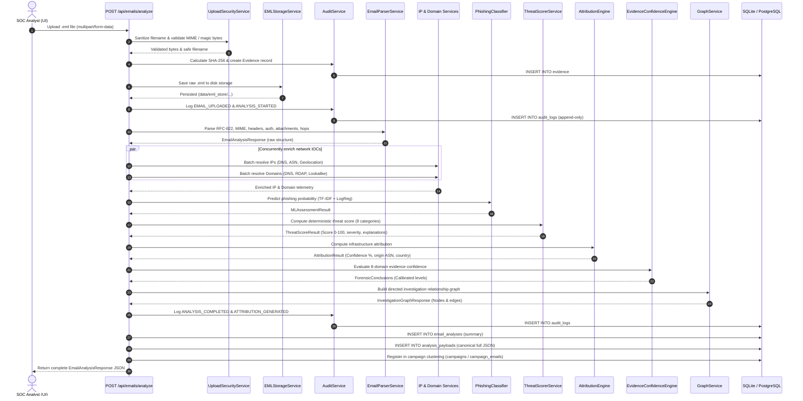

# 01 — Current Architecture Audit

> **Project:** CyberGuard (formerly MailTraceAI / SIH Problem Statement 106)  
> **Evaluation Date:** September 2026  
> **Status:** Existing Production Codebase (Air-Gapped & Online Hybrid Architecture)  

---

## 1. Executive Technology Stack

CyberGuard is built on a decoupled, asynchronous Python + React architecture designed for high-assurance forensic investigation, deterministic threat scoring, and evidentiary chain of custody.

| Tier | Core Technology | Version | Purpose & Responsibilities |
|---|---|---|---|
| **Backend Runtime** | Python | 3.11 (Docker) / 3.14 (Host) | Core runtime environment |
| **API Framework** | FastAPI | >=0.100.0 (0.141.1 installed) | Asynchronous REST API service with OpenAPI documentation |
| **Database & ORM** | PostgreSQL 16 / SQLite 3 | SQLAlchemy 2.0.52, Alembic 1.19.2 | Dual persistence: SQLite for air-gapped/local; PostgreSQL for Docker/cloud |
| **Data Validation** | Pydantic v2 | 2.13.5 | Strict schema typing, request/response validation, serialization |
| **Machine Learning** | scikit-learn, joblib, numpy | sklearn 1.9.0, numpy 2.5.3 | Local TF-IDF + Logistic Regression phishing classification (offline) |
| **Report Generation** | ReportLab | 5.0.1 (with Pillow 12.3.0) | Server-side cryptographic vector PDF dossier construction |
| **Network & OSINT** | dnspython, tldextract, httpx | dnspython 2.8.0, tldextract 5.3.2 | DNS record resolution (A/AAAA/MX/NS/TXT), RDAP registration, WHOIS fallback |
| **Frontend Framework** | React | 19.2.8 | Declarative single-page application (SPA) |
| **Language & Build** | TypeScript, Vite | TypeScript ~6.0.2, Vite 8.2.2 | Strict type-checked compilation, modern ES module bundling |
| **Styling & Theme** | Tailwind CSS | ^4.3.3 (`@tailwindcss/vite`) | Dark/light forensic theme with CSS variables and utility classes |
| **Graph Visualization** | Cytoscape.js | 3.34.2 (with @types/cytoscape) | Directed forensic relationship graph (Emails, IPs, Domains, URLs, Attachments) |
| **Geospatial Mapping** | Leaflet | 1.9.4 (with @types/leaflet) | Hop-by-hop relay and infrastructure origin geospatial visualization |
| **Telemetry Charts** | Recharts | 3.10.1 | Threat score category breakdowns, radar charts, latency benchmarks |
| **Reverse Proxy** | Nginx | Alpine 1.25+ | Static asset delivery, SPA routing, API reverse proxy (`/api/`) |

---

## 2. Repository Structure

```
CyberGuard/
├── backend/
│   ├── api/
│   │   ├── middleware/              # Security headers, token bucket rate limiter
│   │   │   ├── rate_limiter.py
│   │   │   └── security_headers.py
│   │   └── routes/                  # 13 REST API route controllers
│   │       ├── attribution.py       # Probabilistic threat attribution
│   │       ├── audit.py             # Append-only audit logs & evidence endpoints
│   │       ├── benchmark.py         # SIH benchmark runs & workspace resets
│   │       ├── cases.py             # Full case management CRUD
│   │       ├── confidence.py        # 8-domain evidence confidence engine
│   │       ├── copilot.py           # Investigation copilot QA & report summaries
│   │       ├── correlation.py       # Campaign clustering & pairwise comparison
│   │       ├── cross_investigation.py # Multi-email correlation workspace (2-5 emails)
│   │       ├── dashboard.py         # Aggregated SOC metrics & telemetry
│   │       ├── email.py             # Core EML parser & analysis pipeline
│   │       ├── intelligence.py      # IP geolocation & provider status
│   │       └── reports.py           # PDF report generation & download
│   ├── app/
│   │   └── ml/                      # Machine learning subsystem
│   │       ├── classifier.py        # PhishingClassifier runtime inference
│   │       ├── normalizer.py        # Regex & token text normalizer
│   │       ├── models/              # Saved model joblib + metadata JSON
│   │       └── training/            # Model training script & synthetic dataset
│   ├── config/                      # Configuration files & rule sets
│   │   ├── attribution_rules.json   # Infrastructure attribution scoring weights
│   │   ├── brands.json              # 40+ known brand domains for lookalike detection
│   │   ├── evidence_confidence_rules.json # 8-domain confidence matrix & decay rates
│   │   ├── geolocation_config.py    # Geolocation provider resolver
│   │   ├── llm_config.json          # LLM prompt templates & parameters
│   │   └── scoring_rules.json       # 9-category deterministic threat weights
│   ├── data/                        # Persistent local data & caches
│   │   ├── eml_store/               # Original uploaded .eml files (raw RFC-822)
│   │   ├── evidence/                # Extracted attachments & file artifacts
│   │   ├── reports/                 # Generated PDF dossiers
│   │   ├── benchmark_dataset.json   # 60 labelled samples (30 legit / 30 phish)
│   │   ├── benchmark_results.json   # Cached evaluation run metrics
│   │   ├── mailtrace.db             # SQLite database (when DATABASE_URL unset)
│   │   └── sih_scenarios.py         # 3 SIH synthetic demo scenarios
│   ├── db/                          # Database connection & ORM definitions
│   │   ├── models.py                # 13 SQLAlchemy models
│   │   └── session.py               # Engine creation, connection pool, init_db()
│   ├── migrations/                  # Alembic database migrations
│   │   └── versions/                # 3 sequential migration scripts
│   ├── schemas/                     # 19 Pydantic validation schemas
│   ├── scripts/                     # Benchmark dataset generation utilities
│   ├── services/                    # 40 business logic & analysis services
│   ├── tests/                       # 28 pytest test suites (264 test cases)
│   ├── Dockerfile                   # Python 3.11-slim backend container
│   ├── main.py                      # FastAPI application entrypoint & lifespan
│   └── requirements.txt             # Python dependency manifest
├── frontend/
│   ├── Dockerfile                   # Multi-stage Node 20 builder + Nginx runner
│   └── nginx.conf                   # Nginx reverse proxy & security header config
├── src/                             # React frontend source code
│   ├── components/                  # UI components divided by domain
│   │   ├── campaign/                # Campaign cluster cards & graphs
│   │   ├── case/                    # Case management modals & lists
│   │   ├── common/                  # Modals, tabs, badges, headers
│   │   ├── copilot/                 # AI Drawer & floating Copilot button
│   │   ├── correlation/             # Cross-email comparison matrix & inspector
│   │   ├── demo/                    # SIH guided tour banner & HUD
│   │   ├── forensic/                # Authentication badges, headers viewer, hops
│   │   ├── history/                 # Investigation history table & filters
│   │   ├── layout/                  # Navbar, Sidebar, ActiveInvestigationHeader
│   │   └── ui/                      # Base buttons, cards, status alerts
│   ├── context/                     # Global state providers
│   │   ├── DemoTourContext.tsx      # Step-by-step guided demo progression
│   │   ├── InvestigationContext.tsx # Active email, 6-stage navigation, cache
│   │   └── ThemeContext.tsx         # Dark / Light / Cyber theme state
│   ├── data/                        # Static datasets & demo scenarios
│   │   ├── demo/                    # Demo loading utilities
│   │   ├── mockData.ts              # Legacy prototype mock fixtures (unused)
│   │   └── sihScenariosData.ts      # 3 SIH synthetic scenarios
│   ├── pages/                       # 12 top-level application views
│   │   ├── investigation/           # 6-stage unified workspace container
│   │   │   ├── InvestigationWorkspace.tsx
│   │   │   ├── CleanWorkspaceEmptyState.tsx
│   │   │   └── sections/            # 6 tabbed section views
│   │   │       ├── OverviewSectionView.tsx       # 01 Overview & threat score
│   │   │       ├── EmailSectionView.tsx          # 02 Headers, hops, auth
│   │   │       ├── AnalysisSectionView.tsx       # 03 URLs, content, intent
│   │   │       ├── IntelligenceSectionView.tsx   # 04 IP/DNS/WHOIS/RDAP
│   │   │       ├── InvestigationSectionView.tsx  # 05 Graph & campaign correlation
│   │   │       └── ReportSectionView.tsx         # 06 PDF generation & summary
│   │   ├── AnalyzeEmail.tsx         # File drag-and-drop ingestion page
│   │   ├── BenchmarkEvaluation.tsx  # Live model performance benchmarks
│   │   ├── CampaignIntelligence.tsx # Global campaign cluster directory
│   │   ├── CaseDetail.tsx           # Comprehensive case management dossier
│   │   ├── Cases.tsx                # Case management list & filters
│   │   ├── CrossInvestigationWorkspacePage.tsx # Multi-email correlation
│   │   ├── Dashboard.tsx            # SOC executive telemetry dashboard
│   │   ├── EmailForensicView.tsx    # Legacy email detail view
│   │   ├── InvestigationHistory.tsx # Ingested email history directory
│   │   ├── Reports.tsx              # Stored reports repository
│   │   ├── Settings.tsx             # System parameters & API keys
│   │   └── ThreatIntelligence.tsx   # Manual IP / Domain lookup utility
│   ├── types/                       # 13 TypeScript interface definitions
│   └── utils/                       # Client helper utilities & API client
├── docs/                            # Security & architectural documentation
├── docker-compose.yml               # Multi-container orchestration (Postgres, API, Nginx)
├── package.json                     # Frontend npm manifest
└── vite.config.ts                   # Vite bundler configuration
```

---

## 3. High-Level Architecture Diagram

```mermaid
graph TB
    subgraph Client["Frontend Client (Browser)"]
        UI["React 19 SPA (TypeScript + Vite)"]
        Router["HashRouter Navigation"]
        State["InvestigationContext & ForensicStore"]
        Viz["Cytoscape Graph / Leaflet Map / Recharts"]
    end

    subgraph Gateway["Edge / Ingress Tier"]
        Nginx["Nginx Reverse Proxy (:80)"]
    end

    subgraph Backend["FastAPI Application Tier (:8000)"]
        App["FastAPI (main.py)"]
        SecMiddleware["SecurityHeaders & RateLimiter Middleware"]
        RouterHub["API Route Controllers (13 Routers)"]

        subgraph Engines["Core Forensic & Analysis Engines"]
            Parser["EmailParserService (RFC-822 / MIME)"]
            AuthEngine["AuthAnalyzerService (SPF / DKIM / DMARC)"]
            RelayEngine["RelayReconstructorService (SMTP Hops)"]
            IOCEngine["IOCExtractorService (IPs, URLs, Domains)"]
            URLScanner["URLAnalyzerService (Static Detection)"]
            Lookalike["LookalikeDetectorService (Levenshtein / Homoglyph)"]
            AttScanner["AttachmentIntelligenceService (PE, PDF, Office)"]
            MLModel["PhishingClassifier (TF-IDF + Logistic Regression)"]
            Scorer["ThreatScorerService (9 Categories / Explainable)"]
            AttrEngine["AttributionEngine (Probabilistic Infrastructure)"]
            ConfEngine["EvidenceConfidenceEngine (8 Domains)"]
            GraphEngine["GraphService (Directed Relationship Graph)"]
            Correlator["CampaignCorrelator & CrossEmailService"]
            PDFGen["ReportService (ReportLab Vector Engine)"]
        end

        subgraph AI["AI / LLM Assistive Layer"]
            AIAnalyst["AIAnalystService"]
            Copilot["CopilotService & ContextEngine"]
            LLMProvider["LLMProviderFactory (Gemini / OpenAI / Fallback)"]
        end

        subgraph Security["Defensive Hardening"]
            UploadSec["UploadSecurityService (Magic bytes / Traversal)"]
            SSRF["SSRFProtector (Private/Cloud IP Filter)"]
            HTMLSan["HTMLSanitizerService (Script & Beacon Strip)"]
            LogSan["LogSanitizer (Secret Redaction)"]
        end
    end

    subgraph Persistence["Persistence & Storage Tier"]
        DB[(PostgreSQL / SQLite: mailtrace.db)]
        EMLDisk["Disk: backend/data/eml_store/ (*.eml)"]
        ReportDisk["Disk: backend/data/reports/ (*.pdf)"]
    end

    subgraph External["External Network Services (Optional)"]
        DNS["Public DNS (8.8.8.8, 1.1.1.1)"]
        RDAP["RDAP.org / WHOIS Registration"]
        IPIntel["IP-API / IPInfo (Geolocation & ASN)"]
        CloudLLM["Google Gemini / OpenAI REST APIs"]
    end

    UI -->|HTTP / JSON| Nginx
    Nginx -->|/api/* Proxy| App
    App --> SecMiddleware
    SecMiddleware --> RouterHub
    RouterHub --> Engines
    RouterHub --> AI
    Engines --> Security
    AI --> LLMProvider
    LLMProvider -.-> CloudLLM

    Engines -.-> DNS
    Engines -.-> RDAP
    Engines -.-> IPIntel

    RouterHub --> DB
    RouterHub --> EMLDisk
    PDFGen --> ReportDisk
```



---

## 4. Frontend Architecture & Flow

1. **Routing Strategy**: Implements `HashRouter` (`/#/...`) allowing direct asset execution from static servers without URL rewrites.
2. **Investigation Workspace**: The primary operational surface is `InvestigationWorkspace.tsx`, mounted at `/investigate` and subdivided into six sequential numbered stages:
   - `01 Overview`: Executive summary, threat gauge, risk factors, AI analyst assessment.
   - `02 Email`: Raw RFC-822 headers, parsed body (plain & sanitized HTML), visual hop relay timeline, SPF/DKIM/DMARC badges.
   - `03 Analysis`: IOC tables, URL risk analysis, lookalike domain breakdown, attachment forensic flags.
   - `04 Intelligence`: IP geolocation cards, WHOIS/RDAP registration timelines, Leaflet infrastructure map.
   - `05 Investigation`: Directed Cytoscape relationship graph, campaign cluster correlation (C-042), cross-incident overlap.
   - `06 Report`: Full evidence dossier viewer, ReportLab PDF download, case attachment.
3. **State Management & Caching**:
   - `InvestigationContext.tsx`: Tracks active email ID, loaded `EmailAnalysis` object, current active section/subtab, and orchestrates asynchronous backend enrichments.
   - `forensicStore.ts`: Dual-tier client cache using an in-memory `Map` and `sessionStorage` (`mailtrace_forensic_{id}`). Survives browser refreshes in the same tab.
   - Local fallback: When navigating to demo IDs (`scenario-1-legit`, `scenario-2-phish`, `scenario-3-campaign`), loads statically compiled SIH scenarios from `sihScenariosData.ts`.
4. **Contextual AI Copilot Drawer**:
   - Persistent slide-out drawer accessible across all workspace views via a floating action button or inline "Ask Copilot" triggers.
   - Grounded strictly in active evidence JSON with confidence calibration.

---

## 5. Backend Architecture & Service Layering

The backend follows a layered separation of concerns:

1. **API Routers (`backend/api/routes/`)**:
   - Thin HTTP controllers handling parameter parsing, Pydantic model validation, DB session injection, and error mapping.
2. **Middleware (`backend/api/middleware/`)**:
   - `SecurityHeadersMiddleware`: Injects `X-Content-Type-Options: nosniff`, `X-Frame-Options: DENY`, `X-XSS-Protection`, `Content-Security-Policy`, and `Referrer-Policy`.
   - `RateLimiterMiddleware`: In-memory sliding window rate limiter enforcing per-minute quotas on `/api/emails/analyze` (20/min), LLM endpoints (10/min), and general routes (120/min).
3. **Forensic Services (`backend/services/`)**:
   - Discrete, stateless analyzers operating on in-memory RFC-822 bytes or Pydantic representations.
   - Comprehensive error isolation: failure in external network enrichment (e.g. DNS timeout or RDAP error) is caught gracefully and never terminates the core analysis pipeline.
4. **Data Access & Storage (`backend/db/` & `backend/data/`)**:
   - SQLAlchemy session management with thread-safe session injection (`get_db`).
   - Dual persistence: Metadata rows stored in SQL tables; raw payload JSON stored in `analysis_payloads`; raw `.eml` files stored on disk in `backend/data/eml_store/`; reports in `backend/data/reports/`.

---

## 6. Analysis Pipeline Execution Lifecycle



---

## 7. External Integrations & Boundaries

| Service | Mechanism | Precedence / Config | Fallback Behavior |
|---|---|---|---|
| **Google Gemini** | REST API (`v1beta/models`) | `GEMINI_API_KEY` -> `LLM_API_KEY` | Gracefully falls back to deterministic rule-based template summary |
| **OpenAI** | REST API (`v1/chat/completions`) | `OPENAI_API_KEY` | Falls back to rule-based summary |
| **IP-API** | HTTP REST (`ip-api.com` / `pro.ip-api.com`) | `IPAPI_KEY` (Pro) or Free unauth tier | Returns `enrichment_available: false` with error message |
| **IPInfo** | HTTP REST (`ipinfo.io`) | `IPINFO_TOKEN` / `IPINFO_API_KEY` | Returns `enrichment_available: false` |
| **RDAP / WHOIS** | HTTP REST (`rdap.org`) / Socket port 43 | Public standard protocols | Returns `registration_source: "UNAVAILABLE"` |
| **Public DNS** | UDP/TCP port 53 via `dnspython` | `8.8.8.8`, `1.1.1.1` (configurable) | Returns `status_message: "DNS Resolution Timeout"` |

---

## 8. Architectural Invariants (What Must NOT Be Broken)

1. **Air-Gapped Operation**: The application is explicitly designed to function in closed/air-gapped networks. If internet access is completely cut off, all core functionality (email parsing, MIME dissection, header decoding, SPF/DKIM/DMARC verification, lookalike detection, TF-IDF NLP prediction, attachment static analysis, deterministic threat scoring, graph generation, and PDF reporting) MUST continue to operate without crashing.
2. **Separation of Evidence and AI Interpretation**: Raw cryptographic and forensic evidence (hashes, headers, relay timestamps, authentication results) is strictly separated from LLM generation. An LLM NEVER alters a threat score or fabricates an IOC.
3. **Audit Log Immutability**: `AuditLogModel` has database event triggers that throw `PermissionError` on `UPDATE` or `DELETE`. Forensic chain-of-custody records cannot be modified or destroyed.
4. **Deterministic Threat Scoring**: Threat score calculation is 100% auditable and configuration-driven (`scoring_rules.json`). Identical email inputs always yield identical threat scores.
