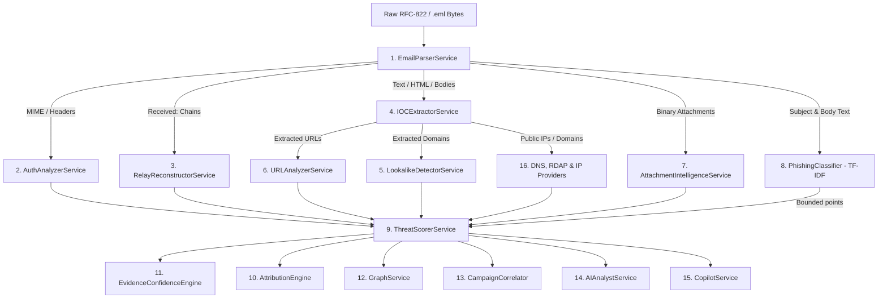

# 05 — Analysis Engine & Detection Subsystem Audit

> **Core Mandate:** CyberGuard must explain the exact origin and evidentiary basis for every cybersecurity conclusion.  
> **Methodology Classification:** `DETERMINISTIC ANALYSIS` | `RULE` | `HEURISTIC` | `ML MODEL` | `LLM` | `EXTERNAL THREAT INTELLIGENCE` | `STATIC DATA`  

---

## 1. Analysis Engine Master Registry

---

## 2. In-Depth Engine Audits

### 2.1 Email Parser & MIME Dissector
- **Implementation:** `backend/services/email_parser.py` (`EmailParserService`)
- **Methodology:** `DETERMINISTIC ANALYSIS`
- **Input:** Raw email bytes (`bytes`) and optional filename string.
- **Output:** `EmailAnalysisResponse` data structure with parsed headers, body texts, attachments, relay hops, and authentication data.
- **Algorithm:** RFC-822 header tokenizer using Python's standard `email` library; decodes base64, quoted-printable, RFC-2047 encoded words (`=?UTF-8?Q?...?=`), traverses MIME multipart trees, and preserves raw header order.
- **Evidence Produced:** Header dictionary, message ID, subject, From/To/Cc/Reply-To/Return-Path, body strings, attachment binary byte arrays.
- **Confidence:** 100% (Deterministic).
- **External Dependencies:** None (Standard library + regex).
- **Failure Behavior:** Raises `EmailParseException` on corrupt bytes; caught by HTTP handler and converted to HTTP 400 with diagnostic message.

---

### 2.2 Authentication & Cryptographic Alignment Analyzer
- **Implementation:** `backend/services/auth_analyzer.py` (`AuthAnalyzerService`)
- **Methodology:** `DETERMINISTIC ANALYSIS` + `RULE`
- **Input:** Header lists (`Authentication-Results`, `Received-SPF`, `ARC-Authentication-Results`, envelope addresses).
- **Output:** `AuthenticationAnalysis` (SPF, DKIM, DMARC statuses, verification type, alignment flags).
- **Algorithm:** 
  1. Regex parsing of authentication headers extracting `result`, `header.i`, `header.from`, and IP designations.
  2. Domain alignment validation: compares RFC-5322 `From` domain against RFC-5321 `Return-Path` domain (SPF alignment) and `d=` tag (DKIM alignment).
  3. Mismatch detection: flags `reply_to_mismatch` and `return_path_mismatch`.
- **Evidence Produced:** Verification status (`pass`, `fail`, `softfail`, `neutral`, `none`), exact policy (`p=reject`), domain alignment boolean flags.
- **Confidence:** High (Flags whether results are based on observed headers or unverified local lookups).
- **External Dependencies:** None.
- **Failure Behavior:** Defaults safely to `result="none"`, `details="Authentication header absent"`.

---

### 2.3 SMTP Relay Path Reconstructor
- **Implementation:** `backend/services/relay_reconstructor.py` (`RelayReconstructorService`)
- **Methodology:** `DETERMINISTIC ANALYSIS` + `HEURISTIC`
- **Input:** List of `Received:` header strings in chronological top-to-bottom order.
- **Output:** `RelayPathAnalysis` (Ordered hop list, transit delays in seconds, earliest observable node, spoofing flags).
- **Algorithm:** 
  1. Reverses headers to reconstruct actual delivery timeline (bottom = origin hop; top = delivery hop).
  2. Tokenizes `from`, `by`, `with`, `id`, and RFC-2822 timestamps per hop.
  3. Computes hop-to-hop delay $(\Delta t = t_{n} - t_{n-1})$.
  4. Heuristically identifies the **Earliest Observable Node**: the earliest hop with a publicly routable IP address outside the recipient's internal network.
  5. Flags negative delays (clock skew / forged headers) or anomalous transit times (> 300s).
- **Evidence Produced:** Hop numbers, sending hostnames, sending IPs, transit duration, earliest untrusted node IP.
- **Confidence:** Calibrated (Hops inside enterprise border marked trustworthy; external hops evaluated for spoofing).
- **External Dependencies:** `ipaddress` standard library.
- **Failure Behavior:** Skips unparseable received lines without halting pipeline.

---

### 2.4 IOC Extractor & Normalizer
- **Implementation:** `backend/services/ioc_extractor.py` (`IOCExtractorService`)
- **Methodology:** `DETERMINISTIC ANALYSIS` + `RULE`
- **Input:** Header text, decoded email bodies, attachment bytes.
- **Output:** Deduplicated dictionaries of IPv4, IPv6, Domains, URLs, Email Addresses, SHA-256 hashes.
- **Algorithm:** Comprehensive regex extraction for standard IOC formats, defanging restoration (`hxxp://` -> `http://`, `example[.]com` -> `example.com`), private IP exclusion, and SHA-256 cryptographic hashing.
- **Evidence Produced:** Literal extracted strings with occurrence counts and byte hashes.
- **Confidence:** 100% deterministic pattern matching.
- **External Dependencies:** None.
- **Failure Behavior:** Returns empty lists on unparseable tokens.

---

### 2.5 Lookalike & Homoglyph Brand Impersonation Detector
- **Implementation:** `backend/services/lookalike_detector.py` (`LookalikeDetectorService`)
- **Methodology:** `HEURISTIC` + `STATIC DATA`
- **Input:** Extracted domain strings.
- **Output:** `LookalikeDetectionResult` (Suspected target brand, similarity score 0.0-1.0, technique category).
- **Algorithm:**
  1. Loads 40+ protected brand profiles from `backend/config/brands.json` (e.g. `paypal.com`, `microsoft.com`, `google.com`, `sbi.co.in`, `icicibank.com`).
  2. Exact match check: Whitelists official brand domains and legitimate subdomains (`mail.paypal.com`).
  3. Character substitution / Homoglyph mapping (e.g. `0` -> `o`, `1` -> `l`, `vv` -> `w`, Cyrillic `а` -> Latin `a`).
  4. Levenshtein distance ratio calculation: flags domains with similarity $\ge 0.82$.
  5. Subdomain abuse: detects brand keywords embedded in subdomains (e.g. `paypal.com.attacker-control.net`).
  6. Added affixes: detects brand keywords with prefixes/suffixes (e.g. `secure-paypal-update.com`).
- **Evidence Produced:** Target brand identifier, normalized string, detected technique (`homoglyph`, `subdomain_abuse`, `brand_keyword_affix`).
- **Confidence:** High ($> 0.85$ score).
- **External Dependencies:** Local `brands.json`.
- **Failure Behavior:** Returns `None` if domain does not match any known brand profile.

---

### 2.6 Static URL Feature Analyzer
- **Implementation:** `backend/services/url_analyzer.py` (`URLAnalyzerService`)
- **Methodology:** `HEURISTIC` + `RULE`
- **Input:** URL strings and visible anchor text.
- **Output:** `URLAnalysisResult` (Suspicion score 0-100, risk level, structural features).
- **Algorithm:** 
  - Purely static parsing via `urllib.parse` and `tldextract` without fetching remote resources.
  - Flags direct IP hostnames (`http://192.0.2.1/login`), non-standard ports (`:8080`), embedded credentials (`user:pass@`), shortener services (`bit.ly`, `tinyurl`), and display link mismatches (where visible anchor displays `bank.com` but href directs to `evil.com`).
- **Evidence Produced:** Parsed hostname, scheme, path length, mismatched link texts, suspicious keywords.
- **Confidence:** High for structural characteristics; medium for keyword presence.
- **External Dependencies:** `tldextract`.
- **Failure Behavior:** Gracefully marks malformed URLs as `is_malformed: true`.

---

### 2.7 Static Attachment & Malware Inspection Engine
- **Implementation:** `backend/services/attachment_intelligence_service.py` (`AttachmentIntelligenceService`)
- **Methodology:** `DETERMINISTIC ANALYSIS` + `HEURISTIC`
- **Input:** Attachment binary bytes.
- **Output:** `AttachmentStaticAnalysisResult` (PE headers, PDF JavaScript/launch actions, Office macros, entropy score).
- **Algorithm:**
  - **Zero Execution**: Strict static inspection only.
  - **Zip Bomb & Zip Slip Guard**: Rejects uncompressed ratio $> 100:1$, file count $> 500$, nested depth $> 3$, or traversal filenames (`../`).
  - **Shannon Entropy**: Calculates $H = -\sum p \log_2(p)$ to detect packed or encrypted sections (entropy $> 7.2$).
  - **PE Dissector**: Parses DOS header (`MZ`), PE signature, COFF header, Optional Header, sections, and imports. Flags process injection APIs (`VirtualAlloc`, `WriteProcessMemory`, `CreateRemoteThread`).
  - **PDF Analyzer**: Scans cross-reference tables and streams for `/JavaScript`, `/JS`, `/Launch`, `/EmbeddedFile`.
  - **Office Macros**: Detects OLE2 storage and VBA macro streams (`vbaProject.bin`).
  - **Double Extension**: Detects disguised filenames (e.g. `invoice.pdf.exe`).
- **Evidence Produced:** Hashes (SHA-256, SHA-1, MD5), entropy value, PE sections, imported APIs, detected macro names.
- **Confidence:** High for binary structures; entropy explicitly qualified as neutral unless combined with executable indicators.
- **External Dependencies:** None (uses built-in `struct`, `zipfile`, `hashlib`, `math`).
- **Failure Behavior:** Returns partial analysis with `error` string; never crashes on malformed files.

---

### 2.8 NLP Phishing Classifier
- **Implementation:** `backend/app/ml/classifier.py` (`PhishingClassifier`)
- **Methodology:** `ML MODEL`
- **Input:** Subject string and decoded plain-text/HTML body.
- **Output:** `MLAssessmentResult` (Phishing probability 0.0-1.0, confidence tier: `high`/`medium`/`low`, top predictive features).
- **Algorithm:** Text normalization (stripping HTML tags, lowercasing, tokenizing numbers/URLs) -> Scikit-Learn TF-IDF Vectorizer -> Logistic Regression classifier loaded from `phishing_model.joblib`.
- **Evidence Produced:** Probability float, distance from decision boundary, top tokens that triggered prediction (e.g. `httpurl`, `wire`, `urgent`).
- **Confidence:** Low when probability is near 0.5; High when $\ge 0.80$ or $\le 0.20$.
- **External Dependencies:** `scikit-learn`, `joblib`, local model weights.
- **Failure Behavior:** If model artifact is missing or corrupted, returns `available: false` with notice; does NOT block pipeline.
- **Impact on Global Threat Score:** Strictly bounded (+10 points max for high probability; -5 points mitigating for low probability). NEVER overrides hard forensic evidence.

---

### 2.9 Global Explainable Threat Scoring Engine
- **Implementation:** `backend/services/threat_scorer.py` (`ThreatScorerService`)
- **Methodology:** `RULE` + `DETERMINISTIC ANALYSIS`
- **Input:** Aggregated `EmailAnalysisResponse` telemetry.
- **Output:** `ThreatScoreResult` (Global score 0-100, severity rating, category breakdown, positive evidence list, mitigating signals list).
- **Algorithm:**
  - Evaluates 9 risk categories based on weights in `backend/config/scoring_rules.json`:
    1. Authentication Risk (SPF/DKIM/DMARC)
    2. Sender Identity Risk (Display name spoofing, alignment mismatch)
    3. Domain Risk (Age $< 30$ days, registration metadata)
    4. Lookalike Risk (Brand impersonation)
    5. URL Risk (Suspicious URLs, link mismatches)
    6. Infrastructure Risk (Hostile ASN, proxy/Tor origin)
    7. Content Risk (Urgency keywords, financial diversion, bounded ML probability)
    8. Attachment Risk (Executable disguise, macro payload, PDF launch actions)
    9. Campaign Risk (Correlated cluster membership)
  - Applies mitigating factors (e.g. established domain age $> 365$ days, full auth pass).
  - Enforces mandatory clamping $[0, 100]$.
- **Evidence Produced:** Itemized point contribution for every signal, explanation string, source engine tag.
- **Confidence:** 100% reproducible and auditable.
- **External Dependencies:** Local `scoring_rules.json`.
- **Failure Behavior:** Falls back to hardcoded default scoring weights if JSON file is missing.

---

### 2.10 Probabilistic Threat Attribution Engine
- **Implementation:** `backend/services/attribution_engine.py` (`AttributionEngine`)
- **Methodology:** `HEURISTIC` + `RULE`
- **Input:** Email telemetry and historical case database.
- **Output:** `AttributionResult` (Probable origin IP, ASN, provider, hosting country, confidence score %, supporting vs conflicting evidence).
- **Algorithm:**
  - Follows strict **Non-Attribution Standards**: attributes technical infrastructure, never nation-states or individuals without legal proof.
  - Correlates origin IP from earliest reliable SMTP hop with ASN registry and hosting provider telemetry.
  - Scores confidence based on supporting signals (consistent ASN, country, provider) and deducts points for conflicting signals (e.g. proxy/VPN/Tor egress).
- **Evidence Produced:** Origin IP, ASN name, country, supporting evidence list, conflicting evidence list.
- **Confidence:** Explicitly calibrated percentage with confidence tier (`HIGH`, `MEDIUM`, `LOW`).
- **External Dependencies:** Database session, local `attribution_rules.json`.
- **Failure Behavior:** Produces `"Attribution Indeterminate"` if origin hop cannot be resolved.

---

### 2.11 Evidence Confidence Engine (8 Domains)
- **Implementation:** `backend/services/evidence_confidence_engine.py` (`EvidenceConfidenceEngine`)
- **Methodology:** `RULE` + `HEURISTIC`
- **Input:** Analyzed email indicators.
- **Output:** `List[ForensicConclusion]` categorized into Confirmed (90-100%), Probable (70-89%), Possible (50-69%), Doubtful (25-49%), or Disproved (< 25%).
- **Algorithm:**
  - Evaluates 8 forensic domains: Authentication, Sender Identity, URL Safety, Attachment Safety, Content Intent, Infrastructure Origin, Domain Legitimacy, Campaign Linkage.
  - Applies **Recency Decay**: degrades confidence of intelligence older than 30/90 days.
  - Applies **Anti-Double-Counting**: prevents correlated feeds (e.g. multiple URL blocklists sharing upstream data) from artificially inflating confidence.
  - Detects contradictions: lowers confidence when signals conflict.
- **Evidence Produced:** Conclusion ID, category, confidence score, calibrated tier, evidence basis string.
- **Confidence:** Calibrated 5-tier standard.
- **External Dependencies:** Local `evidence_confidence_rules.json`.
- **Failure Behavior:** Emits `Doubtful` conclusion with explanatory warning.

---

### 2.12 Directed Investigation Graph Builder
- **Implementation:** `backend/services/graph_service.py` (`GraphService`)
- **Methodology:** `DETERMINISTIC ANALYSIS`
- **Input:** `EmailAnalysisResponse` object.
- **Output:** `InvestigationGraphResponse` (Deduplicated nodes and directed edges).
- **Algorithm:** Constructs directed graph mapping entities: `email`, `email_address`, `domain`, `url`, `ip`, `asn`, `attachment`. Generates deterministic node IDs (e.g. `ip:198.51.100.1`, `domain:paypal-update.com`) to eliminate duplication, and assigns typed edges (`sent_from`, `contains_url`, `resolves_to`, `routes_through`).
- **Evidence Produced:** Node and edge collections formatted for Cytoscape.js.
- **Confidence:** 100% deterministic linkage.
- **External Dependencies:** None.
- **Failure Behavior:** Returns empty graph object.

---

### 2.13 Campaign Correlator & Clustering Engine
- **Implementation:** `backend/services/campaign_correlator.py` & `campaign_service.py`
- **Methodology:** `HEURISTIC` + `RULE`
- **Input:** Email indicators vs existing database campaigns.
- **Output:** Campaign assignment, similarity score, correlation reasons list.
- **Algorithm:**
  - Multi-vector similarity scoring:
    1. Infrastructure Overlap: Shared ASN, sending IP subnet (/24), hosting provider (Weight: 35%).
    2. Attachment Overlap: Matching SHA-256 or MD5 hashes (Weight: 25%).
    3. Target Alignment: Same targeted brand or domain naming convention (Weight: 20%).
    4. Temporal Proximity: Sent within 7 days of campaign window (Weight: 10%).
    5. Content & Subject Pattern: Urgency and subject structure similarity (Weight: 10%).
  - If aggregate similarity $> 0.65$, email is correlated with the campaign.
- **Evidence Produced:** Correlation reasons, shared IOC list, category similarity breakdown.
- **Confidence:** Scored 0-100%.
- **External Dependencies:** Database access (`campaigns`, `campaign_emails`).
- **Failure Behavior:** Continues without campaign correlation if database query fails.

---

### 2.14 AI Analyst Assistant
- **Implementation:** `backend/services/ai_analyst_service.py` (`AIAnalystService`)
- **Methodology:** `LLM` + `RULE` Fallback
- **Input:** Sanitized forensic findings JSON.
- **Output:** `AIAnalystAssessment` (Executive summary, likely attack type, key evidence list, recommended actions, limitations statement).
- **Algorithm:** Formats structured findings into a prompt with anti-prompt-injection fences -> Submits to `LLMProvider` (Gemini or OpenAI) with temperature 0.1 -> Validates JSON response. If LLM is unconfigured, disabled, timed out, or returns invalid JSON, **automatically executes deterministic rule-based template generation**.
- **Evidence Produced:** Executive summary text and action items.
- **Confidence:** Calibrated; explicitly marked as AI-assisted interpretation.
- **External Dependencies:** Google Gemini API / OpenAI API.
- **Failure Behavior:** Zero pipeline disruption: switches to rule-based template summary instantly.

---

### 2.15 Investigation Copilot & Context Engine
- **Implementation:** `backend/services/copilot_service.py` & `copilot_context_engine.py`
- **Methodology:** `LLM` + `RULE` Fallback
- **Input:** Investigator natural language query + active investigation JSON context.
- **Output:** `CopilotQueryResponse` (Answer string, referenced evidence IDs, confidence tier, follow-up suggested questions).
- **Algorithm:** 
  1. `CopilotContextEngine` extracts only relevant evidence subset for active mode (`email`, `case`, `campaign`).
  2. Injects system prompt enforcing strict grounding: "Answer only based on the provided evidence. If unknown, state 'Information not present in evidence'."
  3. Validates citations: ensures every cited Evidence ID exists in the context.
  4. Audits query in `copilot_audit_logs`.
  5. Rule-based fallback: provides keyword-matched forensic answers if LLM is unavailable.
- **Evidence Produced:** Citations of active evidence records.
- **Confidence:** 5-tier confidence indicator (`CONFIRMED`, `PROBABLE`, `POSSIBLE`, etc.).
- **External Dependencies:** Gemini / OpenAI API.
- **Failure Behavior:** Falls back to offline keyword response engine.

---

### 2.16 External Network OSINT Resolvers (DNS, RDAP, IP)
- **Implementation:** `dns_service.py`, `rdap_service.py`, `ip_providers.py`
- **Methodology:** `EXTERNAL THREAT INTELLIGENCE`
- **Input:** IP addresses, domain names.
- **Output:** DNS records, registrar names, domain creation dates, IP geolocation, ASN.
- **Algorithm:**
  - `DNSService`: Queries A, AAAA, MX, NS, TXT via `dnspython` with 2.5s timeout.
  - `RDAPService`: Queries RFC-7480 HTTP endpoints on `rdap.org` with 3.5s timeout; falls back to port 43 WHOIS socket.
  - `IPApiProvider` / `IPInfoProvider`: Calls external REST APIs with configured keys.
- **Evidence Produced:** IP geolocation, autonomous system numbers, registration dates.
- **Confidence:** Depends on external registry integrity.
- **External Dependencies:** Internet access, public DNS, RDAP, third-party IP APIs.
- **Failure Behavior:** Bypassed for private/RFC-1918 IPs via `SSRFProtector`; on network timeout, sets `enrichment_available: false` and proceeds.
