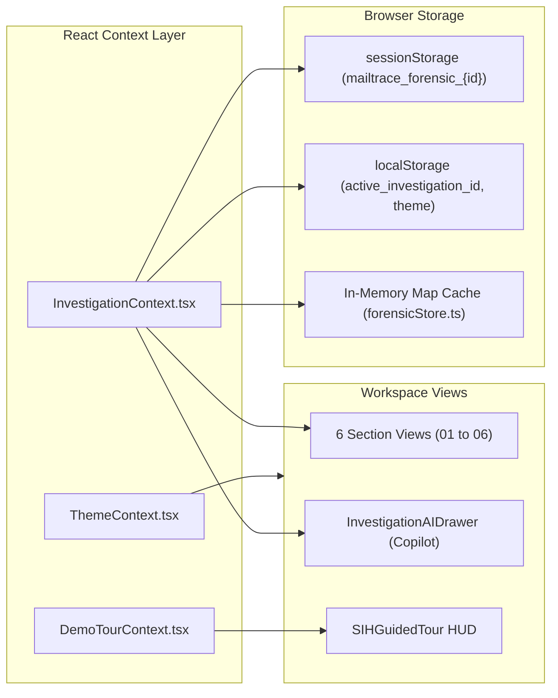

# 06 — Frontend Architecture & UI Audit

> **Framework:** React 19.2.8 + TypeScript ~6.0.2 + Vite 8.2.2  
> **Router:** React Router DOM 7.18.3 (`HashRouter`)  
> **Styling:** Tailwind CSS 4.3.3 (`@tailwindcss/vite`) + Custom CSS Variables  
> **Visualizations:** Cytoscape.js 3.34.2, Leaflet 1.9.4, Recharts 3.10.1, Lucide-React 1.41.0  

---

## 1. Frontend Route & Navigation Map

```
HashRouter (/#/...)
│
├── /investigate                       ──> InvestigationWorkspace.tsx
│   ├── /investigate/overview          ──> [01] OverviewSectionView.tsx (Score, risks, AI summary)
│   ├── /investigate/email             ──> [02] EmailSectionView.tsx (Headers, body, hops, auth)
│   ├── /investigate/analysis          ──> [03] AnalysisSectionView.tsx (IOCs, URLs, lookalikes, atts)
│   ├── /investigate/intelligence      ──> [04] IntelligenceSectionView.tsx (IP/DNS/WHOIS/Map)
│   ├── /investigate/investigation     ──> [05] InvestigationSectionView.tsx (Graph, campaign, correlation)
│   ├── /investigate/report            ──> [06] ReportSectionView.tsx (Dossier, PDF export, case link)
│   └── /investigate/:id/:section      ──> Direct deep-link to specific investigation record
│
├── Top-Level Navigation Routes
│   ├── / or /dashboard                ──> Dashboard.tsx (Executive SOC telemetry & 30-day trends)
│   ├── /analyze                       ──> AnalyzeEmail.tsx (Drag-and-drop EML upload intake)
│   ├── /history                       ──> InvestigationHistory.tsx (Searchable archive of ingested emails)
│   ├── /cross-investigation           ──> CrossInvestigationWorkspacePage.tsx (2-5 email comparative matrix)
│   ├── /cases                         ──> Cases.tsx (Incident case directory & status filter)
│   ├── /cases/:id                     ──> CaseDetail.tsx (Comprehensive incident dossier, notes, findings)
│   ├── /campaigns                     ──> CampaignIntelligence.tsx (Coordinated campaign directory)
│   ├── /campaigns/:id                 ──> CampaignIntelligence.tsx (Campaign cluster graph & IOCs)
│   ├── /osint                         ──> ThreatIntelligence.tsx (Manual IP / Domain OSINT search)
│   ├── /reports                       ──> Reports.tsx (Repository of generated forensic PDF reports)
│   ├── /benchmarks                    ──> BenchmarkEvaluation.tsx (Live empirical benchmark & confusion matrix)
│   └── /settings                      ──> Settings.tsx (System parameters, API keys, retention limits)
│
└── Backward-Compatibility Shortcuts
    ├── /overview, /email, /analysis, /intelligence, /investigation, /report ──> Redirect to /investigate/:section
    └── /analysis/:id                  ──> Redirect to /investigate/:id/overview
```

---

## 2. Layout & Shell Architecture

The user interface follows a persistent responsive application shell:

1. **`Sidebar.tsx`**:
   - Collapsible desktop sidebar (256px expanded / 80px icon-only rail).
   - Mobile slide-out drawer with backdrop.
   - Highlights the 6-stage investigation workflow when an active investigation is open.
2. **`Navbar.tsx`**:
   - Displays active workspace badge, system connectivity health indicator (`/health`), theme switcher (Dark / Light / Cyber), and the global "Clean Reset" button (`POST /api/workspace/reset`).
3. **`ActiveInvestigationHeader.tsx`**:
   - Mounted atop `InvestigationWorkspace.tsx`.
   - Displays current email subject, evidence ID badge, cryptographic SHA-256 hash, threat score badge, and quick tabs for navigating between the 6 investigation stages.
4. **`SIHGuidedTour.tsx`**:
   - Floating persistent HUD at the bottom of the viewport designed for hackathon/presentation demonstrations.
   - Allows one-click switching between the 3 SIH synthetic scenarios (`scenario-1-legit`, `scenario-2-phish`, `scenario-3-campaign`) and guided step progression.

---

## 3. State Management & Data Flow



### 3.1 `InvestigationContext.tsx` (24.3 KB)
- Primary application state container.
- Holds `activeEmailId`, `activeEmail` (`EmailAnalysis`), `activeSection`, `subTabs`, `loading`, `error`, `availableAnalyses`, and `isCopilotDrawerOpen`.
- **Loading Pipeline:**
  1. Checks URL parameter for investigation ID.
  2. Looks up record in `forensicStore` (memory map then `sessionStorage`).
  3. If missing locally, calls backend `GET /api/emails/{id}/analysis`.
  4. If no ID specified, falls back to the most recently ingested email.
  5. Dynamically triggers background enrichments (ML prediction, campaign alert check, attribution) if missing from payload.

### 3.2 `forensicStore.ts` (8.2 KB)
- Client-side persistence layer using an in-memory `Map` and `sessionStorage`.
- Prefixes keys with `mailtrace_forensic_`.
- Intercepts requests for `scenario-1-legit`, `scenario-2-phish`, and `scenario-3-campaign` to return static demo objects without contacting the backend.

---

## 4. UI Component Architecture & Heavyweights

Several components have grown exceptionally large and accumulate multiple responsibilities:

| Component / Utility | File Path | Size (Bytes) | Lines | Primary Responsibility & Observations |
|---|---|---|---|---|
| **`CaseDetail.tsx`** | `src/pages/CaseDetail.tsx` | 72,982 | 1,840 | **God Component**: Renders entire case overview, timeline, email assignment, findings list, notes, indicator correlation, attribution, and report export in a single file. |
| **`ReportSectionView.tsx`** | `src/pages/investigation/sections/ReportSectionView.tsx` | 62,679 | 1,420 | **God Component**: Renders full evidentiary dossier, interactive PDF generator, findings builder, header inspection, and case linkage. |
| **`indicatorHelper.ts`** | `src/utils/indicatorHelper.ts` | 60,741 | 1,510 | **God Utility**: Contains comprehensive client-side data normalizers, RFC-2047 decoders, fallback attribution engines, and indicator formatters. |
| **`InvestigationHistory.tsx`** | `src/pages/InvestigationHistory.tsx` | 53,167 | 1,280 | Full history directory with advanced multi-filter search, severity badges, and batch actions. |
| **`BenchmarkEvaluation.tsx`**| `src/pages/BenchmarkEvaluation.tsx` | 39,140 | 910 | Benchmark runner, confusion matrix visualizer, and P95 latency charts. |
| **`CampaignIntelligence.tsx`**| `src/pages/CampaignIntelligence.tsx`| 36,052 | 870 | Campaign cluster cards, timeline visualizer, and Cytoscape campaign graph. |
| **`OverviewSectionView.tsx`** | `src/pages/investigation/sections/OverviewSectionView.tsx` | 33,134 | 780 | Score gauge, severity badges, AI executive summary, and key risk factor list. |
| **`Dashboard.tsx`** | `src/pages/Dashboard.tsx` | 30,842 | 680 | SOC metrics cards, Recharts 30-day volume chart, and recent email tables. |

---

## 5. Client vs Server Security Logic Audit

> [!WARNING]
> **Client-Side Security Logic Fallbacks:**  
> In `src/utils/indicatorHelper.ts` and `src/utils/confidenceResolver.ts`, the frontend contains client-side fallback implementations of:
> 1. `resolveAttribution(email)`: Computes origin ASN and provider if backend did not supply it.
> 2. `resolveConfidenceConclusions(email)`: Evaluates evidence confidence across 8 domains if backend did not supply it.
> 3. `resolveEmailIndicators(email)`: Calculates overall threat score severity and category breakdowns if missing.
> 
> **Architecture Principle:** In the target CyberGuard architecture, all security scoring, attribution, and confidence calculations MUST be performed exclusively on the backend. The frontend must act strictly as a display and control layer.

---

## 6. Dead Code & Mock Data in Frontend

1. **`src/data/mockData.ts` (26.6 KB, 672 lines)**:
   - Contains `SAMPLE_EMAILS`, `MOCK_CASES`, `MOCK_THREAT_CLUSTERS`, `MOCK_REPORTS`, `CHART_DATA_TRENDS`, and `CHART_DATA_GEOLOCATIONS`.
   - **Grep verification:** Zero imports across the entire `src/` directory. Completely dead prototype code.
2. **Duplicated Scenario Fixture**:
   - `src/data/sihScenariosData.ts` (32.2 KB) and `src/data/demo/sihScenariosData.ts` (32.2 KB) are byte-for-byte identical duplicates.
