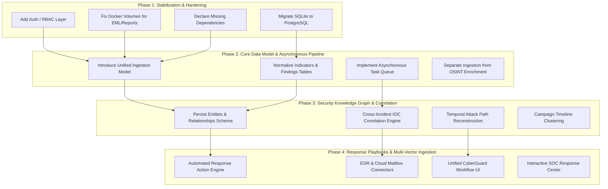

# 10 — Migration Roadmap & Architectural Compatibility Check

This document outlines a non-destructive, phased migration roadmap to transition CyberGuard from an email-forensics utility into an enterprise-grade AI Cyber Threat, Phishing, Impersonation Detection, Investigation, and Response platform.

It also provides an Architectural Compatibility Check evaluating the effort required to introduce the 12 core enterprise cybersecurity entities.

---

## 1. Architectural Migration Principles

1. **Strict Non-Destructive Evolution**: Existing working engines (parsers, forensic headers, static attachment inspection, deterministic scoring rules, Cytoscape graph generator, ReportLab dossier compiler) must not be rewritten. They will be wrapped in standardized provider interfaces.
2. **Unified Core Pipeline**: The platform will converge from siloed upload routes into a single workflow:
   $$\text{Ingestion} \longrightarrow \text{Orchestration} \longrightarrow \text{Detection Engines} \longrightarrow \text{Evidence / Findings} \longrightarrow \text{Knowledge Graph} \longrightarrow \text{Correlation} \longrightarrow \text{Attack Path} \longrightarrow \text{Response} \longrightarrow \text{Reporting}$$
3. **Decoupled Asynchronous Enrichment**: External OSINT queries (DNS, RDAP, WHOIS, IP-API) must run asynchronously in background workers, decoupling immediate ingestion response from external network latency.
4. **Authoritative Backend Security Facts**: Deprecate client-side threat scoring, confidence resolution, and attribution overrides. The backend serves verified, reproducible security evaluations.
5. **Separation of Evidence and AI Interpretation**: Raw forensic telemetry (hashes, headers, relay timestamps) is strictly separated from AI/LLM probabilistic hypotheses.

---

## 2. Phased Migration Roadmap

---

### Phase 1: Foundation Hardening & Integrity (Immediate Priority)
- **Goal**: Resolve all architectural blockers and vulnerabilities identified in the audit without modifying business logic.
- **Milestones**:
  1. **Dependencies**: Add `reportlab>=4.0.0` and `pillow>=10.0.0` to `backend/requirements.txt`.
  2. **Docker Storage**: Configure named volumes in `docker-compose.yml` for `eml_store` and `reports`.
  3. **Database Migration**: Complete the transition from local SQLite file storage to PostgreSQL with Alembic migrations, dropping obsolete orphan prototype tables (`emails`, `iocs`, `email_iocs`, `email_relationships`, `analysis_runs`).
  4. **Authentication & RBAC**: Introduce FastAPI OAuth2/JWT middleware with roles:
     - `SOC_ANALYST_L1`: Read-only case review and artifact upload.
     - `SOC_ANALYST_L2`: Finding creation, note authoring, report generation.
     - `INCIDENT_COMMANDER`: Case closure, workspace reset, response playbook execution.
     - `ADMIN`: User management, API key rotation, system configuration.

---

### Phase 2: Unified Ingestion & Asynchronous Orchestration
- **Goal**: Expand ingestion beyond `.eml` files to multi-vector artifacts while decoupling synchronous network bottlenecks.
- **Milestones**:
  1. **Unified Artifact Model**:
     - Generalize `backend/models/evidence.py` into a polymorphic `Artifact` model supporting emails, file binaries, network PCAPs, URLs, and memory dumps.
  2. **Asynchronous Execution Queue**:
     - Integrate Redis + ARQ (or Celery) for background processing.
     - Split `/api/emails/analyze` into:
       - **Fast Synchronous Parsing**: MIME parsing, SHA-256 calculation, header extraction, static attachment triage, heuristic scoring (< 400ms).
       - **Asynchronous Enrichment Workers**: DNS lookups, RDAP WHOIS queries, IP geolocation, ThreatFox/AbuseIPDB reputation scoring.
  3. **Real-time Event Streaming**:
     - Introduce WebSocket or Server-Sent Events (SSE) at `/api/cases/{id}/stream` to push asynchronous enrichment findings directly to the frontend graph.

---

### Phase 3: Security Knowledge Graph & Cross-Incident Correlation
- **Goal**: Transition from isolated per-email Cytoscape views to an enterprise security knowledge graph.
- **Milestones**:
  1. **Persistent Entity & Relationship Schema**:
     - Normalize in-memory graph elements into `entities` (Users, Hosts, Mailboxes, Domains, IPs) and `relationships` (COMMUNICATED_WITH, DOWNLOADED, RESOLVED_TO, AUTHENTICATED_FROM).
  2. **Cross-Case Correlation Engine**:
     - Expand `CampaignCorrelationService` to continuously index newly ingested artifacts against all historical cases.
     - Flag recurring adversary infrastructure (e.g. reused ASN, shared registrant, identical fuzzy attachment hash).
  3. **Attack Path Reconstruction**:
     - Develop an algorithm that traverses the knowledge graph temporally, mapping observed events to MITRE ATT&CK stages:
       $$\text{Phishing Link (T1566.002)} \longrightarrow \text{User Execution (T1204)} \longrightarrow \text{C2 Callback (T1071)} \longrightarrow \text{Exfiltration (T1048)}$$

---

### Phase 4: Automated Response & Unified CyberGuard UI
- **Goal**: Transform passive analysis into active remediation and streamline frontend navigation into the target workflow.
- **Milestones**:
  1. **Response Action Framework**:
     - Introduce `response_actions` table tracking remediation tasks.
     - Implement response drivers:
       - Google Workspace / Microsoft 365: Message recall & mailbox purge.
       - Firewall / DNS: Domain & IP sinkholing / blocking.
       - Identity Provider (IdP): Revoke active user session & force MFA reset.
  2. **Frontend Workflow Unification**:
     - Restructure top-level navigation from disconnected tool tabs to the 5-stage CyberGuard workflow:
       $$\text{Dashboard / Ingestion} \longrightarrow \text{Analysis} \longrightarrow \text{Investigation} \longrightarrow \text{Response} \longrightarrow \text{Reporting}$$
     - Refactor monolithic components (`CaseDetail.tsx`, `ReportSectionView.tsx`) into modular widget assemblies.

---

## 3. Architectural Compatibility Check

Evaluation of the 12 core cybersecurity concepts required for the future CyberGuard platform:

| Core Concept | Compatibility Rating | Implementation Effort | Architectural Rationale & Strategy |
|---|:---:|:---:|---|
| **Artifact** | **EASY** | Low | The existing `Evidence` model in `backend/models/evidence.py` already implements file storage, SHA-256 hashing, MIME typing, and relational links. Generalizing it into an abstract base `Artifact` class (supporting emails, files, PCAPs, URLs) requires simple inheritance and a discriminator column. |
| **ThreatEvent** | **MODERATE** | Medium | Current events are represented as discrete stages within an email's transport hops or audit logs. Introducing a generic `ThreatEvent` entity requires a dedicated time-series table indexed on `(timestamp, event_type, actor_id, target_id)` to ingest authentication logs, network flows, and email deliveries. |
| **AnalysisRun** | **EASY** | Low | The codebase already maintains an `email_analyses` table recording model versions, timestamps, threat scores, and JSON outputs, plus an unused `analysis_runs` prototype table. Formalizing `AnalysisRun` to track any engine execution against any `Artifact` is straightforward. |
| **Finding** | **EASY** | Low | The `CaseFinding` model in `backend/models/case_finding.py` already includes title, description, severity, status, MITRE ATT&CK technique IDs, and evidence associations. Promoting this to a universal `Finding` model requires minimal schema adjustment. |
| **Evidence** | **COMPLETED** | Done | Implemented via `FindingEvidenceModel` (`finding_evidence` table) linking machine-readable observations to findings, alongside legacy `evidence` table. |
| **Indicator** | **COMPLETED** | Done | Implemented via `IndicatorModel` (`indicators` table) with canonical normalization, deduplication on `(indicator_type, normalized_value)`, and reputation. |
| **Entity** | **COMPLETED** | Done | Implemented via `EntityModel` (`entities` table) with external IDs, attribute tracking, and first/last seen timestamps. |
| **Relationship** | **COMPLETED** | Done | Implemented via `RelationshipModel` (`relationships` table) providing polymorphic Security Knowledge Graph persistence with confidence and method. |
| **Incident** | **COMPLETED** | Done | Implemented via `IncidentModel` (`incidents` table) with `INC-YYYY-XXXXXX` numbering, bi-directional ThreatEvent linkage, and legacy case adapter pointer. |
| **AttackPath** | **PREPARED** | Done | Foundational schema implemented via `AttackPathModel`, `AttackStageModel`, and `AttackEdgeModel` tables; ready for traversal engine in Section 3. |
| **ResponseAction** | **COMPLETED** | Done | Implemented via `ResponseActionModel` (`response_actions` table) tracking action types, approval workflows, and execution states. |
| **ModelVersion** | **COMPLETED** | Done | Implemented via `ModelVersionModel` (`model_versions` table) tracking model provenance, algorithms, training references, and metrics. |

---

## 4. Section 2 Progress & Implementation Summary

**Section 2 Status: COMPLETED**

1. **Alembic Migration Applied**: Revision `b7e2a901c43f` created all 14 canonical tables, indexes, and additive `request_id` column on `audit_logs`.
2. **Unified Schemas & Enums**: Defined in `backend/schemas/unified.py` with canonical Pydantic V2 models, standardized enums, and normalization rules.
3. **Service Layer**: Fully functional `ArtifactService`, `AnalysisService`, `FindingService`, `IndicatorService`, `EntityService`, `RelationshipService`, `ThreatEventService`, `IncidentService`, and `ModelVersionService` in `backend/services/unified_service.py`.
4. **Non-Destructive Dual-Write**: Ingestion adapter hooked into `POST /api/emails/analyze` to dual-write normalized records while preserving 100% of legacy behavior and endpoints.
5. **Inspection API**: Minimal inspection routes added at `/api/unified/*` and `/api/*` for inspecting artifacts, analysis runs, findings, indicators, relationships, and incidents.
6. **Testing**: 19 unit & integration tests in `backend/tests/test_unified_data_model.py` passing, with 100% backward compatibility across all legacy test suites.

