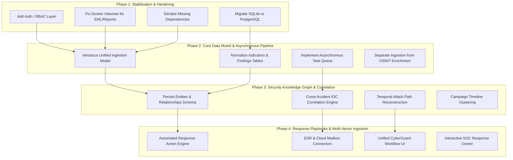

# 10 — Migration Roadmap & Architectural Compatibility Check

This document outlines a non-destructive, phased migration roadmap to transition CyberGuard from an email-forensics utility into an enterprise-grade AI Cyber Threat, Phishing, Impersonation Detection, Investigation, and Response platform.

It also provides an Architectural Compatibility Check evaluating the effort required to introduce the 12 core enterprise cybersecurity entities.

---

## 1. Architectural Migration Principles

1. **Strict Non-Destructive Evolution**: Existing working engines (parsers, forensic headers, static attachment inspection, deterministic scoring rules, Cytoscape graph generator, ReportLab dossier compiler) must not be rewritten. They will be wrapped in standardized provider interfaces.
2. **Unified Core Pipeline**: The platform will converge from siloed upload routes into a single workflow:
   $$\text{Ingestion} \longrightarrow \text{Orchestration} \longrightarrow \text{Detection Engines} \longrightarrow \text{Evidence / Findings} \longrightarrow \text{Knowledge Graph} \longrightarrow \text{Correlation} \longrightarrow \text{Attack Path} \longrightarrow \text{Response} \longrightarrow \text{Reporting}$$
3. **Decoupled Asynchronous Enrichment**: External OSINT queries (DNS, RDAP, WHOIS, IP-API) must run asynchronously in background workers, decoupling immediate ingestion response from external network latency.
4. **Authoritative Backend Security Facts**: Deprecate client-side threat scoring, confidence resolution, and attribution overrides. The backend serves verified, reproducible security evaluations.
5. **Separation of Evidence and AI Interpretation**: Raw forensic telemetry (hashes, headers, relay timestamps) is strictly separated from AI/LLM probabilistic hypotheses.

---

## 2. Phased Migration Roadmap

---

### Phase 1: Foundation Hardening & Integrity (Immediate Priority)
- **Goal**: Resolve all architectural blockers and vulnerabilities identified in the audit without modifying business logic.
- **Milestones**:
  1. **Dependencies**: Add `reportlab>=4.0.0` and `pillow>=10.0.0` to `backend/requirements.txt`.
  2. **Docker Storage**: Configure named volumes in `docker-compose.yml` for `eml_store` and `reports`.
  3. **Database Migration**: Complete the transition from local SQLite file storage to PostgreSQL with Alembic migrations, dropping obsolete orphan prototype tables (`emails`, `iocs`, `email_iocs`, `email_relationships`, `analysis_runs`).
  4. **Authentication & RBAC**: Introduce FastAPI OAuth2/JWT middleware with roles:
     - `SOC_ANALYST_L1`: Read-only case review and artifact upload.
     - `SOC_ANALYST_L2`: Finding creation, note authoring, report generation.
     - `INCIDENT_COMMANDER`: Case closure, workspace reset, response playbook execution.
     - `ADMIN`: User management, API key rotation, system configuration.

---

### Phase 2: Unified Ingestion & Asynchronous Orchestration
- **Goal**: Expand ingestion beyond `.eml` files to multi-vector artifacts while decoupling synchronous network bottlenecks.
- **Milestones**:
  1. **Unified Artifact Model**:
     - Generalize `backend/models/evidence.py` into a polymorphic `Artifact` model supporting emails, file binaries, network PCAPs, URLs, and memory dumps.
  2. **Asynchronous Execution Queue**:
     - Integrate Redis + ARQ (or Celery) for background processing.
     - Split `/api/emails/analyze` into:
       - **Fast Synchronous Parsing**: MIME parsing, SHA-256 calculation, header extraction, static attachment triage, heuristic scoring (< 400ms).
       - **Asynchronous Enrichment Workers**: DNS lookups, RDAP WHOIS queries, IP geolocation, ThreatFox/AbuseIPDB reputation scoring.
  3. **Real-time Event Streaming**:
     - Introduce WebSocket or Server-Sent Events (SSE) at `/api/cases/{id}/stream` to push asynchronous enrichment findings directly to the frontend graph.

---

### Phase 3: Security Knowledge Graph & Cross-Incident Correlation
- **Goal**: Transition from isolated per-email Cytoscape views to an enterprise security knowledge graph.
- **Milestones**:
  1. **Persistent Entity & Relationship Schema**:
     - Normalize in-memory graph elements into `entities` (Users, Hosts, Mailboxes, Domains, IPs) and `relationships` (COMMUNICATED_WITH, DOWNLOADED, RESOLVED_TO, AUTHENTICATED_FROM).
  2. **Cross-Case Correlation Engine**:
     - Expand `CampaignCorrelationService` to continuously index newly ingested artifacts against all historical cases.
     - Flag recurring adversary infrastructure (e.g. reused ASN, shared registrant, identical fuzzy attachment hash).
  3. **Attack Path Reconstruction**:
     - Develop an algorithm that traverses the knowledge graph temporally, mapping observed events to MITRE ATT&CK stages:
       $$\text{Phishing Link (T1566.002)} \longrightarrow \text{User Execution (T1204)} \longrightarrow \text{C2 Callback (T1071)} \longrightarrow \text{Exfiltration (T1048)}$$

---

### Phase 4: Automated Response & Unified CyberGuard UI
- **Goal**: Transform passive analysis into active remediation and streamline frontend navigation into the target workflow.
- **Milestones**:
  1. **Response Action Framework**:
     - Introduce `response_actions` table tracking remediation tasks.
     - Implement response drivers:
       - Google Workspace / Microsoft 365: Message recall & mailbox purge.
       - Firewall / DNS: Domain & IP sinkholing / blocking.
       - Identity Provider (IdP): Revoke active user session & force MFA reset.
  2. **Frontend Workflow Unification**:
     - Restructure top-level navigation from disconnected tool tabs to the 5-stage CyberGuard workflow:
       $$\text{Dashboard / Ingestion} \longrightarrow \text{Analysis} \longrightarrow \text{Investigation} \longrightarrow \text{Response} \longrightarrow \text{Reporting}$$
     - Refactor monolithic components (`CaseDetail.tsx`, `ReportSectionView.tsx`) into modular widget assemblies.

---

## 3. Architectural Compatibility Check

Evaluation of the 12 core cybersecurity concepts required for the future CyberGuard platform:

| Core Concept | Compatibility Rating | Implementation Effort | Architectural Rationale & Strategy |
|---|:---:|:---:|---|
| **Artifact** | **EASY** | Low | The existing `Evidence` model in `backend/models/evidence.py` already implements file storage, SHA-256 hashing, MIME typing, and relational links. Generalizing it into an abstract base `Artifact` class (supporting emails, files, PCAPs, URLs) requires simple inheritance and a discriminator column. |
| **ThreatEvent** | **MODERATE** | Medium | Current events are represented as discrete stages within an email's transport hops or audit logs. Introducing a generic `ThreatEvent` entity requires a dedicated time-series table indexed on `(timestamp, event_type, actor_id, target_id)` to ingest authentication logs, network flows, and email deliveries. |
| **AnalysisRun** | **EASY** | Low | The codebase already maintains an `email_analyses` table recording model versions, timestamps, threat scores, and JSON outputs, plus an unused `analysis_runs` prototype table. Formalizing `AnalysisRun` to track any engine execution against any `Artifact` is straightforward. |
| **Finding** | **EASY** | Low | The `CaseFinding` model in `backend/models/case_finding.py` already includes title, description, severity, status, MITRE ATT&CK technique IDs, and evidence associations. Promoting this to a universal `Finding` model requires minimal schema adjustment. |
| **Evidence** | **COMPLETED** | Done | Implemented via `FindingEvidenceModel` (`finding_evidence` table) linking machine-readable observations to findings, alongside legacy `evidence` table. |
| **Indicator** | **COMPLETED** | Done | Implemented via `IndicatorModel` (`indicators` table) with canonical normalization, deduplication on `(indicator_type, normalized_value)`, and reputation. |
| **Entity** | **COMPLETED** | Done | Implemented via `EntityModel` (`entities` table) with external IDs, attribute tracking, and first/last seen timestamps. |
| **Relationship** | **COMPLETED** | Done | Implemented via `RelationshipModel` (`relationships` table) providing polymorphic Security Knowledge Graph persistence with confidence and method. |
| **Incident** | **COMPLETED** | Done | Implemented via `IncidentModel` (`incidents` table) with `INC-YYYY-XXXXXX` numbering, bi-directional ThreatEvent linkage, and legacy case adapter pointer. |
| **AttackPath** | **PREPARED** | Done | Foundational schema implemented via `AttackPathModel`, `AttackStageModel`, and `AttackEdgeModel` tables; ready for traversal engine in Section 3. |
| **ResponseAction** | **COMPLETED** | Done | Implemented via `ResponseActionModel` (`response_actions` table) tracking action types, approval workflows, and execution states. |
| **ModelVersion** | **COMPLETED** | Done | Implemented via `ModelVersionModel` (`model_versions` table) tracking model provenance, algorithms, training references, and metrics. |

---

## 4. Section 2 Progress & Implementation Summary

**Section 2 Status: COMPLETED**

1. **Alembic Migration Applied**: Revision `b7e2a901c43f` created all 14 canonical tables, indexes, and additive `request_id` column on `audit_logs`.
2. **Unified Schemas & Enums**: Defined in `backend/schemas/unified.py` with canonical Pydantic V2 models, standardized enums, and normalization rules.
3. **Service Layer**: Fully functional `ArtifactService`, `AnalysisService`, `FindingService`, `IndicatorService`, `EntityService`, `RelationshipService`, `ThreatEventService`, `IncidentService`, and `ModelVersionService` in `backend/services/unified_service.py`.
4. **Non-Destructive Dual-Write**: Ingestion adapter hooked into `POST /api/emails/analyze` to dual-write normalized records while preserving 100% of legacy behavior and endpoints.
5. **Inspection API**: Minimal inspection routes added at `/api/unified/*` and `/api/*` for inspecting artifacts, analysis runs, findings, indicators, relationships, and incidents.
6. **Testing**: 19 unit & integration tests in `backend/tests/test_unified_data_model.py` passing, with 100% backward compatibility across all legacy test suites.

---

## 5. Section 3 Progress & Implementation Summary

**Section 3 Status: COMPLETED**

1. **Persistent Evidence Storage Abstraction**: Implemented `StorageBackend` abstract class and `LocalStorageBackend` concrete class in `backend/services/evidence_storage.py` featuring streaming SHA-256 calculation, atomic staging (`tmp/.tmp_<uuid>`), atomic rename, and robust path traversal protections.
2. **Alembic Migration Applied**: Revision `c1f4a82b9e3d` created `artifact_storage_records` and `ingestions` tables with foreign keys to `artifacts`, plus additive columns on `reports` (`artifact_id`, `analysis_run_id`, `sha256`, `format`, `generator_version`).
3. **Content Identity vs Ingestion Provenance**: Separated physical content identity (`ArtifactModel`, `ArtifactStorageRecordModel`) from discrete ingestion provenance (`IngestionRecordModel`). Duplicate content uploads share physical bytes while preserving discrete provenance records.
4. **Append-Oriented Analysis History**: Enhanced `AnalysisService.reanalyze_artifact` to guarantee that re-analysis never overwrites historical `AnalysisRunModel` records or associated findings.
5. **Evidence Integrity Verification**: Implemented SHA-256 on-demand verification (`StorageRecordService.verify_artifact_integrity`) detecting `VERIFIED`, `MISMATCH`, and `MISSING` states without silent failures.
6. **Safe Evidence Retrieval**: Implemented `GET /api/unified/artifacts/{id}/download` streaming files with proper headers and zero raw filesystem path disclosure to clients.
7. **Report Persistence**: Enhanced report generation to persist PDFs into `evidence_storage` with cryptographic hashing and link them to artifacts and analysis runs.
8. **Docker Persistence**: Added named volume mappings in `docker-compose.yml` for `cyberguard_storage` (`/app/backend/data/storage`), `eml_evidence_data`, and `reports_data`.
9. **Storage Maintenance**: Implemented orphan detection (`/api/unified/maintenance/orphans`) and legacy backfill utility (`/api/unified/maintenance/backfill`).
10. **Testing & Verification**: 20 comprehensive unit/integration tests in `backend/tests/test_evidence_storage.py` covering persistence, integrity, deduplication, re-analysis, traversal protection, size limits, and restart survival; all 303 test cases passing across the entire test suite.

---

## 6. Section 4 Progress & Implementation Summary

**Section 4 Status: COMPLETED**

1. **Universal Ingestion Gateway Service**: Implemented `UniversalIngestionService` in `backend/services/universal_ingestion.py` accepting diverse evidence streams through a single backend layer, supporting `FILE_UPLOAD`, `TEXT_INPUT`, `STRUCTURED_EVENT`, and preparing for telemetry/connectors.
2. **Multi-Tiered Deterministic Type Detection**: Built `TypeDetector` utilizing magic byte signatures (PNG, JPEG, GIF, WebP, BMP, TIFF, WAV, MP3, MP4, MKV, AVI, PDF, ZIP, GZ, 7z, PE, ELF), RFC-822 email header structural heuristics, Python standard library `ipaddress` parsing, `urllib.parse` URL parsing, domain regex with defang translation, email address validation, and JSON structural classification. LLMs are strictly excluded as primary file type detectors.
3. **Forensic Normalization Pipeline**: Implemented standards-aware canonical normalization for URLs (lowercase scheme & host, port normalization, percent-encoding), domains (lowercasing, un-defanging, trailing dot removal), IP addresses (IPv4 octet normalization, canonical IPv6 RFC-5952 representation), and email addresses, while preserving exact raw/original values.
4. **Strict SSRF Boundary**: Enforced zero automatic URL fetching during ingestion. Inputs like `http://127.0.0.1/`, `http://localhost/`, and `http://169.254.169.254/` are classified, normalized, and persisted purely as static text evidence without outbound network dispatch. Internal/private/loopback IPs are annotated with `is_internal_network: true` and audited.
5. **Capability & Routing Registry**: Created `CapabilityRegistry` maintaining operational states (`AVAILABLE`, `DISABLED`, `NOT_CONFIGURED`, `NOT_IMPLEMENTED`). Registered 12 active analyzers (`email_forensics`, `email_authentication`, `ioc_extraction`, `nlp_phishing_detector`, `url_intelligence`, `domain_intelligence`, `ip_intelligence`, `attachment_security`, `file_metadata`, `qr_code_analyzer`, `auth_event_parser`, `api_log_parser`) and marked future deepfake/EDR modules as `NOT_IMPLEMENTED`.
6. **Separation of Routing from Execution**: The gateway determines candidate analysis pipelines (`candidate_analyzers`) without executing them, maintaining fast, non-blocking ingestion and deferring workflow scheduling to Section 5.
7. **Derived Artifact Provenance**: Implemented `UniversalIngestionService.register_derived_artifact` allowing downstream analyzers to register child artifacts (e.g. extracted attachments, QR code URLs) with cryptographic hashing, parent-child links, and knowledge graph relationship edges (`RelationshipModel`).
8. **Polymorphic Ingestion API**: Added `POST /api/ingest` (supporting both multipart file uploads and JSON text/event payloads), subroutes (`/api/ingest/file`, `/api/ingest/text`, `/api/ingest/event`), pre-flight detection (`POST /api/ingest/detect`), and capability enumeration (`GET /api/ingest/capabilities`).
9. **Backward Compatibility**: Fully preserved legacy endpoints (`/api/emails/analyze`, `/api/reports/generate`, etc.) and data models.
10. **Testing & Verification**: Added 29 comprehensive test cases in `backend/tests/test_universal_ingestion.py` verifying all 25 specification scenarios, SSRF defense, multi-input integration, and capabilities; all 332 tests in the repository pass with zero errors.

### Architectural Decisions Affecting Section 5 (Analysis Orchestrator)
- **Decoupled Candidate Routing**: Section 4 returns candidate analyzer identifiers (`candidate_analyzers`). Section 5's Orchestrator will consume these candidates, evaluate dependency graphs, check analyzer availability, and dispatch execution tasks.
- **Artifact-Driven Analysis**: All analyzers in Section 5 must accept an `artifact_id` and read evidence from `evidence_storage` rather than relying on ephemeral HTTP upload files.
- **Dynamic Derived Ingestion**: When Section 5 analyzers discover secondary evidence (e.g., attachments inside emails or URLs inside images), they must call `UniversalIngestionService.register_derived_artifact` to spawn child artifacts and trigger child analysis runs.

---

## 7. Section 6 Progress & Implementation Summary

**Section 6 Status: COMPLETED**

1. **Modular Email Intelligence Architecture**: Built a multi-stage, evidence-driven email and phishing analysis engine implementing the unified `AnalyzerExecutionResult` interface across 9 discrete analyzers:
   - `EmailParserAnalyzer`: RFC-822 / RFC-2047 parsing, header normalization (display name, email address, domain decomposition), and MIME boundary extraction.
   - `EmailAuthenticationAnalyzer`: SPF, DKIM, and DMARC result parsing with strict provenance distinction (parsed upstream vs locally verified).
   - `EmailHeaderAnalyzer`: Sender identity alignment (From vs Return-Path, From vs Reply-To, Display Name spoofing) and legitimate mailing list suppression.
   - `EmailRelayAnalyzer`: SMTP `Received` chain reconstruction, transit latency calculation, private/public boundary detection, and relay anomaly identification.
   - `EmailAttachmentDiscoveryAnalyzer`: Safe static attachment extraction into Section 3 content-addressed storage, SHA-256 fingerprinting, derived Artifact creation, and static metadata risk triage (`SUSPICIOUS_ATTACHMENT_TYPE`).
   - `EmailIOCAnalyzer`: Extraction of URLs, domains, IPs, and email addresses with provenance mapping (e.g. `HTML_BODY`, `RECEIVED_HEADER_0`) and deceptive visible link mismatch detection (`VISIBLE_LINK_MISMATCH`).
   - `EmailSocialEngineeringAnalyzer`: Linguistic and heuristic analysis for urgency, credential solicitation, account suspension, financial/wire requests, and ML text classification.
   - `EmailImpersonationAnalyzer`: Contextual lookalike domain detection (Levenshtein distance, homoglyph substitution, brand abuse keywords) and BEC signal detection.
   - `EmailPhishingAggregator`: Multi-category evidence corroboration (`AUTHENTICATION`, `IDENTITY`, `URL`, `DOMAIN`, `CONTENT`, `ATTACHMENT`, `INFRASTRUCTURE`) ensuring signal independence and preventing redundant double-counting.

2. **Canonical Persistence Integration**:
   - `AnalysisRunModel`: Tracks individual execution sessions with pipeline version, status, start/complete timestamps, overall risk score, overall severity, confidence, and forensic summaries.
   - `FindingModel`: Persists machine-readable analytical observations with standardized severities (`SAFE`, `LOW`, `MEDIUM`, `HIGH`, `CRITICAL`), detection methods (`DETERMINISTIC`, `RULE`, `HEURISTIC`, `ML`), and MITRE ATT&CK references.
   - `FindingEvidenceModel`: Links each finding directly to verified factual evidence (`key`, `value`, `source`, `confidence`, `timestamp`, `artifact_id`).
   - `IndicatorModel`: Normalizes and deduplicates reusable observables (`URL`, `DOMAIN`, `IP`, `EMAIL_ADDRESS`, `FILE_HASH`).
   - `RelationshipModel`: Constructs security knowledge graph edges (`EMAIL CONTAINS ATTACHMENT`, `EMAIL REFERENCES URL`, `EMAIL REFERENCES DOMAIN`, `EMAIL OBSERVED_RELAY IP`).
   - `ThreatEventModel`: Creates normalized incident events (`PHISHING_ATTEMPT`, `EMAIL_IMPERSONATION`, `SUSPICIOUS_EMAIL`) when corroborated high-severity findings exist.

3. **False-Positive Mitigation**:
   - Legitimate mailing lists (`List-Id`, `List-Unsubscribe`, `Precedence: list`) suppress sender mismatch alerts.
   - Isolated SPF `none`/`unknown` does not elevate benign emails to phishing.
   - Marketing urgency alone without corroborating deceptive URLs or credential harvesting does not trigger phishing verdicts.
   - Legitimate security newsletters discussing phishing or malware do not trigger false alarms.

4. **API Endpoints**:
   - `POST /api/emails/pipeline/analyze`: Accepts multipart `.eml` uploads, executes the full orchestrated pipeline, persists canonical records, and returns full backward-compatible `EmailAnalysisResponse`.
   - `POST /api/emails/analyze-artifact/{artifact_id}`: Re-analyzes an existing durable artifact loaded directly from `evidence_storage`.
   - `POST /api/emails/analyze`: Fully preserved legacy endpoint routing into the upgraded pipeline.

5. **Capabilities Breakdown**:
   - **REUSED**:
     - `AuthAnalyzerService` (SPF/DKIM/DMARC evaluation logic)
     - `RelayReconstructorService` (SMTP Received hop traversal)
     - `LookalikeDetectorService` (Levenshtein edit distance & homoglyph detection)
     - `AttachmentIntelligenceService` (Static attachment feature extraction)
     - `IOCExtractorService` (Regex observable extraction and IP scope classification)
     - `URLAnalyzerService` (Static URL feature evaluation)
     - `ThreatScorerService` (Deterministic global threat score computation)
     - `global_phishing_classifier` (Trained TF-IDF + SGD text model)
     - `EvidenceConfidenceEngine` (Confidence score synthesis)
     - `global_ai_analyst_service` (Auxiliary LLM forensic explanation)
     - `global_graph_service` (Investigation graph synthesis)
   - **REFACTORED**:
     - `EmailAnalysisResponse` payload construction (unified schema alignment, dual flat/nested support)
     - `EmailParserService` (modularized into RFC-822 analyzer with separate display name / domain / email decomposition)
     - `generate_uuid()` in `backend/db/models.py` (accept optional prefix parameter without breaking arity)
   - **NEW**:
     - `backend/services/email_analyzers.py`: 9 modular analyzers implementing `AnalyzerExecutionResult`
     - `backend/services/email_intelligence_pipeline.py`: Pipeline coordinator, canonical persistence layer, and legacy response builder
     - `VISIBLE_LINK_MISMATCH` deceptive hyperlink detection
     - `MAILING_LIST_TRANSPORT_PATTERN` false-positive suppressor
     - `backend/tests/test_email_intelligence_pipeline.py`: 37 comprehensive test cases
     - `docs/architecture/15-email-phishing-engine.md`: Comprehensive architectural documentation and finding catalog
   - **DEFERRED**:
     - Dynamic attachment execution / sandboxing (Deferred to Section 8)
     - Unified Risk Engine (Deferred to Section 26)
     - Automated response actions / mailbox quarantine (Deferred to Section 27)
     - Deepfake / audio / video analysis (Deferred to Section 13)

6. **Testing & Verification**:
   - 37 comprehensive unit, integration, and false-positive tests in `backend/tests/test_email_intelligence_pipeline.py`.
   - Full regression suite execution: **369 passed, 0 failed** across the entire repository.

