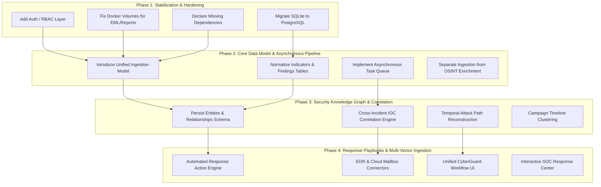

# 10 — Migration Roadmap & Architectural Compatibility Check

This document outlines a non-destructive, phased migration roadmap to transition CyberGuard from an email-forensics utility into an enterprise-grade AI Cyber Threat, Phishing, Impersonation Detection, Investigation, and Response platform.

It also provides an Architectural Compatibility Check evaluating the effort required to introduce the 12 core enterprise cybersecurity entities.

---

## 1. Architectural Migration Principles

1. **Strict Non-Destructive Evolution**: Existing working engines (parsers, forensic headers, static attachment inspection, deterministic scoring rules, Cytoscape graph generator, ReportLab dossier compiler) must not be rewritten. They will be wrapped in standardized provider interfaces.
2. **Unified Core Pipeline**: The platform will converge from siloed upload routes into a single workflow:
   $$\text{Ingestion} \longrightarrow \text{Orchestration} \longrightarrow \text{Detection Engines} \longrightarrow \text{Evidence / Findings} \longrightarrow \text{Knowledge Graph} \longrightarrow \text{Correlation} \longrightarrow \text{Attack Path} \longrightarrow \text{Response} \longrightarrow \text{Reporting}$$
3. **Decoupled Asynchronous Enrichment**: External OSINT queries (DNS, RDAP, WHOIS, IP-API) must run asynchronously in background workers, decoupling immediate ingestion response from external network latency.
4. **Authoritative Backend Security Facts**: Deprecate client-side threat scoring, confidence resolution, and attribution overrides. The backend serves verified, reproducible security evaluations.
5. **Separation of Evidence and AI Interpretation**: Raw forensic telemetry (hashes, headers, relay timestamps) is strictly separated from AI/LLM probabilistic hypotheses.

---

## 2. Phased Migration Roadmap

---

### Phase 1: Foundation Hardening & Integrity (Immediate Priority)
- **Goal**: Resolve all architectural blockers and vulnerabilities identified in the audit without modifying business logic.
- **Milestones**:
  1. **Dependencies**: Add `reportlab>=4.0.0` and `pillow>=10.0.0` to `backend/requirements.txt`.
  2. **Docker Storage**: Configure named volumes in `docker-compose.yml` for `eml_store` and `reports`.
  3. **Database Migration**: Complete the transition from local SQLite file storage to PostgreSQL with Alembic migrations, dropping obsolete orphan prototype tables (`emails`, `iocs`, `email_iocs`, `email_relationships`, `analysis_runs`).
  4. **Authentication & RBAC**: Introduce FastAPI OAuth2/JWT middleware with roles:
     - `SOC_ANALYST_L1`: Read-only case review and artifact upload.
     - `SOC_ANALYST_L2`: Finding creation, note authoring, report generation.
     - `INCIDENT_COMMANDER`: Case closure, workspace reset, response playbook execution.
     - `ADMIN`: User management, API key rotation, system configuration.

---

### Phase 2: Unified Ingestion & Asynchronous Orchestration
- **Goal**: Expand ingestion beyond `.eml` files to multi-vector artifacts while decoupling synchronous network bottlenecks.
- **Milestones**:
  1. **Unified Artifact Model**:
     - Generalize `backend/models/evidence.py` into a polymorphic `Artifact` model supporting emails, file binaries, network PCAPs, URLs, and memory dumps.
  2. **Asynchronous Execution Queue**:
     - Integrate Redis + ARQ (or Celery) for background processing.
     - Split `/api/emails/analyze` into:
       - **Fast Synchronous Parsing**: MIME parsing, SHA-256 calculation, header extraction, static attachment triage, heuristic scoring (< 400ms).
       - **Asynchronous Enrichment Workers**: DNS lookups, RDAP WHOIS queries, IP geolocation, ThreatFox/AbuseIPDB reputation scoring.
  3. **Real-time Event Streaming**:
     - Introduce WebSocket or Server-Sent Events (SSE) at `/api/cases/{id}/stream` to push asynchronous enrichment findings directly to the frontend graph.

---

### Phase 3: Security Knowledge Graph & Cross-Incident Correlation
- **Goal**: Transition from isolated per-email Cytoscape views to an enterprise security knowledge graph.
- **Milestones**:
  1. **Persistent Entity & Relationship Schema**:
     - Normalize in-memory graph elements into `entities` (Users, Hosts, Mailboxes, Domains, IPs) and `relationships` (COMMUNICATED_WITH, DOWNLOADED, RESOLVED_TO, AUTHENTICATED_FROM).
  2. **Cross-Case Correlation Engine**:
     - Expand `CampaignCorrelationService` to continuously index newly ingested artifacts against all historical cases.
     - Flag recurring adversary infrastructure (e.g. reused ASN, shared registrant, identical fuzzy attachment hash).
  3. **Attack Path Reconstruction**:
     - Develop an algorithm that traverses the knowledge graph temporally, mapping observed events to MITRE ATT&CK stages:
       $$\text{Phishing Link (T1566.002)} \longrightarrow \text{User Execution (T1204)} \longrightarrow \text{C2 Callback (T1071)} \longrightarrow \text{Exfiltration (T1048)}$$

---

### Phase 4: Automated Response & Unified CyberGuard UI
- **Goal**: Transform passive analysis into active remediation and streamline frontend navigation into the target workflow.
- **Milestones**:
  1. **Response Action Framework**:
     - Introduce `response_actions` table tracking remediation tasks.
     - Implement response drivers:
       - Google Workspace / Microsoft 365: Message recall & mailbox purge.
       - Firewall / DNS: Domain & IP sinkholing / blocking.
       - Identity Provider (IdP): Revoke active user session & force MFA reset.
  2. **Frontend Workflow Unification**:
     - Restructure top-level navigation from disconnected tool tabs to the 5-stage CyberGuard workflow:
       $$\text{Dashboard / Ingestion} \longrightarrow \text{Analysis} \longrightarrow \text{Investigation} \longrightarrow \text{Response} \longrightarrow \text{Reporting}$$
     - Refactor monolithic components (`CaseDetail.tsx`, `ReportSectionView.tsx`) into modular widget assemblies.

---

## 3. Architectural Compatibility Check

Evaluation of the 12 core cybersecurity concepts required for the future CyberGuard platform:

| Core Concept | Compatibility Rating | Implementation Effort | Architectural Rationale & Strategy |
|---|:---:|:---:|---|
| **Artifact** | **EASY** | Low | The existing `Evidence` model in `backend/models/evidence.py` already implements file storage, SHA-256 hashing, MIME typing, and relational links. Generalizing it into an abstract base `Artifact` class (supporting emails, files, PCAPs, URLs) requires simple inheritance and a discriminator column. |
| **ThreatEvent** | **MODERATE** | Medium | Current events are represented as discrete stages within an email's transport hops or audit logs. Introducing a generic `ThreatEvent` entity requires a dedicated time-series table indexed on `(timestamp, event_type, actor_id, target_id)` to ingest authentication logs, network flows, and email deliveries. |
| **AnalysisRun** | **EASY** | Low | The codebase already maintains an `email_analyses` table recording model versions, timestamps, threat scores, and JSON outputs, plus an unused `analysis_runs` prototype table. Formalizing `AnalysisRun` to track any engine execution against any `Artifact` is straightforward. |
| **Finding** | **EASY** | Low | The `CaseFinding` model in `backend/models/case_finding.py` already includes title, description, severity, status, MITRE ATT&CK technique IDs, and evidence associations. Promoting this to a universal `Finding` model requires minimal schema adjustment. |
| **Evidence** | **COMPLETED** | Done | Implemented via `FindingEvidenceModel` (`finding_evidence` table) linking machine-readable observations to findings, alongside legacy `evidence` table. |
| **Indicator** | **COMPLETED** | Done | Implemented via `IndicatorModel` (`indicators` table) with canonical normalization, deduplication on `(indicator_type, normalized_value)`, and reputation. |
| **Entity** | **COMPLETED** | Done | Implemented via `EntityModel` (`entities` table) with external IDs, attribute tracking, and first/last seen timestamps. |
| **Relationship** | **COMPLETED** | Done | Implemented via `RelationshipModel` (`relationships` table) providing polymorphic Security Knowledge Graph persistence with confidence and method. |
| **Incident** | **COMPLETED** | Done | Implemented via `IncidentModel` (`incidents` table) with `INC-YYYY-XXXXXX` numbering, bi-directional ThreatEvent linkage, and legacy case adapter pointer. |
| **AttackPath** | **PREPARED** | Done | Foundational schema implemented via `AttackPathModel`, `AttackStageModel`, and `AttackEdgeModel` tables; ready for traversal engine in Section 3. |
| **ResponseAction** | **COMPLETED** | Done | Implemented via `ResponseActionModel` (`response_actions` table) tracking action types, approval workflows, and execution states. |
| **ModelVersion** | **COMPLETED** | Done | Implemented via `ModelVersionModel` (`model_versions` table) tracking model provenance, algorithms, training references, and metrics. |

---

## 4. Section 2 Progress & Implementation Summary

**Section 2 Status: COMPLETED**

1. **Alembic Migration Applied**: Revision `b7e2a901c43f` created all 14 canonical tables, indexes, and additive `request_id` column on `audit_logs`.
2. **Unified Schemas & Enums**: Defined in `backend/schemas/unified.py` with canonical Pydantic V2 models, standardized enums, and normalization rules.
3. **Service Layer**: Fully functional `ArtifactService`, `AnalysisService`, `FindingService`, `IndicatorService`, `EntityService`, `RelationshipService`, `ThreatEventService`, `IncidentService`, and `ModelVersionService` in `backend/services/unified_service.py`.
4. **Non-Destructive Dual-Write**: Ingestion adapter hooked into `POST /api/emails/analyze` to dual-write normalized records while preserving 100% of legacy behavior and endpoints.
5. **Inspection API**: Minimal inspection routes added at `/api/unified/*` and `/api/*` for inspecting artifacts, analysis runs, findings, indicators, relationships, and incidents.
6. **Testing**: 19 unit & integration tests in `backend/tests/test_unified_data_model.py` passing, with 100% backward compatibility across all legacy test suites.

---

## 5. Section 3 Progress & Implementation Summary

**Section 3 Status: COMPLETED**

1. **Persistent Evidence Storage Abstraction**: Implemented `StorageBackend` abstract class and `LocalStorageBackend` concrete class in `backend/services/evidence_storage.py` featuring streaming SHA-256 calculation, atomic staging (`tmp/.tmp_<uuid>`), atomic rename, and robust path traversal protections.
2. **Alembic Migration Applied**: Revision `c1f4a82b9e3d` created `artifact_storage_records` and `ingestions` tables with foreign keys to `artifacts`, plus additive columns on `reports` (`artifact_id`, `analysis_run_id`, `sha256`, `format`, `generator_version`).
3. **Content Identity vs Ingestion Provenance**: Separated physical content identity (`ArtifactModel`, `ArtifactStorageRecordModel`) from discrete ingestion provenance (`IngestionRecordModel`). Duplicate content uploads share physical bytes while preserving discrete provenance records.
4. **Append-Oriented Analysis History**: Enhanced `AnalysisService.reanalyze_artifact` to guarantee that re-analysis never overwrites historical `AnalysisRunModel` records or associated findings.
5. **Evidence Integrity Verification**: Implemented SHA-256 on-demand verification (`StorageRecordService.verify_artifact_integrity`) detecting `VERIFIED`, `MISMATCH`, and `MISSING` states without silent failures.
6. **Safe Evidence Retrieval**: Implemented `GET /api/unified/artifacts/{id}/download` streaming files with proper headers and zero raw filesystem path disclosure to clients.
7. **Report Persistence**: Enhanced report generation to persist PDFs into `evidence_storage` with cryptographic hashing and link them to artifacts and analysis runs.
8. **Docker Persistence**: Added named volume mappings in `docker-compose.yml` for `cyberguard_storage` (`/app/backend/data/storage`), `eml_evidence_data`, and `reports_data`.
9. **Storage Maintenance**: Implemented orphan detection (`/api/unified/maintenance/orphans`) and legacy backfill utility (`/api/unified/maintenance/backfill`).
10. **Testing & Verification**: 20 comprehensive unit/integration tests in `backend/tests/test_evidence_storage.py` covering persistence, integrity, deduplication, re-analysis, traversal protection, size limits, and restart survival; all 303 test cases passing across the entire test suite.

---

## 6. Section 4 Progress & Implementation Summary

**Section 4 Status: COMPLETED**

1. **Universal Ingestion Gateway Service**: Implemented `UniversalIngestionService` in `backend/services/universal_ingestion.py` accepting diverse evidence streams through a single backend layer, supporting `FILE_UPLOAD`, `TEXT_INPUT`, `STRUCTURED_EVENT`, and preparing for telemetry/connectors.
2. **Multi-Tiered Deterministic Type Detection**: Built `TypeDetector` utilizing magic byte signatures (PNG, JPEG, GIF, WebP, BMP, TIFF, WAV, MP3, MP4, MKV, AVI, PDF, ZIP, GZ, 7z, PE, ELF), RFC-822 email header structural heuristics, Python standard library `ipaddress` parsing, `urllib.parse` URL parsing, domain regex with defang translation, email address validation, and JSON structural classification. LLMs are strictly excluded as primary file type detectors.
3. **Forensic Normalization Pipeline**: Implemented standards-aware canonical normalization for URLs (lowercase scheme & host, port normalization, percent-encoding), domains (lowercasing, un-defanging, trailing dot removal), IP addresses (IPv4 octet normalization, canonical IPv6 RFC-5952 representation), and email addresses, while preserving exact raw/original values.
4. **Strict SSRF Boundary**: Enforced zero automatic URL fetching during ingestion. Inputs like `http://127.0.0.1/`, `http://localhost/`, and `http://169.254.169.254/` are classified, normalized, and persisted purely as static text evidence without outbound network dispatch. Internal/private/loopback IPs are annotated with `is_internal_network: true` and audited.
5. **Capability & Routing Registry**: Created `CapabilityRegistry` maintaining operational states (`AVAILABLE`, `DISABLED`, `NOT_CONFIGURED`, `NOT_IMPLEMENTED`). Registered 12 active analyzers (`email_forensics`, `email_authentication`, `ioc_extraction`, `nlp_phishing_detector`, `url_intelligence`, `domain_intelligence`, `ip_intelligence`, `attachment_security`, `file_metadata`, `qr_code_analyzer`, `auth_event_parser`, `api_log_parser`) and marked future deepfake/EDR modules as `NOT_IMPLEMENTED`.
6. **Separation of Routing from Execution**: The gateway determines candidate analysis pipelines (`candidate_analyzers`) without executing them, maintaining fast, non-blocking ingestion and deferring workflow scheduling to Section 5.
7. **Derived Artifact Provenance**: Implemented `UniversalIngestionService.register_derived_artifact` allowing downstream analyzers to register child artifacts (e.g. extracted attachments, QR code URLs) with cryptographic hashing, parent-child links, and knowledge graph relationship edges (`RelationshipModel`).
8. **Polymorphic Ingestion API**: Added `POST /api/ingest` (supporting both multipart file uploads and JSON text/event payloads), subroutes (`/api/ingest/file`, `/api/ingest/text`, `/api/ingest/event`), pre-flight detection (`POST /api/ingest/detect`), and capability enumeration (`GET /api/ingest/capabilities`).
9. **Backward Compatibility**: Fully preserved legacy endpoints (`/api/emails/analyze`, `/api/reports/generate`, etc.) and data models.
10. **Testing & Verification**: Added 29 comprehensive test cases in `backend/tests/test_universal_ingestion.py` verifying all 25 specification scenarios, SSRF defense, multi-input integration, and capabilities; all 332 tests in the repository pass with zero errors.

### Architectural Decisions Affecting Section 5 (Analysis Orchestrator)
- **Decoupled Candidate Routing**: Section 4 returns candidate analyzer identifiers (`candidate_analyzers`). Section 5's Orchestrator will consume these candidates, evaluate dependency graphs, check analyzer availability, and dispatch execution tasks.
- **Artifact-Driven Analysis**: All analyzers in Section 5 must accept an `artifact_id` and read evidence from `evidence_storage` rather than relying on ephemeral HTTP upload files.
- **Dynamic Derived Ingestion**: When Section 5 analyzers discover secondary evidence (e.g., attachments inside emails or URLs inside images), they must call `UniversalIngestionService.register_derived_artifact` to spawn child artifacts and trigger child analysis runs.

---

## 7. Section 6 Progress & Implementation Summary

**Section 6 Status: COMPLETED**

1. **Modular Email Intelligence Architecture**: Built a multi-stage, evidence-driven email and phishing analysis engine implementing the unified `AnalyzerExecutionResult` interface across 9 discrete analyzers:
   - `EmailParserAnalyzer`: RFC-822 / RFC-2047 parsing, header normalization (display name, email address, domain decomposition), and MIME boundary extraction.
   - `EmailAuthenticationAnalyzer`: SPF, DKIM, and DMARC result parsing with strict provenance distinction (parsed upstream vs locally verified).
   - `EmailHeaderAnalyzer`: Sender identity alignment (From vs Return-Path, From vs Reply-To, Display Name spoofing) and legitimate mailing list suppression.
   - `EmailRelayAnalyzer`: SMTP `Received` chain reconstruction, transit latency calculation, private/public boundary detection, and relay anomaly identification.
   - `EmailAttachmentDiscoveryAnalyzer`: Safe static attachment extraction into Section 3 content-addressed storage, SHA-256 fingerprinting, derived Artifact creation, and static metadata risk triage (`SUSPICIOUS_ATTACHMENT_TYPE`).
   - `EmailIOCAnalyzer`: Extraction of URLs, domains, IPs, and email addresses with provenance mapping (e.g. `HTML_BODY`, `RECEIVED_HEADER_0`) and deceptive visible link mismatch detection (`VISIBLE_LINK_MISMATCH`).
   - `EmailSocialEngineeringAnalyzer`: Linguistic and heuristic analysis for urgency, credential solicitation, account suspension, financial/wire requests, and ML text classification.
   - `EmailImpersonationAnalyzer`: Contextual lookalike domain detection (Levenshtein distance, homoglyph substitution, brand abuse keywords) and BEC signal detection.
   - `EmailPhishingAggregator`: Multi-category evidence corroboration (`AUTHENTICATION`, `IDENTITY`, `URL`, `DOMAIN`, `CONTENT`, `ATTACHMENT`, `INFRASTRUCTURE`) ensuring signal independence and preventing redundant double-counting.

2. **Canonical Persistence Integration**:
   - `AnalysisRunModel`: Tracks individual execution sessions with pipeline version, status, start/complete timestamps, overall risk score, overall severity, confidence, and forensic summaries.
   - `FindingModel`: Persists machine-readable analytical observations with standardized severities (`SAFE`, `LOW`, `MEDIUM`, `HIGH`, `CRITICAL`), detection methods (`DETERMINISTIC`, `RULE`, `HEURISTIC`, `ML`), and MITRE ATT&CK references.
   - `FindingEvidenceModel`: Links each finding directly to verified factual evidence (`key`, `value`, `source`, `confidence`, `timestamp`, `artifact_id`).
   - `IndicatorModel`: Normalizes and deduplicates reusable observables (`URL`, `DOMAIN`, `IP`, `EMAIL_ADDRESS`, `FILE_HASH`).
   - `RelationshipModel`: Constructs security knowledge graph edges (`EMAIL CONTAINS ATTACHMENT`, `EMAIL REFERENCES URL`, `EMAIL REFERENCES DOMAIN`, `EMAIL OBSERVED_RELAY IP`).
   - `ThreatEventModel`: Creates normalized incident events (`PHISHING_ATTEMPT`, `EMAIL_IMPERSONATION`, `SUSPICIOUS_EMAIL`) when corroborated high-severity findings exist.

3. **False-Positive Mitigation**:
   - Legitimate mailing lists (`List-Id`, `List-Unsubscribe`, `Precedence: list`) suppress sender mismatch alerts.
   - Isolated SPF `none`/`unknown` does not elevate benign emails to phishing.
   - Marketing urgency alone without corroborating deceptive URLs or credential harvesting does not trigger phishing verdicts.
   - Legitimate security newsletters discussing phishing or malware do not trigger false alarms.

4. **API Endpoints**:
   - `POST /api/emails/pipeline/analyze`: Accepts multipart `.eml` uploads, executes the full orchestrated pipeline, persists canonical records, and returns full backward-compatible `EmailAnalysisResponse`.
   - `POST /api/emails/analyze-artifact/{artifact_id}`: Re-analyzes an existing durable artifact loaded directly from `evidence_storage`.
   - `POST /api/emails/analyze`: Fully preserved legacy endpoint routing into the upgraded pipeline.

5. **Capabilities Breakdown**:
   - **REUSED**:
     - `AuthAnalyzerService` (SPF/DKIM/DMARC evaluation logic)
     - `RelayReconstructorService` (SMTP Received hop traversal)
     - `LookalikeDetectorService` (Levenshtein edit distance & homoglyph detection)
     - `AttachmentIntelligenceService` (Static attachment feature extraction)
     - `IOCExtractorService` (Regex observable extraction and IP scope classification)
     - `URLAnalyzerService` (Static URL feature evaluation)
     - `ThreatScorerService` (Deterministic global threat score computation)
     - `global_phishing_classifier` (Trained TF-IDF + SGD text model)
     - `EvidenceConfidenceEngine` (Confidence score synthesis)
     - `global_ai_analyst_service` (Auxiliary LLM forensic explanation)
     - `global_graph_service` (Investigation graph synthesis)
   - **REFACTORED**:
     - `EmailAnalysisResponse` payload construction (unified schema alignment, dual flat/nested support)
     - `EmailParserService` (modularized into RFC-822 analyzer with separate display name / domain / email decomposition)
     - `generate_uuid()` in `backend/db/models.py` (accept optional prefix parameter without breaking arity)
   - **NEW**:
     - `backend/services/email_analyzers.py`: 9 modular analyzers implementing `AnalyzerExecutionResult`
     - `backend/services/email_intelligence_pipeline.py`: Pipeline coordinator, canonical persistence layer, and legacy response builder
     - `VISIBLE_LINK_MISMATCH` deceptive hyperlink detection
     - `MAILING_LIST_TRANSPORT_PATTERN` false-positive suppressor
     - `backend/tests/test_email_intelligence_pipeline.py`: 37 comprehensive test cases
     - `docs/architecture/15-email-phishing-engine.md`: Comprehensive architectural documentation and finding catalog
   - **DEFERRED**:
     - Dynamic attachment execution / sandboxing (Deferred to Section 8)
     - Unified Risk Engine (Deferred to Section 26)
     - Automated response actions / mailbox quarantine (Deferred to Section 27)
     - Deepfake / audio / video analysis (Deferred to Section 13)

6. **Testing & Verification**:
   - 37 comprehensive unit, integration, and false-positive tests in `backend/tests/test_email_intelligence_pipeline.py`.
   - Full regression suite execution: **369 passed, 0 failed** across the entire repository.

---

## 8. Section 7 Progress & Implementation Summary

**Section 7 Status: COMPLETED**

1. **Centralized Network Safety Gateway (`SafeHttpClient`)**:
   - Strictly defends against SSRF attacks targeting localhost, loopback (`127.0.0.0/8`, `::1`), private RFC-1918 networks (`10.0.0.0/8`, `172.16.0.0/12`, `192.168.0.0/16`, `fc00::/7`), link-local (`169.254.0.0/16`, `fe80::/10`), cloud metadata (`169.254.169.254`, `fd00:ec2::254`, `metadata.google.internal`), multicast, reserved, and Carrier-Grade NAT (`100.64.0.0/10`).
   - Enforces per-hop redirect validation with strict maximum limit (`max_redirects=5`) and zero blind redirect following.
   - Streams payloads up to 1 MB max size with automatic truncation detection (`is_truncated`).
   - Conducts safe read-only TLS handshake extracting subject CN, issuer, dates, SANs, and distinguishing configuration errors from malicious signals.

2. **Passive-First URL Analyzer (`PassiveURLAnalyzer`)**:
   - Standards-aware decomposition: scheme, hostname, port, path, query, fragment, userinfo.
   - Signals: `URL_USERINFO_PRESENT`, `IP_LITERAL_HOST`, `NON_STANDARD_PORT`, `EXCESSIVE_SUBDOMAINS`, `DECEPTIVE_SUBDOMAIN_HIERARCHY`, `PUNYCODE_DOMAIN`, `SUSPICIOUS_PATH_TOKENS`, `SUSPICIOUS_DOWNLOAD_EXTENSION`, `KNOWN_URL_SHORTENER`, `NON_HTTP_SCHEME`.

3. **Domain Infrastructure Intelligence (`DomainIntelligenceAnalyzer`)**:
   - Public Suffix List aware domain and subdomain extraction using `tldextract`.
   - Homoglyph and lookalike detection (`LookalikeDetectorService`) against protected reference targets.
   - DNS infrastructure resolution (`DNSService`) mapping `A`, `AAAA`, `MX`, `NS`, `TXT` records to security graph relationships (`RESOLVES_TO`, `MAIL_EXCHANGER`, `USES_NAMESERVER`).
   - RDAP / WHOIS registration metadata (`RDAPService`) computing domain age (`RECENTLY_REGISTERED_DOMAIN`) and handling privacy redactions neutrally (`REGISTRATION_DATA_REDACTED`).
   - Cached threat intelligence (`ThreatIntelligenceService`) with TTL caching and explicit rate-limit handling (`THREAT_INTEL_RATE_LIMITED`).

4. **Safe Website Static Inspector (`SafeWebsiteAnalyzer` & `WebsiteInspector`)**:
   - Observational static HTML parsing with standard library `HTMLParser`.
   - Zero JavaScript execution; zero form submission.
   - Extracted indicators: `PASSWORD_FIELD_DETECTED`, `LOGIN_FORM_DETECTED`, `CROSS_DOMAIN_FORM_ACTION`, `CREDENTIAL_HARVESTING_INDICATORS`.
   - Discovered download URLs recorded as indicators and linked via `REFERENCES` relationships.

5. **Canonical Persistence & Re-Analysis Lineage**:
   - Durable persistence across `ArtifactModel`, `AnalysisRunModel`, `FindingModel`, `FindingEvidenceModel`, `IndicatorModel`, `RelationshipModel`, and `ThreatEventModel`.
   - Append-only re-analysis: re-analyzing an existing artifact generates a new independent `AnalysisRunModel` preserving historical observation changes.

6. **FastAPI Endpoints**:
   - `POST /api/urls/analyze`: Complete URL investigation with passive + active analysis.
   - `POST /api/urls/analyze-domain`: Direct domain intelligence analysis.
   - `POST /api/urls/analyze-artifact/{artifact_id}`: Re-analysis of durable stored artifacts.
   - `GET /api/urls/config`: Engine configuration and network safety parameters.

7. **Testing & Verification**:
   - 37 tests in `backend/tests/test_domain_intelligence.py` covering SSRF prevention, redirect hops, passive URL tokens, homoglyphs, DNS/RDAP resolution, and HTML inspection.
   - Full regression test suite passing cleanly.

---

## 9. Section 8 Progress & Implementation Summary

**Section 8 Status: COMPLETED**

1. **Modular Static File Security Architecture**: Built a multi-analyzer static file analysis pipeline implementing the `AnalyzerExecutionResult` interface across 9 discrete analyzers:
   - `FileIdentityAnalyzer`: Streaming SHA-256 (primary integrity primitive), SHA-1, and MD5 (threat intelligence interoperability); exact byte size; safe MIME / file signature inspection (`python-magic` with fallback to comprehensive file signature dictionary); detection of `FILE_TYPE_MISMATCH` when claimed extension conflicts with detected MIME/signature.
   - `FilenameSecurityAnalyzer`: Path traversal defense (`SAFE_DISPLAY_NAME`), detection of double extensions (`DOUBLE_EXTENSION`), misleading extension chains, deceptive Unicode bidirectional control characters (`UNICODE_FILENAME_DECEPTION` with exact codepoints such as `\u202e` Right-To-Left Override), executable/script attachment warnings (`EXECUTABLE_ATTACHMENT`, `SCRIPT_ATTACHMENT`), and macro-capable document warnings (`MACRO_CAPABLE_DOCUMENT_EXTENSION`).
   - `DocumentStaticAnalyzer`: Safe static inspection of PDF and Office formats without executing JavaScript, launching viewer applications, or executing macros:
     - PDF: Active token detection (`/JavaScript`, `/OpenAction`, `/Launch`, `/EmbeddedFiles`, `/URI`, `/Encrypt`), external hyperlink extraction, object count bounds, producing `PDF_JAVASCRIPT_PRESENT`, `PDF_OPEN_ACTION_PRESENT`, `PDF_LAUNCH_ACTION_PRESENT`, `PDF_EMBEDDED_FILE`, `PDF_ENCRYPTED`, `PDF_EXTERNAL_URL`.
     - Office: OpenXML/OLE container inspection, macro detection (`vbaProject.bin`, `word/vbaProject.bin`, `macros/`), external relationship detection (`Type=".../attachedTemplate"`), embedded OLE objects, producing `MACRO_PRESENT`, `SUSPICIOUS_DOCUMENT_RELATIONSHIP`, `EMBEDDED_OBJECT_PRESENT`.
   - `ExecutableStaticAnalyzer`: Safe binary structure inspection of Portable Executable (PE) headers without execution or library loading: machine architecture, COFF compile timestamp (as untrusted metadata), section table enumeration, section-level Shannon entropy calculation, Authenticode digital signature detection, and suspicious import detection (`SUSPICIOUS_IMPORT_SET`, `HIGH_ENTROPY_SECTION`, `EXECUTABLE_UNSIGNED`, `EXECUTABLE_SIGNATURE_INVALID`).
   - `ScriptStaticAnalyzer`: Bounded deterministic static keyword and pattern inspection for script artifacts (`.ps1`, `.bat`, `.cmd`, `.sh`, `.vbs`, `.js`, `.py`): encoded PowerShell (`-enc`, `FromBase64String`), download invocation (`Invoke-WebRequest`, `curl`, `certutil`), execution chains (`cmd /c`, `IEX`), credential harvesting indicators (`Invoke-Mimikatz`, `lsass`), and persistence mechanisms (`schtasks`, `reg add`), producing `SUSPICIOUS_STATIC_SCRIPT`.
   - `ArchiveSecurityAnalyzer`: Safe archive inspection for ZIP, TAR, GZIP containers with strict defensive bounds:
     - Zip-Slip path traversal defense: Rejection of `../` traversal or absolute paths (`ZIP_SLIP_ATTEMPT_DETECTED`).
     - Zip-Bomb protection: Strict limits on total uncompressed size (default 100 MB), total entry count (default 500), compression ratio (default 50x), producing `ARCHIVE_EXTRACTION_LIMIT_REACHED`.
     - Password protection: Detecting encrypted entries (`ARCHIVE_ENCRYPTED`) without brute-forcing or treating encryption as automatic proof of malware.
     - Safe derived artifact extraction: Storing extracted child entries in durable evidence storage with `ARCHIVE CONTAINS FILE` relationship links up to configurable recursion depth (`MAX_ARCHIVE_DEPTH = 3`).
   - `FileIOCAnalyzer`: Bounded printable string and regex observable extraction across all text and binary files: URLs, domains, IPv4 addresses, email addresses, and hashes with provenance tracking and deduplication.
   - `FileReputationAnalyzer`: Privacy-preserving threat intelligence lookup by SHA-256 (and SHA-1/MD5 where needed) via `ThreatIntelligenceService` with TTL caching:
     - **Strict Privacy Rule**: Only hashes are queried externally; raw sample bytes are NEVER uploaded to third-party services.
     - **Strict Negative Evidence Rule**: `NO MATCH != SAFE` (`THREAT_INTEL_HASH_MATCH` vs `THREAT_INTEL_HASH_NOT_FOUND`).
   - `FileClassificationService`: Conservative risk classification (`BENIGN_LIKELY`, `UNKNOWN`, `SUSPICIOUS`, `MALWARE_SUSPECTED`, `KNOWN_MALICIOUS`) where `KNOWN_MALICIOUS` requires authoritative reputation matches or malicious signatures, and isolated signals (macros, high entropy, unsigned status) are never over-claimed.

2. **Canonical Persistence Integration**:
   - `ArtifactModel`: Registers file artifacts with SHA-256 content addressing and safe display names.
   - `AnalysisRunModel`: Tracks each discrete file security evaluation session.
   - `FindingModel` & `FindingEvidenceModel`: Persists structured machine-readable findings and evidentiary proofs.
   - `IndicatorModel`: Records discovered cryptographic hashes and printable string IOCs.
   - `RelationshipModel`: Persists `HAS_HASH`, `CONTAINS`, and `REFERENCES` relationships.
   - `ThreatEventModel`: Emits security events when malicious indicators or high-risk findings are corroborated.

3. **API Endpoints**:
   - `POST /api/files/analyze`: Multipart upload and complete static file analysis.
   - `POST /api/files/analyze-artifact/{artifact_id}`: Re-analysis of stored durable artifacts creating a new independent `AnalysisRunModel`.
   - `GET /api/files/config`: Runtime configuration, security thresholds, and safety bounds.

4. **Testing & Verification**:
   - 41 tests in `backend/tests/test_file_security_analyzer.py` covering all 34 required test cases: streaming hashing, MIME mismatch, double extensions, Unicode RTL override, safe PDF token parsing, Office macro/template detection, script heuristic detection, PE header inspection, Shannon entropy, Zip-Slip rejection, Zip-Bomb limits, encrypted archives, child artifact extraction, reputation caching, privacy rules, false-positive resistance, and a synthetic multi-stage integration test (`Email -> ZIP -> PDF -> URL`).
   - Full test suite passing: **447 passed, 0 failed** in 61 seconds.

5. **Requirements for Section 9 (Identity, Credential & Authentication Security)**:
   - Handled in Section 9 Authentication & Account-Takeover Detection Engine.

---

## 10. Section 9 Progress & Implementation Summary

**Section 9 Status: COMPLETED**

1. **Modular Authentication & ATO Detection Architecture**: Built an explainable, deterministic/heuristic authentication security engine with multi-provider log normalization, baseline comparison, and multi-category ATO hypothesis aggregation:
   - `NormalizedAuthEvent`: Canonical representation of authentication attempts with standardized result states (`SUCCESS`, `FAILURE`, `CHALLENGE`, `MFA_REQUIRED`, `MFA_SUCCESS`, `MFA_FAILURE`, `LOCKED`, `DENIED`, `UNKNOWN`), auth methods, MFA factors, failure reasons, geolocation, device identifiers, and client profile normalization.
   - `SecretRedactor`: Zero raw password or credential leakage; automatically redacts passwords, tokens, API keys, session secrets, and authorization headers to `[REDACTED_BY_CYBERGUARD]`.
   - `AdapterRegistry`: Multi-provider log adapters for Okta System Log, Microsoft Entra ID (Azure AD), Google Workspace Login Audits, Linux OpenSSH/Syslog, and a universal `GenericAuthAdapter`.
   - `FailureAnalysisEngine`: Detects repeated failures (`REPEATED_LOGIN_FAILURES`) and defensive account lockouts (`ACCOUNT_LOCKED`).
   - `BruteForceDetector`: Detects concentrated password guessing against a single account (`BRUTE_FORCE_PATTERN`, MITRE `T1110.001`).
   - `PasswordSprayDetector`: Detects low-and-slow horizontal password spray across multiple accounts from single sources (`PASSWORD_SPRAY_PATTERN`, MITRE `T1110.003`).
   - `CredentialStuffingDetector`: Detects high-volume testing of credential dumps (`CREDENTIAL_STUFFING_SUSPECTED`, MITRE `T1110.004`).
   - `SuccessAfterFailuresDetector`: Identifies sequence of consecutive failures followed immediately by successful entry (`SUCCESS_AFTER_REPEATED_FAILURES`).
   - `DeviceAnalysisEngine`: Identifies unfamiliar hardware (`NEW_DEVICE`) and substantially new OS/browser profiles (`NEW_CLIENT_PROFILE`) with strict `INSUFFICIENT_HISTORY` guards.
   - `LocationAnalysisEngine`: Identifies unseen source IPs (`NEW_SOURCE_IP`), unfamiliar geographic regions (`UNUSUAL_LOGIN_LOCATION`), and rapid location changes exceeding 900 km/h with Haversine great-circle calculation (`RAPID_LOCATION_CHANGE`), including proxy/VPN contextual caveats.
   - `TemporalAnalysisEngine`: Identifies authentications outside established activity hours (`UNUSUAL_LOGIN_TIME`).
   - `MFAAnalysisEngine`: Detects repeated MFA rejections (`REPEATED_MFA_FAILURES`) and policy bypass signals (`MFA_EXPECTATION_ANOMALY`).
   - `SessionAnalysisEngine`: Identifies concurrent session reuse across distinct IP subnets (`SUSPICIOUS_SESSION_ACTIVITY`).
   - `AccountTakeoverAggregator`: Corroborates ATO hypothesis (`ACCOUNT_TAKEOVER_SUSPECTED`) only when successful authentication occurs alongside at least 2 or 3 independent anomaly categories (`CREDENTIAL_ATTACK`, `DEVICE_ANOMALY`, `LOCATION_ANOMALY`, `MFA_ANOMALY`, `SESSION_ANOMALY`).

2. **Canonical Persistence Integration**:
   - `ArtifactModel`: Records container artifacts for ingested `AUTH_LOG` payloads.
   - `AnalysisRunModel`: Tracks individual evaluation runs with overall threat scores and severities.
   - `FindingModel` & `FindingEvidenceModel`: Persists structured machine-readable findings and evidentiary proofs.
   - `IndicatorModel`: Records source IPs with canonical normalized representations.
   - `EntityModel`: Persists `ACCOUNT`, `USER`, `DEVICE`, and `SESSION` entities.
   - `RelationshipModel`: Persists `AUTHENTICATED_FROM`, `AUTHENTICATED_ON`, and `HAS_SESSION` graph relationships.
   - `ThreatEventModel`: Emits security events for `ACCOUNT_TAKEOVER_SUSPECTED`, `BRUTE_FORCE_ATTACK`, `PASSWORD_SPRAY_ATTACK`, and `SUSPICIOUS_AUTHENTICATION`.

3. **API Endpoints**:
   - `GET /api/auth-security/config`: Runtime configuration, detection thresholds, and temporal windows.
   - `POST /api/auth-security/analyze-event`: Real-time analysis of single authentication events.
   - `POST /api/auth-security/analyze-batch`: Ingestion and processing of event batches.
   - `POST /api/auth-security/upload-log`: Log file upload (JSON array, JSON lines, Linux syslog).
   - `POST /api/auth-security/analyze-artifact/{id}`: Re-analysis of stored `AUTH_LOG` artifacts with append-only lineage.
   - `GET /api/auth-security/accounts/{id}/profile`: Historical baseline status and observed dimensions.

4. **Testing & Verification**:
   - 38 comprehensive tests in `backend/tests/test_authentication_security.py` covering event normalization, timestamp parsing, out-of-order sorting, deduplication, brute force, spray, impossible travel, new device, false-positive resistance, API routes, and synthetic performance benchmark.
   - Full regression test suite passing: **485 passed, 0 failed** in 64 seconds.

5. **Section 10 Implementation Summary (Network & Traffic Anomaly Detection Engine)**:
   - **Section 10 Status: COMPLETED**
   - Implemented canonical `NormalizedNetworkEvent` with rich transport attributes, DNS query/response telemetry, direction (`INBOUND`, `OUTBOUND`, `INTERNAL`, `UNKNOWN`), and IP scopes (`PUBLIC`, `PRIVATE`, `LOOPBACK`, `LINK_LOCAL`, `MULTICAST`, `RESERVED`).
   - Built modular log adapters: `GenericJsonNetworkAdapter`, `GenericCsvNetworkAdapter`, `DnsLogAdapter`, `NetflowJsonAdapter`.
   - Built specialized detection engines:
     - `ConnectionPatternEngine`: Repeated drops/failures (`REPEATED_CONNECTION_FAILURES`), scan-like port sweeps & host sweeps (`SCAN_LIKE_CONNECTION_PATTERN`), and high-frequency bursts (`CONNECTION_BURST`).
     - `PeriodicityEngine`: Statistical beaconing interval analysis ($\mu, \text{median}, \sigma^2, \text{CV} \le 0.20$ with minimum 5 observations) with explicit false-positive controls (severity MEDIUM with explicit caveat that benign software/cloud agents are periodic).
     - `DnsTelemetryEngine`: NXDOMAIN bursts (`EXCESSIVE_DNS_FAILURES`), lexical DGA heuristics (`DGA_LIKE_DOMAIN_STRUCTURE` with Shannon entropy and character distribution), DNS query bursts (`DNS_QUERY_BURST`), and tunneling indicators (`DNS_TUNNELING_INDICATORS`).
     - `TransferExfiltrationEngine`: High outbound volume transfers (`HIGH_OUTBOUND_DATA_VOLUME`), asymmetric flows (`OUTBOUND_TRAFFIC_ASYMMETRY`), and persistent sessions (`LONG_LIVED_EXTERNAL_CONNECTION`).
     - `DestinationAnomalyEngine`: Destination novelty (`NEW_NETWORK_DESTINATION`), new ports (`NEW_DESTINATION_PORT`), and fleet-wide rarity (`RARE_DESTINATION`), guarded by strict minimum history thresholds.
     - `NetworkPatternAggregator`: Multi-signal hypothesis corroboration for `SUSPICIOUS_EXTERNAL_COMMUNICATION` and `POSSIBLE_DATA_EXFILTRATION`.
   - Integrated full canonical persistence (`ArtifactModel`, `AnalysisRunModel`, `FindingModel`, `FindingEvidenceModel`, `EntityModel` for `DEVICE`/`SESSION`/`USER`, `IndicatorModel` for `IP`/`DOMAIN`, `RelationshipModel` for `CONNECTS_TO`/`QUERIED_DNS`/`HAS_SESSION`, `ThreatEventModel`).
   - Integrated with Section 4 Universal Ingestion (`ArtifactTypeEnum.NETWORK_LOG`) and registered operational capability `network_security_analyzer` in `CapabilityRegistry`.
   - Exposed REST API endpoints:
     - `GET /api/network-security/config`
     - `POST /api/network-security/analyze-event`
     - `POST /api/network-security/analyze-batch`
     - `POST /api/network-security/upload-log`
     - `POST /api/network-security/analyze-artifact/{id}`
     - `GET /api/network-security/devices/{id}/profile`
   - Verified with 38 unit and security tests in `backend/tests/test_network_security.py` and benchmarked at 2,411.2 events/second.
   - **Architectural Boundary Note**: Section 10 implements deterministic and statistical network telemetry analysis. Advanced behavioral baseline ML, auto-regressive forecasting, dynamic clustering, and continual learning are reserved for **Section 21 (Behavioral Baseline Engine)**.

6. **Section 11 Implementation Summary (API Abuse Detection Engine)**:
   - **Section 11 Status: COMPLETED**
   - Canonical `NormalizedAPIEvent` model supporting granular identity attribution (`account_id`, `session_id`, `device_id`), token cryptographic fingerprints (`tkfp_<hash>`), HTTP semantics, status codes, query redaction, and egress bytes.
   - Built modular log adapters: `GenericJsonApiAdapter`, `GenericCsvApiAdapter`, `GatewayJsonApiAdapter`.
   - Built specialized detection engines:
     - `APIRateBurstEngine`: High request volume (`HIGH_API_REQUEST_RATE`) and concentrated spikes (`API_REQUEST_BURST`).
     - `APIEnumerationEngine`: Route traversal (`API_ENDPOINT_ENUMERATION_PATTERN`) and sequential resource probing (`RESOURCE_ENUMERATION_PATTERN`).
     - `APIAuthFailureEngine`: Authentication denials (`REPEATED_API_AUTH_FAILURES`), authorization barriers (`REPEATED_AUTHORIZATION_FAILURES`), and missing endpoints (`HIGH_MISSING_ENDPOINT_RATE`).
     - `APIMethodPrivilegeEngine`: Unusual destructive HTTP methods (`UNUSUAL_API_METHOD`) and sensitive administrative access (`PRIVILEGED_API_OPERATION`).
     - `APISessionAnomalyEngine`: IP shifting (`SESSION_SOURCE_CHANGE`), rapid hijacking indicators (`RAPID_SESSION_SOURCE_CHANGE`), client profile changes (`API_CLIENT_PROFILE_CHANGE`), and first-time endpoint access (`NEW_API_ENDPOINT`).
     - `APIVolumeScrapingEngine`: High egress volume (`HIGH_API_RESPONSE_VOLUME`), bulk export activity (`UNUSUAL_BULK_EXPORT_ACTIVITY`), scraping patterns (`SCRAPING_LIKE_API_ACTIVITY`), and bot periodicity (`PERIODIC_API_ACTIVITY`).
     - `APIPatternAggregator`: Cross-engine corroboration for `API_ABUSE_SUSPECTED` and `POSSIBLE_API_DATA_EXFILTRATION`.
   - Cross-module correlation with Section 9 (`ACCOUNT_TAKEOVER_SUSPECTED`) and Section 10 (`SUSPICIOUS_EXTERNAL_COMMUNICATION`).
   - Integrated full canonical persistence (`ArtifactModel`, `AnalysisRunModel`, `FindingModel`, `FindingEvidenceModel`, `EntityModel` for `ACCOUNT`/`SESSION`/`SERVICE`, `IndicatorModel` for `IP`, `ThreatEventModel`).
   - Integrated with Section 4 Universal Ingestion (`ArtifactTypeEnum.API_LOG`) and registered operational capability `api_abuse_analyzer` in `CapabilityRegistry`.
   - Exposed REST API endpoints:
     - `GET /api/api-security/config`
     - `POST /api/api-security/analyze-event`
     - `POST /api/api-security/analyze-batch`
     - `POST /api/api-security/upload-log`
     - `POST /api/api-security/reanalyze/{artifact_id}`
     - `GET /api/api-security/account/{account_id}`
   - Verified with 34 comprehensive tests in `backend/tests/test_api_abuse_analyzer.py` and benchmarked at >11,000 events/second. Full test suite passing: **557 passed, 0 failed**.
   - **Architectural Boundary Note**: Section 11 implements deterministic and statistical API telemetry analysis. Full adaptive behavioral baseline ML is reserved for **Section 21 (Behavioral Baseline Engine)**.

7. **Section 12 — Digital Impersonation Detection Engine (COMPLETED)**:
   - Architecture document: [`21-digital-impersonation-engine.md`](file:///Users/samvabmishra/Sam/Codes/CyberGuard/docs/architecture/21-digital-impersonation-engine.md).
   - Core Schema & Types: `backend/schemas/impersonation.py` with canonical `IdentityClaim`, `ProtectedIdentityProfile`, `ImpersonationFinding`, `ImpersonationAssessment`, and scoped classifications (`NO_IMPERSONATION_EVIDENCE`, `INSUFFICIENT_EVIDENCE`, `IDENTITY_MISMATCH`, `IMPERSONATION_SUSPECTED`, `STRONG_IMPERSONATION_INDICATORS`).
   - Database Persistence: `ProtectedIdentityModel` in `backend/db/models.py` with revision tracking, JSON fields for trusted domains, authorized delegated senders, and strict provenance tracking.
   - Core Engine Service: `backend/services/impersonation_service.py` implementing:
     - `ProtectedIdentityManager`: System baseline profiles (Microsoft, Google, PayPal, Apple, GitHub, Acme), CRUD, revision bumps, and immutable audit logs (`PROTECTED_IDENTITY_CREATED`, `PROTECTED_IDENTITY_UPDATED`, etc.).
     - `IdentityClaimExtractor`: Multi-channel extraction from email display names/headers, website HTML titles/forms, and deceptive subdomains.
     - `IdentityComparisonService`: Levenshtein distance, Unicode/Cyrillic homoglyph mappings, digit substitutions, base label normalization, and delegated sender matching.
     - Analytical engines:
       - `EmailImpersonationEngine`: Display-name deception (`IMP_NAME_001`), Reply-To divergence (`IMP_RT_001`), unauthorized sender domains (`IMP_SND_001`).
       - `DomainImpersonationEngine`: Lookalike typosquatting (`IMP_DOM_001`), homoglyph IDN (`IMP_HOM_001`), deceptive brand subdomains (`IMP_SUB_001`).
       - `WebsiteImpersonationEngine`: Brand claim mismatch (`IMP_WEB_001`, `IMP_WEB_002`), credential harvesting fake login portals (`IMP_HARV_001`).
       - `AuthorityExecutiveEngine`: Authority role claims (`IMP_AUTH_001`), executive impersonation (`IMP_EXEC_001`), BEC financial wire fraud (`IMP_BEC_001`).
     - `ImpersonationAggregator`: Evidence-based synthesis weighing supporting vs. contradicting signals (DMARC/DKIM alignment, authorized ESPs, authentic hosting).
     - `DigitalImpersonationPipeline`: Universal graph integration with `EntityModel` and relationships (`CLAIMS_IDENTITY`, `TARGETS`).
   - Universal Ingestion Gateway: Registered `digital_impersonation_analyzer` in `CapabilityRegistry` for `EMAIL`, `URL`, and `DOMAIN`.
   - REST API Endpoints: `backend/api/routes/impersonation.py`:
     - `GET /api/impersonation/profiles`
     - `POST /api/impersonation/profiles`
     - `GET /api/impersonation/profiles/{id}`
     - `PUT /api/impersonation/profiles/{id}`
     - `DELETE /api/impersonation/profiles/{id}`
     - `POST /api/impersonation/analyze`
     - `POST /api/impersonation/reanalyze/{artifact_id}`
     - `GET /api/impersonation/audit-logs`
   - Verified with 27 comprehensive tests in `backend/tests/test_digital_impersonation.py`.

8. **Section 13 — Deepfake & Multimedia Authenticity Analysis Engine (COMPLETED)**:
   - Architecture document: [`22-multimedia-authenticity-engine.md`](file:///Users/samvabmishra/Sam/Codes/CyberGuard/docs/architecture/22-multimedia-authenticity-engine.md).
   - Core Schema & Types: `backend/schemas/multimedia.py` defining canonical `MediaIdentity`, `MediaMetadata`, `ProvenanceRecord`, `DetectorResult`, `TemporalSegment`, `MediaFinding`, `MediaAuthenticityAssessment`, and calibrated classifications (`NO_STRONG_MANIPULATION_SIGNAL`, `INSUFFICIENT_EVIDENCE`, `MANIPULATION_SIGNALS_DETECTED`, `SYNTHETIC_MEDIA_SIGNALS_DETECTED`, `STRONG_SYNTHETIC_MEDIA_INDICATORS`).
   - Forensic Analysis Engine: `backend/services/multimedia_service.py` implementing:
     - Safety & Resource Bounding: Magic signature container identification, Pillow decompression bomb limit (`MAX_IMAGE_PIXELS = 50_000_000`), bounded temporal frame/audio limits, and automatic temporary file cleanup.
     - Cryptographic Provenance: C2PA / JUMBF content credentials parsing with honest `NO_CREDENTIALS_FOUND` reporting (no fake provenance).
     - Concrete Forensic Detectors:
       - `ImageMetadataProvenanceDetector` (`img_meta_01`): Detects generative AI prompt strings and generator software tags (Stable Diffusion, Midjourney, DALL-E, ComfyUI).
       - `ImageFrequencyArtifactDetector` (`img_freq_01`): Computes 2D-DCT orthogonal frequency decomposition and radial spectral grid peaks via SciPy/NumPy.
       - `ImageErrorLevelDetector` (`img_ela_01`): Real Pillow JPEG Error Level Analysis (ELA) quadrant variance for splicing detection.
       - `AudioSpectralAcousticDetector` (`aud_spec_01`): SciPy FFT spectral rolloff and vocoder abrupt cutoff detection.
       - `VideoFrameSampler`: Bounded uniform temporal sampling with monotonic timestamps and frame indices.
       - `VideoFrameForensicsDetector` (`vid_frame_01`): Sampled frame multi-spectral forensics and suspicious timestamp localization.
       - `VideoTemporalConsistencyDetector` (`vid_temp_01`): Inter-frame structural difference and temporal jump-cut detection.
     - Multimodal Disagreement: Flags divergent signals between video frames and audio track (`MULTIMODAL_DETECTOR_DISAGREEMENT`).
     - Evidence Fusion & Aggregator: Weighs supporting vs. contradicting evidence (C2PA pass, camera hardware EXIF) without fake AI probabilities.
     - Section 12 Impersonation Handshake: Connects synthetic media with claimed executive identities to synthesize `DEEPFAKE_IMPERSONATION_SUSPECTED` ThreatEvents and graph `TARGETS` relationships.
   - REST API Endpoints: `backend/api/routes/multimedia.py`:
     - `GET /api/multimedia/detectors`
     - `POST /api/multimedia/analyze`
     - `POST /api/multimedia/upload`
     - `POST /api/multimedia/reanalyze/{artifact_id}`
   - Universal Ingestion Gateway: Registered `multimedia_authenticity_analyzer` in `CapabilityRegistry` for `IMAGE`, `AUDIO`, and `VIDEO`.
   - Verified with 28 comprehensive tests in `backend/tests/test_multimedia_authenticity.py`.

9. **Section 14 — Canonical Security Knowledge Graph (COMPLETED)**:
   - Architecture document: [`23-security-knowledge-graph.md`](file:///Users/samvabmishra/Sam/Codes/CyberGuard/docs/architecture/23-security-knowledge-graph.md).
   - Relational Graph Decision: Validated that relational RDBMS store (`EntityModel` + `RelationshipModel` + `RelationshipObservationModel`) provides superior ACID consistency, operational simplicity, and sub-millisecond query performance without the operational complexity and failure modes of an external graph database.
   - Core Database Models & Alembic Migration:
     - `EntityModel` augmented with `canonical_key` and `workspace_id`.
     - `RelationshipModel` augmented with `origin` (`OBSERVED`, `DERIVED`, `INFERRED`, `EXTERNAL_INTELLIGENCE`), `status` (`ACTIVE`, `SUPERSEDED`, `RETRACTED`), `workspace_id`, and `observations` relationship.
     - `RelationshipObservationModel` (`relationship_observations` table) tracking individual evidence-backed observations over time with provenance, analyzer, confidence, timestamps.
     - Alembic migration `d3e1a72b8c4f_create_security_knowledge_graph.py` applied and verified.
   - Core Schemas & Controlled Vocabulary: `backend/schemas/knowledge_graph.py` defining 19 canonical entity types, 25 controlled relationship types, `GraphNode`, `GraphEdge`, `EdgeEvidenceResponse`, `GraphSubgraphResponse`, `GraphPathResponse`, `EntityTimelineResponse`, and `EntitySearchResponse`.
   - Security Graph Service: `backend/services/security_graph_service.py` implementing bounded neighborhood traversal, multi-hop path query with hop-by-hop provenance, incident subgraphs, entity timelines, and edge evidence disclosure ("Why does this edge exist?"). Traversal safety bounds enforce maximum depth $\le 5$, maximum nodes $\le 500$, and maximum edges $\le 1000$.
   - Centralized Graph Builder: `backend/services/security_graph_builder.py` consuming normalized outputs from Sections 6–13 with strict idempotency and re-analysis support.
   - Legacy Investigation Graph Bridge: `InvestigationGraphService` in `backend/services/graph_service.py` preserves 100% backward compatibility while adding bidirectional bridges to/from the canonical graph store (`persist_to_knowledge_graph`, `build_from_knowledge_graph`).
   - Security & Tenant Isolation: Recursive secret and credential redaction (`sanitize_graph_attributes`) and workspace isolation scoping.
   - REST API Endpoints: `backend/api/routes/knowledge_graph.py` mounted at `/api/graph`.
   - Performance Benchmark: Validated on synthetic graph of 10,000 entities and 25,000 relationships with 0.119 ms average entity lookups, 0.834 ms depth-1 neighbor queries, and 11.9 ms multi-hop path searches.
   - Verified with 22 comprehensive tests in `backend/tests/test_security_knowledge_graph.py` and 1 performance benchmark in `backend/tests/test_graph_performance.py`.

10. **Section 15 — Cross-Incident Pattern Detection & Campaign Correlation Engine (COMPLETED)**:
   - Architecture document: [`24-cross-incident-correlation.md`](file:///Users/samvabmishra/Sam/Codes/CyberGuard/docs/architecture/24-cross-incident-correlation.md).
   - Core Models & Alembic Migration:
     - `IncidentModel` augmented with `workspace_id`.
     - `CampaignModel` augmented with `status`, `workspace_id`, `engine_version`, `supporting_evidence_json`, `contradicting_evidence_json`, and `correlation_summary`.
     - `IncidentCorrelationModel` (`incident_correlations` table) recording pairwise correlations with decomposed category breakdowns, supporting evidence, and contradicting penalties.
     - `CampaignIncidentModel` (`campaign_incidents` table) managing campaign candidate memberships.
     - Alembic migration `e4f2b8c1a93d_create_cross_incident_correlation.py` applied and verified.
   - Schemas & Controlled Contracts: `backend/schemas/cross_incident.py` defining 8 feature categories (`INFRASTRUCTURE`, `ARTIFACT`, `IDENTITY`, `CONTENT`, `BEHAVIOR`, `TACTIC`, `TEMPORAL`, `TARGETING`), `IndicatorSpecificity` (`HIGH`, `MEDIUM`, `LOW`), `CorrelationEvidenceItem`, `ContradictingEvidenceItem`, `FeatureBreakdown`, `IncidentCorrelationProfile`, and `IncidentCorrelationResult`.
   - Cross-Incident Correlation Engine: `backend/services/cross_incident_engine.py` implementing:
     - Incident Profile Extraction from normalized incident metadata, threat events, and Security Knowledge Graph subgraphs (no raw artifact reparsing).
     - Inverted Indicator Indexing: Sub-linear candidate selection ($O(k)$ lookup) achieving 20.0x speedup over naive all-pairs search.
     - False-Positive & Specificity Control: Down-weighting or penalizing shared CDNs (Cloudflare, Fastly), public DNS resolvers, generic webmail, and generic URL paths.
     - Transitive Correlation & Bridge Indicator Prevention: Requiring high specificity or corroborated threshold to avoid transitive mega-clustering.
     - Graph-Based Threshold Clustering: Groups related incidents into explainable Campaign Candidates with non-attribution semantics.
     - Knowledge Graph Integration: Dynamically generates `CAMPAIGN` nodes and `ASSOCIATED_WITH` edges to `INCIDENT` nodes.
     - Analyst Feedback & Audit: Append-only audit logs for correlation and campaign confirmation/rejection.
   - REST API Endpoints: `backend/api/routes/cross_incident.py` mounted in `backend/main.py`:
     - `GET /api/incidents/{incident_id}/related`
     - `POST /api/correlations/compare`
     - `GET /api/correlations/{correlation_id}`
     - `POST /api/correlations/{correlation_id}/review`
     - `GET /api/campaigns/candidates`
     - `GET /api/campaigns/candidates/{campaign_id}`
     - `POST /api/campaigns/candidates/{campaign_id}/review`
   - Verified with 13 comprehensive unit/scenario tests in `backend/tests/test_cross_incident_correlation.py` and 1 large-scale performance benchmark (1,000 incidents) in `backend/tests/test_correlation_performance.py`.

11. **Section 16 — Canonical Temporal Correlation & Event Sequencing Engine (COMPLETED)**:
   - Architecture document: [`25-temporal-correlation-engine.md`](file:///Users/samvabmishra/Sam/Codes/CyberGuard/docs/architecture/25-temporal-correlation-engine.md).
   - Core Database Models & Alembic Migration:
     - `SecurityEventModel` (`security_events` table) storing indexed temporal event projections over multi-source evidence.
     - `TemporalSequenceCandidateModel` (`temporal_sequences` table) storing multi-event sequence candidates with supporting/conflicting evidence, shared entities, and limitations.
     - Alembic migration `f5a1c3d7b92e_create_temporal_correlation_engine.py` applied and verified.
   - Core Schemas & Controlled Contracts: `backend/schemas/temporal_correlation.py` defining controlled `SecurityEventType` vocabulary, `TimePrecision` (EXACT, MILLISECOND, SECOND, MINUTE, DATE_ONLY, UNKNOWN), `TimestampTrust` (HIGH, MEDIUM, LOW, UNCERTAIN), `SequenceStatus`, `TimestampProvenance`, `SecurityEvent`, `TimelineBurstSummary`, `TimelineItem`, `IncidentTimelineResponse`, `EntityTimelineResponse`, and `CampaignTimelineResponse`.
   - Canonical Temporal Engine: `backend/services/temporal_engine.py` implementing:
     - `TimestampNormalizer`: Handles parsing, timezone conversion (aware vs naive, default adapter timezone, `UNKNOWN_TIMEZONE`), precision detection, trust assignment, clock offset application, and clock-skew tolerance comparison (`compare_timestamps`).
     - `EventProjector`: Projects `SecurityEvent` models from normalized source models (`NormalizedAuthEvent`, `NormalizedNetworkEvent`, `NormalizedAPIEvent`, `FindingModel`, `ThreatEventModel`, Email MIME headers) without duplicating truth stores.
     - `TemporalRuleRegistry`: 8 versioned declarative temporal rules with configurable delay windows, required shared entities, and resulting sequence statuses.
     - `CandidateGenerator`: Sub-linear $O(K \log K)$ candidate generation using entity-keyed indices and binary search (`bisect`), completely avoiding $O(N^2)$ all-pairs bottlenecks.
     - `TimelineCompressor`: Presentation-layer burst summarization collapsing $\ge 4$ repetitive consecutive events into `TimelineBurstSummary` while preserving underlying evidence.
     - `TemporalCorrelationService`: Authoritative service orchestrating event recording, incident/entity/campaign timelines, and sequence candidate discovery.
   - False-Positive Controls & Non-Attribution:
     - Enforces non-attribution linguistic guarantee: outputs "observed cross-incident/temporal sequence similarity", never claiming adversary causation or actor attribution.
     - Strictly suppresses false sequences between different accounts (Scenario B).
     - Identifies conflicting evidence (`TIMESTAMP_INCONSISTENCY`) and near-simultaneous clock skew (`ORDER_UNCERTAIN`).
   - REST API Endpoints: `backend/api/routes/temporal_correlation.py` mounted in `backend/main.py`:
     - `GET /api/incidents/{incident_id}/timeline`
     - `GET /api/entities/{entity_id}/timeline`
     - `GET /api/incidents/{incident_id}/sequences`
     - `POST /api/incidents/{incident_id}/analyze-sequences`
     - `GET /api/sequences/{sequence_id}`
     - `GET /api/campaigns/{campaign_id}/timeline`
   - Verification & Performance:
     - 25 comprehensive unit/scenario tests in `backend/tests/test_temporal_correlation.py` covering Scenarios A-F, Hero scenario, out-of-order ingestion, late events, and API endpoints.
     - Large-scale performance benchmark with **100,000 synthetic events** in `backend/tests/test_temporal_performance.py`: 33.15 ms incident timeline queries, 31.32 ms entity queries, and 235.84 ms candidate evaluation over 2,000 events across 8 rules.

12. **Requirements & Prerequisites for Section 17 (Attack Path Reconstruction Engine)**:
   - **Prerequisites Satisfied**:
     - Canonical Security Knowledge Graph links multi-telemetry evidence with provenance and timestamps (Section 14).
     - Cross-incident pattern engine identifies shared infrastructure and campaign candidates (Section 15).
     - Temporal correlation engine provides chronological sequencing, sub-linear candidates, and timestamp provenance (Section 16).
     - Workspace tenant isolation, privacy secret redaction, and analyst audit records established.
   - **Section 17 Focus**:
     - Mapping temporal sequences and graph relationships into directed attack graphs.
     - MITRE ATT&CK tactic and technique stage alignment (Initial Access -> Execution -> Persistence -> C2 -> Exfiltration).
     - Causal attack progression reasoning, branch pruning, and confidence scoring.

