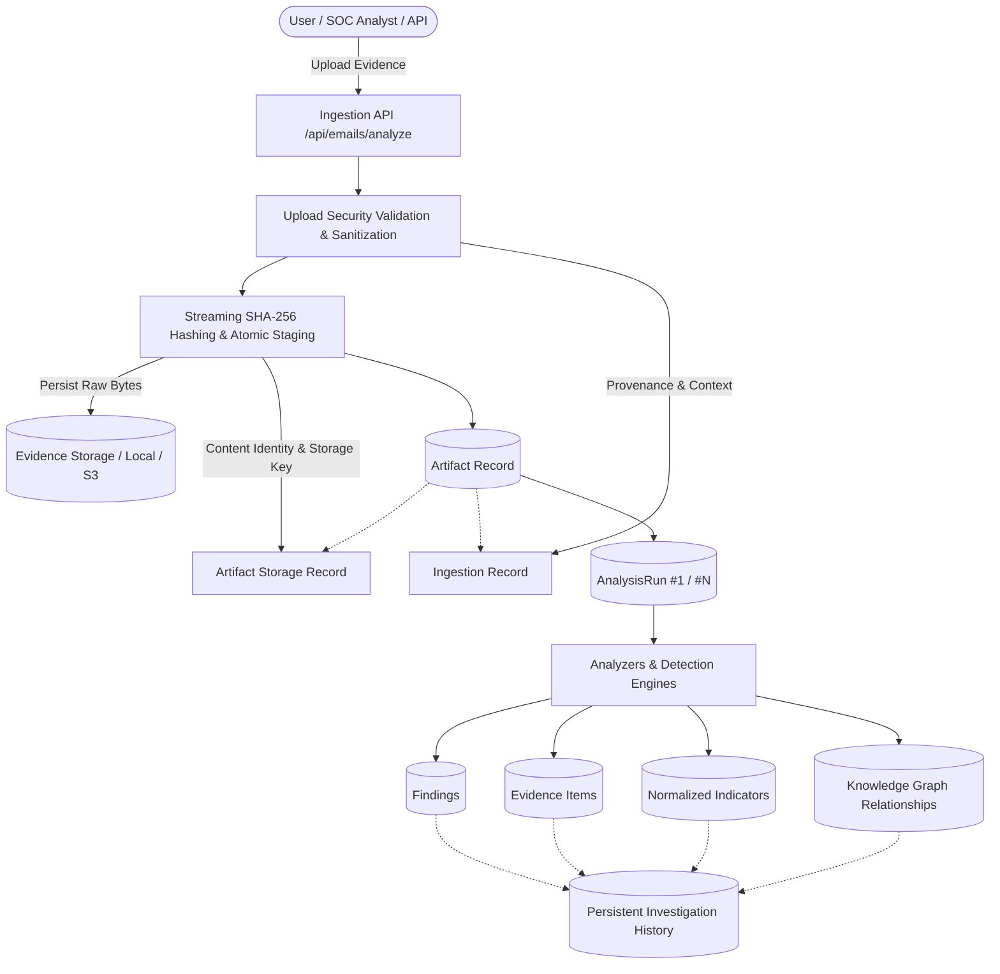
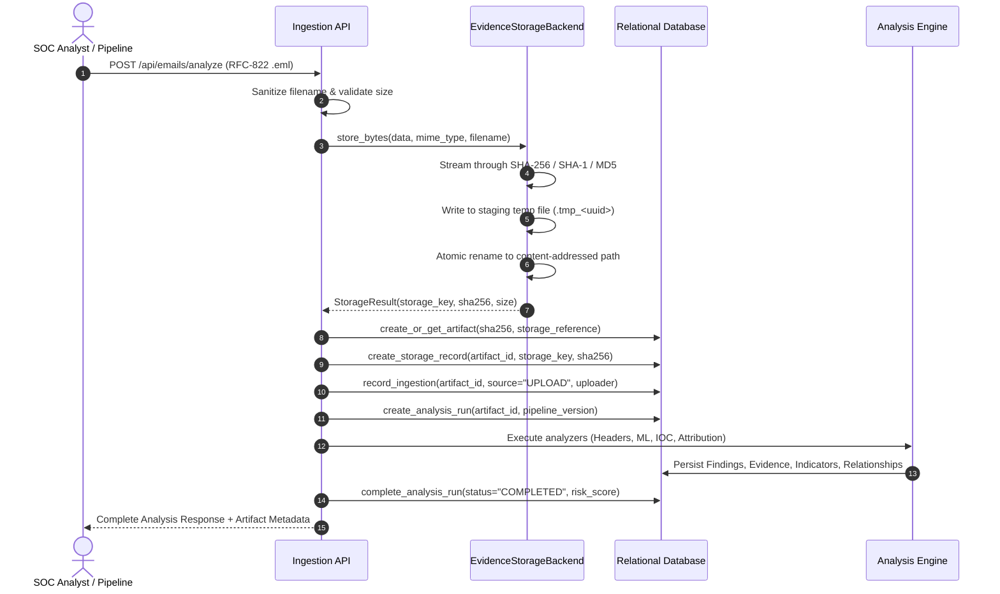
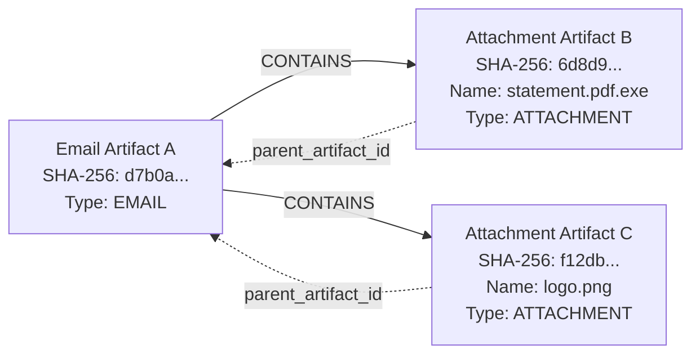

# 12. Persistent Evidence & Analysis Storage Architecture

## 1. Storage Architecture Overview

CyberGuard operates as an enterprise-grade AI-powered cybersecurity investigation platform. Forensic evidence and analysis history must persist reliably across:
- Browser refreshes and frontend restarts
- Backend and API worker restarts
- Container recreations and updates
- Application deployments and redeployments
- Re-analyses and future detection/ML model upgrades

CyberGuard does **not** operate as a temporary file analyzer where uploaded evidence disappears after an HTTP request or worker termination.

### High-Level Architecture Diagram



---

## 2. Artifact & Ingestion Lifecycle

### Conceptual Model: Separation of Content Identity and Ingestion Provenance

A core architectural principle of Section 3 is that **Content Identity** and **Ingestion Context** are strictly separated:
- **Artifact**: Represents the intrinsic entity and its immutable content identity (identified by cryptographic SHA-256 hash).
- **ArtifactStorageRecord**: Tracks the physical persistence of the artifact bytes across backends (Local, S3, Azure Blob, GCS), verified integrity states, and physical byte counts.
- **IngestionRecord**: Tracks every discrete ingestion event (source, uploader, timestamp, request ID, contextual metadata). If the exact same file is uploaded across different incidents or departments, content is deduplicated on disk while discrete provenance records are preserved.



---

## 3. Storage Backends & Abstraction Layer

All file-system operations are encapsulated within the `StorageBackend` abstraction in `backend/services/evidence_storage.py`. Routes, controllers, and analyzers never perform direct POSIX filesystem writes or path interpolations.

### Interface Definition

```python
class StorageBackend(ABC):
    @abstractmethod
    def store_stream(self, stream: BinaryIO, original_filename: Optional[str] = None, mime_type: Optional[str] = None) -> StorageResult: ...
    @abstractmethod
    def store_bytes(self, data: bytes, original_filename: Optional[str] = None, mime_type: Optional[str] = None) -> StorageResult: ...
    @abstractmethod
    def retrieve_stream(self, storage_key: str) -> BinaryIO: ...
    @abstractmethod
    def retrieve_bytes(self, storage_key: str) -> bytes: ...
    @abstractmethod
    def exists(self, storage_key: str) -> bool: ...
    @abstractmethod
    def delete(self, storage_key: str) -> bool: ...
    @abstractmethod
    def verify_integrity(self, storage_key: str, expected_sha256: str) -> IntegrityCheckResult: ...
    @abstractmethod
    def get_metadata(self, storage_key: str) -> Optional[StorageMetadata]: ...
```

### Supported & Future Backends

1. **`LocalStorageBackend` (Implemented & Active)**:
   - Configured via `CYBERGUARD_STORAGE_ROOT` (default: `backend/data/storage`).
   - Uses content-addressed prefix directories (`artifacts/<prefix>/<sha256>/original`).
   - Enforces atomic staging (`tmp/.tmp_<uuid>`) and atomic POSIX replacement (`os.replace`).
   - Enforces strict path traversal defenses rejecting relative traversal (`..`), root paths (`/`), home directories (`~`), and Windows drive letters (`C:`).
2. **`S3StorageBackend` (Extension Point)**:
   - Designed for AWS S3 and MinIO object storage.
   - Leverages S3 multipart streaming and client-side SHA-256 calculation.
3. **`GCSStorageBackend` / `AzureBlobStorageBackend` (Extension Points)**:
   - Designed for containerized multi-cloud production environments.

---

## 4. Content Identity & Cryptographic Integrity Model

### Integrity States

Storage integrity is formally tracked via the `IntegrityStatusEnum`:
- **`VERIFIED`**: Stored bytes successfully read, rehashed, and bit-level identical to the recorded SHA-256.
- **`MISMATCH`**: Stored bytes exist but their calculated SHA-256 differs from the recorded record (evidence tampering or disk corruption).
- **`MISSING`**: Stored object key cannot be located on the backing storage device.
- **`UNVERIFIED`**: Initial state before integrity scan or background audit.

Integrity verification can be performed on-demand via:
```http
GET /api/unified/artifacts/{id}/integrity
```
Or via the Python service:
```python
result = StorageRecordService.verify_artifact_integrity(db, artifact_id)
```

---

## 5. Directory & Object Storage Organization

Content-addressed storage ensures high fan-out performance and prevents single-directory inode exhaustion on Linux/Unix filesystems:

```
CYBERGUARD_STORAGE_ROOT/
├── .gitkeep
├── artifacts/
│   ├── ab/
│   │   └── abc12345...6789/
│   │       ├── original            <-- Raw forensic bytes (immutable)
│   │       └── metadata.json       <-- File metadata snapshot
│   └── cf/
│       └── cf30093e...4e70/
│           ├── original
│           └── metadata.json
├── derived/                        <-- Derived artifacts (extracted attachments, thumbnails)
├── reports/                        <-- Cryptographically hashed PDF reports
│   ├── <report_uuid>.pdf
│   └── metadata.json
└── tmp/                            <-- Staging directory for atomic uploads
    └── .tmp_<uuid>                 <-- Removed immediately after atomic commit
```

---

## 6. Analysis History & Snapshots

Analysis in CyberGuard is strictly **append-oriented**. An existing `AnalysisRun` record is never overwritten when an artifact is evaluated again.

### Analysis Run Model
Each run records:
- `pipeline_version`: Version of the CyberGuard core pipeline (e.g. `1.0.0`).
- `analyzer_versions`: JSON snapshot mapping each analyzer to its version (e.g. `{"AuthenticationAnalyzer": "1.0.0", "NLPClassifier": "1.0.0", "ThreatScorer": "1.0.0"}`).
- `rule_versions`: Snapshot of rule engine versioning.
- `model_versions`: Linked foreign keys to `ModelVersionModel` tracking model name, training references, and provider.
- `trigger`: Enumerated trigger (`USER`, `AUTOMATIC`, `REANALYSIS`, `SCHEDULED`).
- `overall_risk_score`, `overall_severity`, `confidence`.
- `started_at`, `completed_at`, `execution_time_ms`, `error_message`.

---

## 7. Re-Analysis Workflow

When an analyst or automated pipeline requests a re-analysis:

```http
POST /api/unified/artifacts/{id}/reanalyze
{
    "pipeline_version": "2.0.0",
    "analyzer_versions": {"ThreatScorer": "2.1.0"},
    "trigger": "REANALYSIS",
    "notes": "Re-evaluated against October 2026 threat intelligence feeds."
}
```

The system executes the following deterministic steps:
1. **Locates Artifact**: Retrieves the canonical `ArtifactModel` by ID or hash.
2. **Verifies Integrity**: Re-hashes stored bytes via `verify_integrity()`. If corrupted or missing, halts with HTTP 422.
3. **Retrieves Raw Evidence**: Streams the original immutable bytes from `evidence_storage`.
4. **Initializes New Run**: Creates a new `AnalysisRunModel` with `trigger="REANALYSIS"`. Previous runs remain completely untouched and accessible.
5. **Executes Analyzers**: Invokes the current generation of parsers, ML classifiers, and threat scoring algorithms.
6. **Stores New Canonical Entities**: Appends new `FindingModel`, `FindingEvidenceModel`, `IndicatorModel`, and `RelationshipModel` entries linked to the new run ID.
7. **Emits Audit Event**: Writes `ANALYSIS_STARTED` and `ANALYSIS_COMPLETED` records to the audit trail.
8. **Returns Comparison**: Yields both the newly completed run and the historical runs.

---

## 8. Derived Artifacts & Email Attachment Persistence

Extracted attachments and derived representations are modeled as first-class `ArtifactModel` entities linked via `parent_artifact_id` and knowledge graph `CONTAINS` relationships:



- Each attachment receives its own distinct SHA-256 and byte storage in `evidence_storage`.
- Ingestion deduplication is scoped by `parent_artifact_id`, ensuring that if two distinct emails contain an identical attachment payload, both emails maintain their distinct forensic hierarchy while sharing underlying deduplicated disk blocks.

---

## 9. Report Persistence

PDF reports generated by the reporting engine are persisted directly to `evidence_storage` rather than ephemeral temp folders.

- Stored under `reports/<report_id>.pdf`.
- Added canonical columns to `ReportModel`:
  - `artifact_id`: Linked target artifact.
  - `analysis_run_id`: Linked specific analysis run snapshot.
  - `sha256`: Cryptographic hash of the compiled PDF.
  - `format`: Report format (e.g. `PDF`, `JSON`, `HTML`).
  - `generator_version`: Reporting engine version (e.g. `ReportService-1.0`).

---

## 10. Deployment Persistence & Docker Strategy

### Docker Compose Volume Configuration

Evidence and database durability is guaranteed across container restarts, recreations, and updates via named persistent volumes defined in `docker-compose.yml`:

```yaml
services:
  backend:
    volumes:
      - cyberguard_storage:/app/backend/data/storage
      - eml_evidence_data:/app/backend/data/eml_store
      - reports_data:/app/backend/data/reports
    environment:
      - CYBERGUARD_STORAGE_ROOT=/app/backend/data/storage

volumes:
  cyberguard_storage:
    name: cyberguard_storage_volume
  eml_evidence_data:
    name: eml_evidence_volume
  reports_data:
    name: reports_volume
```

### Ephemeral / Serverless Deployment Warning

> [!WARNING]
> If CyberGuard is deployed to an ephemeral runtime or serverless container environment (e.g. Google Cloud Run, AWS Fargate without EFS, or Heroku), the local filesystem does **NOT** persist across container restarts or autoscaling events.
>
> In such environments, configure an object storage backend (e.g. Amazon S3, MinIO, or GCS) by subclassing `StorageBackend` and setting the appropriate storage provider environment variable. Local storage is strictly intended for local development, bare-metal deployments, and Docker configurations with mounted persistent volumes.

---

## 11. Storage Maintenance & Migration Procedures

### Orphan Scanning

Maintenance scans identify inconsistencies between relational records and physical storage:
- Stored files on disk without a corresponding database record.
- Database records whose physical storage file is missing on disk.
- Reports without parent evidence associations.

Scan endpoint:
```http
GET /api/unified/maintenance/orphans
```

### Legacy Evidence Backfill

For installations migrating from legacy CyberGuard releases:
```http
POST /api/unified/maintenance/backfill?dry_run=false
```
Scans legacy `eml_store/` directories and `evidence` database records:
1. Calculates SHA-256 from disk bytes.
2. Migrates raw files into content-addressed persistent storage.
3. Creates missing `ArtifactModel`, `ArtifactStorageRecordModel`, and `IngestionRecordModel` entries.
4. Preserves historical timestamps without inventing synthetic metadata.

---

## 12. Chain of Custody & Audit Trail

Every interaction with physical evidence is permanently recorded in `audit_logs` with structured metadata:
- `ARTIFACT_INGESTED`: Initial upload and MIME classification.
- `ARTIFACT_STORED`: Physical commitment to content-addressed storage.
- `ARTIFACT_RETRIEVED`: Evidence streamed or downloaded by an analyst.
- `ARTIFACT_INTEGRITY_VERIFIED`: Verification scan outcome (`VERIFIED` or `MISMATCH`).
- `ANALYSIS_STARTED`: Execution triggered against an artifact.
- `ANALYSIS_COMPLETED`: Execution completed with risk score and findings count.
- `ANALYSIS_REANALYZED`: Re-analysis run initialized.
- `REPORT_GENERATED`: Cryptographic PDF report written to durable storage.
