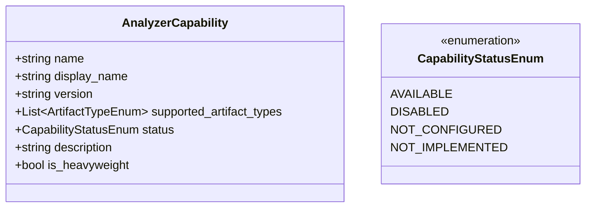
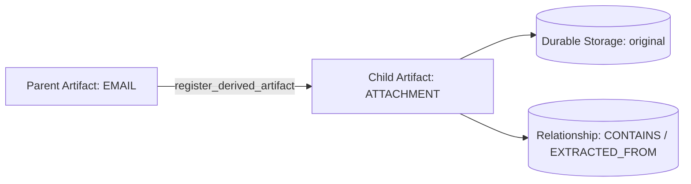

# 13. Universal Ingestion Gateway Architecture

## 1. Gateway Overview

CyberGuard's Universal Ingestion Gateway provides a unified, canonical entry point for all cybersecurity evidence and digital artifacts. Rather than requiring users or upstream automated systems to manually select specific analyzers (e.g., "Run URL Analyzer", "Run IP Analyzer", "Run EML Analyzer"), CyberGuard ingests any supported evidence format through a single gateway layer.

The gateway executes a strict, deterministic sequence:
$$\text{Input} \longrightarrow \text{Validation} \longrightarrow \text{Type Detection} \longrightarrow \text{Normalization} \longrightarrow \text{Persistence} \longrightarrow \text{Artifact Creation} \longrightarrow \text{Routing Decision} \longrightarrow \text{AnalysisRun Preparation}$$

```mermaid
graph TD
    User([User / SOC Analyst / API / SIEM]) --> Gateway[POST /api/ingest Universal Gateway]
    
    subgraph Ingestion Pipeline
        Gateway --> Val[Safe Input Validation & Sanitization]
        Val --> Detect[Deterministic Type Detection]
        Detect --> Norm[Standards-Aware Normalization]
        Norm --> HashPersist[Streaming Hash & Durable Evidence Persistence]
        HashPersist --> ArtifactReg[Artifact & Ingestion Record Creation]
        ArtifactReg --> Routing[Routing Decision Engine]
    end

    subgraph Capability & Routing Registry
        Routing --> CapReg[Global Capability Registry]
        CapReg -->|Registered & Available| Candidates[Candidate Analyzers List]
    end

    subgraph Analysis Execution (Deferred to Section 5)
        Candidates -.-> Orchestrator[Analysis Orchestrator]
        Orchestrator -.-> EmailPipe[Email Pipeline]
        Orchestrator -.-> URLPipe[URL Pipeline]
        Orchestrator -.-> FilePipe[File Pipeline]
        Orchestrator -.-> NetPipe[Network / IP Pipeline]
    end
```

---

## 2. Supported Input Modes

The gateway accepts 6 input modes:

| Input Mode | Description | Example Sources | Status |
| :--- | :--- | :--- | :--- |
| `FILE_UPLOAD` | Binary/text file stream via multipart form | `.eml`, `.pdf`, `.png`, `.wav`, `.mp4`, `.pcap`, logs | **ACTIVE** |
| `TEXT_INPUT` | Plain-text strings, IOCs, messages, defanged indicators | URLs, domains, IPs, email addresses, SMS text | **ACTIVE** |
| `STRUCTURED_EVENT` | JSON telemetry / security envelopes | Auth logs, API gateway logs, SIEM alerts, audit logs | **ACTIVE** |
| `ENDPOINT_TELEMETRY` | Host agents, EDR events, process trees | Sysmon, osquery, auditd | *FOUNDATION PREPARED* |
| `CONNECTOR_INPUT` | Cloud/SaaS connectors (M365, Google Workspace, Okta) | Ingestion webhooks, polling workers | *FOUNDATION PREPARED* |
| `BATCH_IMPORT` | Multi-artifact bundles & forensic containers | Case folders, multi-file uploads | *FOUNDATION PREPARED* |

---

## 3. Deterministic Type Detection

Type detection **never** relies solely on user-supplied file extensions, nor does it invoke costly or non-deterministic LLMs as primary file type detectors. Classification is performed via multi-tiered deterministic inspection:

```mermaid
flowchart TD
    In[Received Input] --> ModeCheck{Input Mode?}
    
    ModeCheck -->|FILE_UPLOAD| MagicBytes[1. Magic Byte / File Signature Inspection]
    MagicBytes -->|Match Found| AssignFile[Assign ArtifactType: IMAGE, AUDIO, VIDEO, FILE]
    MagicBytes -->|Header Scan| RFC822{RFC-822 / MIME Email Headers?}
    RFC822 -->|Yes| AssignEML[Assign ArtifactType: EMAIL]
    RFC822 -->|No| ExtMime[Fallback: Clean Extension + Sniffed MIME]
    ExtMime --> AssignGeneric[Assign ArtifactType: FILE / LOG / UNKNOWN]

    ModeCheck -->|TEXT_INPUT| IPCheck{Valid IPv4 or IPv6?}
    IPCheck -->|Yes| AssignIP[Assign ArtifactType: IP]
    IPCheck -->|No| URLCheck{Defanged or Formatted URL?}
    URLCheck -->|Yes| AssignURL[Assign ArtifactType: URL]
    URLCheck -->|No| DomCheck{Valid FQDN / Domain?}
    DomCheck -->|Yes| AssignDomain[Assign ArtifactType: DOMAIN]
    DomCheck -->|No| EmailAddrCheck{User@Domain?}
    EmailAddrCheck -->|Yes| AssignEmailAddr[Assign ArtifactType: TEXT / Subtype: EMAIL_ADDRESS]
    EmailAddrCheck -->|No| JSONCheck{Valid JSON Structure?}
    JSONCheck -->|Yes| AssignJSON[Assign ArtifactType: STRUCTURED_LOG]
    JSONCheck -->|No| AssignText[Assign ArtifactType: TEXT / Social Eng Message]

    ModeCheck -->|STRUCTURED_EVENT| ValidateEnvelope[Validate Canonical Event Envelope]
    ValidateEnvelope --> AssignEvent[Assign ArtifactType: AUTH_LOG / API_LOG / SYSTEM_LOG]
```

### File Signature (Magic Byte) Table
- **Images**: PNG (`\x89PNG\r\n\x1a\n`), JPEG (`\xff\xd8\xff`), GIF (`GIF87a` / `GIF89a`), WebP (`RIFF....WEBP`), BMP (`BM`), TIFF (`II*\x00` / `MM\x00*`).
- **Audio**: WAV (`RIFF....WAVE`), MP3 (`ID3` or frame sync `\xff\xfb`), FLAC (`fLaC`), OGG (`OggS`).
- **Video**: MP4/MOV (`ftyp`), MKV/WebM (`\x1a\x45\xdf\xa3`), AVI (`RIFF....AVI `).
- **Documents & Archives**: PDF (`%PDF-`), ZIP (`PK\x03\x04`), GZIP (`\x1f\x8b`), 7-Zip (`7z\xbc\xaf\x27\x1c`).
- **Executables**: Windows PE (`MZ`), Linux ELF (`\x7fELF`), Mach-O (`\xfe\xed\xfa\xce` / `\xcf\xfa\xed\xfe`).
- **RFC-822 Emails**: Inspects top 4096 bytes for mandatory headers (`Received:`, `From:`, `To:`, `Subject:`, `Message-ID:`, `MIME-Version:`).

---

## 4. Normalization Standards

Forensic integrity requires preserving both the exact **original value** and producing a **canonical normalized value** for deduplication and intelligence correlation.

| Input Type | Original Value Handling | Normalization Strategy | Defanging Handled |
| :--- | :--- | :--- | :--- |
| **URL** | Preserved verbatim in database and evidence blob | Lowercase scheme & host, strip default ports (`:80`, `:443`), decode percent-encoded ASCII, preserve path & query parameters | `hxxp://`, `hxxps://`, `[.]`, `(.)` |
| **Domain** | Preserved verbatim | Lowercase, strip trailing dots, strip whitespace, convert IDN/punycode where applicable | `evil[.]com`, `sub(.)domain[.]org` |
| **IP Address** | Preserved verbatim | Parsed via Python standard `ipaddress`, strip leading zeros from octets (e.g., `192.168.001.010` $\rightarrow$ `192.168.1.10`), canonical IPv6 RFC-5952 representation | `192[.]168[.]1[.]1`, `ipv6:...` |
| **Email Address** | Preserved verbatim | RFC-5322 parsing, lowercase domain, preserve mailbox local-part (case-preserving per RFC standards) | `user[at]domain[.]com` |
| **Structured Event** | Preserved raw in storage | Normalized envelope with standard timestamp, source type, and sanitized metadata dictionary | N/A |

---

## 5. Routing Registry vs. Execution (Section 4 vs. Section 5)

CyberGuard strictly enforces the boundary between **Routing Candidate Determination** and **Execution Orchestration**:
- **Section 4 (Routing Registry)** answers: *"What analyzers CAN handle this artifact type?"*
- **Section 5 (Analysis Orchestration)** answers: *"Which analyzers SHOULD execute, in what dependency order, and based on what interim findings?"*

No analyzer is executed during Section 4 ingestion. Ingestion remains fast, non-blocking, and deterministic.

---

## 6. Capability Matrix & Registry

CyberGuard uses a centralized `CapabilityRegistry` to track all analysis engines, their versions, supported artifact types, and actual operational status. **No capability is ever faked.**



### Authoritative Capability Matrix

| Analyzer Name | Category | Supported Artifacts | Status | Implementation Details |
| :--- | :--- | :--- | :--- | :--- |
| `email_forensics` | Email | `EMAIL` | **AVAILABLE** | RFC-822 parser, header trace, hop latency analysis |
| `email_authentication` | Email | `EMAIL` | **AVAILABLE** | SPF, DKIM, DMARC alignment and verification |
| `ioc_extraction` | Threat Intel | `EMAIL`, `TEXT` | **AVAILABLE** | Regex/structural extraction of IPs, URLs, domains, emails, hashes |
| `nlp_phishing_detector` | NLP / ML | `EMAIL`, `TEXT` | **AVAILABLE** | Urgency, authority, deception, phishing intent scoring |
| `url_intelligence` | Web Intel | `URL` | **AVAILABLE** | Lexical analysis, WHOIS lookup, IP resolution, entropy analysis |
| `domain_intelligence` | DNS Intel | `DOMAIN`, `URL` | **AVAILABLE** | TLD analysis, typosquatting/Levenshtein similarity, MX/NS lookups |
| `ip_intelligence` | Network Intel | `IP`, `URL` | **AVAILABLE** | GeoIP, ASN routing, private/bogon classification, abuse lookups |
| `attachment_security` | File Security | `ATTACHMENT`, `FILE` | **AVAILABLE** | Extension mismatch, magic bytes, hash lookups, macro heuristic |
| `file_metadata` | File Forensics | `FILE`, `IMAGE`, `ATTACHMENT` | **AVAILABLE** | Cryptographic hashing (MD5, SHA1, SHA256), MIME sniffing, size analysis |
| `qr_code_analyzer` | Computer Vision | `IMAGE`, `FILE` | **AVAILABLE** | Static CV QR extraction and embedded URL identification |
| `auth_event_parser` | Log Analysis | `AUTH_LOG`, `STRUCTURED_LOG` | **AVAILABLE** | Brute force, impossible travel, credential abuse heuristics |
| `api_log_parser` | Log Analysis | `API_LOG`, `STRUCTURED_LOG` | **AVAILABLE** | Anomaly detection, unauthorized access, rate limit evasion |
| `deepfake_audio` | Audio AI | `AUDIO` | *NOT_IMPLEMENTED* | Voice clone and synthetic audio detection (Section 18) |
| `deepfake_video` | Video AI | `VIDEO` | *NOT_IMPLEMENTED* | Facial landmark manipulation & temporal artifact detection (Section 19) |
| `attack_path_reconstruction` | Graph Engine | All types | *NOT_IMPLEMENTED* | Automated graph causal chain reconstruction (Section 6) |
| `endpoint_behavior_engine` | EDR | `ENDPOINT_TELEMETRY` | *NOT_IMPLEMENTED* | Process-injection and living-off-the-land telemetry analysis (Section 23) |

---

## 7. Security Boundaries & SSRF Defense

All ingested input is treated as completely untrusted:

1. **Strict SSRF Isolation (NO Automatic URL Fetching)**:
   The ingestion layer **never** makes outbound HTTP/HTTPS requests to user-submitted URLs. Strings like `http://127.0.0.1/`, `http://localhost/`, and `http://169.254.169.254/` (cloud metadata service) are validated, classified, normalized, and persisted purely as static text evidence.
2. **Private & Special Network Tagging**:
   Any IP address or URL targeting loopback, RFC-1918 private subnets, link-local, multicast, or reserved blocks is annotated in metadata (`is_internal_network: true`) and generates an explicit audit warning.
3. **Path Traversal Sanitization**:
   Filenames containing directory traversal sequences (e.g., `../../etc/shadow`, `C:\\Windows\\System32\\cmd.exe`) are stripped using `os.path.basename` and sanitized to safe identifiers.
4. **Enforced Upload Limits**:
   Configurable limits prevent denial of service (default 50 MB max per file, 100 MB max batch size, 1 MB max text payload).
5. **Archive Safety**:
   Uploaded archives (`.zip`, `.tar.gz`, `.7z`) are stored immutably as raw blobs. Decompression is never performed during ingestion to prevent zip-bombing.
6. **Execution Prevention**:
   No ingested binary is executed under any circumstance. Stored evidence files have non-executable permissions.

---

## 8. Derived Artifact Provenance

When an analyzer subsequently inspects an artifact and extracts a secondary artifact (e.g., an email contains an invoice attachment, or a PDF contains an embedded URL, or a screenshot contains a QR code), the gateway provides `UniversalIngestionService.register_derived_artifact`:



This guarantees:
- Full cryptographic hashing and durable storage of derived bytes.
- Direct parent-child linkage via `parent_artifact_id`.
- Automatic edge creation in the CyberGuard knowledge graph (`RelationshipModel`).

---

## 9. API Specifications

### `POST /api/ingest` (Universal Gateway)
Polymorphic endpoint accepting either:
- **Multipart Form**: `file` (UploadFile), `source` (str), `uploader` (str), `notes` (str).
- **JSON Body**: `text` (str), `source` (str), `uploader` (str), `notes` (str).
- **JSON Event**: `event` (dict with `source_type`, `data`, `source`, `timestamp`).

#### Response:
```json
{
  "ingestion_id": "ing-9f2b84e1-2c1b-4f9e-b9b2-358b68c92a10",
  "artifact_id": "art-7a1c4b22-8d94-4b5a-93f1-28a49c253b21",
  "artifact_type": "URL",
  "name": "https://example.com/login",
  "original_value": "hxxps://example[.]com/login",
  "normalized_value": "https://example.com/login",
  "sha256": "4b227777d4dd1fc61c6f884f48641d02b4d121d3fd328cb08b5531fcacdabf8a",
  "size": 27,
  "storage_status": "STORED",
  "analysis_status": "INGESTED",
  "support_status": "SUPPORTED",
  "candidate_analyzers": [
    "url_intelligence",
    "domain_intelligence",
    "ip_intelligence"
  ],
  "classification": {
    "input_mode": "TEXT_INPUT",
    "artifact_type": "URL",
    "confidence": 1.0,
    "detector": "urllib_standard_parser",
    "support_status": "SUPPORTED",
    "warnings": []
  },
  "created_at": "2026-10-01T23:30:00Z"
}
```

### Dedicated Subroutes
- `POST /api/ingest/file`: Dedicated file upload endpoint.
- `POST /api/ingest/text`: Dedicated text/IOC input endpoint.
- `POST /api/ingest/event`: Dedicated structured security event endpoint.
- `POST /api/ingest/detect`: Fast pre-flight detection endpoint (no persistence).
- `GET /api/ingest/capabilities`: Returns all analyzer capabilities and operational statuses.

---

## 10. Backward Compatibility

All legacy routes remain 100% operational:
- `POST /api/emails/analyze`: Ingests and runs legacy email analysis, delegating evidence persistence to `evidence_storage`.
- `POST /api/reports/generate`: Unaffected.
- `GET /api/reports/export`: Unaffected.
