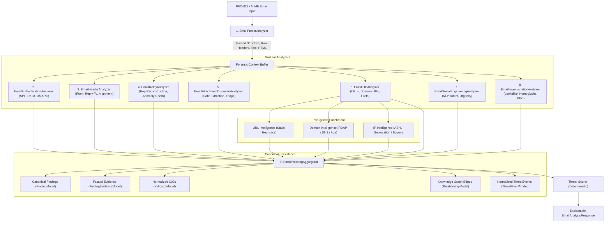

# 15. Email & Phishing Intelligence Engine Architecture (Section 6)

## 1. Executive Summary & Mission

CyberGuard's Email & Phishing Intelligence Engine upgrades the platform from a collection of isolated email inspection widgets into a coherent, explainable, evidence-driven phishing and impersonation analysis pipeline.

Prior to Section 6, email analysis computed disconnected scores and unlinked telemetry fields (`SPF: FAIL`, `DKIM: PASS`, `URLs: 3`, `Risk: 78`). Under the new architecture, every conclusion is bound to verifiable, immutable evidence:

```
EMAIL ARTIFACT
 │
 ├── Sender Identity Anomaly
 │     └── Evidence: RFC-5322 From domain differs from RFC-5321 Return-Path and Reply-To
 │
 ├── Authentication Weakness
 │     └── Evidence: DMARC policy check failed upstream; SPF softfail recorded
 │
 ├── Social Engineering Signal
 │     └── Evidence: Credential-verification request with artificial urgency pattern
 │
 ├── Deceptive Hyperlink
 │     ├── Visible Anchor Domain: trusted-service.test
 │     └── Destination Domain: trusted-service-verify.test
 │
 └── Domain Impersonation
       └── Evidence: Levenshtein distance 2 from target brand reference
```

Every observation is persisted as canonical Unified Data Model records:
$$\text{Artifact} \longrightarrow \text{AnalysisRun} \longrightarrow \text{Finding} \longleftrightarrow \text{EvidenceItem} \longrightarrow \text{Indicator} \longrightarrow \text{Relationship} \longrightarrow \text{ThreatEvent}$$

Full backward compatibility is guaranteed: legacy endpoints (`/api/emails/analyze`, `/api/reports/generate`, case management, graph visualizer) continue to function identically with zero frontend breaking changes.

---

## 2. End-to-End Processing Pipeline

The email intelligence pipeline follows an evidence-preserving, sequential-modular execution topology:



---

## 3. Modular Analyzer Architecture

The engine decomposes analysis into 9 focused, single-responsibility services. Each analyzer implements the unified `analyze(content_bytes, context) -> AnalyzerExecutionResult` interface.

### 3.1. `EmailParserAnalyzer`
- **Role**: Robust RFC-822 / RFC-2047 / MIME parsing using Python standard library `email.policy.default`.
- **Outputs**:
  - Normalized and raw headers: `From`, `To`, `Cc`, `Reply-To`, `Return-Path`, `Subject`, `Date`, `Message-ID`.
  - RFC-2047 encoded-word decoding across subjects, display names, and filenames.
  - Multi-hop `Received` headers preserved in verbatim transit order.
  - Authentication headers: `Authentication-Results`, `Received-SPF`, `DKIM-Signature`.
  - Body extraction: plain-text body, HTML body, and structural MIME boundaries.
  - Fault tolerance: malformed MIME segments or corrupted encodings log warnings and fallback gracefully rather than aborting analysis.

### 3.2. `EmailAuthenticationAnalyzer`
- **Role**: Authoritative extraction and evaluation of SPF, DKIM, and DMARC status.
- **Distinction of Provenance**:
  - **Parsed Upstream Result**: Result extracted from trusted MTA `Authentication-Results` or `Received-SPF` headers.
  - **Locally Verified**: Explicitly flags whether cryptographic verification occurred locally or was parsed from message headers.
  - CyberGuard **never** claims cryptographic verification when only header inspection took place.
- **Status Normalization**:
  - SPF: `PASS`, `FAIL`, `SOFTFAIL`, `NEUTRAL`, `NONE`, `TEMPERROR`, `PERMERROR`, `UNKNOWN`.
  - DKIM: `PASS`, `FAIL`, `NONE`, `TEMPERROR`, `PERMERROR`, `UNKNOWN`. Captures signing domain (`d=`) and selector (`s=`).
  - DMARC: `PASS`, `FAIL`, `NONE`, `UNKNOWN`. Identifies evaluated policy (`p=none`, `quarantine`, `reject`) when present in headers.
  - Incomplete/missing authentication is recorded as `SPF_UNVERIFIED` / `DMARC_NONE` and is **never** conflated with active spoofing failure (`SPF_FAILURE`).

### 3.3. `EmailHeaderAnalyzer`
- **Role**: Multi-identity alignment and display-name spoofing detection.
- **Analyzed Dimensions**:
  1. RFC-5322 `From` domain vs RFC-5321 `Return-Path` domain (envelope sender alignment).
  2. RFC-5322 `From` domain vs `Reply-To` domain (reply redirection analysis).
  3. Display Name vs actual email address disparity (e.g., `"Microsoft Support" <attacker@random-domain.test>`).
- **Mailing List Awareness**:
  - Detects `List-Id`, `List-Unsubscribe`, `Precedence: list`, or Google Groups/Mailman headers.
  - Suppresses false-positive sender identity mismatch alarms for verified mailing list distributions.

### 3.4. `EmailRelayAnalyzer`
- **Role**: SMTP `Received` header parsing, hop ordering, latency tracking, and anomaly detection.
- **Capabilities**:
  - Reconstructs relay hops in chronological progression (earliest sender hop $\rightarrow$ final recipient MX).
  - Extracts hop IP (IPv4 and IPv6), reverse-DNS hostname, receiving server, and protocol (`ESMTPA`, `ESMTPS`).
  - Calculates hop transit latency in seconds.
  - Identifies private-to-public IP transit transitions.
  - Emits findings: `PUBLIC_RELAY_IDENTIFIED`, `RELAY_ANOMALY` (malformed hop timestamps, synthetic relay headers).

### 3.5. `EmailAttachmentDiscoveryAnalyzer`
- **Role**: Safe static attachment extraction, cryptographic fingerprinting, and risk triage.
- **Safety Policy**:
  - **Zero Execution**: No macros, scripts, binaries, or dynamic code execution are invoked.
  - Extracts raw payload bytes and stores them immutably in content-addressed storage via Section 3 `EvidenceStorageService`.
  - Computes SHA-256, SHA-1, and MD5 hashes.
  - Registers derived `ArtifactModel` (type: `ATTACHMENT`) with `parent_artifact_id` pointing to the source email.
  - Emits relationship: `EMAIL -[CONTAINS]-> ATTACHMENT`.
  - Static risk triage: Detects executable extensions (`.exe`, `.bat`, `.scr`, `.vbs`, `.ps1`), double extensions (e.g. `invoice.pdf.exe`), and macro-enabled documents (`.docm`, `.xlsm`).
  - Produces `SUSPICIOUS_ATTACHMENT_TYPE` finding with neutral, factual justification.

### 3.6. `EmailIOCAnalyzer`
- **Role**: Comprehensive observable extraction across all email surfaces.
- **Extraction Targets**:
  - Plain-text URLs, HTML `<a href="...">` links, `` links.
  - Domain names (lowercased, normalized, defang-aware).
  - IPv4 and IPv6 addresses with scope classification (PUBLIC, PRIVATE, LOOPBACK).
  - Email addresses (sender, recipient, CC, embedded).
- **Deceptive Link Detection (`VISIBLE_LINK_MISMATCH`)**:
  - Compares visible link text against actual destination `href`.
  - When visible text represents a URL (e.g., `https://trusted-bank.test`) but destination points elsewhere (e.g., `https://evil-phish.test/login`), a high-confidence finding is created with verbatim anchor text and destination URL preserved in evidence.

### 3.7. `EmailSocialEngineeringAnalyzer`
- **Role**: Linguistic, heuristic, and machine learning social engineering analysis.
- **Evaluated Vectors**:
  - **Urgency & Coercion**: Artificial deadlines, threats of account deactivation or immediate disciplinary action.
  - **Credential Solicitation**: Demands for passwords, 2FA tokens, PINs, or security question answers.
  - **Financial/Wire Requests**: Wire transfer instructions, gift card purchases, payroll changes.
  - **Authority Impersonation**: Claims of IT executive, security team, or government oversight.
- **Machine Learning Integration**:
  - Integrates Section 1's `global_phishing_classifier` (TF-IDF + Stochastic Gradient Descent text classifier).
  - Emits `ML_PHISHING_PROBABILITY_ELEVATED` when prediction probability exceeds threshold.
  - NLP findings always provide excerpted sentence strings as supporting evidence.

### 3.8. `EmailImpersonationAnalyzer`
- **Role**: Lookalike domain detection, homoglyph analysis, and Business Email Compromise (BEC) patterns.
- **Techniques**:
  - Normalized domain comparison using Levenshtein edit distance against contextual references.
  - Character substitution / homoglyph detection (e.g., `micros0ft.com`, `paypal-verify.com`).
  - Brand abuse keyword matching within domains and subdomains.
  - Contextual reference targeting: Reference domains are derived from observed headers, display names, and reputable organization catalogs rather than arbitrary guessing.

### 3.9. `EmailPhishingAggregator`
- **Role**: Synthesis of all analyzer results into a coherent, explainable verdict.
- **Signal Independence & Deduplication**:
  - Tracks distinct suspicious categories: `AUTHENTICATION`, `IDENTITY`, `URL`, `DOMAIN`, `CONTENT`, `ATTACHMENT`, `INFRASTRUCTURE`.
  - Prevents double-counting: A single observation (e.g. From/Reply-To domain mismatch) does not compound five separate risk penalties merely because multiple analyzers observed it.
- **Corroboration Matrix**:
  - High confidence requires corroboration across multiple independent categories.
  - Single isolated anomalies (e.g., marketing email with urgency, or single SPF `none`) are labeled `SUSPICIOUS` or `BENIGN`, never escalating directly to `PHISHING`.

---

## 4. Finding Catalog

The following finding types are actively implemented and emitted by the Section 6 engine:

| Finding Type | Category | Default Severity | Method | Description |
| :--- | :--- | :--- | :--- | :--- |
| `EMAIL_STRUCTURE_PARSED` | `STRUCTURE` | `SAFE` | `DETERMINISTIC` | Telemetry confirming RFC-822 MIME structure successfully parsed. |
| `SPF_PASS` | `AUTHENTICATION` | `SAFE` | `DETERMINISTIC` | Authorized IP matched SPF sender policy record. |
| `SPF_FAILURE` | `AUTHENTICATION` | `HIGH` | `DETERMINISTIC` | Sending MTA IP is explicitly rejected by domain's SPF record (`-all`). |
| `SPF_SOFTFAIL` | `AUTHENTICATION` | `MEDIUM` | `DETERMINISTIC` | Sending MTA IP is not authorized by domain's SPF record (`~all`). |
| `SPF_UNVERIFIED` | `AUTHENTICATION` | `LOW` | `DETERMINISTIC` | SPF record absent, neutral, or unverified by upstream MTA. |
| `DKIM_PASS` | `AUTHENTICATION` | `SAFE` | `DETERMINISTIC` | Valid cryptographic signature aligned with sender domain. |
| `DKIM_FAILURE` | `AUTHENTICATION` | `HIGH` | `DETERMINISTIC` | DKIM signature verification failed or body hash mismatch detected. |
| `DKIM_UNVERIFIED` | `AUTHENTICATION` | `LOW` | `DETERMINISTIC` | Message unsigned or DKIM evaluation unavailable. |
| `DMARC_PASS` | `AUTHENTICATION` | `SAFE` | `DETERMINISTIC` | Sender domain aligned with verified SPF or DKIM identifier. |
| `DMARC_FAILURE` | `AUTHENTICATION` | `HIGH` | `DETERMINISTIC` | DMARC alignment failed against domain's published DMARC policy. |
| `DMARC_NONE` | `AUTHENTICATION` | `LOW` | `DETERMINISTIC` | Domain publishes no DMARC record or upstream MTA did not evaluate. |
| `SENDER_IDENTITY_MISMATCH` | `IDENTITY` | `MEDIUM` | `DETERMINISTIC` | RFC-5322 From domain differs from RFC-5321 Return-Path envelope. |
| `REPLY_TO_MISMATCH` | `IDENTITY` | `HIGH` | `DETERMINISTIC` | Reply-To domain differs from From domain, redirecting user responses. |
| `DISPLAY_NAME_SPOOFING` | `IDENTITY` | `HIGH` | `HEURISTIC` | Friendly display name mimics a brand or executive while actual sender address is unrelated. |
| `MAILING_LIST_TRANSPORT_PATTERN` | `IDENTITY` | `SAFE` | `DETERMINISTIC` | Sender discrepancy attributable to legitimate mailing list transport headers. |
| `PUBLIC_RELAY_IDENTIFIED` | `INFRASTRUCTURE`| `SAFE` | `DETERMINISTIC` | Forensically verified public origin relay hop reconstructed. |
| `RELAY_ANOMALY` | `INFRASTRUCTURE`| `MEDIUM` | `HEURISTIC` | Chronological timestamp inversion or malformed relay hop detected. |
| `RELAY_HEADERS_ABSENT` | `INFRASTRUCTURE`| `LOW` | `DETERMINISTIC` | Email message contains zero `Received` transit headers. |
| `VISIBLE_LINK_MISMATCH` | `URL` | `HIGH` | `DETERMINISTIC` | Displayed link anchor text presents a domain different from actual destination href. |
| `SUSPICIOUS_ATTACHMENT_TYPE`| `ATTACHMENT` | `HIGH` | `DETERMINISTIC` | Attachment contains an executable, script, or macro-capable file extension. |
| `DOUBLE_EXTENSION_ATTACHMENT`| `ATTACHMENT` | `HIGH` | `DETERMINISTIC` | Attachment uses deceptive double extension (e.g. `doc.pdf.exe`). |
| `LOOKALIKE_DOMAIN` | `DOMAIN` | `HIGH` | `HEURISTIC` | Domain demonstrates high Levenshtein similarity or homoglyph substitution to known brand. |
| `CREDENTIAL_REQUEST` | `CONTENT` | `HIGH` | `RULE` | Message body solicits passwords, 2FA tokens, or account credentials. |
| `URGENCY_LANGUAGE` | `CONTENT` | `MEDIUM` | `RULE` | Coercive urgency language pressuring recipient into immediate action. |
| `FINANCIAL_REQUEST` | `CONTENT` | `MEDIUM` | `RULE` | Unprompted wire transfer, payment redirection, or bank account update request. |
| `ML_PHISHING_PROBABILITY_ELEVATED` | `CONTENT` | `HIGH` | `ML` | Statistical NLP text classifier evaluated high probability of phishing intent. |
| `TELEMETRY_OBSERVED` | `FORENSIC` | `SAFE` | `DETERMINISTIC` | Raw factual telemetry recorded for audit and forensic completeness. |

---

## 5. Explainability Architecture: Finding $\longleftrightarrow$ Evidence Linkage

Every significant conclusion in CyberGuard is defensible through exact evidence references:

$$\textbf{WHAT WAS OBSERVED?} \longrightarrow \textbf{WHY IS IT RELEVANT?} \longrightarrow \textbf{HOW WAS IT DETECTED?} \longrightarrow \textbf{WHAT EVIDENCE SUPPORTS IT?}$$

### Example: Deceptive Hyperlink Detection
```json
{
  "finding": {
    "finding_type": "VISIBLE_LINK_MISMATCH",
    "title": "Deceptive Hyperlink: Visible URL differs from href destination",
    "severity": "HIGH",
    "confidence": 1.0,
    "method": "DETERMINISTIC",
    "description": "HTML anchor tag displays 'https://trusted-service.test' but href destination points to 'https://trusted-service-verify.test/login/auth'."
  },
  "evidence": [
    {
      "source": "HTML_BODY",
      "evidence_type": "LINK_MISMATCH",
      "key": "VISIBLE_LINK_MISMATCH",
      "confidence": 1.0,
      "parsed_content": {
        "visible_text": "https://trusted-service.test",
        "href": "https://trusted-service-verify.test/login/auth",
        "visible_domain": "trusted-service.test",
        "href_domain": "trusted-service-verify.test"
      }
    }
  ]
}
```

### Example: Reply-To Redirection Mismatch
```json
{
  "finding": {
    "finding_type": "REPLY_TO_MISMATCH",
    "title": "Reply-To Redirection Mismatch",
    "severity": "HIGH",
    "confidence": 1.0,
    "method": "DETERMINISTIC",
    "description": "Email specifies a Reply-To address ('support@trusted-service-verify.test') with domain 'trusted-service-verify.test' differing from the From domain 'trusted-service.test'."
  },
  "evidence": [
    {
      "source": "HEADER_REPLY_TO",
      "evidence_type": "IDENTITY_MISMATCH",
      "key": "REPLY_TO_MISMATCH",
      "confidence": 1.0,
      "parsed_content": {
        "from_domain": "trusted-service.test",
        "reply_to_domain": "trusted-service-verify.test"
      }
    }
  ]
}
```

---

## 6. False-Positive Controls & Defenses

CyberGuard implements explicit defenses to avoid aggressive over-classification:

1. **Legitimate Mailing Lists**:
   - Automated detection of standard mailing list headers (`List-Id`, `List-Post`, `Precedence: list`).
   - Automatically suppresses `SENDER_IDENTITY_MISMATCH` and creates `MAILING_LIST_TRANSPORT_PATTERN` with `SAFE` severity.
2. **Isolated SPF `NONE` / `UNKNOWN`**:
   - Domains without SPF records are recorded as `SPF_UNVERIFIED` (`LOW` severity).
   - In the absence of corroborating signals, classification remains strictly `BENIGN`.
3. **Marketing Urgency Isolation**:
   - Marketing emails with words like "Order today! Limited time offer" produce `URGENCY_LANGUAGE` (`MEDIUM` severity).
   - Without authentication failure, credential solicitation, or deceptive URLs, the overall verdict remains `BENIGN` or `SUSPICIOUS`, avoiding `PHISHING` misclassification.
4. **Legitimate Security Terminology**:
   - Newsletters or security bulletins discussing "phishing", "malware", or "password rotation" are not flagged as credential harvesting. Sentence parsing ensures that the context represents instruction or reporting rather than an imperative call-to-action targeting the user.
5. **Multi-Category Corroboration**:
   - Escalation to `PHISHING` requires corroboration across at least two independent categories (e.g. Identity Anomaly + Deceptive URL, or Authentication Failure + Credential Harvesting).

---

## 7. Knowledge Graph Relationships & ThreatEvents

The engine produces graph edges using Section 2's `RelationshipModel`:

| Source Type | Relationship | Target Type | Example |
| :--- | :--- | :--- | :--- |
| `Artifact` (Email) | `CONTAINS` | `Artifact` (Attachment) | `Email (SHA-256) -> Attachment (SHA-256)` |
| `Artifact` (Email) | `REFERENCES` | `Indicator` (URL) | `Email -> https://trusted-service-verify.test/login` |
| `Artifact` (Email) | `REFERENCES` | `Indicator` (Domain) | `Email -> trusted-service-verify.test` |
| `Artifact` (Email) | `OBSERVED_RELAY`| `Indicator` (IP) | `Email -> 198.51.100.25` |

When corroborated phishing findings occur, a `ThreatEventModel` is automatically created:
- **Event Types**: `PHISHING_ATTEMPT`, `EMAIL_IMPERSONATION`, `SUSPICIOUS_EMAIL`.
- **Severity**: `HIGH` or `CRITICAL`.
- **Traceability**: Retains foreign keys to both `source_artifact_id` and `analysis_run_id`.

---

## 8. Known Limitations & Section 7 Boundary

1. **Static Analysis Only**:
   - Attachments are fingerprinted and classified by metadata; dynamic behavioral sandboxing is deferred to Section 8.
2. **SSRF Boundary Enforcement**:
   - Extracted URLs and domains are statically analyzed and routed to Section 5 orchestrator/intelligence providers. No direct, unauthenticated HTTP fetching occurs within the email parser.
3. **No Autonomous Mitigation**:
   - Generates recommended findings and response actions, but does not autonomously execute mailbox quarantine or firewall blocks (deferred to Section 27).
4. **Image & QR Extraction**:
   - Images are extracted as derived child artifacts. QR-code decoding and OCR visual analysis are handled by the Section 5 orchestrator routing to Section 13/multimedia modules.
