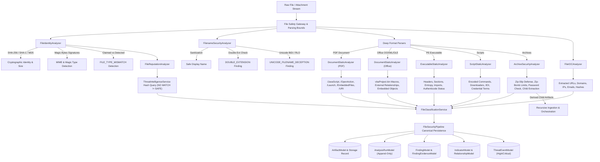
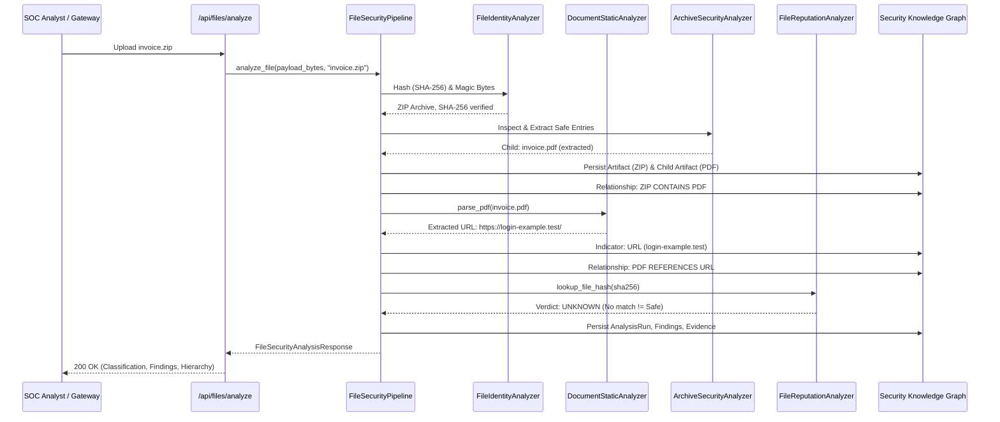

# Section 8 — Attachment & File Security Analyzer Architecture

## 1. Overview & Mission

CyberGuard's **Attachment & File Security Analyzer** provides a safe, evidence-driven static file-analysis layer. It processes files received via direct user upload, email attachments, extracted archive contents, or future telemetry feeds **without ever executing untrusted code**.

Untrusted files are treated strictly as **DATA**, never as application code.

The analyzer deterministically computes:
1. True file format via magic byte signatures vs claimed MIME/extension.
2. Cryptographic identity: SHA-256 (primary integrity identifier), SHA-1, and MD5 (for threat intelligence interoperability and legacy IOC matching) via streaming hashing.
3. Filename deception signals: double extensions, misleading extension chains, and Right-to-Left Override (RLO) / invisible Unicode control characters.
4. Deep static document structure: PDF active objects (`/JavaScript`, `/OpenAction`, `/Launch`, `/EmbeddedFiles`, `/URI`, `/Encrypt`) and Office OpenXML/OLE structures (`vbaProject.bin` macros, external template relationships, embedded objects).
5. Static script heuristics: base64/encoded commands, remote web downloaders, shell invocation chains, credential access terms, and persistence commands.
6. Static PE executable analysis: architecture, compile timestamp as untrusted metadata, sections, Authenticode digital signature presence, section entropy, and suspicious API imports.
7. Shannon byte entropy (0.00 to 8.00) for packing/encryption detection (`HIGH_ENTROPY_CONTENT`).
8. Secure archive inspection (ZIP, TAR, GZIP): Zip-Slip path traversal rejection, Zip-Bomb limits (expansion size, entry count, compression ratio), password protection detection, and safe child artifact extraction.
9. Printable string observable extraction: discoverable URLs, domains, IP addresses, email addresses, and hashes.
10. Hash reputation query via `ThreatIntelligenceService`: privacy-preserving hash queries where **NO MATCH $\neq$ SAFE**.
11. Conservative risk classification: `KNOWN_MALICIOUS`, `MALWARE_SUSPECTED`, `SUSPICIOUS`, `BENIGN_LIKELY`, and `UNKNOWN` (where **UNKNOWN $\neq$ SAFE**).

---

## 2. Security Boundary & Non-Execution Guarantees

```
==================================================
CRITICAL SECURITY BOUNDARY: STATIC ANALYSIS ONLY
==================================================
DO NOT:
• Execute uploaded binaries (PE, ELF, Mach-O)
• Open documents using desktop applications
• Execute Office VBA macros
• Execute PDF JavaScript streams
• Execute shell scripts (.sh, .bash)
• Execute PowerShell scripts (.ps1)
• Execute Python or JavaScript from uploaded files
• Dynamically load uploaded DLLs or shared libraries
• Run unknown installers (.msi, .exe, .pkg)
• Mount uploaded disk images (.iso, .vhd, .dmg)
• Deserialize untrusted arbitrary objects
==================================================
```

All parsers run under strict bounded limits, exception isolation, and safe in-memory staging to prevent attacker-controlled computational denial-of-service.

---

## 3. High-Level Architecture



---

## 4. Capability Matrix

| Format / File Category | Identity (Hashes/Size) | Metadata Extraction | Static Analysis Capability | IOC Extraction | Notes / Implementation Status |
|:---|:---:|:---:|:---:|:---:|:---|
| **PDF Document** | **YES** | **YES** | **YES** | **YES** | Structural scan for `/JavaScript`, `/OpenAction`, `/Launch`, `/EmbeddedFiles`, `/URI`, `/Encrypt`. |
| **DOCX (Word OpenXML)** | **YES** | **YES** | **YES** | **YES** | OpenXML package inspection, external template relationships, document core properties. |
| **DOCM (Word Macro-Enabled)** | **YES** | **YES** | **YES** | **YES** | `vbaProject.bin` detection, static macro keyword extraction (`AutoOpen`, `Shell`), external rels. |
| **XLSX (Excel OpenXML)** | **YES** | **YES** | **YES** | **YES** | Spreadsheet structure, external hyperlink relationships, core properties. |
| **XLSM (Excel Macro-Enabled)** | **YES** | **YES** | **YES** | **YES** | Macro presence detection, VBA project inspection, external relationships. |
| **PPTX / PPTM (PowerPoint)** | **YES** | **YES** | **YES** | **YES** | Presentation container inspection, macro and external relationship verification. |
| **ZIP Archive** | **YES** | **YES** | **YES** | **YES** | In-memory listing, Zip-Slip traversal rejection, Zip-Bomb limits, child artifact extraction. |
| **TAR / GZIP Archive** | **YES** | **YES** | **YES** | **YES** | Standard container inspection with traversal and size guards. |
| **PE / Windows Executable** | **YES** | **YES** | **YES** | **YES** | Header parsing, architecture, compile timestamp, sections, section entropy, Authenticode status, suspicious imports. |
| **Scripts (.ps1, .sh, .bat, .vbs, .js, .py)** | **YES** | **YES** | **YES** | **YES** | Static pattern heuristics: base64 encoded execution, downloaders, execution chains, credential dump terms. |
| **Images (PNG, JPEG, GIF, WEBP, BMP, TIFF)** | **YES** | **YES** | **BASIC** | **NO** | Magic bytes verification, dimensions, color mode, safe EXIF metadata extraction. (Deepfake deferred to Sec 13). |
| **Audio (WAV, MP3)** | **YES** | **BASIC** | **DEFERRED** | **NO** | Identity, size, and container type only. Dedicated forensics deferred to Section 13. |
| **Video (MP4, MKV, AVI)** | **YES** | **BASIC** | **DEFERRED** | **NO** | Identity, size, and container type only. Dedicated forensics deferred to Section 13. |
| **Unknown / Generic Binary** | **YES** | **BASIC** | **LIMITED** | **LIMITED** | Cryptographic identity, size, Shannon entropy, printable string IOC extraction. |

---

## 5. File Identity & Hash Hashing

Every analyzed file receives a stable cryptographic identity calculated via streaming chunks (`FileIdentityAnalyzer.calculate_streaming_hashes`):
- **SHA-256**: Primary integrity and deduplication primitive.
- **SHA-1**: Secondary hash for threat intelligence interoperability and legacy feeds.
- **MD5**: Interoperability hash for legacy IOC matching.

Hashes are registered as `IndicatorModel` records and linked to the artifact via `HAS_HASH` relationships:

```
ARTIFACT (File)
    │
    └── HAS_HASH
            ↓
       INDICATOR (FILE_HASH: SHA-256)
```

---

## 6. Filename Analysis & Deception Detection

Filename inspection operates on the raw original filename (`FilenameSecurityAnalyzer`):
1. **Safe Display Name Generation**: Strips path separators (`../`, `..\\`), terminal escape characters (`\x00` - `\x1f`), and HTML injection characters (`<`, `>`, `&`, `"`).
2. **Double Extension Evasion (`DOUBLE_EXTENSION`)**: Detects files where an inner document/data extension precedes an outer executable/script extension:
   - Example: `invoice.pdf.exe`, `photo.jpg.scr`, `report.docx.vbs`.
   - Produces `DOUBLE_EXTENSION` finding (Severity `HIGH`, MITRE `T1036.007`).
3. **Deceptive Extension Chains (`DECEPTIVE_FILENAME`)**: Flags excessive extension chains or misleading space padding (e.g. `invoice.pdf    .exe`).
4. **Unicode Control Character Deception (`UNICODE_FILENAME_DECEPTION`)**:
   - Inspects filenames character-by-character for BiDi overrides (`\u202e` Right-to-Left Override, `\u202d` LRO, `\u202a` LRE, `\u202b` RLE, `\u2066` - `\u2069` Isolates) and invisible zero-width characters (`\u200b`, `\u200c`, `\u200d`, `\ufeff`, `\u00ad`).
   - Produces `UNICODE_FILENAME_DECEPTION` finding (Severity `HIGH`, MITRE `T1036.002`).
   - **Legitimate non-ASCII preservation**: Valid international characters (French accents `résumé.pdf`, German umlauts `über.pdf`, Japanese `日本語.txt`) are explicitly recognized as legitimate and never falsely flagged.

---

## 7. MIME & Magic Byte Verification

Client-provided `Content-Type` and filename extensions are untrusted. `FileIdentityAnalyzer.detect_file_type` inspects binary magic bytes:
- PDF: `%PDF-`
- Windows PE: `MZ` header with `PE\0\0` at `e_lfanew`
- Linux ELF: `\x7fELF`
- Mach-O: `\xca\xfe\xba\xbe`, `\xfe\xed\xfa\xce`
- ZIP container: `PK\x03\x04` (inspected for Office `word/`, `xl/`, `ppt/`, `vbaproject.bin`, `META-INF/`)
- OLE Compound Document: `\xd0\xcf\x11\xe0\xa1\xb1\x1a\xe1` (`WordDocument`, `Workbook`, `PowerPoint`)
- Images: PNG, JPEG, GIF, WebP, BMP, TIFF

### Disagreement Finding: `FILE_TYPE_MISMATCH`
When a file extension claims an inert document format (e.g. `.pdf`, `.docx`, `.xlsx`, `.jpg`), but the detected signature is an executable (`Windows executable`, `Linux ELF`) or script, CyberGuard generates:
- Finding: `FILE_TYPE_MISMATCH` (Severity `HIGH`, MITRE `T1036.008`).

---

## 8. Document Static Analysis

### PDF Inspection (`DocumentStaticAnalyzer.parse_pdf`)
- Safely scans PDF dictionaries without JavaScript execution or external viewer rendering.
- Signals & Findings:
  - `PDF_JAVASCRIPT_PRESENT` (Medium): `/JavaScript` or `/JS` stream discovered.
  - `PDF_OPEN_ACTION_PRESENT` (Medium): `/OpenAction` or `/AA` auto-trigger.
  - `PDF_LAUNCH_ACTION_PRESENT` (High): `/Launch` external binary executor.
  - `PDF_EMBEDDED_FILE` (Medium): `/EmbeddedFiles`, `/EF`, `/UF` embedded payload.
  - `PDF_EXTERNAL_URL` (Low): `/URI` hyperlinks extracted into indicators.
  - `PDF_ENCRYPTED` (Low): `/Encrypt` dictionary present.
  - `PDF_SUSPICIOUS_STRUCTURE` (Low): Malformed trailer / multi-revision EOF.

### Office Inspection (`DocumentStaticAnalyzer.parse_office`)
- Safely inspects OpenXML zip archives (`.docx`, `.xlsx`, `.pptx`, `.docm`, `.xlsm`) and OLE compound documents.
- Signals & Findings:
  - `MACRO_PRESENT` (Medium): `vbaProject.bin` or `_VBA_PROJECT` present. Extracts bounded static keywords (`AutoOpen`, `Workbook_Open`, `Shell`, `WScript.Shell`, `powershell`).
  - `SUSPICIOUS_DOCUMENT_RELATIONSHIP` (Medium): `TargetMode="External"` relationships in `_rels/.rels` (e.g. remote template injection / Follina).
  - `EMBEDDED_OBJECT_PRESENT` (Low): `oleObject*.bin` or `embeddings/`.

---

## 9. Executable & Script Static Analysis

### PE Static Inspection (`ExecutableStaticAnalyzer`)
- Static parsing without loading or executing:
  - Architecture: x86, x64, ARM64.
  - Compile timestamp: Untrusted metadata check.
  - Subsystem & Entry point.
  - Authenticode status: `Signed` vs `Unsigned`. `EXECUTABLE_UNSIGNED` is flagged at Severity `LOW` (explicitly documenting that unsigned does NOT mean malware).
  - Sections: Virtual size, raw size, characteristics, and section entropy.
  - Section anomalies: `UNUSUAL_SECTION_NAME` (e.g. `.upx`, `.aspack`, `.vmp`) and `HIGH_ENTROPY_SECTION` (entropy > 7.2 in executable section).
  - Suspicious API imports: Memory injection (`VirtualAlloc`, `WriteProcessMemory`), execution (`WinExec`, `CreateProcess`), downloader (`URLDownloadToFile`), evasion (`IsDebuggerPresent`). `SUSPICIOUS_IMPORT_SET` generated when multiple risky APIs match.

### Shannon Byte Entropy (`HIGH_ENTROPY_CONTENT`)
- Evaluates byte randomness $H = -\sum p_i \log_2 p_i$.
- Levels: `low` (< 3.5), `normal` (3.5 - 6.8), `high` (6.8 - 7.2), `very_high` (> 7.2).
- When entropy > 7.2: Produces `HIGH_ENTROPY_CONTENT` finding with clear caveat: **High entropy indicates compression, packing, or encryption; it is NOT proof of malware without malicious structure.**

### Script Static Analysis (`ScriptStaticAnalyzer`)
- Pure static text analysis for `.ps1`, `.sh`, `.bat`, `.cmd`, `.vbs`, `.js`, `.py`.
- Heuristics:
  - Encoded PowerShell (`-enc`, `-encodedcommand`, `FromBase64String`)
  - Downloaders (`DownloadString`, `DownloadFile`, `Invoke-WebRequest`, `curl`, `wget`)
  - Dynamic execution chains (`iex`, `Invoke-Expression`, `cmd.exe /c`, `powershell -w hidden`)
  - Credential dump keywords (`mimikatz`, `sekurlsa`, `lsass`, `samdump`)
  - Persistence commands (`schtasks /create`, `reg add ...\\Run`)
- Finding: `SUSPICIOUS_STATIC_SCRIPT` and `SCRIPT_ATTACHMENT`.

---

## 10. Archive Security & Decompression Guards

Archive processing enforces strict defense-in-depth bounds:

| Guard Parameter | Limit Ceiling | Purpose / Threat Defended |
|:---|:---:|:---|
| `MAX_FILE_SIZE` | 25 MB | Per-file size limit |
| `MAX_UNCOMPRESSED_TOTAL` | 50 MB | Zip-Bomb defense (aggregate expanded bytes) |
| `MAX_ENTRIES` | 250 files | Zip-Bomb defense (directory traversal exhaustion) |
| `MAX_COMPRESSION_RATIO` | 100.0 (100:1) | Decompression ratio bomb defense |
| `MAX_ARCHIVE_DEPTH` | 3 levels | Nested archive recursion bomb defense |
| `MAX_PATH_LENGTH` | 255 chars | Path buffer overflow defense |

### Zip-Slip Path Traversal Protection
Every entry name is validated before extraction (`ArchiveSecurityAnalyzer.is_safe_path`):
- Rejects paths containing `../` or `..\\`
- Rejects leading `/` or `\\`
- Rejects Windows drive letters (`C:`, `D:`)
- Rejects control and null bytes (`\x00`, `\r`, `\n`)
- Normalizes path and verifies it strictly resides within controlled extraction root.
- Violations produce `PATH_TRAVERSAL_DETECTED` (Severity `CRITICAL`).

### Password-Protected Archives
- Detected via encryption bit flags (`ARCHIVE_ENCRYPTED`).
- Passwords are **never brute-forced**. Encrypted archives are flagged as `SUSPICIOUS` evasion containers without assuming maliciousness.

---

## 11. Hash Reputation (Privacy Rule: Zero Sample Upload)

The analyzer integrates with `ThreatIntelligenceService.lookup_file_hash`:
- **Privacy Guarantee**: Only cryptographic hashes (SHA-256, SHA-1, MD5) are queried. User file bytes are **never uploaded to external third-party services**.
- **Mandatory Rule: NO MATCH $\neq$ SAFE**:
  - When threat intelligence returns no match, verdict is recorded as `UNKNOWN`, NOT `SAFE`.
  - Providers have no record of new, targeted, or proprietary files.
  - Matches produce `THREAT_INTELLIGENCE_HASH_MATCH` (Severity `CRITICAL`).

---

## 12. Conservative Classification Matrix

CyberGuard maintains strict discipline between observed evidence and subjective interpretation:

| Classification | Required Evidence Threshold | Example Triggers |
|:---|:---|:---|
| **KNOWN_MALICIOUS** | Verified external threat intelligence hash match or verified high-confidence signature. | Threat intelligence match, known C2 stager hash. |
| **MALWARE_SUSPECTED** | Multiple corroborating high-severity signals or exploit structure. | Zip-Slip path traversal, disguised executable (`.pdf.exe`) with injection APIs and packed section. |
| **SUSPICIOUS** | Single high-severity anomaly or multiple active automation signals. | VBA macros present, embedded PDF JavaScript + auto action, encoded PowerShell downloader, encrypted archive. |
| **BENIGN_LIKELY** | Clean document or media with zero suspicious markers or evasion signals. | Standard clean PDF, clean DOCX, clean PNG image. |
| **UNKNOWN** | Unsupported format or encrypted payload preventing static analysis. | Unrecognized binary container, password-protected archive without other signals. |

---

## 13. End-to-End Orchestrator Integration



---

## 14. API Endpoints

### 1. `POST /api/files/analyze`
Multipart file upload analyzing any binary payload via safe static inspection.
- Input: `file` (UploadFile), `uploader` (str).
- Output: `FileSecurityAnalysisResponse`.

### 2. `POST /api/files/analyze-artifact/{artifact_id}`
Re-analyzes an existing durable artifact loaded directly from `evidence_storage`.
- Preserves historical observation lineage by generating a new independent `AnalysisRunModel`.
- Output: `FileSecurityAnalysisResponse`.

### 3. `GET /api/files/config`
Enumerates static analyzer limits, threat intelligence parameters, and format capability matrix.
- Output: `FileSecurityConfigResponse`.

---

## 15. Known Limitations & Deferred Capabilities

1. **Static Analysis Only**: Does not execute samples in a detonation sandbox or observe dynamic network callbacks (Dynamic sandboxing deferred).
2. **Obfuscated / Packed Scripts**: Highly obfuscated polyglot or encrypted scripts may conceal payload URLs unless decoded.
3. **Password-Protected Documents & Archives**: Content inside AES-encrypted ZIPs or password-locked PDFs/Office files cannot be parsed statically without passwords.
4. **Multimedia Deepfake Forensics**: Image analysis provides format and EXIF inspection only. Deepfake, voice clone, and video face-swap detection are deferred to Section 13.
5. **Unified Risk Engine**: Attachment scores feed into current deterministic risk synthesis; holistic cross-vector risk scoring is formalized in Section 26.
