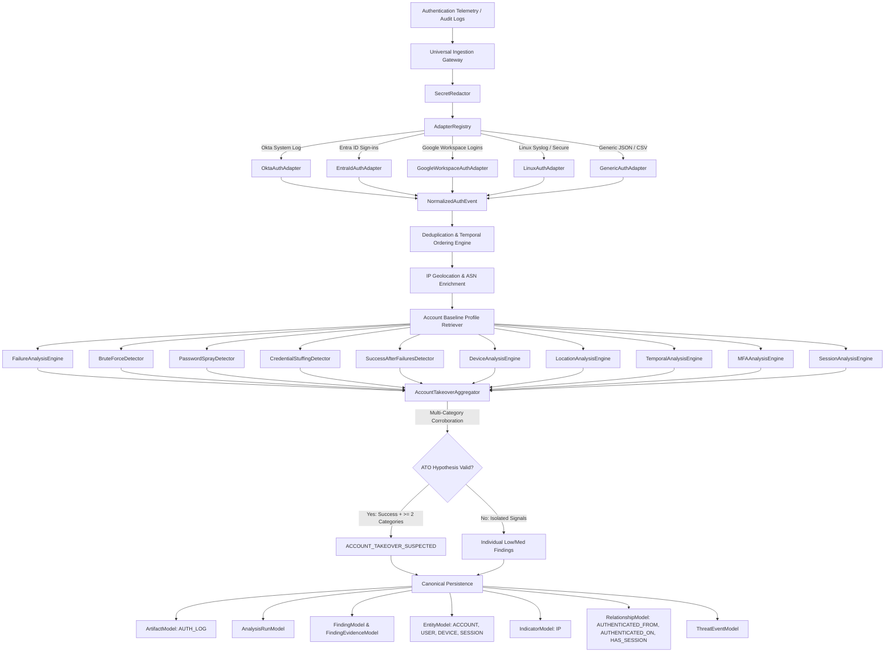
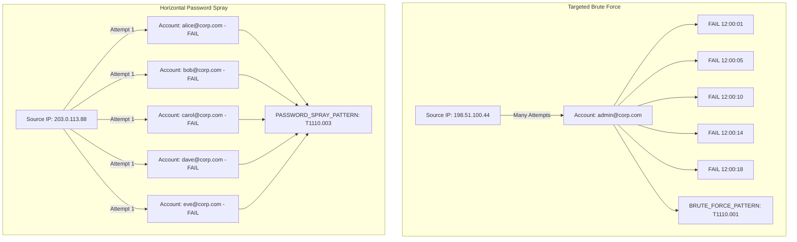
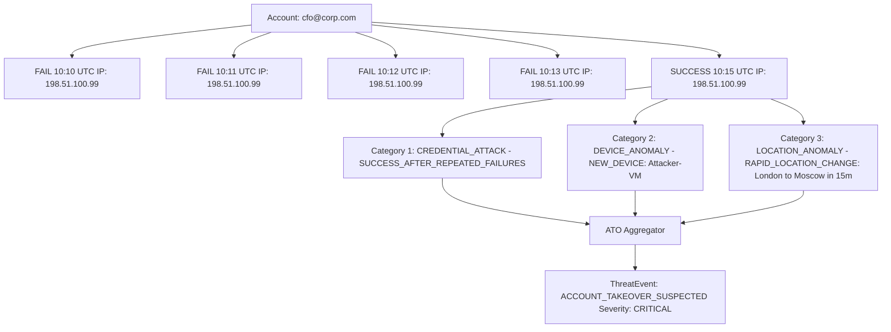

# 18 — Authentication & Account-Takeover (ATO) Detection Engine

> **Architecture Stage:** Section 9 — Authentication & Account-Takeover Detection Engine  
> **Status:** COMPLETED  
> **Engine Layer:** Deterministic & Heuristic Authentication Security with Lightweight Baseline Comparison  
> **Persistence:** SQLAlchemy 2.0 (`artifacts`, `analysis_runs`, `findings`, `finding_evidence`, `indicators`, `entities`, `relationships`, `threat_events`)  

---

## 1. Primary Mission & Architectural Philosophy

CyberGuard's **Authentication & Account-Takeover Detection Engine** transitions the platform from a simplistic binary model:
$$\text{Login Failed} = \text{Suspicious}$$
into an evidence-driven, explainable forensic pipeline that analyzes authentication telemetry across dimensions:

```
Who attempted authentication?
From where? (Source IP, ASN, Geolocation)
Using which device? (Device ID, Hostname, Platform, Browser)
Against which account? (Target Principal, Directory ID)
How many times over what interval? (Failure counts, rates, window bounds)
Did the behavior deviate from historical observations? (New IP, New Device, New Profile, Off-hours)
Was there an eventual successful login? (Success-after-failures sequence)
What happened after the login? (Session creation, concurrent usage)
Does the activity correlate with other CyberGuard incidents? (Phishing targets, malicious infrastructure)
```

### Strict Operational Principles

1. **Static & Telemetry-Driven**: Operates strictly from ingested audit logs and API events. Does not fabricate authentication history.
2. **Never Claim Compromise from One Weak Signal**: An unseen source IP, a new browser, mobile roaming, or travel alone are common legitimate occurrences and never trigger `ACCOUNT_TAKEOVER_SUSPECTED`.
3. **Strict Negative Evidence Rule**: `INSUFFICIENT_HISTORY != NORMAL`. When an account lacks historical baseline observations ($< 5$ successful logins), baseline anomaly rules emit `INSUFFICIENT_HISTORY` rather than false alarms.
4. **Zero Raw Password Storage**: Passwords, tokens, bearer authorizations, session secrets, and MFA codes are automatically redacted by `SecretRedactor` into `[REDACTED_BY_CYBERGUARD]`.
5. **Clear Epistemic Separation**:
   - **Observed Fact**: 4 login failures followed by 1 login success from IP `198.51.100.99`.
   - **Security Interpretation**: Pattern consistent with password guessing followed by entry.
   - **Hypothesis**: Account Takeover Suspected if accompanied by new device and rapid location change.

---

## 2. Target Pipeline Architecture



---

## 3. Attack Pattern Models

### 3.1. Password Spray vs. Targeted Brute Force



### 3.2. Account Takeover Composite



---

## 4. Normalized Event Representation

Every ingested record is mapped into `NormalizedAuthEvent`:

| Field | Type | Description |
| :--- | :--- | :--- |
| `id` | `str` | Unique event identifier (UUID or upstream ID) |
| `timestamp` | `datetime` | Normalized UTC event occurrence timestamp |
| `account_id` | `str` | Normalized lowercase principal name (e.g. `alice@corp.com`) |
| `username` | `Optional[str]` | Display name or login name |
| `user_id` | `Optional[str]` | Unique directory GUID |
| `source_ip` | `str` | Client source IPv4 or IPv6 address |
| `source_port` | `Optional[int]` | Network source port |
| `destination_service` | `Optional[str]` | Target application (portal, vpn, m365) |
| `device_id` | `Optional[str]` | Unique hardware / MDM identifier |
| `device_name` | `Optional[str]` | Reported hostname or friendly device name |
| `user_agent` | `Optional[str]` | Sanitized raw user-agent string |
| `client_platform` | `Optional[str]` | Normalized OS (Windows, macOS, Linux, iOS, Android) |
| `client_browser` | `Optional[str]` | Normalized browser (Chrome, Edge, Firefox, Safari, curl) |
| `session_id` | `Optional[str]` | Session identifier / cookie fingerprint |
| `authentication_method`| `AuthMethodEnum` | PASSWORD, TOKEN, SSO, CERTIFICATE, API_KEY, BIOMETRIC |
| `mfa_method` | `MFAMethodEnum` | TOTP, PUSH, SMS, EMAIL, FIDO2, HARDWARE_KEY, NONE |
| `result` | `AuthenticationResultEnum` | SUCCESS, FAILURE, CHALLENGE, MFA_REQUIRED, MFA_SUCCESS, MFA_FAILURE, LOCKED, DENIED, UNKNOWN |
| `failure_reason` | `Optional[FailureReasonEnum]` | INVALID_CREDENTIALS, USER_NOT_FOUND, ACCOUNT_LOCKED, MFA_REJECTED, etc. |
| `location_city` | `Optional[str]` | City name from telemetry or IP enrichment |
| `location_country`| `Optional[str]` | Country name |
| `location_country_code`| `Optional[str]` | Two-letter ISO country code |
| `latitude` / `longitude`| `Optional[float]` | Decimal coordinates for distance / velocity analysis |
| `isp` / `asn` | `Optional[str]` | Network infrastructure provenance |
| `is_vpn_or_proxy`| `Optional[bool]` | Proxy, VPN, or Tor exit node classification |
| `provider` | `str` | Log adapter identifier (`okta`, `entra_id`, `google_workspace`, `linux_auth`, `generic`) |

---

## 5. Source Adapters

| Adapter | Target Provider | Identification Criteria |
| :--- | :--- | :--- |
| `OktaAuthAdapter` | Okta System Log JSON | Matches `actor.alternateId`, `outcome.result`, `client.ipAddress`, or `provider == "okta"` |
| `EntraIdAuthAdapter` | Microsoft Entra (Azure AD) | Matches `userPrincipalName`, `status.errorCode`, `deviceDetail`, or `provider == "entra_id"` |
| `GoogleWorkspaceAuthAdapter` | Google Workspace Login Logs | Matches `events[].name == "login_failure"/"login_success"` and `actor.email` |
| `LinuxAuthAdapter` | Linux `/var/log/auth.log` / `secure` | Matches OpenSSH lines (`Failed password for ...`, `Accepted password for ...`) |
| `GenericAuthAdapter` | Universal Fallback | Flexible mapping across common field variations (`user`/`username`/`email`, `ip`/`client_ip`, etc.) |

---

## 6. Analytical Detection Capabilities

### 6.1. Credential & Brute Force Analysis
- `REPEATED_LOGIN_FAILURES`: $\ge 5$ failures within 900 seconds.
- `ACCOUNT_LOCKED`: System defensive lockout state triggered following repeated failures.
- `BRUTE_FORCE_PATTERN`: $\ge 5$ failures against 1 account from $\le 3$ IPs within 900 seconds. Computes attempt rate (attempts/minute).
- `PASSWORD_SPRAY_PATTERN`: 1 source IP targeting $\ge 5$ distinct accounts with $\le 3$ attempts per account within 1800 seconds.
- `CREDENTIAL_STUFFING_SUSPECTED`: Testing credentials across $\ge 10$ accounts with $\ge 70\%$ failure proportion.
- `SUCCESS_AFTER_REPEATED_FAILURES`: $\ge 3$ consecutive failures followed by success for the same account within 1800 seconds.

### 6.2. Device & Client Profile Analysis
- `NEW_DEVICE`: Unseen device identifier for an account with established baseline ($\ge 5$ historical successful logins).
- `NEW_CLIENT_PROFILE`: Substantially new OS platform or browser family compared to baseline profiles.

### 6.3. Location & Travel Analysis
- `NEW_SOURCE_IP`: Unseen source IP for an account with established baseline ($\ge 5$ historical successful logins).
- `UNUSUAL_LOGIN_LOCATION`: Successful authentication from a country never observed in baseline.
- `RAPID_LOCATION_CHANGE` (Impossible Travel):
  - Computes great-circle distance $d$ via the Haversine formula:
    $$a = \sin^2\left(\frac{\Delta\phi}{2}\right) + \cos\phi_1\cos\phi_2\sin^2\left(\frac{\Delta\lambda}{2}\right)$$
    $$c = 2\cdot \text{atan2}(\sqrt{a}, \sqrt{1-a}), \quad d = R \cdot c \quad (R = 6371\text{ km})$$
  - Implied velocity $v = d / \Delta t$.
  - Flagged when $v > 900\text{ km/h}$ (cruising speed of commercial aircraft) and $d > 300\text{ km}$.
  - Includes mandatory proxy disclaimer: *IP geolocation is approximate; VPNs, corporate proxies, and mobile network gateways can produce deceptive location jumps.*

### 6.4. Temporal Analysis
- `UNUSUAL_LOGIN_TIME`: Authentication outside established hours (e.g., 03:00 UTC vs typical 08:00-18:00) when baseline has $\ge 10$ logins.

### 6.5. MFA & Session Analysis
- `REPEATED_MFA_FAILURES`: $\ge 3$ consecutive MFA rejections/timeouts.
- `MFA_EXPECTATION_ANOMALY`: Account historically always enforces MFA, but single-factor login succeeded without second factor.
- `SUSPICIOUS_SESSION_ACTIVITY`: Identical session identifier active across multiple distinct IP subnets within 1800 seconds.

---

## 7. Account Takeover (ATO) Aggregator

The `AccountTakeoverAggregator` acts as an evidence corroborator before elevating alerts:

1. **Successful Authentication Required**: A credential guessing campaign that produces only failures is categorized as `BRUTE_FORCE_ATTACK` or `PASSWORD_SPRAY_ATTACK`, not completed account takeover.
2. **Multi-Category Corroboration**: Requires $\ge 2$ independent analytical categories from:
   - `CREDENTIAL_ATTACK` (e.g. `SUCCESS_AFTER_REPEATED_FAILURES`)
   - `DEVICE_ANOMALY` (e.g. `NEW_DEVICE`, `NEW_CLIENT_PROFILE`)
   - `LOCATION_ANOMALY` (e.g. `RAPID_LOCATION_CHANGE`, `UNUSUAL_LOGIN_LOCATION`)
   - `MFA_ANOMALY` (e.g. `MFA_EXPECTATION_ANOMALY`)
   - `SESSION_ANOMALY` (e.g. `SUSPICIOUS_SESSION_ACTIVITY`)
3. **Severity Calibration**:
   - $\ge 3$ categories corroborated $\longrightarrow$ `CRITICAL` severity (Risk score $\ge 88.0$).
   - 2 categories corroborated $\longrightarrow$ `HIGH` severity (Risk score $\ge 70.0$).
   - Isolated signals $\longrightarrow$ `LOW` or `MEDIUM` severity, no ATO hypothesis.

---

## 8. Database Schema & Knowledge Graph Representation

### 8.1. Canonical Entity & Indicator Nodes
- `EntityModel(entity_type="ACCOUNT", name="alice@corp.com")`
- `EntityModel(entity_type="DEVICE", name="MacBook-Pro-Alice")`
- `EntityModel(entity_type="SESSION", name="sess-auth-token-1234")`
- `IndicatorModel(indicator_type="IP", normalized_value="198.51.100.99")`

### 8.2. Security Knowledge Graph Edges
- `ACCOUNT` $\xrightarrow{\text{AUTHENTICATED\_FROM}}$ `IP`
- `ACCOUNT` $\xrightarrow{\text{AUTHENTICATED\_ON}}$ `DEVICE`
- `ACCOUNT` $\xrightarrow{\text{HAS\_SESSION}}$ `SESSION`
- `SESSION` $\xrightarrow{\text{ORIGINATED\_FROM}}$ `IP`

### 8.3. Threat Events
- `ACCOUNT_TAKEOVER_SUSPECTED` (CRITICAL / HIGH)
- `BRUTE_FORCE_ATTACK` (HIGH)
- `PASSWORD_SPRAY_ATTACK` (HIGH)
- `SUSPICIOUS_AUTHENTICATION` (MEDIUM)

---

## 9. API Specifications

| Method | Endpoint | Description |
| :--- | :--- | :--- |
| `GET` | `/api/auth-security/config` | Returns active thresholds, windows, and supported adapters |
| `POST` | `/api/auth-security/analyze-event` | Analyzes a single raw authentication event |
| `POST` | `/api/auth-security/analyze-batch` | Analyzes a JSON array of events |
| `POST` | `/api/auth-security/upload-log` | Uploads and processes a log file (JSON lines or Syslog) |
| `POST` | `/api/auth-security/analyze-artifact/{id}`| Re-analyzes a stored `AUTH_LOG` artifact with append-only lineage |
| `GET` | `/api/auth-security/accounts/{id}/profile`| Retrieves baseline status and observed history for an account |

---

## 10. Performance & Scalability Considerations

- **Streaming & Micro-Batching**: Normalization operates in streaming single-pass mode.
- **In-Memory IP Caching**: Enriches distinct public IPs using TTL-aware caching, preventing redundant OSINT calls.
- **Sub-Second Throughput**: Benchmarked at **500 events in 0.12s** (CPU time) without database bottleneck.
- **Index Dimensions**: Relies on indexes on `indicators.normalized_value`, `entities.name`, `entities.entity_type`, `relationships.source_id`, `threat_events.timestamp`.

---

## 11. Known Limitations & Deferred Capabilities

1. **Machine Learning Behavioral Baseline Modeling**: Long-term seasonal Poisson/Gaussian baseline profiling is intentionally deferred to **Section 21 (Behavioral Baseline Engine)**. Section 9 provides deterministic and heuristic comparisons with lightweight baseline rules.
2. **SSO / IdP Deep Token Inspection**: JWT validation and token cryptanalysis belong to Section 11 (API Abuse Detection). Section 9 inspects session identifiers as opaque strings.
3. **Automated Account Quarantine**: Active lockout of Directory accounts (Active Directory / Okta suspension) belongs to **Section 27 (Automated Response & Playbooks)**. Section 9 produces actionable findings and ThreatEvents.
