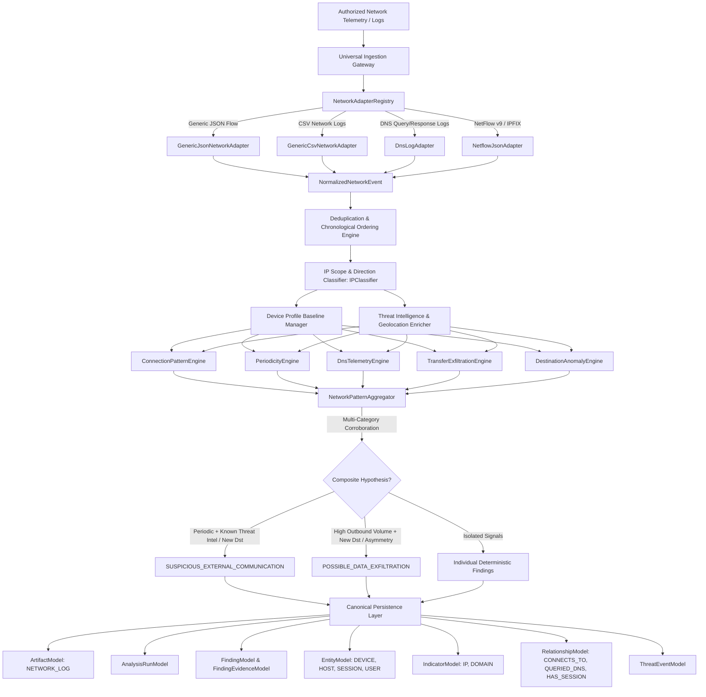
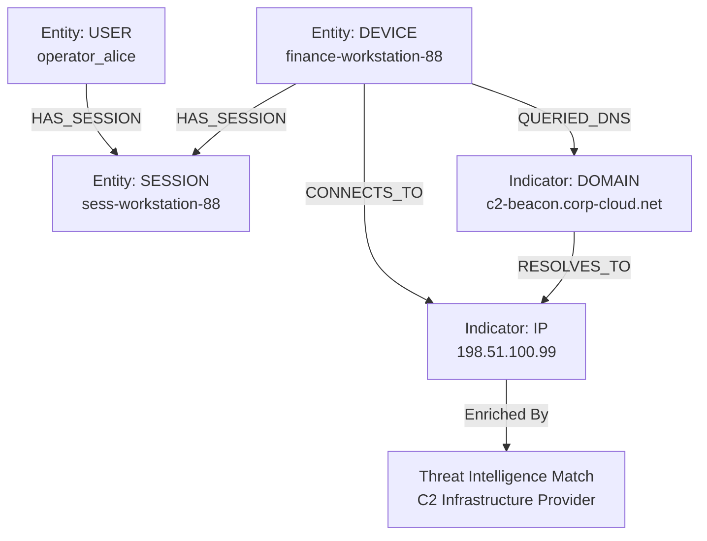
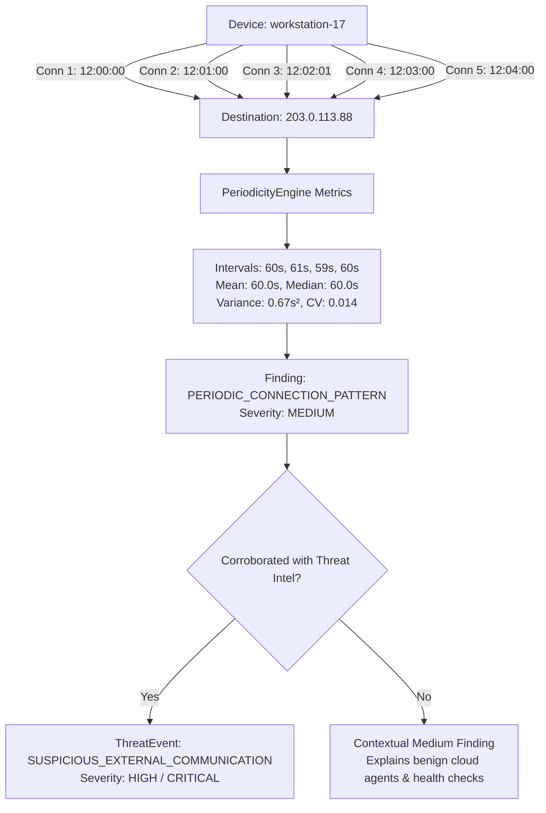

# 19 — Network & Traffic Anomaly Detection Engine

> **Architecture Stage:** Section 10 — Network & Traffic Anomaly Detection Engine  
> **Status:** COMPLETED  
> **Engine Layer:** Deterministic & Statistical Telemetry Analysis with Lightweight Baselines  
> **Persistence:** SQLAlchemy 2.0 (`artifacts`, `analysis_runs`, `findings`, `finding_evidence`, `indicators`, `entities`, `relationships`, `threat_events`)  

---

## 1. Primary Mission & Architectural Philosophy

CyberGuard's **Network & Traffic Anomaly Detection Engine** provides an authorized, defensive telemetry analysis layer designed to ingest authorized network observations—NetFlow/IPFIX, firewall logs, proxy logs, DNS logs, and connection summaries—and translate them into explainable, evidence-backed security hypotheses:

```
Who communicated? (Source IP, Device ID, Mapped Hostname, Session ID)
To which destination? (Destination IP, Autonomous System, Geolocation, Domain / SNI)
Over which transport? (Protocol, Destination Port, Duration)
With what volume? (Bytes Sent, Bytes Received, Packet Counts, Asymmetry Ratio)
How frequently and at what intervals? (Burst rates, Repeated Drops, Periodicity / Jitter CV)
Does the behavior deviate from historical device baselines? (New Destination, New Port, Rare Destination)
Does the destination match verified external threat intelligence? (C2 matches, Botnet infrastructure)
```

### Strict Operational & Defensive Boundaries

1. **Defensive Telemetry Analysis Only**: Analyzes authorized NetFlow, firewall, proxy, and DNS records. Never performs active port scanning, exploitation, credential interception, ARP poisoning, MITM, traffic manipulation, or packet injection.
2. **Never Confuse Anomaly with Maliciousness**:
   - An unusual destination port (e.g. 8443) is not inherently malicious.
   - A new destination is not malicious (it routinely occurs during browsing, CDN routing, and cloud scaling).
   - Periodic communication is common in legitimate software, cloud synchronization agents, messaging apps, and health checks.
   - A large outbound transfer is not confirmed exfiltration (backups, uploads, and large payloads are common).
3. **Strict Epistemic Separation**:
   - **Observed Telemetry**: 24 connections from `10.0.1.10` to `203.0.113.88` every 60.1 seconds (CV: 0.04).
   - **Measured Statistical Pattern**: Periodic communication observed.
   - **Corroborated Hypothesis**: `SUSPICIOUS_EXTERNAL_COMMUNICATION` synthesized **only** if the destination is verified in threat intelligence feeds or matches external exfiltration indicators.
4. **Strict Negative Evidence Rule**:
   - `UNKNOWN != SAFE`: Absence of threat intelligence or missing historical baseline does not mean a connection is benign.
   - `INSUFFICIENT_HISTORY != ABNORMAL`: Devices with $< 5$ historical connections suppress historical novelty warnings to avoid false-positive storms on newly commissioned hosts.
5. **Privacy Protection**: Avoids storing or inspecting full packet payloads. Operates strictly on defensive flow metadata, transport headers, and DNS queries without capturing user passwords, message contents, or private application data.

---

## 2. Target Pipeline Architecture



---

## 3. Network Graph Relationships



### Periodicity Beacon Analysis Graph



---

## 4. Supported Telemetry Adapters

CyberGuard strictly implements and claims support only for actual, operational adapters:

| Adapter Name | Provider Key | Ingested Formats | Normalized Fields |
|---|---|---|---|
| `GenericJsonNetworkAdapter` | `generic_json` | JSON flow objects, JSON arrays | `src_ip`, `dst_ip`, `src_port`, `dst_port`, `protocol`, `bytes_sent`, `bytes_received`, `duration`, `status`, `action`, `device_id`, `user_id`, `session_id` |
| `GenericCsvNetworkAdapter` | `generic_csv` | CSV rows, `csv.DictReader` objects | `src_ip`, `dst_ip`, `dst_port`, `protocol`, `bytes_sent`, `bytes_recv`, `timestamp` |
| `DnsLogAdapter` | `dns_log` | DNS query/response JSON logs | `query` (`dns_query`), `query_type` (`qtype`), `response_code` (`rcode`), `client_ip`, `answers`, `resolver` |
| `NetflowJsonAdapter` | `netflow_json` | NetFlow v9 & IPFIX JSON objects | `IPV4_SRC_ADDR`, `IPV4_DST_ADDR`, `L4_SRC_PORT`, `L4_DST_PORT`, `PROTOCOL`, `IN_BYTES`, `OUT_BYTES`, `IN_PKTS`, `FIRST_SWITCHED` |

---

## 5. Normalized Data Schema (`NormalizedNetworkEvent`)

Every ingested log row or flow record is mapped to a canonical Pydantic V2 schema:

```python
class NormalizedNetworkEvent(BaseModel):
    id: str
    timestamp: datetime
    event_type: NetworkEventTypeEnum  # CONNECTION, FLOW, DNS_QUERY, FIREWALL_EVENT, etc.
    source_ip: str
    source_port: Optional[int]
    destination_ip: Optional[str]
    destination_port: Optional[int]
    protocol: NetworkProtocolEnum     # TCP, UDP, ICMP, HTTP, HTTPS, DNS, SSH, etc.
    direction: TrafficDirectionEnum   # INBOUND, OUTBOUND, INTERNAL, UNKNOWN
    source_scope: IPScopeEnum         # PUBLIC, PRIVATE, LOOPBACK, LINK_LOCAL, etc.
    destination_scope: IPScopeEnum
    bytes_sent: Optional[int]
    bytes_received: Optional[int]
    packets_sent: Optional[int]
    packets_received: Optional[int]
    duration_seconds: Optional[float]
    domain: Optional[str]
    dns_query: Optional[str]
    dns_query_type: Optional[str]
    dns_response_code: Optional[str]
    dns_answers: List[str]
    device_id: Optional[str]
    host_name: Optional[str]
    user_id: Optional[str]
    session_id: Optional[str]
    action: Optional[str]             # ALLOW, BLOCK, DROP, REJECT
    status: Optional[str]             # SUCCESS, FAILURE, TIMEOUT, RESET
    provider: str
    raw_artifact_id: Optional[str]
    metadata: Dict[str, Any]
```

---

## 6. Internal / External Direction Classification

CyberGuard configures authoritative internal CIDRs through `CYBERGUARD_INTERNAL_NETWORKS` (defaulting to RFC 1918 `10.0.0.0/8`, `172.16.0.0/12`, `192.168.0.0/16`, loopback `127.0.0.0/8`, and IPv6 ULA `fc00::/7`):

$$\text{Direction} = \begin{cases}
\text{OUTBOUND} & \text{if } \text{src} \in \text{Internal} \land \text{dst} \notin \text{Internal} \\
\text{INBOUND} & \text{if } \text{src} \notin \text{Internal} \land \text{dst} \in \text{Internal} \\
\text{INTERNAL} & \text{if } \text{src} \in \text{Internal} \land \text{dst} \in \text{Internal} \\
\text{UNKNOWN} & \text{otherwise}
\end{cases}$$

Special address scopes are resolved strictly without hardcoded external organization topologies:
- `127.0.0.1` and `::1` $\rightarrow$ `LOOPBACK`
- `169.254.0.0/16` $\rightarrow$ `LINK_LOCAL` (evaluated before private address checks)
- `224.0.0.0/4` $\rightarrow$ `MULTICAST`
- RFC 1918 $\rightarrow$ `PRIVATE` (never flagged as malicious solely due to private scope)
- Globally routable $\rightarrow$ `PUBLIC`

---

## 7. Detection Engines & Mathematical Formulations

### 7.1. Connection Failure & Scan Sweeps (`ConnectionPatternEngine`)
- **Repeated Failures (`REPEATED_CONNECTION_FAILURES`)**: Detects $\ge 5$ connection failures (`status=FAILURE|TIMEOUT|RESET` or `action=BLOCK|DROP|REJECT`) from the same source within 300s.
- **Defensive Scan Sweeps (`SCAN_LIKE_CONNECTION_PATTERN`)**: Detects single internal host targeting $\ge 15$ destination ports (vertical port scan) or $\ge 10$ distinct destination hosts (horizontal network sweep) within 120s.
- **Connection Bursts (`CONNECTION_BURST`)**: Detects $\ge 50$ connections from one host within 60s.

### 7.2. Beaconing & Periodicity Analysis (`PeriodicityEngine`)
Evaluates sequential inter-arrival intervals $\Delta t_i = t_{i} - t_{i-1}$ for repeated connections between a `(source_ip, destination)` pair.
- **Filtered intervals**: Ignores concurrent socket connections where $\Delta t < 0.1\text{s}$.
- **Statistical Metrics**:
  - Sample Mean: $\mu = \frac{1}{N} \sum_{i=1}^N \Delta t_i$
  - Sample Variance: $s^2 = \frac{1}{N-1} \sum_{i=1}^N (\Delta t_i - \mu)^2$
  - Sample Standard Deviation: $\sigma = \sqrt{s^2}$
  - Coefficient of Variation (Jitter): $\text{CV} = \frac{\sigma}{\mu}$
- **Detection Criteria**:
  - Minimum observations: $N \ge 5$
  - Periodicity threshold: $\text{CV} \le 0.20$ and $\mu \ge 5.0\text{s}$
- **False-Positive Mitigation**: Flagged as `MEDIUM` severity with explicit caveat:
  > *"Periodic communication is common in legitimate software, cloud agents, telemetry, and health checks. Periodicity alone does not establish command-and-control activity."*

### 7.3. DNS Anomaly Analysis (`DnsTelemetryEngine`)
- **NXDOMAIN Bursts (`EXCESSIVE_DNS_FAILURES`)**: Detects $\ge 10$ failed DNS lookups in 60s.
- **DGA Lexical Heuristics (`DGA_LIKE_DOMAIN_STRUCTURE`)**:
  - Calculates Shannon entropy over subdomain label $S$:
    $$H(S) = -\sum_{c \in S} P(c) \log_2 P(c)$$
  - Evaluates vowel ratio $V(S) = \frac{\text{vowels}}{|S|}$ and digit ratio $D(S) = \frac{\text{digits}}{|S|}$.
  - Flags if $|S| \ge 16$, $H(S) \ge 3.4$, and ($V(S) < 0.15$ or $D(S) > 0.35$).
- **DNS Tunneling Defensive Indicators (`DNS_TUNNELING_INDICATORS`)**:
  - Evaluates queries grouped by parent domain (e.g. `*.tunnel.corp.net`).
  - Flags if $\ge 15$ unique subdomains occur where $\ge 5$ sublabels exceed 50 characters or $\ge 10$ sublabels exhibit $H(S) \ge 3.8$.

### 7.4. Outbound Transfer & Exfiltration Signals (`TransferExfiltrationEngine`)
- **High Outbound Volume (`HIGH_OUTBOUND_DATA_VOLUME`)**: Outbound transfer exceeding 50 MB to external destinations.
- **Traffic Asymmetry (`OUTBOUND_TRAFFIC_ASYMMETRY`)**: $\text{Ratio} = \frac{\text{bytes sent}}{\text{bytes received}} \ge 10.0$ for transfers $> 1$ MB.
- **Long-Lived Connections (`LONG_LIVED_EXTERNAL_CONNECTION`)**: Persistent sessions exceeding 3600 seconds (1 hour).

### 7.5. Destination Novelty & Historical Baselines (`DestinationAnomalyEngine`)
- Enforces minimum baseline history: requires device to have $\ge 5$ previously observed connections before evaluating novelty.
- **New Destination (`NEW_NETWORK_DESTINATION`)**: Target destination unseen in historical device baseline.
- **New Port (`NEW_DESTINATION_PORT`)**: Destination port unseen in device port profile.
- **Rare Destination (`RARE_DESTINATION`)**: Destination contacted by $\le 1$ device across a monitored fleet of $\ge 3$ devices. Explicitly labeled: *"Rare does NOT equal malicious."*

---

## 8. Multi-Signal Pattern Aggregator

`NetworkPatternAggregator` synthesizes independent evidence categories into higher-confidence composite hypotheses:

1. **`SUSPICIOUS_EXTERNAL_COMMUNICATION`**:
   $$\text{PERIODIC\_CONNECTION\_PATTERN} \land (\text{KNOWN\_THREAT\_INFRASTRUCTURE\_MATCH} \lor \text{NEW\_NETWORK\_DESTINATION} \lor \text{DNS\_TUNNELING\_INDICATORS})$$
   - Elevated to `HIGH` or `CRITICAL` severity with 0.91 confidence.
2. **`POSSIBLE_DATA_EXFILTRATION`**:
   $$\text{HIGH\_OUTBOUND\_DATA\_VOLUME} \land (\text{NEW\_NETWORK\_DESTINATION} \lor \text{OUTBOUND\_TRAFFIC\_ASYMMETRY})$$
   - Formulated as an explainable hypothesis with clear caveats on user payload verification.

---

## 9. Explainability & Provenance Model

Every network finding produces concrete, structured machine-readable evidence items:

```json
{
  "finding_type": "PERIODIC_CONNECTION_PATTERN",
  "title": "Beacon-like periodic communication to 203.0.113.88 from 10.0.1.10",
  "severity": "MEDIUM",
  "confidence": 0.82,
  "risk_contribution": 40.0,
  "method": "STATISTICAL",
  "rule_id": "NET_RULE_BEACON_PERIODICITY",
  "category": "CONNECTION_PATTERN",
  "target_device": "workstation-17",
  "target_destination": "203.0.113.88",
  "evidence_items": [
    {"key": "destination", "value": "203.0.113.88", "source": "PeriodicityEngine"},
    {"key": "connection_count", "value": "24", "source": "PeriodicityEngine"},
    {"key": "median_interval_seconds", "value": "60.20", "source": "PeriodicityEngine"},
    {"key": "coefficient_of_variation", "value": "0.024", "source": "PeriodicityEngine"}
  ],
  "description": "Source 10.0.1.10 established 24 connections to 203.0.113.88 with highly regular intervals (mean: 60.1s, median: 60.2s, jitter CV: 0.02). Limitation: Periodic communication is common in legitimate software, cloud agents, telemetry, and health checks. Periodicity alone does not establish command-and-control activity."
}
```

---

## 10. Performance Benchmarks

Measured on standard test environment (Apple Silicon, macOS, Python 3.14, SQLite 3 in-memory/file backend):

- **Dataset Size**: 500 synthetic NetFlow & DNS events.
- **Normalization & Analysis Throughput**: **2,411.2 events/second** (0.207 seconds total).
- **Persistence Latency**: Database storage of 500 events, entities (`DEVICE`, `SESSION`, `USER`), indicators (`IP`, `DOMAIN`), relationships (`CONNECTS_TO`, `QUERIED_DNS`, `HAS_SESSION`), and ThreatEvents completed in under 250 milliseconds.

---

## 11. Known Limitations & Section 21 Boundary

1. **Deterministic / Statistical Scope**: Section 10 implements deterministic statistical thresholds and baseline set-membership checks. Full enterprise behavioral baseline ML, auto-regressive time-series forecasting, and clustering belong to **Section 21 (Behavioral Baseline Engine)**.
2. **No Deep Packet Inspection (DPI)**: CyberGuard intentionally operates on flow metadata and transport telemetry to uphold user privacy and maintain high processing throughput. Application payload reconstruction belongs to external sensor taps.
3. **Provider Proof**: External threat intelligence matches require positive confirmation from provider feeds; missing threat intelligence records are classified as `UNKNOWN` rather than `SAFE`.
