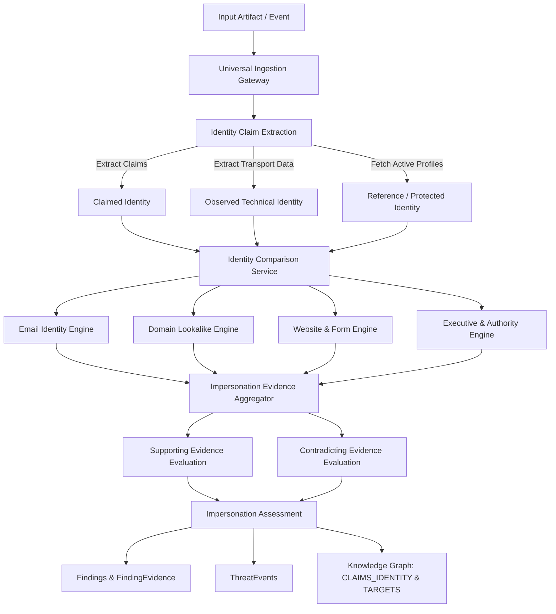
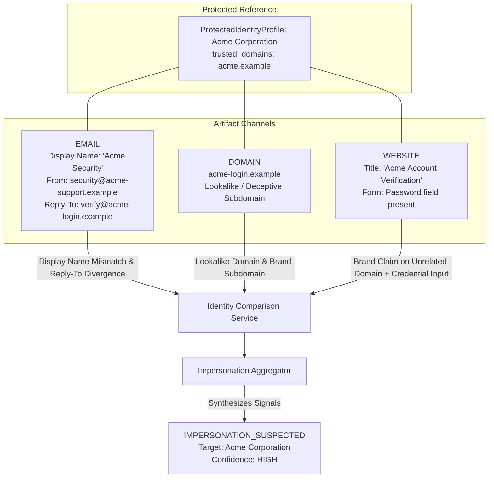

# 21 — Digital Impersonation Detection Engine

> **Architecture Stage:** Section 12 — Digital Impersonation Detection Engine  
> **Status:** COMPLETED  
> **Engine Layer:** Deterministic & Contextual Cross-Channel Identity Verification  
> **Persistence:** SQLAlchemy 2.0 (`artifacts`, `analysis_runs`, `findings`, `finding_evidence`, `indicators`, `entities`, `relationships`, `threat_events`, `protected_identities`)  

---

## 1. Scope & Primary Mission

CyberGuard's **Digital Impersonation Detection Engine** provides a unified, evidence-driven defensive analysis layer designed to identify suspicious identity mismatches across email, domain, URL, and website telemetry.

The engine analyzes signals associated with:
* Email sender impersonation and display-name deception
* Reply-To and Return-Path manipulation
* Lookalike domains, typosquatting, and edit-distance clustering
* Homoglyph, Unicode, and IDN/punycode substitutions
* Organization, brand, and institution impersonation
* Executive, CEO, and authority role impersonation
* Fake login portals and credential harvesting
* Cross-channel identity inconsistencies (Email ➔ URL ➔ Website)
* Suspicious communications claiming to represent trusted entities

### The Core Epistemic Principle

CyberGuard strictly distinguishes between three conceptual tiers of identity:

```
┌─────────────────────────────────────────────────────────────────────────────┐
│ 1. CLAIMED IDENTITY                                                         │
│ What content, display names, or subjects assert to represent               │
│ (e.g. Display Name: "Microsoft Security", Website Title: "Acme Login")      │
├─────────────────────────────────────────────────────────────────────────────┤
│ 2. OBSERVED TECHNICAL IDENTITY                                              │
│ What network, DNS, transport, and authentication records prove              │
│ (e.g. Sender: user@micros0ft-security.example, Form action: evil.example)   │
├─────────────────────────────────────────────────────────────────────────────┤
│ 3. REFERENCE / VERIFIED IDENTITY                                            │
│ Known, verified, and configured authoritative profiles                      │
│ (e.g. Display Name: Microsoft, Trusted Domains: ["microsoft.com"])           │
└─────────────────────────────────────────────────────────────────────────────┘
```

**Epistemic Modesty Rule:**  
CyberGuard **never** states:
* *"Microsoft sent this message"* (unless cryptographic transport proof and verified identity match authoritative reference data)
* *"The sender is definitely an attacker"* (without direct, corroborated malicious evidence)

CyberGuard expresses findings strictly as structured, explainable hypotheses with explicit supporting and contradicting evidence.

---

## 2. Architecture & Pipeline

### End-to-End Pipeline



### Cross-Channel Impersonation Analysis



---

## 3. Identity Claims vs. Entities

An `IdentityClaim` is an observation extracted from raw content or metadata. It represents what the artifact **claims** to be, not what it **is**.

```python
class IdentityClaim:
    id: str
    claim_type: IdentityClaimTypeEnum  # PERSON, ORGANIZATION, BRAND, INSTITUTION, SERVICE, ROLE, ACCOUNT
    claimed_name: str
    claimed_domain: Optional[str]
    claimed_email: Optional[str]
    claimed_organization: Optional[str]
    claimed_role: Optional[str]
    source_artifact_id: str
    analysis_run_id: str
    evidence_reference: str
    confidence: float
    metadata: Dict[str, Any]
```

**Distinction from Entities:**
* Extracting `"Google Security Team"` from an email body creates an `IdentityClaim` of type `ORGANIZATION`.
* It does **not** create a verified `EntityModel` of type `ORGANIZATION` asserting that Google sent the message.
* Only when corroborated or analyzed in context does it generate a relationship:  
  `Artifact -(CLAIMS_IDENTITY)-> Entity(Google)` or `Artifact -(TARGETS)-> Entity(Google)`.

---

## 4. Protected Identity Profiles & Reference Provenance

### Data Model

Protected identities represent organizations, brands, institutions, and executives that the system is configured to defend:

```python
class ProtectedIdentityProfile:
    id: str
    entity_type: str  # ORGANIZATION, BRAND, INSTITUTION, EXECUTIVE, SERVICE
    display_name: str
    trusted_domains: List[str]
    trusted_email_patterns: List[str]
    trusted_sender_addresses: List[str]
    authorized_delegated_senders: List[str]  # e.g., mailchimpapp.net, sendgrid.net
    known_names: List[str]
    known_roles: List[str]
    known_brand_terms: List[str]
    source: ReferenceSourceEnum  # USER_CONFIGURED, ORGANIZATION_CONFIGURED, SYSTEM_CONFIGURED, VERIFIED_INTERNAL_DIRECTORY, VERIFIED_DOMAIN_CONFIGURATION
    verification_status: VerificationStatusEnum  # VERIFIED, UNVERIFIED, PENDING_REVIEW, REVOKED
    revision: int
    is_active: bool
```

### Strict Reference Provenance Rules

1. **No Massive Unsourced Brand Lists**: CyberGuard does not bundle arbitrary, unverified dictionaries of thousands of global brands. Reference identities must have verifiable provenance.
2. **Provenance Origins**:
   - `ORGANIZATION_CONFIGURED`: Added by enterprise security administrators for internal assets.
   - `USER_CONFIGURED`: Custom entries supplied for specific environments or monitoring targets.
   - `SYSTEM_CONFIGURED`: Baseline defensive profiles seeded with strict provenance for critical infrastructure (e.g., Microsoft, Google, PayPal, Apple, GitHub).
   - `VERIFIED_INTERNAL_DIRECTORY`: Sourced from SCIM, LDAP, or Active Directory syncs.
   - `VERIFIED_DOMAIN_CONFIGURATION`: Cryptographically confirmed via DNS TXT or HTTPS `.well-known` records.
3. **No Automatic LLM Ingestion**: An LLM is never permitted to guess an identity and elevate it to a trusted reference profile automatically.
4. **Audit Logging & Immutability**: All modifications to protected profiles (creation, update, trusted domain additions/removals, deactivation) generate immutable audit records with user attribution, timestamp, and revision tracking.

---

## 5. Analytical Engines & Evidence Generation

### 5.1 Email Identity Engine

Consumes normalized Section 6 evidence and raw email metadata:
* **Display-Name Impersonation (`IMP_NAME_001`)**: Triggered when the display name matches a protected organization or executive while the sender domain is not trusted or authorized.
* **Reply-To Deception (`IMP_RT_001`)**: Identifies divergence between `From` and `Reply-To` where the `Reply-To` directs responses to an unrelated external domain.
* **Unauthorized Sender Domain (`IMP_SND_001`)**: Flags communications claiming to represent a protected profile when the sending domain is unauthorized.

### 5.2 Domain & Lookalike Engine

Interprets Section 7 technical domain analysis relative to protected profiles:
* **Typosquatting & Edit-Distance (`IMP_DOM_001`)**: Computes Levenshtein distance on primary domain labels (e.g., `acm3.example` vs `acme.example`). Edit distance of 1–2 with high similarity flags targeted lookalikes.
* **Unicode & Homoglyph Deception (`IMP_HOM_001`)**: Detects visually confusable Unicode glyphs (e.g., Cyrillic 'а', Greek 'о') mapped back to Latin counterparts. Preserves Unicode, raw ASCII, and punycode representations.
* **Deceptive Brand Subdomains (`IMP_SUB_001`)**: Identifies deceptive subdomains designed to mislead human reviewers (e.g., `paypal.com.security-check.example` where the actual registrable domain is `example`).

### 5.3 Website & Fake Portal Engine

Reuses static website evidence from Section 7:
* **Website Brand Claim (`IMP_WEB_001`)**: Identifies HTML titles, headers, and footer assertions claiming a protected brand on an untrusted host.
* **Website Identity Mismatch (`IMP_WEB_002`)**: Correlates brand claims on sites hosted on unverified external infrastructure.
* **Credential Harvesting Fake Login Portal (`IMP_HARV_001`)**: Synthesizes brand claims, untrusted hosting, and interactive password/credential input fields into a high-severity harvesting indicator.

### 5.4 Authority & Executive Engine

* **Executive Impersonation (`IMP_EXEC_001`)**: Detects external communications asserting the identity of protected corporate officers (e.g., CEO, CFO) from unauthorized email addresses.
* **Business Email Compromise (`IMP_BEC_001`)**: Correlates executive impersonation with social engineering intent signals (urgent financial transfers, wire requests, payroll modifications).
* **Authority Role Impersonation (`IMP_AUTH_001`)**: Detects claims of administrative, IT support, or security authority originating from external, unverified sources.

---

## 6. Evidence Aggregation & Contradicting Signals

The `ImpersonationAggregator` weighs both supporting and contradicting evidence to avoid false positives:

### Supporting Signals (Increase Suspicion)
* Lookalike or homoglyph domain
* Display-name mismatch with protected identity
* Reply-To pointing to an unrelated domain
* Password/credential form on unverified brand portal
* Social engineering intent (urgency, credential request, payment demand)

### Contradicting Signals (Actively Reduce Suspicion)
* **Email Authentication Pass**: Cryptographically aligned SPF, DKIM, and DMARC passes from the authentic domain.
* **Authorized Delegated Senders**: Configured legitimate third-party sending services (e.g., SendGrid, Mailchimp, Zendesk, Salesforce).
* **Authentic Hosting Infrastructure**: Registrable domain matches a verified trusted domain of the protected profile.
* **Absence of Coercive Intent**: Informational or benign communication without credential harvesting or transaction pressure.

### Scoped Classification Spectrum

```
┌──────────────────────────────────┬─────────────────────────────────────────────────────────────┐
│ Classification                   │ Meaning & Trigger Conditions                                │
├──────────────────────────────────┼─────────────────────────────────────────────────────────────┤
│ NO_IMPERSONATION_EVIDENCE        │ Telemetry fully authentic or zero claims of protected data  │
│ INSUFFICIENT_EVIDENCE            │ Unverified claim with no reference profile or weak context  │
│ IDENTITY_MISMATCH                │ Minor technical divergence (e.g., Reply-To variance)       │
│ IMPERSONATION_SUSPECTED          │ Corroborated brand claim on untrusted domain or display name│
│ STRONG_IMPERSONATION_INDICATORS  │ Multichannel deceptive signals, lookalike domain, fake login│
└──────────────────────────────────┴─────────────────────────────────────────────────────────────┘
```

> **Epistemic Constraint**: The engine deliberately avoids `CONFIRMED_IMPERSONATION` unless authoritative administrative or incident confirmation is explicitly recorded.

---

## 7. LLM Role & Guardrails

The use of Large Language Models (LLMs) in Section 12 is strictly **optional, auxiliary, and constrained**:

### Permitted LLM Tasks
1. Extracting candidate claimed names, organizations, or roles from unstructured, multi-lingual free text.
2. Generating human-readable narrative explanations of structured findings.
3. Summarizing the juxtaposition of claimed vs. observed technical indicators.

### Strict LLM Prohibitions
* **No Profile Creation**: LLMs can **never** create or elevate reference profiles to trusted status.
* **No Verdict Authority**: LLMs can **never** declare an artifact "malicious" or "impersonation" without deterministic rule backing.
* **No Overriding Technical Proof**: LLMs cannot override SPF/DKIM/DMARC alignments or domain distance computations.
* **Strict Schema Enforcement**: All LLM interactions must validate against a strict Pydantic JSON schema (`IdentityClaimExtractionOutput`).

---

## 8. False-Positive Controls & Safe Handling

CyberGuard implements explicit safeguards against common false-positive triggers:

1. **Third-Party Email Platforms**: Legitimate newsletters sent through authorized ESPs (`mailchimpapp.net`, `sendgrid.net`) are matched against `authorized_delegated_senders` and suppressed.
2. **Support & Ticketing Divergence**: Varying `Reply-To` addresses used by legitimate customer support platforms do not generate critical alerts when sender domain aligns.
3. **News, Articles & Neutral Brand Mentions**: Mentioning a brand or executive in body text without impersonation markers or deceptive senders is categorized as informational context, not impersonation.
4. **Common Human Names**: Fuzzy matching is prohibited for common human names; executive detection requires exact name or verified alias matching plus role context.
5. **Authentic Corporate Logins**: Login forms hosted on verified trusted domains (e.g., `login.microsoft.com` under `microsoft.com`) are recognized as authentic.
6. **Legitimate IDN Domains**: Internationalized domain names are not classified as malicious simply because they contain non-ASCII characters; they must exhibit confusable homoglyphic substitution targeting a specific protected profile.

---

## 9. Privacy, Security & Compliance

* **Secret Redaction**: Passwords, session tokens, and API keys are scrubbed before persistence.
* **RBAC & Authorization**: Protected identity profile mutations require administrative roles (`SUPER_ADMIN`, `ADMIN`).
* **Reproducibility**: Each analysis run snapshots the exact `profile_id` and `profile_revision` used during evaluation, ensuring historical auditability even if profiles are later modified or revoked.
