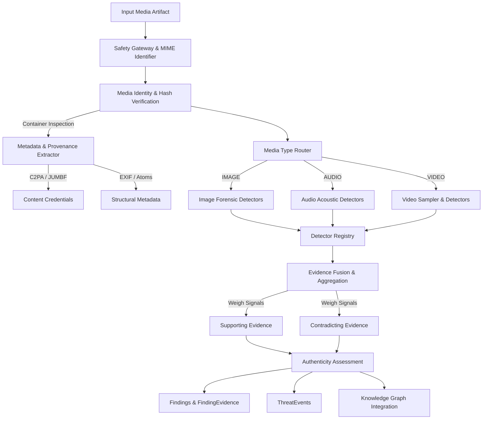

# 22 — Deepfake & Multimedia Authenticity Analysis Engine

> **Architecture Stage:** Section 13 — Deepfake & Multimedia Authenticity Analysis Engine  
> **Status:** COMPLETED  
> **Engine Layer:** Modular Multi-Modal Forensics, Spectral/ELA Analysis & Provenance Verification  
> **Persistence:** SQLAlchemy 2.0 (`artifacts`, `analysis_runs`, `findings`, `finding_evidence`, `entities`, `relationships`, `threat_events`)  

---

## 1. Scope & Primary Mission

CyberGuard's **Deepfake & Multimedia Authenticity Analysis Engine** provides a modular, explainable defensive analysis layer designed to evaluate the integrity and authenticity of digital images, audio, and video streams.

The engine analyzes evidence related to:
* Possible AI-generated images (latent diffusion models, GANs, generative upsampling)
* Digitally manipulated, spliced, or composited images
* Deepfake video streams (facial manipulation, inter-frame temporal discontinuities)
* Synthetic or voice-cloned speech (abrupt vocoder spectral cutoffs, monotonic pitch trajectories)
* Metadata and container provenance (EXIF, camera hardware parameters, encoder signatures)
* Cryptographic Content Credentials (C2PA / JUMBF manifests)
* Multi-modal detector disagreement (e.g. authentic video with synthetic audio overlay)
* Calibrated authenticity assessments that never reduce multimedia forensics to a binary `AI score > threshold = FAKE`

### Epistemic Principles & Core Boundary

CyberGuard strictly distinguishes between four analytical tiers:

```
┌─────────────────────────────────────────────────────────────────────────────┐
│ 1. OBSERVED MEDIA PROPERTIES                                                │
│ Binary container atoms, pixel dimensions, EXIF tags, sample rates, waveforms │
├─────────────────────────────────────────────────────────────────────────────┤
│ 2. MODEL DETECTOR OUTPUT                                                    │
│ Raw scores, spectral peak counts, error level variance, detector status      │
├─────────────────────────────────────────────────────────────────────────────┤
│ 3. AUTHENTICITY ASSESSMENT                                                  │
│ Calibrated synthesis of supporting vs. contradicting evidence               │
├─────────────────────────────────────────────────────────────────────────────┤
│ 4. IDENTITY ATTRIBUTION                                                     │
│ External context, investigation metadata, or Section 12 protected profiles  │
└─────────────────────────────────────────────────────────────────────────────┘
```

**Epistemic Modesty Guarantees:**
* CyberGuard **never** states: *"This person created a deepfake"* or *"This video is definitely fake."*
* CyberGuard **never** invents or fabricates AI scores when no model is available (**NO FAKE AI MODEL** rule).
* Missing EXIF, recompression, or absence of C2PA credentials is **never** treated as proof of manipulation.

---

## 2. Security Boundaries & Non-Execution Guarantees

1. **Defensive Static Forensics Only**: CyberGuard processes media strictly as **DATA**. It never executes embedded binary streams, macro payloads, or active scripts.
2. **Decompression & Resource Bomb Protection**:
   * Image pixel bounding: `Pillow.Image.MAX_IMAGE_PIXELS = 50_000_000` (50 Megapixels max) to prevent pixel decompression bombs.
   * File size limits: Strict `MAX_MEDIA_BYTES = 50 MB` limit on direct uploads.
   * Temporal and sampling bounding: Max 30 frame samples for video; max 10 temporal segments for audio.
3. **No Biometric Surveillance or Facial Recognition**:
   * Face detection is used strictly as a local bounded cropping mechanism for frame-level analysis.
   * CyberGuard **does not** perform arbitrary facial recognition, face search, biometric database indexing, or voice identification.
4. **Temporary Processing Safety**:
   * All frame extractions and intermediate wave/audio buffers use safe temporary directories (`tempfile.TemporaryDirectory`) with guaranteed cleanup in `finally` blocks.
   * Safe binary arguments; no raw shell string concatenation with untrusted file names.

---

## 3. Architecture & Target Pipeline



---

## 4. Capability Matrix

| Capability | Image | Audio | Video |
| :--- | :---: | :---: | :---: |
| **Cryptographic Hash / Identity** | YES | YES | YES |
| **MIME / Magic Container Detection** | YES | YES | YES |
| **Structural & Hardware Metadata** | YES | YES | YES |
| **Content Credentials (C2PA/JUMBF)** | YES | YES | YES |
| **Real Local Signal Forensics** | YES (2D-DCT & ELA) | YES (FFT & Spectral) | YES (Inter-frame & Frame ELA) |
| **Bounded Frame / Segment Sampling** | N/A | YES (Acoustic Segments) | YES (Uniform Frame Sampling) |
| **Multimodal Disagreement** | N/A | N/A | YES (Video vs Audio Track) |
| **Section 12 Impersonation Link** | YES | YES | YES |

---

## 5. Detector Registry & Specification Matrix

| Detector ID | Media Type | Purpose | Implementation | Model / Heuristic | Input Reqs | Threshold | Status |
| :--- | :--- | :--- | :--- | :--- | :--- | :--- | :--- |
| `img_meta_01` | IMAGE | GenAI Software / Prompt Detection | Python EXIF & PNG info parser | Heuristic Regex & EXIF Tags | Raw Image | GenAI Prompt / Software tag | **AVAILABLE** |
| `img_freq_01` | IMAGE | High-Frequency & Grid Artifacts | SciPy 2D-DCT & NumPy FFT | 2D Orthogonal DCT Radial Spectrum | Grayscale 256x256 | Peak count $\ge 50$ or HF ratio $\ge 0.30$ | **AVAILABLE** |
| `img_ela_01` | IMAGE | Splicing & Error Level Analysis | Pillow JPEG Resave Difference | Quadrant Compression Variance | RGB Image | Quadrant Max Diff $\ge 1.5$ | **AVAILABLE** |
| `aud_spec_01` | AUDIO | Acoustic & Vocoder Band-limit | SciPy FFT & Wave Parser | Spectral Flatness & 8kHz Rolloff | PCM / WAV | Abrupt HF cutoff $< 0.001$ | **AVAILABLE** |
| `vid_frame_01`| VIDEO | Frame-Level Manipulation | Bounded Temporal Frame Sampler | Multi-Spectral Frame Forensics | MP4/MOV/GIF | Frame score $> 0.60$ | **AVAILABLE** |
| `vid_temp_01` | VIDEO | Temporal Inconsistency / Flickering | Inter-Frame Structural Difference | Color Histogram & L1 Difference | $\ge 2$ Frames | Inter-frame jitter $> 35.0$ | **AVAILABLE** |

---

## 6. Detailed Analytical Engines

### 6.1 Image Forensics Engine
* **Metadata & Provenance Detector (`img_meta_01`)**: Identifies generator software tags (Midjourney, Stable Diffusion, DALL-E, ComfyUI, NovelAI) in EXIF `UserComment` or PNG `parameters` chunks.
* **Frequency Spectral Analysis (`img_freq_01`)**: Calculates 2D Discrete Cosine Transform (DCT). Identifies periodic grid peaks and abnormal high-frequency energy caused by generative upsampling convolutions.
* **Error Level Analysis (`img_ela_01`)**: Resaves image at quality 90 and calculates error variance across image quadrants to detect composite splicing or localized tampering.

### 6.2 Audio & Synthetic Speech Forensics Engine
* **Acoustic Rolloff & Vocoder Cutoff (`aud_spec_01`)**: Computes power spectrum via FFT. Detects unnatural artificial band-limiting above 8kHz/12kHz typical of neural TTS vocoders.
* **Pitch Stability**: Measures fundamental frequency contour variation. Unnatural monotonic flatness raises synthetic speech indicators.

### 6.3 Video & Deepfake Forensics Engine
* **Bounded Frame Sampler (`VideoFrameSampler`)**: Samples frames uniformly across duration with monotonic timestamp indexes.
* **Frame-by-Frame Forensics (`vid_frame_01`)**: Evaluates sampled frames using frequency and compression detectors, recording exact suspicious frame timestamps.
* **Temporal Consistency (`vid_temp_01`)**: Evaluates sequential frame divergence, identifying unnatural jump-cuts and face-swap boundary flickering.
* **Multimodal Disagreement (`MULTIMODAL_DETECTOR_DISAGREEMENT`)**: Detects divergence when video frames appear authentic but the audio track exhibits synthetic speech (e.g., deepfake audio dubbing over real footage).

---

## 7. Evidence Fusion & Authenticity Assessment

The `MediaAuthenticityAggregator` evaluates both supporting and contradicting evidence:

### Supporting Signals (Increase Suspicion)
* Embedded generative AI prompt/software tags (`img_meta_01`)
* Elevated 2D-DCT high-frequency spectral grid peaks (`img_freq_01`)
* Heterogeneous ELA compression variance across quadrants (`img_ela_01`)
* Abrupt high-frequency acoustic cutoff in speech (`aud_spec_01`)
* Temporal structural divergence across sampled video frames (`vid_temp_01`)
* Multimodal disagreement between video frames and audio track

### Contradicting Signals (Actively Decrease Suspicion)
* **Cryptographic Content Credentials (C2PA)**: Valid digital signature and verified provenance manifest.
* **Physical Camera Provenance**: Authentic EXIF metadata with camera make, model, lens, and exposure parameters.
* **Natural Acoustic Spectrum**: Continuous high-frequency harmonics above 8kHz.
* **Uniform Inter-frame Consistency**: Smooth temporal frame progression.

### Scoped Classifications
1. `NO_STRONG_MANIPULATION_SIGNAL`: Normal characteristics, no significant anomalies detected.
2. `INSUFFICIENT_EVIDENCE`: Unrecognized format, low quality, or unavailable detectors.
3. `MANIPULATION_SIGNALS_DETECTED`: Localized editing, compression discrepancy, or splicing detected.
4. `SYNTHETIC_MEDIA_SIGNALS_DETECTED`: Machine-generated indicators (frequency peaks, vocoder cutoff).
5. `STRONG_SYNTHETIC_MEDIA_INDICATORS`: Multiple converging indicators across spatial, frequency, and temporal dimensions.

---

## 8. Integration with Section 12 (Impersonation)

When a media artifact is ingested in connection with a claimed corporate identity (e.g. an email or video claiming to be from a protected executive):
* If `SYNTHETIC_MEDIA_SIGNALS_DETECTED` or `STRONG_SYNTHETIC_MEDIA_INDICATORS` is identified:
  * Emits `DEEPFAKE_IMPERSONATION_SUSPECTED` ThreatEvent.
  * Connects graph relationship `(MediaArtifact)-[TARGETS]->(Entity:Executive)`.
* If no identity context exists:
  * Emits `SYNTHETIC_MEDIA_SUSPECTED` or `DEEPFAKE_VIDEO_SUSPECTED` without guessing who was depicted.

---

## 9. Privacy, Security & Resource Governance

* **No Leaked Media**: Extracted frames, temporary audio buffers, and intermediate files are created in isolated temporary directories and deleted upon analysis completion.
* **Decompression Safety**: Pillow decompression bomb protection enforced globally.
* **No Unsolicited Cloud Uploads**: Analysis runs locally on CPU/local hardware without transmitting media to external third-party cloud APIs unless explicitly configured.
