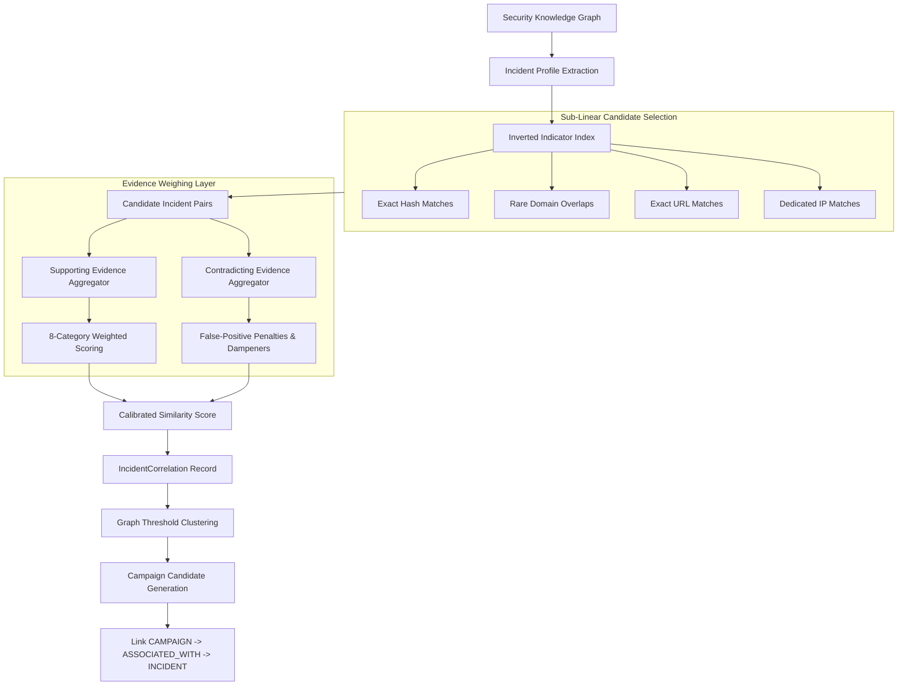

# 24 — Cross-Incident Pattern Detection & Campaign Correlation Engine

## 1. Purpose & Scope

The **Cross-Incident Pattern Detection & Campaign Correlation Engine** (Section 15) provides explainable cross-investigation correlation across separate security incidents within CyberGuard. It identifies recurring adversary infrastructure, shared artifact payloads, lookalike domain families, similar social engineering templates, and common delivery tactics.

### Core Principle
$$\textbf{OBSERVATION} \neq \textbf{RELATIONSHIP} \neq \textbf{CORRELATION} \neq \textbf{CAUSATION}$$

* **Shared Indicator $\neq$ Shared Campaign**: Sharing a common cloud IP, CDN resolver, or webmail domain does not imply coordinated adversary action.
* **Shared Campaign $\neq$ Same Human Threat Actor**: CyberGuard strictly generates **Campaign Candidates** and reports **observed similarity strength**; it **NEVER** declares attribution to an individual person or nation-state group without authoritative, verifiable intelligence.

---

## 2. Architecture & Pipeline



---

## 3. Incident Correlation Profile

The primary correlation comparison unit is the **Incident / Investigation**, not individual raw events. The `IncidentCorrelationProfile` is constructed dynamically from normalized evidence, findings, threat events, and the Security Knowledge Graph:

```python
class IncidentCorrelationProfile(BaseModel):
    incident_id: str
    workspace_id: str = "default"
    time_start: Optional[datetime]
    time_end: Optional[datetime]
    domains: List[str]
    ips: List[str]
    urls: List[str]
    hashes: List[str]
    sender_domains: List[str]
    sender_addresses: List[str]
    protected_identities: List[str]
    targeted_accounts: List[str]
    targeted_services: List[str]
    threat_event_types: List[str]
    finding_types: List[str]
    tactic_features: List[str]
    template_fingerprint: Optional[str]
    profile_version: str = "2.0.0"
    generated_at: datetime
```

---

## 4. Feature Categories & Category Weights

Correlation features are decomposed across 8 categories to prevent single dimensions from dominating evaluations:

| Category | Weight | Description | Primary Indicators |
|---|:---:|---|---|
| `INFRASTRUCTURE` | 0.35 | Network and hosting infrastructure | Rare domains, dedicated IPs, lookalike families, nameservers |
| `ARTIFACT` | 0.35 | Binary and document artifacts | Cryptographic SHA-256 hashes, file types, fuzzy hashes |
| `IDENTITY` | 0.10 | Protected brand/executive identity | Claimed organizations, impersonated executives, targeted brands |
| `CONTENT` | 0.10 | Social engineering & message structure | Normalized message templates, SimHash tokens, subject lines |
| `TEMPORAL` | 0.05 | Event timing and proximity | Monotonic delta ($t_a - t_b$), recurrence periodicity |
| `BEHAVIOR` | 0.03 | Delivery mechanics | Spearfishing lures, attachment delivery, credential harvesting |
| `TACTIC` | 0.02 | Observed adversary tactics | ThreatEvent categories, MITRE ATT&CK technique tags |
| `TARGETING` | 0.02 | Internal targeting profile | Targeted corporate departments, executive tiers, specific accounts |

---

## 5. Candidate Generation & Sub-Linear Retrieval

To avoid pathological $O(N^2)$ comparison complexity across thousands of incidents ($N=1,000 \implies 499,500$ pairs), CyberGuard uses an **Inverted Indicator Index**:

1. High- and medium-specificity tokens (`hash:<sha256>`, `dom:<domain>`, `url:<url>`, `ip:<ip>`, `brand:<identity>`) are mapped to incident IDs.
2. Bridge indicators (Cloudflare IPs, Google resolvers, common webmail) are explicitly excluded from the inverted candidate index.
3. For an incident with $k$ unique indicators, candidate generation executes in $O(k)$ time, retrieving only plausible candidates before running the deeper 8-category evaluation.

Empirical benchmark: Evaluated 1,000 incidents in **2.523 ms**, achieving a **20.0x speedup** over all-pairs comparison.

---

## 6. Feature Specificity & Local Prevalence

Indicators carry varying evidentiary value:

* **HIGH Specificity** (Base Contribution: $0.25 - 0.35$):
  - Exact malicious file SHA-256 hash.
  - Rare exact URL.
  - Rare domain (local prevalence $\le 5$ incidents).
* **MEDIUM Specificity** (Base Contribution: $0.15 - 0.20$):
  - Dedicated IP address (local prevalence $\le 3$ incidents).
  - Lookalike domain patterns targeting identical brand tokens.
  - Message template SimHash similarity $\ge 0.85$.
* **LOW Specificity** (Base Contribution: $0.01 - 0.05$):
  - Major CDN IP addresses (Cloudflare, Fastly, Akamai).
  - Public DNS resolvers (8.8.8.8, 1.1.1.1, 9.9.9.9).
  - Common webmail domains (`gmail.com`, `yahoo.com`, `outlook.com`).
  - Generic URL paths (`/login`, `/auth`, `/verify`).

---

## 7. Similarity Scoring & Calibrated Labels

The `correlation_score` $\in [0.0, 1.0]$ represents the **strength of observed cross-incident similarity**, NOT the probability of a shared human attacker:

$$\text{raw\_score} = \sum_{c \in \text{Categories}} \min(1.0, \text{score}_c) \times \text{weight}_c$$
$$\text{final\_score} = \max(0.0, \min(1.0, \text{raw\_score} - \text{penalties}))$$

### Calibrated Labels
* $\ge 0.70$: **Strong cross-incident similarity**
* $0.45 - 0.69$: **Moderate cross-incident similarity**
* $0.20 - 0.44$: **Weak cross-incident similarity**
* $< 0.20$: **Inconclusive / No significant relationship**

---

## 8. Supporting vs. Contradicting Evidence

Every correlation record exposes both supporting evidence and contradicting factors:

### Correlation Diagram

```
 Incident A                           Incident B
     │                                    │
     ├── Hash H1 ─────────────────────────┤
     │                                    │
     ├── Domain D1 ───────────────────────┤
     │                                    │
     └── Target Acme ─────────────────────┘
                  │
                  ▼
         Correlation Evidence
                  │
        ┌─────────┴─────────┐
        ▼                   ▼
     Strong               Weak
   Hash match           Same target
   Rare domain
        │                   │
        └─────────┬─────────┘
                  ▼
          Similarity Assessment
                  │
                  ▼
          Campaign Candidate
```

### Contradicting Factors
* `LARGE_TIME_SEPARATION`: Events separated by $> 30$ days with no persistent artifact overlap (penalty: $-0.15$).
* `COMMON_CDN_INFRASTRUCTURE`: Overlap restricted to common CDN or public resolver IP (penalty: $-0.15$).
* `CONFLICTING_TARGETS`: Incidents target mutually exclusive protected identities (penalty: $-0.10$).
* `HIGH_LOCAL_PREVALENCE`: Indicator appears across $> 20$ unrelated incidents (penalty: $-0.10$).

---

## 9. Campaign Candidates & Transitive Controls

### Transitive Correlation & Bridge Indicator Safeguards
If Incident A is related to Incident B, and Incident B is related to Incident C, CyberGuard **does NOT** automatically merge A and C into a single campaign candidate:
1. An edge is admitted into the clustering graph only if `correlation_score >= 0.55` **AND** at least one `HIGH`-specificity indicator (exact hash, rare domain, exact URL) is shared, or multiple corroborated medium indicators.
2. Common CDN IPs and public resolvers cannot act as bridge indicators.
3. Incident C sharing only a CDN IP with B will have correlation score $\sim 0.0$ and will not bridge into the cluster of A and B.

### Campaign Graph Diagram

```
Campaign Candidate C
       │
       ├── Incident A
       │      ├── Domain D1
       │      └── Hash H1
       │
       ├── Incident B
       │      ├── Domain D1
       │      └── Hash H1
       │
       └── Incident C
              ├── Domain D2
              └── Same template
```

---

## 10. Analyst Review & Knowledge Graph Integration

1. **Analyst Review**: SOC analysts can explicitly confirm or reject correlations and campaign candidates via `POST /api/correlations/{id}/review` and `POST /api/campaigns/candidates/{id}/review`.
2. **Immutable Audit Logs**: Reviews write append-only records to `audit_logs` (`CORRELATION_CONFIRMED`, `CORRELATION_REJECTED`, `CAMPAIGN_MEMBERSHIP_CONFIRMED`, `CAMPAIGN_MEMBERSHIP_REJECTED`).
3. **Knowledge Graph Handshake**:
   - Automated candidates create `CAMPAIGN` node $\rightarrow$ `ASSOCIATED_WITH` $\rightarrow$ `INCIDENT` edges with `origin="INFERRED"`.
   - Analyst confirmation updates edge origin to `origin="ANALYST_CONFIRMED"`.
   - Raw observed evidence edges are never altered or deleted.

---

## 11. Performance Benchmark

Evaluated on synthetic corpus of **1,000 incidents** (SQLite in-memory, Darwin macOS, Python 3.14.3):

* Bulk insertion (1,000 incidents): **0.035 s**
* Profile generation: **0.975 ms** / incident
* Inverted candidate query: **2.523 ms** (searched 999 incidents, selected 50 candidates)
* Sub-linear speedup factor: **20.0x faster than all-pairs**
* Pairwise 8-category evaluation: **1.663 ms**
* Campaign candidate clustering: **5.297 ms**

---

## 12. Known Limitations & Section 16 Scope

1. **No Causal Attack Reconstruction**: Section 15 determines that incidents share characteristics; it does not infer how the adversary progressed through the network or sequence kill-chain stages (deferred to Section 17).
2. **Simple Proximity Timing**: Section 15 evaluates static time differences; sophisticated burst analysis, periodicity tracking, and multi-stage temporal correlation are deferred to Section 16.
3. **In-Memory Clustering**: Clustering executes connected component analysis over filtered correlation edges. For millions of global incidents, community detection should be partitioned by workspace and time window.
