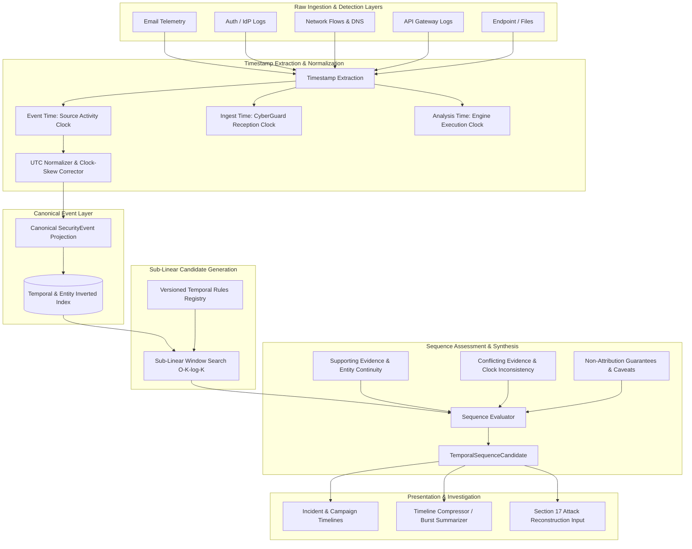

# 25 — Canonical Temporal Correlation & Event Sequencing Engine

> **Architecture Stage:** Section 16 — Canonical Temporal Reasoning Layer  
> **Status:** COMPLETED  
> **Core Principle:** $\textbf{TIME ORDER} \neq \textbf{CAUSATION}$.  
> **Authoritative Service:** `backend/services/temporal_engine.py`  
> **Data Contracts:** `backend/schemas/temporal_correlation.py`  
> **Database Persistence:** `SecurityEventModel` (`security_events`), `TemporalSequenceCandidateModel` (`temporal_sequences`)  
> **Migration:** `f5a1c3d7b92e_create_temporal_correlation_engine.py`  

---

## 1. Executive Mission & Architectural Purpose

CyberGuard's **Temporal Correlation & Event Sequencing Engine** forms the canonical temporal reasoning foundation of the platform. The engine transforms disparate, timestamped security telemetry originating from multiple sensors—emails, authentication logs, network flow records, DNS queries, API gateways, files, and multimedia artifacts—into explainable, chronologically ordered event sequences.

### Core Questions Answered
- **What happened first?** Establishing defensible chronological order based on source event timestamps rather than ingestion arrival time.
- **What happened next?** Identifying contiguous and inter-stage transitions.
- **Which events occurred within a meaningful time window?** Applying domain-calibrated, versioned temporal rules without arbitrary global constants.
- **Which events involve the same entities?** Establishing multi-stage identity, device, and network infrastructure continuity.
- **Which sequences are security-relevant?** Separating routine administrative or background activity from correlated multi-stage intrusion progressions.
- **Where are timestamps uncertain or conflicting?** Rigorously recording sensor clock skew, sender vs. receiver time discrepancies, and granular timestamp provenance.
- **Which ordering relationships are strong vs. merely possible?** Differentiating server-attested timestamps from mutable sender headers.

### Non-Negotiable Boundary Principle
$$\mathbf{TIME\ ORDER} \neq \mathbf{CAUSATION}$$

An observed sequence:
1. `10:00` — Phishing email received targeting Account A
2. `10:05` — Suspicious authentication for Account A

**Does NOT prove that the email caused the authentication.** The user may have logged in independently, or the compromise may have occurred through another vector. CyberGuard reports **observed multi-stage temporal correlation strength**, while preserving uncertainty and strictly avoiding premature causal attribution (reserved for Section 17) and threat actor attribution.

---

## 2. Temporal Processing Architecture



---

## 3. Canonical Security Event Model

`SecurityEvent` acts as an indexed temporal projection over authoritative evidence records. It does **not** duplicate forensic truth stores; source records remain authoritative.

| Field | Type | Description |
|---|---|---|
| `id` | `UUID-36` | Unique security event identifier. |
| `event_type` | `SecurityEventType` | Controlled vocabulary enum (e.g. `EMAIL_RECEIVED`, `AUTH_SUCCESS`, `DNS_QUERY`, `API_REQUEST`). |
| `event_time` | `datetime (UTC)` | Authoritative event occurrence time normalized to UTC. |
| `event_time_end` | `Optional[datetime]` | Marks the end of duration for interval events (flows, sessions). |
| `event_time_precision` | `TimePrecision` | Granularity: `EXACT`, `MILLISECOND`, `SECOND`, `MINUTE`, `DATE_ONLY`, `UNKNOWN`. |
| `event_time_confidence` | `float [0.0 - 1.0]` | Assessed confidence in timestamp veracity. |
| `ingested_at` | `datetime (UTC)` | Timestamp when CyberGuard received the artifact. |
| `analyzed_at` | `Optional[datetime]` | Timestamp when analysis or projection occurred. |
| `source_type` | `str` | Sensor origin: `EMAIL`, `AUTH_LOG`, `NETWORK_LOG`, `API_LOG`, `FILE`, etc. |
| `entity_ids` | `List[str]` | Canonical entity links: `account:<id>`, `session:<id>`, `device:<id>`, `ip:<ip>`, `domain:<dom>`. |
| `finding_ids` | `List[str]` | Associated detection findings. |
| `threat_event_ids` | `List[str]` | Associated ThreatEvent records. |
| `attributes` | `Dict[str, Any]` | Sanitized telemetry attributes (secrets recursively redacted). |
| `timestamp_provenance` | `TimestampProvenance` | Audit trail of extraction, original timezone, trust, and applied clock correction. |

---

## 4. Controlled Event Vocabulary

All security event types are strictly backed by concrete detector telemetry:

- **Email**: `EMAIL_RECEIVED`, `EMAIL_SENT`.
- **Files & Attachments**: `FILE_OBSERVED`, `FILE_EXTRACTED`.
- **URLs & Domains**: `URL_OBSERVED`, `URL_REDIRECTED`, `URL_ACCESSED` *(only when endpoint telemetry proves access)*, `DOMAIN_RESOLVED`.
- **Authentication**: `AUTH_ATTEMPT`, `AUTH_SUCCESS`, `AUTH_FAILURE`, `MFA_EVENT`.
- **Sessions**: `SESSION_CREATED`, `SESSION_ACTIVITY`.
- **Network**: `NETWORK_CONNECTION`, `DNS_QUERY`, `DNS_RESPONSE`, `HIGH_OUTBOUND_DATA_VOLUME`.
- **API**: `API_REQUEST`, `API_RESPONSE`, `API_ENUMERATION`, `BULK_RESOURCE_ACCESS`.
- **Multimedia & Findings**: `MEDIA_OBSERVED`, `FINDING_CREATED`, `THREAT_EVENT_CREATED`.

---

## 5. Timestamp Semantics & Provenance

### Distinction: Event Time vs. Ingestion Time vs. Analysis Time
- **Event Time**: When the source log asserts the activity occurred.
- **Ingestion Time**: When CyberGuard accepted the artifact into storage.
- **Analysis Time**: When analytical pipelines processed the record.
- **Core Rule**: Incident history is **never sorted by arrival time** when valid event time exists. Out-of-order and late-arriving logs are positioned chronologically by their true `event_time`.

### Source Trust Hierarchy
Not all timestamps possess equal evidential reliability:
- **`HIGH` Trust**: Server-side audit logs, Identity Provider (IdP) authentication records, API gateway logs, kernel monotonic timers.
- **`MEDIUM` Trust**: Intermediate network sensors, local MTA top `Received` headers.
- **`LOW` Trust**: Sender-controlled email `Date` headers, client-side clocks, mutable filesystem `mtime`.

### Precision vs. Confidence
Precision and confidence are strictly decoupled:
- A sender-controlled email `Date` header formatted as `Tue, 06 Oct 2026 09:14:02.123456 +0000` has `MILLISECOND` precision, but **`LOW` trust**.
- Conversely, a server event recorded as `2026-10-06` has **`HIGH` trust** but `DATE_ONLY` precision.

---

## 6. Timezone Normalization & Clock-Skew Handling

### Timezone Normalization
- All comparison timestamps are normalized to UTC (`dt.astimezone(timezone.utc)`).
- Original timezone and verbatim timestamp strings are preserved in `TimestampProvenance`.
- Naive timestamps are **never silently assumed to be UTC** without documentation: they are stamped with `original_timezone="UNKNOWN_TIMEZONE"` and noted in audit metadata.
- Configurable per-adapter default timezones are applied where source environments guarantee local time.

### Clock Skew Tolerance & Sensor Offset
- **Configurable Skew Tolerance** (`default: 10.0s`): If two events from different clocks fall within $\le 10$ seconds, their relative temporal order is marked as `ORDER_UNCERTAIN` / near-simultaneous rather than asserting definitive precedence.
- **Known Sensor Offsets**: If a network sensor is known to drift by $+5.2$ seconds, the offset is applied explicitly (`normalized_time = raw_time - offset`) and recorded in provenance without mutating raw evidence.

---

## 7. Cross-Source Multi-Stage Intrusion Correlation

The engine correlates events across diverse telemetry channels while tracking continuous entity context:

```
08:55 EMAIL_RECEIVED   ───► Account A, Domain X
        │
09:02 URL_ACCESSED     ───► Account A, Device D, URL U
        │
09:05 DNS_QUERY        ───► Device D, Domain Y
        │
09:05 NETWORK_CONNECT  ───► Device D, IP Y
        │
09:17 AUTH_FAILURE     ───► Account A, Source IP Y
        │
09:18 AUTH_SUCCESS     ───► Account A, Source IP Y
        │
09:18 SESSION_CREATED  ───► Account A, Session S
        │
09:21 API_ENUMERATION  ───► Session S, Account A
        │
09:26 BULK_ACCESS      ───► Session S, Resource R
        │
09:30 HIGH_TRANSFER    ───► Device D, Session S
```

### Entity Continuity
Temporal correlation becomes defensible only through continuous shared entities:
- **`account:alice@company.com`**: Connects email delivery $\rightarrow$ authentication failures $\rightarrow$ login success.
- **`session:sess-12345`**: Connects authentication success $\rightarrow$ API enumeration $\rightarrow$ bulk export.
- **`device:dev-laptop-01`**: Connects URL interaction $\rightarrow$ local file extraction $\rightarrow$ network callback.

---

## 8. Versioned Declarative Temporal Rules

| Rule ID | Predecessor | Successor | Window | Required Entities | Status |
|---|---|---|---|---|---|
| `RULE_AUTH_BURST_TO_SUCCESS` | `AUTH_FAILURE` | `AUTH_SUCCESS` | 0 – 30 min | `account` | `POSSIBLE_SECURITY_SEQUENCE` |
| `RULE_AUTH_SUCCESS_TO_SESSION` | `AUTH_SUCCESS` | `SESSION_CREATED` | 0 – 5 min | `account` | `OBSERVED_SEQUENCE` |
| `RULE_SESSION_TO_API` | `SESSION_CREATED` | `API_REQUEST` / `API_ENUM` | 0 – 60 min | `session` | `OBSERVED_SEQUENCE` |
| `RULE_API_TO_BULK_EXPORT` | `API_ENUM` / `BULK_ACCESS` | `HIGH_OUTBOUND_DATA_VOLUME` | 0 – 30 min | `session` / `device` | `POSSIBLE_SECURITY_SEQUENCE` |
| `RULE_DNS_TO_NETWORK_CONNECTION` | `DNS_QUERY` / `DNS_RESPONSE` | `NETWORK_CONNECTION` | 0 – 60 sec | `device` / `domain` / `ip` | `OBSERVED_SEQUENCE` |
| `RULE_EMAIL_TO_URL_ACCESS` | `EMAIL_RECEIVED` | `URL_ACCESSED` | 0 – 24 hr | `url` / `domain` | `TEMPORALLY_ASSOCIATED` |
| `RULE_EMAIL_TO_SUSPICIOUS_AUTH` | `EMAIL_RECEIVED` | `AUTH_FAILURE` / `AUTH_SUCCESS` | 0 – 24 hr | `account` | `TEMPORALLY_ASSOCIATED` |
| `RULE_EMAIL_TO_FILE` | `EMAIL_RECEIVED` | `FILE_EXTRACTED` | 0 – 1 hr | `file` / `hash` | `OBSERVED_SEQUENCE` |

---

## 9. Sub-Linear Candidate Generation & False-Positive Controls

### Sub-Linear Algorithm
Naive temporal comparison evaluates every pair of events ($O(N^2)$). For an incident with 2,000 events, this entails 4,000,000 evaluations.
The Section 16 engine achieves **sub-linear complexity**:
1. Groups events by canonical entity key (`entity_index[entity_id] = [(timestamp, event_id), ...]`).
2. Sorts each entity timeline by `event_time`.
3. For each rule requiring entity continuity, performs binary search (`bisect_left` / `bisect_right`) to find events within `[event_time + min_delay, event_time + max_delay]`.
4. Evaluates rule conditions in $O(K \log K)$ where $K \ll N$.

### False-Positive Suppression
- **Different Accounts**: An email targeting Account A followed by an authentication on Account B is **strictly rejected**.
- **Coincidental Proximity**: Two unrelated events occurring at the same second without shared entity continuity do not form a sequence candidate.
- **Generic Cloud Infrastructure**: High-degree shared CDNs or public DNS resolvers alone do not trigger temporal sequences without identity or device continuity.

---

## 10. Timeline Compression (Burst Summarization)

To prevent analyst timeline flooding (e.g. 214 consecutive failed authentication attempts in 4 minutes), the presentation engine implements **Timeline Compression**:
- Consecutive events of identical `event_type` exceeding a threshold ($\ge 4$ events within $\le 300$ seconds) are summarized into a `TimelineBurstSummary`.
- Preserves raw event IDs (`representative_event_ids`) and underlying evidence records without data loss.

---

## 11. Security Knowledge Graph & Campaign Integration

- **Knowledge Graph (Section 14)**: Each `SecurityEvent` references canonical entity keys in `EntityModel`. Relationship observations in `RelationshipObservationModel` match event timestamps. Analysts querying an entity in the graph can inspect its temporal evolution via `GET /api/entities/{id}/timeline`.
- **Campaign Candidates (Section 15)**: Multi-incident campaigns cluster related investigations. `GET /api/campaigns/{id}/timeline` consolidates security events across all clustered incidents to expose operational span (`first_observed_time` to `last_observed_time`).

---

## 12. Workspace Isolation & Privacy

- **Tenant Isolation**: Every `SecurityEventModel` and `TemporalSequenceCandidateModel` is scoped by `workspace_id`. Cross-tenant temporal correlation is strictly forbidden.
- **Secret Redaction**: Recursively strips and redacts passwords, tokens, API keys, session cookies, and authorization headers (`sanitize_temporal_attributes`).

---

## 13. REST API Surface

| Method | Endpoint | Description |
|---|---|---|
| `GET` | `/api/incidents/{incident_id}/timeline` | Paginated chronological incident timeline with burst compression. |
| `GET` | `/api/entities/{entity_id}/timeline` | Chronological observation timeline for an entity. |
| `GET` | `/api/incidents/{incident_id}/sequences` | List pre-computed temporal sequence candidates for an incident. |
| `POST` | `/api/incidents/{incident_id}/analyze-sequences` | Execute on-demand temporal sequence detection and persistence. |
| `GET` | `/api/sequences/{sequence_id}` | Retrieve sequence candidate details, hydrated events, and limitations. |
| `GET` | `/api/campaigns/{campaign_id}/timeline` | Multi-incident aggregated campaign timeline. |

---

## 14. Performance Benchmarks

Validated with `backend/tests/test_temporal_performance.py`:

- **Dataset Size**: **100,000 synthetic security events** across 50 incidents, 200 accounts, 50 devices, 500 sessions, 100 IPs.
- **In-Memory Event Generation**: 2.081s (48,043 events/sec).
- **Database Bulk Ingestion**: 1.471s (67,982 records/sec).
- **Incident Timeline Query (2,000 events)**: **33.15 ms**.
- **Entity Timeline Query (across 100k events)**: **31.32 ms**.
- **Sub-Linear Candidate Generation & Rule Evaluation (2,000 events, 8 rules)**: **235.84 ms** (1,400 valid sequence candidates generated).
- **Sequence Retrieval & Hydration**: **1.47 ms**.

---

## 15. Known Limitations & Architectural Boundaries

1. **Non-Attribution Boundary**: Section 16 proves temporal ordering and entity association. It **does not prove causation**.
2. **Missing Telemetry Caveats**: If endpoint logs are absent, CyberGuard cannot confirm whether an email URL or attachment was executed.
3. **Attack Path Reconstruction Deferred**: Mapping temporal sequences to MITRE ATT&CK stages and generating end-to-end causal progression graphs is explicitly deferred to **Section 17 (Attack Path Reconstruction Engine)**.
