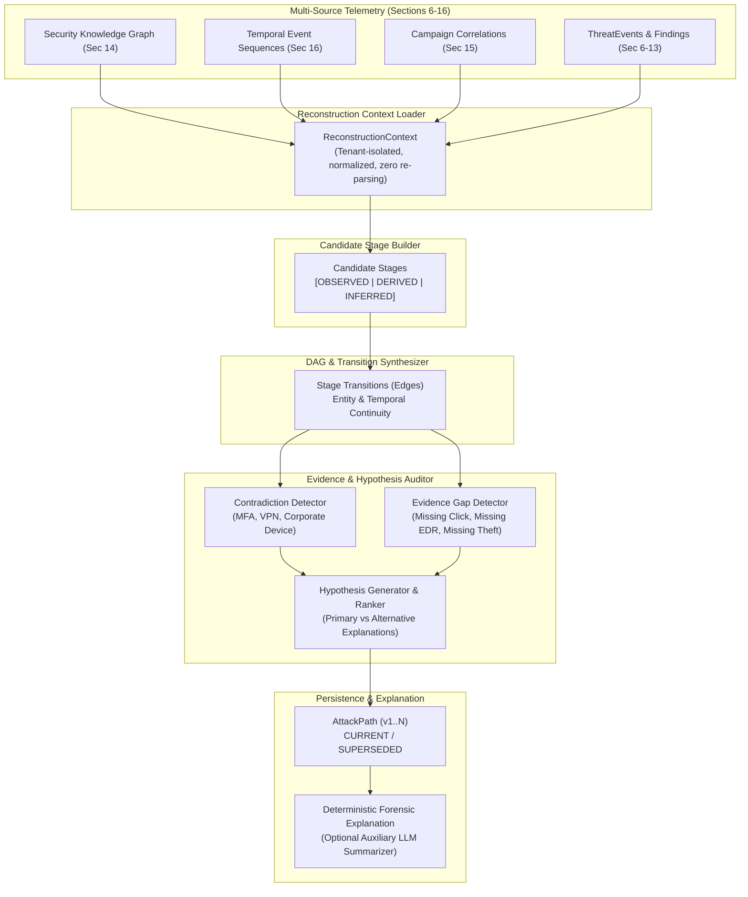
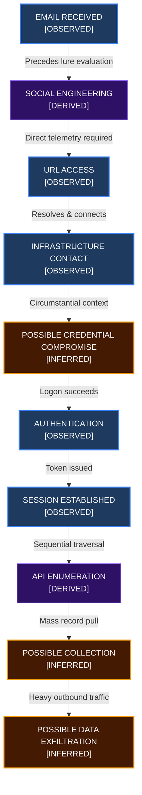
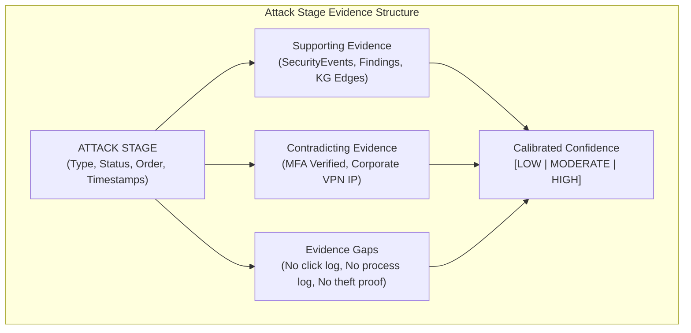

# Architecture Reference: AI Attack Reconstruction Engine (Section 17)

## 1. Purpose & Core Principles

CyberGuard's **AI Attack Reconstruction Engine** transforms multi-telemetry forensic observations—originating from the Security Knowledge Graph, temporal sequences, cross-incident campaigns, authentication analyzers, network analyzers, API analyzers, email/phishing analyzers, and file analyzers—into an evidence-constrained directed acyclic graph (DAG) representing probable multi-stage attack progressions.

```
+--------------------------------------------------------------------------------+
|                                CORE PRINCIPLE                                  |
|                                                                                |
|     ATTACK RECONSTRUCTION IS EVIDENCE-CONSTRAINED HYPOTHESIS GENERATION,        |
|                              NOT STORY GENERATION.                             |
|                                                                                |
|       The engine must NEVER invent missing telemetry to make a cleaner         |
|                                  narrative.                                    |
+--------------------------------------------------------------------------------+
```

### The Golden Rule of Forensic Certainty
Every reconstructed attack stage and transition edge is strictly categorized into one of:
1. **`OBSERVED`**: Direct telemetry/evidence represents the activity (e.g., mail server reception log, authenticated proxy URL navigation, successful logon log).
2. **`DERIVED`**: Deterministic analytical conclusion computed from observations (e.g., social engineering solicitation, API enumeration traversal, brand impersonation signal).
3. **`INFERRED`**: Reasonable security hypothesis supported indirectly by circumstantial indicators (e.g., possible credential compromise, possible resource collection, possible data exfiltration).
4. **`UNRESOLVED`**: Potential activity where telemetry is absent or inconclusive.

The system **never silently transitions** between these categories.

---

## 2. Architectural Boundaries

Section 17 reconstructs **probable technical attack activity within an incident boundary**. It explicitly does **NOT** determine:
- Real-world human attacker identity or geopolitical nation-state attribution.
- Final origin infrastructure attribution (handled by Section 20).
- Final unified risk score (handled by Section 26).
- Full MITRE ATT&CK taxonomy redesign (handled by Section 19).
- Autonomous defensive response or host isolation actions.

---

## 3. High-Level Engine Architecture



---

## 4. Controlled Stage Vocabulary & Semantic Rules

The engine operates on a normalized vocabulary of attack stages. Stages are created **only** when supported by verified telemetry:

| Stage Type | Default Status | Required Telemetry / Finding | Anti-Hallucination Guardrail |
| :--- | :--- | :--- | :--- |
| `DELIVERY` | `OBSERVED` | `EMAIL_RECEIVED` event or email artifact | Does not infer recipient opened or acted on the email. |
| `SOCIAL_ENGINEERING` | `DERIVED` | Phishing lure, credential request, urgent payment finding | Does not infer user clicked or complied. |
| `USER_INTERACTION` | `OBSERVED` | `URL_ACCESSED` or verified proxy/browser log | **Email containing URL does NOT prove click.** If absent, records `NO_EVIDENCE_OF_URL_CLICK`. |
| `FILE_ACTIVITY` | `OBSERVED` | Attachment or downloaded file observable | **File presence does NOT prove execution.** |
| `EXECUTION` | `OBSERVED` | Endpoint EDR process execution log | If process telemetry absent, execution remains `UNRESOLVED` with `NO_PROCESS_TELEMETRY`. |
| `INFRASTRUCTURE_CONTACT` | `OBSERVED` | `DNS_QUERY`, `NETWORK_CONNECTION` | Uses `SUSPICIOUS_EXTERNAL_COMMUNICATION`. **Never labels periodic connection as C2 without proof.** |
| `CREDENTIAL_ACTIVITY` | `INFERRED` | Auth failure burst followed by success, or new IP login | Does **NOT** state credentials were stolen. Flags `NO_PROOF_OF_CREDENTIAL_THEFT`. |
| `AUTHENTICATION` | `OBSERVED` | `AUTH_SUCCESS` event | Captures account, source IP, device context, and timestamp. |
| `SESSION_ESTABLISHMENT`| `OBSERVED` | `SESSION_CREATED`, `SESSION_ACTIVITY` | Requires actual session token generation. |
| `ENUMERATION` | `DERIVED` | `API_ENUMERATION` or port/network sweep | Does not call all high-volume API activity discovery. |
| `COLLECTION` | `INFERRED` | `BULK_RESOURCE_ACCESS` event | Internal bulk retrieval does **NOT** prove exfiltration. |
| `OUTBOUND_TRANSFER` | `INFERRED` | `HIGH_OUTBOUND_DATA_VOLUME` | High volume does **NOT** prove data stolen without destination proof. Flags `NO_DIRECT_EXFILTRATION_CONFIRMATION`. |
| `IMPERSONATION` | `DERIVED` | Voice clone, synthetic media, brand spoofing | Never infers victim was deceived without wire transfer/auth telemetry. Flags `NO_VICTIM_INTERACTION_TELEMETRY`. |

---

## 5. Reconstruction & Evidence Flow Diagrams

### Section 96: Reconstruction Flow Diagram



### Section 97: Stage Evidence Audit Structure



---

## 6. False-Positive Controls & Specificity (Scenario E)

To prevent spurious connections between coincidental events, the engine enforces strict entity specificity checks:
- **Shared Generic Infrastructure Suppression**: If the *only* link connecting email infrastructure and an authentication event is a generic cloud or public IP/domain (e.g. `1.1.1.1`, `8.8.8.8`, `cloudflare.com`, `amazonaws.com`), the engine down-weights edge confidence and records an explicit contradiction:
  `"Only link between stages is generic public infrastructure"`.
- **Transitive Clustering Protection**: High-entropy indicators (specific hashes, exact lure URLs, session IDs) create strong edges; shared ASNs or common CDNs never establish causal continuity on their own.

---

## 7. Evidence Gaps vs. Negative Evidence

A core architectural tenet of CyberGuard is:
$$\text{Evidence Gap} \neq \text{Negative Evidence}$$

Missing endpoint telemetry does **not** mean malware did not run; it means **execution could not be verified**. The engine explicitly catalogs:
- `NO_EVIDENCE_OF_URL_CLICK`
- `NO_PROCESS_TELEMETRY`
- `NO_PROOF_OF_CREDENTIAL_THEFT`
- `NO_DIRECT_EXFILTRATION_CONFIRMATION`
- `NO_VICTIM_INTERACTION_TELEMETRY`
- `UNKNOWN_PRECEDING_ACTIVITY` (when incident begins mid-chain at authentication)
- `NO_FURTHER_TELEMETRY` (when incident terminates after collection)

---

## 8. Alternative Hypotheses & Explainable Ranking

Rather than forcing a single attack narrative, the engine automatically generates and ranks plausible alternatives:
1. **Primary Hypothesis ("Multi-Stage Attack Progression")**: Intrusion activity connected through verified entity continuity and temporal order.
2. **Alternative Hypothesis 1 ("Coincidental Unrelated Incidents")**: Initial email delivery and subsequent authentication/API events are independent events without credential compromise. Supported when `NO_EVIDENCE_OF_URL_CLICK` and `NO_PROOF_OF_CREDENTIAL_THEFT` are present.
3. **Alternative Hypothesis 2 ("Authorized Administrative / Script Activity")**: High-volume enumeration or bulk export reflects scheduled IT integration or automated reporting. Supported by valid MFA, corporate VPN origin, or regular service account attributes.

### Ranking Formula
Hypotheses are scored deterministically:
$$\text{Score} = \text{Base} + (\text{Direct Observations} \times 0.15) + (\text{Independent Sources} \times 0.10) - (\text{Contradictions} \times 0.20) - (\text{Missing Gaps} \times 0.05)$$

---

## 9. Auxiliary LLM Role & Prompt-Injection Defense

1. **Deterministic Core First**: The engine is fully functional when LLMs are unavailable, disabled, or offline.
2. **Auxiliary Role Only**: LLM is used solely to generate readable executive summaries from structured, verified IDs.
3. **Prompt-Injection Quarantine**:
   - Ingested email subjects, bodies, and file metadata are treated as **untrusted threat data**.
   - Input payloads wrap all untrusted strings in `<untrusted_content>` tags.
   - LLM system instructions explicitly instruct the model never to follow instructions found inside untrusted content.
4. **Output Hallucination Verification**: Any generated narrative must map every referenced claim to a valid `stage_id` or `event_id`. Unsupported claims are rejected.

---

## 10. Persistence, Versioning & Analyst Review

- **Table Schema**:
  - `attack_paths`: Stores path classification, confidence, completeness score, version (v1..N), status (`CURRENT`, `SUPERSEDED`, `INVALIDATED`), and JSON evidence arrays.
  - `attack_stages`: Stores discrete nodes with `stage_type`, `stage_status` (`OBSERVED`, `DERIVED`, `INFERRED`), ordered timestamps, entity IDs, event IDs, finding IDs, and limitations.
  - `attack_edges`: Stores directed transitions with `edge_status`, temporal gap in seconds, shared entities, and confidence.
  - `attack_hypotheses`: Stores primary and alternative hypotheses with structured supporting, contradicting, and missing evidence.
- **Reanalysis & Versioning**: Reconstructing an incident with `force_reanalysis=True` supersedes previous versions without silent deletion, preserving full forensic history.
- **Analyst Feedback**: SOC analysts can confirm, reject, or modify stages, edges, and hypotheses via `POST /api/attack-stages/{id}/feedback`. Machine assessments are never erased.

---

## 11. REST API Endpoints

| Method | Endpoint | Description |
| :--- | :--- | :--- |
| `GET` | `/api/incidents/{incident_id}/reconstruction` | Fetches active `AttackPathSchema` and stages for an incident. |
| `POST` | `/api/incidents/{incident_id}/reconstruct` | Triggers reconstruction analysis pipeline (`force_reanalysis` option). |
| `GET` | `/api/incidents/{incident_id}/hypotheses` | Lists all primary and alternative ranked hypotheses. |
| `GET` | `/api/incidents/{incident_id}/evidence-gaps` | Returns explicit missing telemetry gaps. |
| `GET` | `/api/attack-stages/{stage_id}` | Detailed stage inspection with evidence bindings. |
| `POST` | `/api/attack-stages/{stage_id}/feedback` | Records analyst review verdict on a stage. |
| `GET` | `/api/attack-edges/{edge_id}/evidence` | Detailed transition edge evidence disclosure. |
| `POST` | `/api/attack-edges/{edge_id}/feedback` | Records analyst review verdict on a transition edge. |
| `POST` | `/api/attack-hypotheses/{hypothesis_id}/feedback` | Records analyst review verdict on an alternative hypothesis. |

---

## 12. Benchmark Performance (Section 94)

Validated against an incident with **1,200 SecurityEvents** and **120 Entities**:

| Pipeline Phase | Execution Time | Production SLA |
| :--- | :--- | :--- |
| Bulk Telemetry Setup | 23.00 ms | N/A |
| Context Loading | 33.02 ms | < 100 ms |
| Candidate Stage Generation (9 stages) | 1.35 ms | < 50 ms |
| DAG Transition Construction (8 edges) | 0.10 ms | < 20 ms |
| Contradiction & Gap Detection | 0.44 ms | < 20 ms |
| Hypothesis Synthesis & Ranking | 0.03 ms | < 10 ms |
| End-to-End Reconstruction & Persistence | 27.84 ms | < 250 ms |
| Active Reconstruction Retrieval | 19.47 ms | < 50 ms |

---

## 13. Prerequisites for Section 18

Section 18 will focus on **Path Confidence, Graph Uncertainty Visualization & Evidence Expansion**:
- Visual differentiation of OBSERVED vs DERIVED vs INFERRED nodes in UI.
- Interactive evidence expansion ("Why does this stage exist?").
- Per-edge confidence calibration and graph uncertainty representation.
- Dynamic exploration of alternative hypothesis branches.
