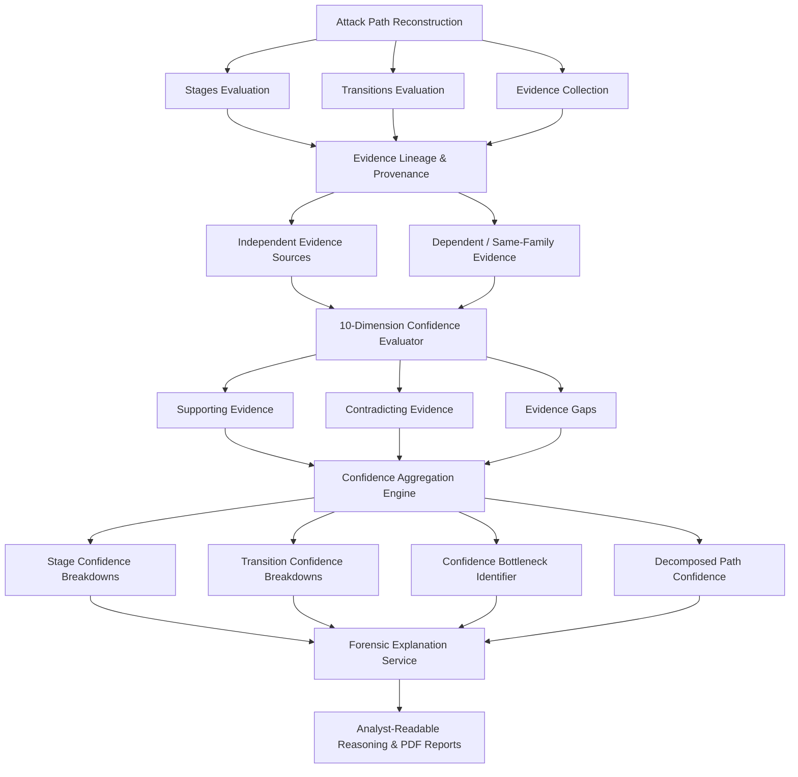
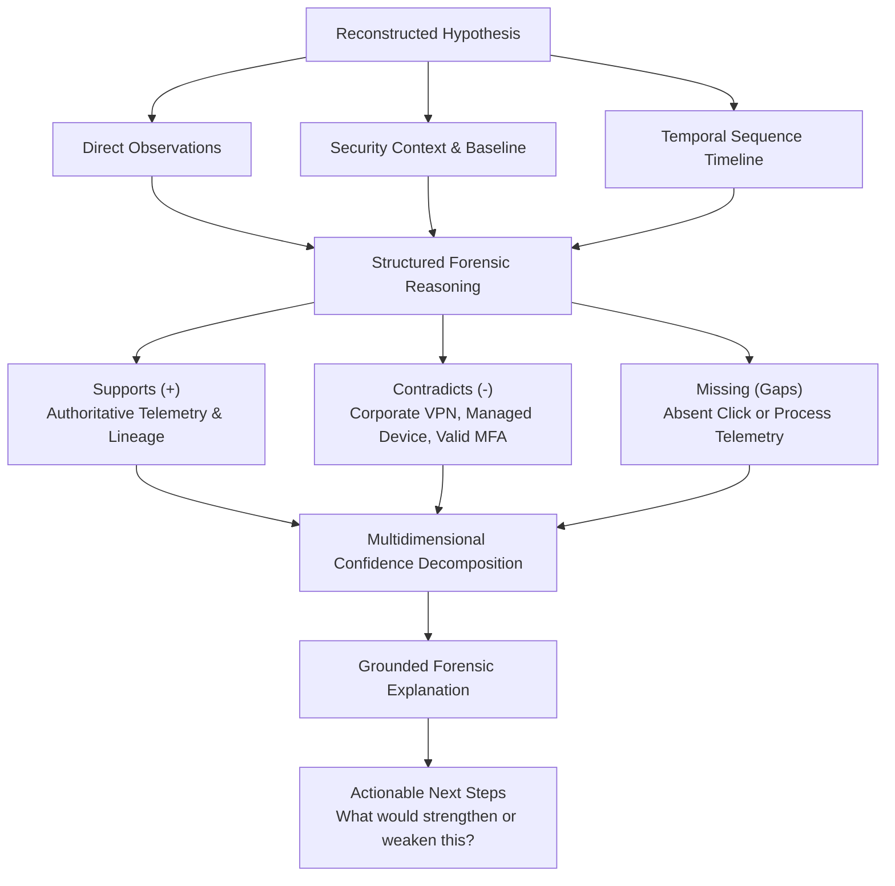

# 27 — Attack Reconstruction Confidence & Explainability Engine

## 1. Purpose & Core Principles

The **CyberGuard Attack Reconstruction Confidence & Explainability Engine** provides an evidence-constrained, audit-verifiable uncertainty and reasoning layer for reconstructed security incidents. It powers explainability for SOC analysts, incident responders, technical auditors, hackathon reviewers, and executive PDF reporting.

### Core Principle 1: Confidence is Not Certainty
A CyberGuard confidence score represents **heuristic evidence strength** for a specific analytical conclusion based on available multi-sensor telemetry. It does **NOT** represent the mathematical "probability that CyberGuard is correct" unless actual statistical calibration exists. Uncalibrated claims like "87% probability of attack" are strictly prohibited.

### Core Principle 2: Explainability Must Come From Evidence
Explanations are **NEVER** generated first to then search for supporting evidence. Reasoning strictly follows the directed flow:
$$\text{Evidence} \longrightarrow \text{Structured Reasoning} \longrightarrow \text{Confidence Decomposition} \longrightarrow \text{Analyst Explanation}$$

### Core Principle 3: Weakest Link Principle (No Naive Averaging)
A reconstructed attack path containing multiple high-confidence stages linked by one speculative transition must expose that transition as the **Confidence Bottleneck**. The composite path confidence is bounded by the bottleneck link rather than obscured behind a misleading arithmetic average.

---

## 2. Confidence Architecture Diagrams

### 2.1 Attack Path Confidence Architecture



### 2.2 Explainability Flow Diagram: "Why Does CyberGuard Believe This?"



---

## 3. Canonical Confidence Vocabulary & Semantic Mapping

CyberGuard standardizes on a 6-band canonical confidence vocabulary:

| Confidence Level | Internal Score Range | Semantic Meaning | Actionability |
| :--- | :--- | :--- | :--- |
| **`VERY_LOW`** | 0.00 – 0.19 | Insufficient or heavily contradicted evidence | Speculative hypothesis requiring manual verification |
| **`LOW`** | 0.20 – 0.39 | Circumstantial evidence with significant gaps | High epistemic uncertainty; critical telemetry absent |
| **`MODERATE`** | 0.40 – 0.59 | Plausible sequence supported by indirect signals | Plausible hypothesis; intermediate link unobserved |
| **`HIGH`** | 0.60 – 0.79 | Strong corroboration across telemetry sources | Well-grounded conclusion with minimal gaps |
| **`VERY_HIGH`** | 0.80 – 1.00 | Direct authoritative multi-sensor confirmation | Sub-minute continuity; verified cryptographic/session proof |
| **`UNKNOWN`** | N/A | Detector unavailable or missing required data | Evaluated as uncertainty; NOT negative evidence |

---

## 4. Confidence vs. Risk vs. Severity

To prevent critical SOC errors, CyberGuard maintains strict architectural separation:

- **Confidence**: Strength of forensic evidence supporting a conclusion (0.0 to 1.0).
- **Severity**: Potential or observed blast radius and organizational harm (SAFE, LOW, MEDIUM, HIGH, CRITICAL).
- **Risk**: Unified metric combining likelihood, confidence, asset criticality, and impact (Section 26).

```
+-----------------------------------------------------------------------------------+
|  HIGH CONFIDENCE + LOW SEVERITY:                                                  |
|  Verified benign ping, scheduled maintenance script, or authorized shift login.   |
|                                                                                   |
|  LOW CONFIDENCE + CRITICAL SEVERITY:                                              |
|  Suspected exfiltration of crown-jewel databases where DLP telemetry is missing.  |
+-----------------------------------------------------------------------------------+
```

---

## 5. Ten Confidence Dimensions

Rather than relying on an opaque magic number, confidence decomposes into 10 explicit dimensions:

1. **`OBSERVATION_STRENGTH`** (Weight: 0.22): Direct authoritative sensor telemetry (0.95) vs. deterministic derived rules (0.85) vs. behavioral inference (0.60) vs. unresolved (0.30).
2. **`ENTITY_CONTINUITY`** (Weight: 0.18): Exact same session (1.00) vs. same account + device (0.92) vs. same account (0.75) vs. shared common CDN/cloud IP (0.25).
3. **`TEMPORAL_CONSISTENCY`** (Weight: 0.15): Sub-minute succession (0.98) vs. 30-min window (0.85) vs. 24-hr window (0.65) vs. multi-day gap (0.40). Negative/out-of-order delta flagged as `ORDER_UNCERTAIN` (0.25).
4. **`GRAPH_CONNECTIVITY`** (Weight: 0.12): Corroboration via Security Knowledge Graph relationship edges (Section 14).
5. **`SOURCE_INDEPENDENCE`** (Weight: 0.12): Independent evidence family count ($\ge 3 \to 1.00$, $2 \to 0.85$, $1 \to 0.65$).
6. **`INDICATOR_SPECIFICITY`** (Weight: 0.08): Rare high-entropy IOCs (hashes, specific URLs) vs. generic infrastructure.
7. **`DETECTOR_CONFIDENCE`** (Weight: 0.05): Calibrated confidence passed from underlying analyzers.
8. **`HISTORICAL_SUPPORT`** (Weight: 0.04): Campaign and cross-incident correlation evidence (Section 15).
9. **`CONTRADICTION_STRENGTH`** (Weight: 0.02): Presence of conflicting facts (VPN, managed device, valid MFA).
10. **`EVIDENCE_COMPLETENESS`** (Weight: 0.02): Ratio of observed transitions to missing critical telemetry gaps.

---

## 6. Evidence Lineage & Double-Count Prevention

A fundamental flaw in automated security scoring is double-counting dependent findings. For example:
- Analyzer A flags `LOOKALIKE_DOMAIN` on `evil-login.com`.
- Analyzer B flags `DOMAIN_IMPERSONATION_SIGNAL` on `evil-login.com`.

If treated as independent confirmations, confidence is falsely inflated. CyberGuard groups evidence dynamically into **`EvidenceFamily`** instances keyed by the root observation:

$$\text{EvidenceFamily}(\text{root} = \text{domain:evil-login.com}) \ni \{\text{Finding A}, \text{Finding B}\}$$

The `independent_sources_count` equals the number of distinct families, preventing artificial score inflation.

---

## 7. Evidence Source Trust Model

Telemetry sources are prioritized according to spoofability and authoritative control:

| Category | Typical Telemetry Sources | Base Trust Weight |
| :--- | :--- | :--- |
| **`DIRECT_TELEMETRY`** | IdP server authentication logs, network PCAP/NetFlow, API gateway logs, cryptographic SHA-256 | 0.95 |
| **`DERIVED_DETERMINISTIC`** | Authoritative DNS A/AAAA resolution, regex matches, base64 payload decoding | 0.85 |
| **`LOCAL_MODEL`** | Anomaly detection algorithms, local NLP classifiers, deepfake audio detectors | 0.70 |
| **`EXTERNAL_INTELLIGENCE`** | Third-party threat feeds, WHOIS registration APIs, external reputation queries | 0.65 |
| **`USER_SUPPLIED`** | Helpdesk tickets, user-submitted security reports, manual analyst notes | 0.45 |
| **`LLM_DERIVED`** | Uncalibrated LLM entity extraction or conversational summarization | 0.35 |
| **`UNTRUSTED_CONTENT`** | Sender-controlled RFC-822 email headers (`Date:`, `From:`), webpage HTML | 0.25 |

---

## 8. Contradictions vs. Evidence Gaps

The engine maintains a strict distinction between **conflicting evidence** and **absent evidence**:

- **Contradicting Evidence**: Facts actively refuting or weakening the hypothesis.
  - *Example*: Source IP belongs to corporate VPN egress gateway ($\text{penalty} = 0.35$).
  - *Example*: Device confirmed as enrolled corporate Intune asset ($\text{penalty} = 0.30$).
  - *Example*: User completed expected out-of-band MFA challenge ($\text{penalty} = 0.25$).
  - *Example*: Authoritative gateway log indicates different session origin ($\text{penalty} = 0.45$).
- **Evidence Gaps (Missing Data)**: Absent sensors where activity cannot be confirmed.
  - `NO_CLICK_TELEMETRY`: Recipient received email, but no web proxy log proves URL click.
  - `NO_CREDENTIAL_CAPTURE_EVIDENCE`: No HTTP POST log of credential submission.
  - `NO_PROCESS_TELEMETRY`: No EDR process execution telemetry on host.
  - `NO_DIRECT_EXFILTRATION_CONFIRMATION`: Outbound traffic observed, but payload not verified.

---

## 9. Bottleneck Detection & Uncertainty Propagation

When evaluating an attack chain:
$$\text{Stage } 1 \xrightarrow{\text{HIGH}} \text{Stage } 2 \xrightarrow{\text{LOW}} \text{Stage } 3 \xrightarrow{\text{HIGH}} \text{Stage } 4$$

1. Transition $2 \to 3$ is designated as the **Confidence Bottleneck**.
2. Composite path confidence is bounded by the bottleneck:
$$\text{Path Score} \le \text{Bottleneck Score} + 0.15$$
3. If the bottleneck is `LOW` ($< 0.40$), the overall path confidence is strictly capped at `MODERATE` ($< 0.60$), ensuring speculative links are never hidden by surrounding high-confidence stages.

---

## 10. Hypothesis Comparison (No Black-Box Ranking)

When competing hypotheses exist (e.g., *Hypothesis A: Account Takeover* vs. *Hypothesis B: Legitimate New Device Login*), CyberGuard compares them deterministically:
- Direct evidence ratio
- Independent evidence family count
- Presence of contradictions
- Entity continuity specificity

The output (`HypothesisComparisonResult`) explains point-by-point why one hypothesis ranks higher, detailing strengths, weaknesses, and key differentiators.

---

## 11. LLM Role & Prompt Injection Defense

LLM integration is strictly auxiliary and optional:
1. **Deterministic First**: The engine produces fully formed structured explanations before any LLM is called. If the LLM is disabled or fails, the deterministic explanation is returned.
2. **No Hallucinated Evidence**: The LLM is forbidden from inventing evidence, missing events, or altering confidence scores.
3. **Prompt Injection Defense**: Untrusted content (email bodies, web payloads, transcripts) is isolated in strict `<untrusted_content>` tags, preventing malicious artifacts from hijacking system instructions.

---

## 12. Auditability & Analyst Disposition

Algorithmic assessments must never be silently overwritten:
- **Reproducibility**: Every confidence breakdown stores `engine_version`, `configuration_version`, and a full audit log of inputs, weights, and adjustments.
- **Analyst Disposition**: Analysts may record verdicts (`CONFIRMED`, `REJECTED`, `MODIFIED`) and review notes in separate columns (`analyst_disposition`, `analyst_notes`, `reviewed_by`, `reviewed_at`) without modifying the historical algorithmic assessment.

---

## 13. REST API Specifications

| Method | Endpoint | Description |
| :--- | :--- | :--- |
| `GET` | `/api/incidents/{incident_id}/confidence` | Get path confidence breakdown & bottleneck for incident |
| `GET` | `/api/incidents/{incident_id}/explanation` | Get analyst-readable explanation for incident reconstruction |
| `GET` | `/api/incidents/{incident_id}/report-explanation` | Get report-ready explanation with epistemic guardrails |
| `POST` | `/api/incidents/{incident_id}/compare-hypotheses` | Deterministic comparison between two hypotheses |
| `GET` | `/api/attack-paths/{path_id}/confidence` | Get decomposed confidence for attack path |
| `GET` | `/api/attack-paths/{path_id}/explanation` | Get explanation for attack path |
| `POST` | `/api/attack-paths/{path_id}/analyst-disposition` | Record analyst disposition on attack path |
| `GET` | `/api/attack-stages/{stage_id}/confidence` | Get 10-dimension confidence decomposition for stage |
| `GET` | `/api/attack-stages/{stage_id}/explanation` | Get explanation for attack stage |
| `POST` | `/api/attack-stages/{stage_id}/analyst-disposition` | Record analyst disposition on attack stage |
| `GET` | `/api/attack-edges/{edge_id}/confidence` | Get confidence breakdown for transition edge |
| `GET` | `/api/attack-edges/{edge_id}/explanation` | Get explanation for transition edge |
| `GET` | `/api/relationships/{relationship_id}/explanation` | Explain Knowledge Graph edge from sensor observations |
| `GET` | `/api/correlations/{correlation_id}/explanation` | Explain cross-incident correlation citing shared indicators |
