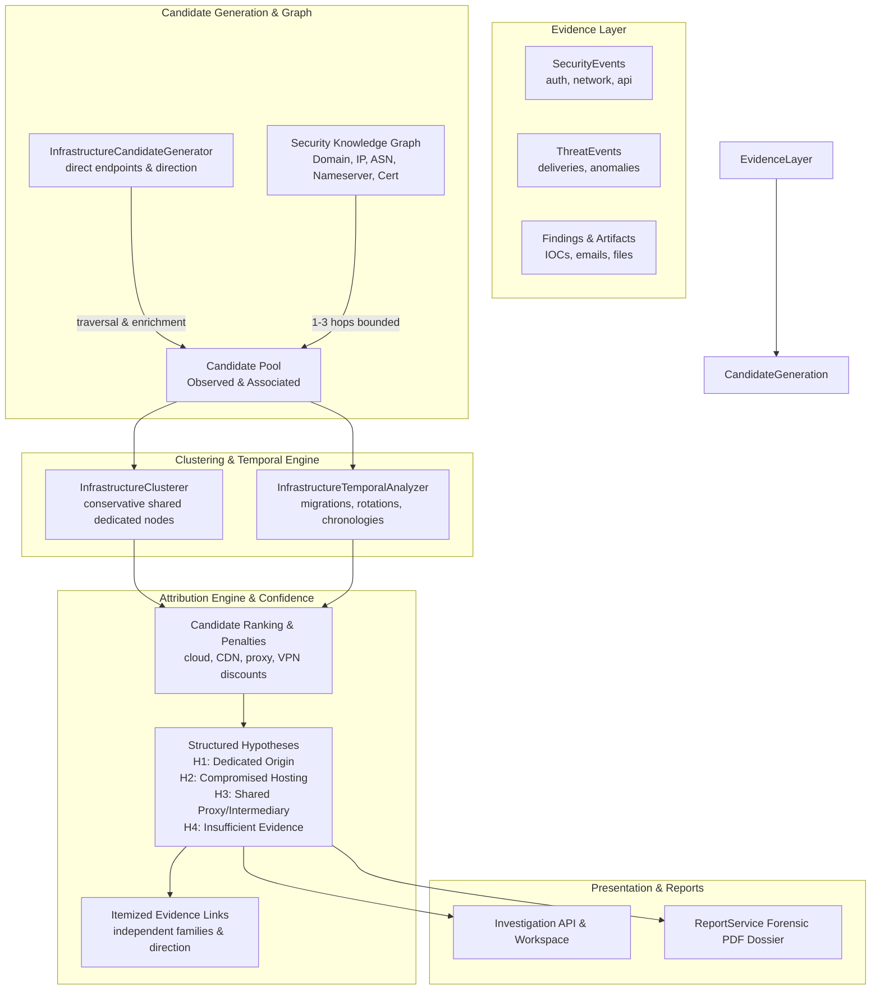
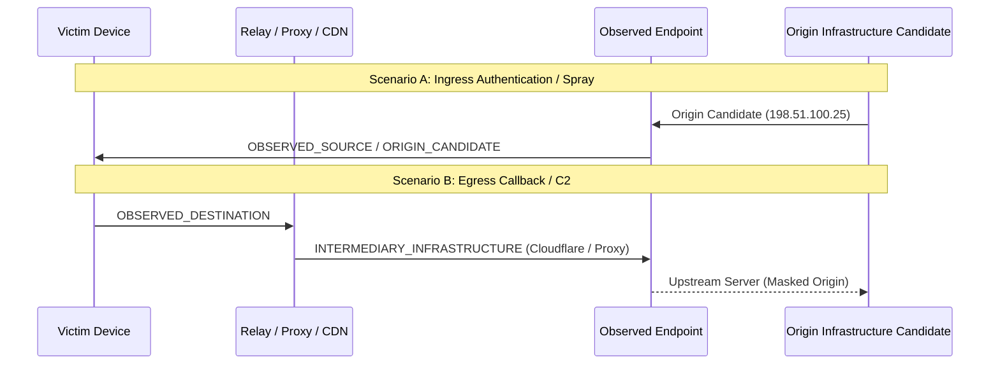

# Section 20: Probable Origin Infrastructure & Threat Infrastructure Attribution Engine

## 1. Objective

The **Probable Origin Infrastructure & Threat Infrastructure Attribution Engine** analyzes the technical network and hosting infrastructure connected to an investigation or security incident. It reconstructs the most plausible infrastructure-level origin, hosting relationships, infrastructure clusters, and historical associations behind observed malicious or suspicious activity.

---

## 2. Hard Attribution & Safety Boundaries

### STRICT NON-ATTRIBUTION GUARANTEES:
CyberGuard is an infrastructure-level analytical platform. It **never** engages in human attribution, individual identity speculation, or physical location claims.

| Prohibited Assertions | Permitted Evidence-Grounded Language |
| :--- | :--- |
| ❌ "This person is the attacker." | ✅ "Observed activity is technically associated with infrastructure cluster `CLUSTER-001`." |
| ❌ "This organization is responsible for the attack." | ✅ "The strongest observed infrastructure relationship points to domains, IP addresses, and hosting networks in ASN `AS64512`." |
| ❌ "This IP proves the attacker's physical location." | ✅ "The observed IP geolocation indicates infrastructure hosting facility geography, not attacker location." |
| ❌ "This domain proves ownership by the attacker." | ✅ "This represents a probable technical infrastructure origin hypothesis based on observed evidence, not confirmed legal ownership." |

Every model and explanation enforces runtime programmatic validation (`FORBIDDEN_ATTRIBUTION_KEYS`) rejecting terms such as `human_attacker_identity`, `person_name`, `attacker_location`, and `confirmed_owner`.

---

## 3. Four Core Architectural Concepts

CyberGuard strictly distinguishes four technical concepts across all infrastructure assessments:

1. **Observed Infrastructure**: Directly observed in raw telemetry or artifacts (source IP, destination IP, domain, URL, mail relay).
2. **Associated Infrastructure**: Technically related through evidentiary graph linkages (Domain $\to$ IP $\to$ ASN, Domain $\to$ Certificate).
3. **Infrastructure Cluster**: Multiple infrastructure entities showing non-generic technical similarity (shared dedicated IP, dedicated custom nameserver, shared certificate, confirmed campaign overlap).
4. **Probable Origin Infrastructure**: The infrastructure node or cluster that best explains observed technical activity according to available evidence. This is a falsifiable hypothesis, not confirmed attribution.

---

## 4. Directionality & Role Classification

CyberGuard preserves observed traffic directionality to prevent false origin assignment:

Controlled Roles:
- `ORIGIN_CANDIDATE`: Observed public source of ingress traffic or authenticated requests.
- `COMMAND_INFRASTRUCTURE_CANDIDATE`: Observed public destination of unauthorized callbacks or beaconing.
- `REDIRECT_INFRASTRUCTURE`: Intermediary HTTP hops in a delivery chain.
- `HOSTING_INFRASTRUCTURE`: Web servers, API gateways, or hosting subnets.
- `MAIL_RELAY`: Public SMTP relay in mail transmission path.
- `DNS_INFRASTRUCTURE`: Authoritative nameserver for domain resolution.
- `PROXY_OR_INTERMEDIARY`: Known VPN, Tor exit node, or reverse proxy.
- `SHARED_INFRASTRUCTURE`: Multi-tenant cloud (AWS, Azure, GCP) or CDN.

---

## 5. Conservative Infrastructure Clustering

Generic cloud providers (AWS, Azure, GCP, Cloudflare, Akamai, Fastly, generic registrar nameservers) **never** form malicious clusters on their own:
- **Dedicated Hosting Cluster**: Requires $\ge 2$ observed domains resolving to the same dedicated non-shared IP.
- **Campaign Cluster**: Requires $\ge 2$ observed endpoints linked to a confirmed threat campaign (`CampaignModel`).
- **Incident Observed Cluster**: Groups concurrent telemetry endpoints within an incident, explicitly flagging multi-tenant cloud overlap as a caveat.

---

## 6. Structured Competing Hypotheses

CyberGuard formulates competing hypotheses for every investigation:
- **`H1` — Dedicated Threat Infrastructure**: Observed unshared infrastructure, historical incident reuse, or campaign-linked endpoints.
- **`H2` — Compromised Legitimate Infrastructure**: Legitimate corporate or educational IP/domain exhibiting sudden malicious behavior without adversary ownership.
- **`H3` — Shared Infrastructure / Proxy / Intermediary**: Activity routed through multi-tenant cloud hosting, public VPN, or CDN masking the true origin.
- **`H4` — Insufficient Evidence**: Inconclusive or absent telemetry cleanly produces `ORIGIN_INSUFFICIENT_EVIDENCE`.

---

## 7. Evidence Families & Independence

To prevent double-counting of multi-vendor feeds, evidence is grouped into independent families:
1. `DIRECT_TELEMETRY`: Raw firewall, IDP, Zeek, or gateway logs.
2. `DNS`: Forward and reverse DNS resolutions.
3. `DOMAIN_INTELLIGENCE`: RDAP, WHOIS, lookalike analysis.
4. `NETWORK_INTELLIGENCE`: BGP, ASN, network prefixes.
5. `THREAT_INTELLIGENCE`: URLhaus, ThreatFox, external IOC feeds.
6. `HISTORICAL_INCIDENT`: Exact IOC reuse in prior investigations.
7. `CAMPAIGN_CORRELATION`: Multi-incident threat campaign clusters.
8. `TEMPORAL_CORRELATION`: Sequenced event transitions and migrations.
9. `GRAPH_RELATIONSHIP`: Topological connections in Knowledge Graph.
10. `USER_ANALYST_INPUT`: Verified human disposition.

---

## 8. REST API Endpoints

Mounted under `/api/v1/investigations/{incident_id}/infrastructure` and `/api/v1/incidents/{incident_id}/infrastructure`:
- `POST /analyze`: Executes end-to-end infrastructure origin and attribution analysis and persists results.
- `GET /`: Retrieves complete assessment response including observed endpoints, associated nodes, clusters, hypotheses, and timeline.
- `GET /origin`: Retrieves primary probable origin infrastructure hypothesis.
- `GET /clusters`: Lists all identified infrastructure clusters.
- `GET /timeline`: Lists chronological infrastructure events, IP rotations, and hosting migrations.
- `GET /evidence`: Retrieves itemized evidence links with support directions and strength scores.
- `GET /hypotheses`: Retrieves all competing origin hypotheses (H1, H2, H3, H4).
