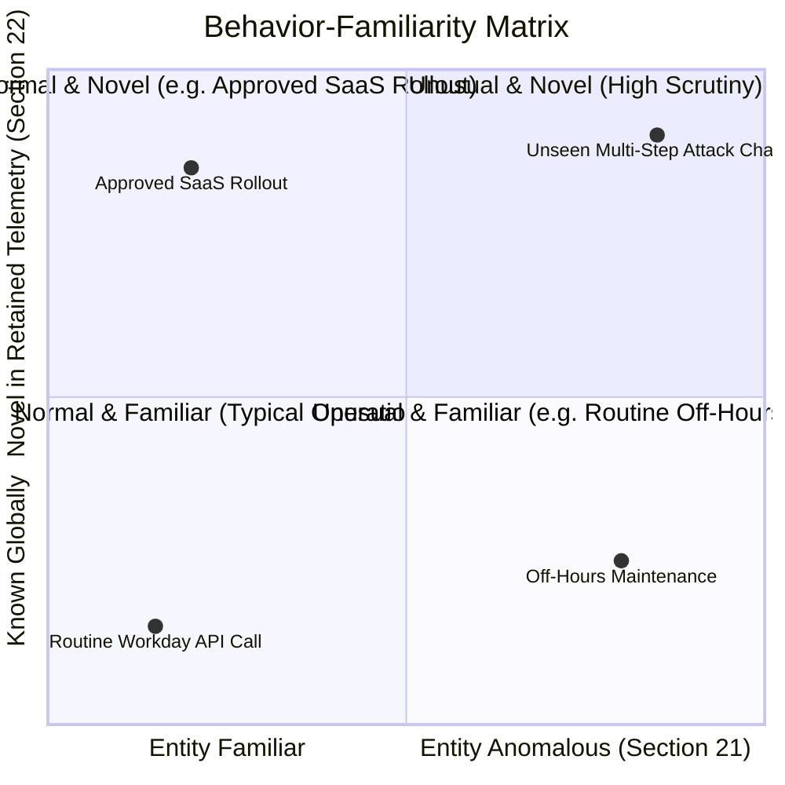
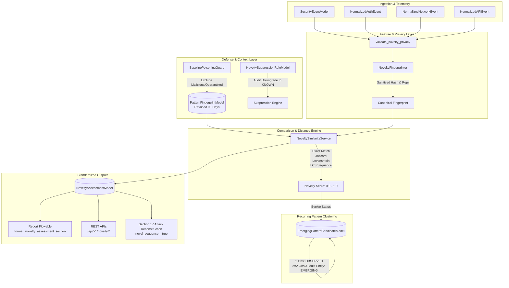
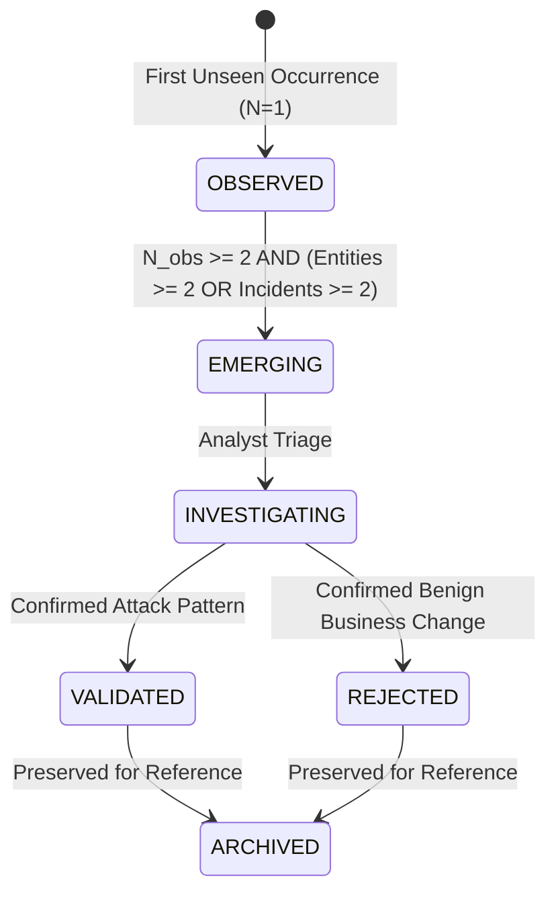

# Section 22: Novelty Detection & Emerging-Threat Identification Engine

## 1. Objective

Section 22 implements the **Novelty Detection & Emerging-Threat Identification Engine** for CyberGuard.

The central analytical question of Section 22 is:

> *"Is this pattern itself new or insufficiently represented in CyberGuard's available historical knowledge?"*

This is fundamentally distinct from Section 21's Behavioral Baseline question:

> *"Is this behavior unusual for this specific entity compared with its own historical behavior?"*

### Core Principles & Epistemic Boundaries
1. **Unfamiliarity $\neq$ Maliciousness**: A novel pattern (e.g. an approved SaaS rollout, new software version, or updated API structure) is technically unfamiliar within retained telemetry, but is **NOT** inherently malicious or a zero-day attack.
2. **Epistemic Humility**: CyberGuard never claims *"CyberGuard discovered a zero-day attack"* or *"This domain proves malicious infrastructure"*. It objectively reports *"CyberGuard identified a previously unseen behavioral pattern in retained telemetry"*.
3. **Evidence-Driven Pipeline**:
   $$\text{Pattern Unfamiliarity} \longrightarrow \text{Context} \longrightarrow \text{Independent Evidence} \longrightarrow \text{Finding} \longrightarrow \text{Confidence} \longrightarrow \text{Threat Assessment}$$
   Novelty is technical evidence, never an autonomous verdict.

---

## 2. Novelty vs. Anomaly: The 4-Quadrant Matrix

To prevent collapsing entity anomalies with global unfamiliarity, Section 22 formalizes the **Behavior-Familiarity Matrix**:

- **NORMAL_FAMILIAR**: Consistent with the entity's baseline and common across historical telemetry.
- **NORMAL_NOVEL**: Normal operation for the entity, but represents a structurally novel pattern across retained knowledge (e.g., approved SaaS rollout, new software version).
- **UNUSUAL_FAMILIAR**: Deviates from the entity's personal baseline (Section 21 anomaly), but the pattern itself is well-represented globally (e.g., off-hours login or standard pagination).
- **UNUSUAL_NOVEL**: Deviates from the entity's baseline **AND** introduces a previously unseen structure or sequence across retained history.

---

## 3. Architecture

---

## 4. Controlled Novelty Categories

| Category | Description | Primary Representation |
| :--- | :--- | :--- |
| `NOVEL_API_BEHAVIOR` | Unseen HTTP method, path template, or resource type | Method + Normalized Route Template + Auth Context |
| `NOVEL_URL_STRUCTURE` | Unseen URL scheme, token structure, or query parameter keys | Scheme + Host Type + Path Depth + Param Keys |
| `NOVEL_DOMAIN_PATTERN` | Unseen TLD, subdomain depth, or lexical entropy class | TLD + Label Depth + Entropy Bracket + IP Status |
| `NOVEL_NETWORK_BEHAVIOR` | Unseen port bracket, protocol, direction, or volume class | Dest Category + Port Class + Protocol + Volume Bracket |
| `NOVEL_AUTHENTICATION_PATTERN` | Unseen auth method, network class, MFA state, or device category | Method + Network Class + MFA + Device Class |
| `NOVEL_ATTACK_SEQUENCE` | Unseen temporal sequence of transition steps | Ordered Event Type Transition List |
| `NOVEL_EVENT_COMBINATION` | Unseen multi-signal attribute tuple | Co-occurring Feature Attribute Tuple |
| `NOVEL_ENTITY_RELATIONSHIP` | Unseen cross-entity relational edge | Source Type + Relationship Type + Target Type |

---

## 5. Fingerprinting & Privacy Safeguards

Fingerprints are deterministic, canonical SHA-256 digests generated from sorted JSON representations. Variable parameters such as numeric IDs and UUIDs are normalized into `{id}` templates (e.g. `/api/v1/users/8372` $\rightarrow$ `/api/v1/users/{id}`).

### Strict Privacy Guarantee
Under no circumstances are the following ingested or persisted:
- Passwords or hashes (`password`, `passwd`)
- API keys (`apikey`, `api_key`)
- Session secrets (`token`, `cookie`, `session_secret`)
- MFA tokens (`mfa_code`, `totp_code`)
- Raw Authorization headers (`Bearer ...`, `Basic ...`)

Every feature key and string value is strictly validated at runtime via `validate_novelty_privacy()`.

---

## 6. Structural Similarity & Distance Algorithms

Rather than binary matching alone, `NoveltySimilarityService` implements lightweight, sub-quadratic algorithms:

1. **Jaccard Similarity** (Token sets, query keys, bigrams):
   $$J(A, B) = \frac{|A \cap B|}{|A \cup B|}$$
2. **Normalized Levenshtein Edit Distance** (API route templates, URL paths):
   $$\text{Sim}(s_1, s_2) = 1.0 - \frac{\text{Levenshtein}(s_1, s_2)}{\max(|s_1|, |s_2|)}$$
3. **Composite Sequence Similarity** (Ordered attack stages):
   $$\text{SeqSim}(S_1, S_2) = 0.60 \times \frac{2 \cdot \text{len}(\text{LCS})}{|S_1| + |S_2|} + 0.40 \times J(\text{Bigrams}_1, \text{Bigrams}_2)$$
4. **Novelty Score**:
   $$\text{NoveltyScore} = 1.0 - \max_{c \in \text{Candidates}}(\text{Similarity}(O, c))$$

### Categorical Novelty Levels
- `KNOWN`: $\text{Novelty} < 0.15$
- `LOW`: $0.15 \le \text{Novelty} < 0.40$
- `MODERATE`: $0.40 \le \text{Novelty} < 0.70$
- `HIGH`: $0.70 \le \text{Novelty} < 0.90$
- `VERY_HIGH`: $\text{Novelty} \ge 0.90$

---

## 7. Emerging Pattern Candidates & Recurrence Scoring

When an unfamiliar pattern appears multiple times across distinct entities or incidents, it advances along an auditable lifecycle:

$$\text{RecurrenceScore} = \min\left(100.0, \, (N_{\text{obs}} \times 10) \times 0.4 + (N_{\text{entities}} \times 20) \times 0.3 + (N_{\text{incidents}} \times 25) \times 0.3\right)$$

### Lifecycle Transitions

---

## 8. Poisoning Safeguards & Contextual Suppression

### Contamination Defense
Adversaries cannot train the novelty engine into considering repeated exploits as "normal" or "familiar":
- Telemetry marked `is_malicious = True`, `quarantined = True`, or flagged by high-confidence detection engines is filtered.
- Malicious observations are evaluated for novelty distance, but are **excluded from persisting into the baseline familiar library** (`PatternFingerprintModel`).

### Contextual Suppression Rules
Authorized business operations (e.g. quarterly SaaS migrations, scheduled pentests, infrastructure upgrades) can be registered via `NoveltySuppressionRuleModel`:
- Auditable: Requires `approved_by` (e.g. CAB change ticket) and explicit `reason`.
- Time-bounded: Scoped by `valid_from` and `valid_until`.
- Scope: Restricts suppression to specific entity IDs, pattern types, or fingerprint hashes.

---

## 9. Retention Boundaries & First-Seen Semantics

CyberGuard operates within a bounded telemetry window (default: 90 days):
- Language is strictly retention-aware: *"Pattern not observed in retained telemetry during the previous 90 days"*.
- It never asserts global claims such as *"First seen on the internet"* or *"Newly created domain"*.
- Observations older than `MAX_HISTORY_LOOKBACK_DAYS` are excluded from candidate comparisons.

---

## 10. Downstream Integration

- **Attack Reconstruction (Section 17)**: Reconstructed incident contexts consume `novel_sequence = true` when unprecedented attack sequences occur. The reconstruction engine treats this as structural evidence without premature causation assumptions.
- **MITRE ATT&CK Mapping (Section 19)**: Novelty is **never** mapped to ATT&CK techniques purely because it is novel. Techniques are mapped only when underlying behaviors independently satisfy specific behavioral requirements.
- **Security Knowledge Graph (Section 14)**: Exposes `EMERGING_PATTERN` entity types linked by `EXHIBITS_NOVEL_PATTERN` and `ASSOCIATED_WITH_NOVEL_PATTERN`.
- **Forensic Reporting (Section 3)**: `ReportService.format_novelty_assessment_section()` provides non-alarmist ReportLab PDF tables documenting novelty levels, 4-quadrant matrix states, and emerging pattern recurrence.

---

## 11. REST API Specifications

| Method | Endpoint | Description |
| :--- | :--- | :--- |
| `POST` | `/api/v1/novelty/evaluate` | Evaluates novelty of an observed pattern or sequence |
| `GET` | `/api/v1/investigations/{id}/novelty` | Comprehensive novelty assessment summary for an incident |
| `GET` | `/api/v1/investigations/{id}/novelty/patterns` | Structural pattern assessments (API, URL, Domain, Auth) |
| `GET` | `/api/v1/investigations/{id}/novelty/sequences` | Event sequence and combination novelty assessments |
| `GET` | `/api/v1/investigations/{id}/novelty/infrastructure` | Network and infrastructure novelty assessments |
| `GET` | `/api/v1/investigations/{id}/emerging-patterns` | Emerging pattern candidates associated with an incident |
| `GET` | `/api/v1/entities/{id}/novelty` | Novelty assessments for a specific entity |
| `POST` | `/api/v1/novelty/emerging-patterns/{id}/status` | Transitions lifecycle state (`OBSERVED` $\rightarrow$ `EMERGING` $\rightarrow$ `INVESTIGATING`) |
| `POST` | `/api/v1/novelty/suppressions` | Registers an auditable contextual exception rule |
| `GET` | `/api/v1/novelty/stats` | Observability counters and metrics |

---

## 12. Verification & Test Coverage

The Section 22 implementation has been verified with 100% passing tests:
- `backend/tests/test_novelty_detection.py` (11 tests): Exact matching, structural similarity, sequence novelty, combination novelty, retention boundaries, poisoning safeguards, contextual suppressions, and privacy validation.
- `backend/tests/test_novelty_scenarios.py` (3 tests):
  - Scenario 1: API sequence novelty evolving to emerging pattern candidate across incidents.
  - Scenario 2: Novel network behavior (device $\rightarrow$ new domain $\rightarrow$ new port).
  - Scenario 3: Legitimate SaaS rollout evaluated without false maliciousness.
- `backend/tests/test_novelty_api.py` (6 tests): REST endpoints and lifecycle transitions.
- `backend/tests/test_novelty_performance.py` (1 test): Sub-quadratic execution and candidate bounds.
- Regression suite: 106 existing tests across Sections 15–21 pass without regression.
