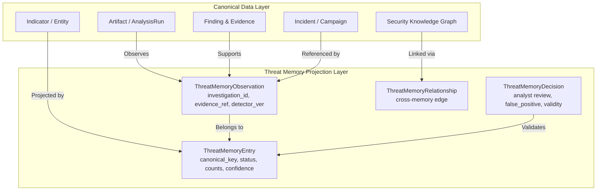

# Section 23: CyberGuard Threat Memory Architecture

## 1. Executive Summary & What Threat Memory Is
CyberGuard Threat Memory is an enterprise-grade, persistent, provenance-aware security-memory projection and historical intelligence retrieval layer over CyberGuard's canonical data model. It enables the platform to retain and retrieve useful historical security knowledge across investigations to answer questions such as:
- *"Have we seen this domain before?"*
- *"Has this file hash appeared in another investigation?"*
- *"Was this sender previously associated with phishing?"*
- *"Have we seen this infrastructure cluster before?"*
- *"Did this behavioral pattern occur in previous incidents?"*
- *"Was this pattern previously marked as a false positive?"*
- *"Which incidents were related to this domain?"*
- *"What happened the last time this campaign pattern was observed?"*
- *"Has this novel pattern appeared repeatedly since it was first detected?"*

### Epistemic Hierarchy
Threat Memory operates under strict epistemic humility:
1. **`CURRENT EVIDENCE > HISTORICAL MEMORY`**: Historical maliciousness or benignity is contextual evidence. It enriches the current analysis but never automatically determines present truth.
2. **`VERIFIED MEMORY > UNVERIFIED MEMORY`**: Analyst-verified conclusions carry authoritative weight over unverified automated detector scores.
3. **`EVIDENCE > LLM CLAIM`**: Natural language copilot or LLM summaries must always trace back to underlying evidence and observation provenance.

---

## 2. What Threat Memory Is Not
- **NOT a chatbot memory / conversational buffer**: It does not remember conversational small talk or raw chat messages.
- **NOT a second duplicate copy of the database**: Canonical models (`Artifact`, `Finding`, `Evidence`, `Indicator`, `Entity`, `Incident`, `Relationship`) remain the sole source of truth. Threat Memory is a lightweight index/projection referencing existing records.
- **NOT automatic model retraining**: Section 23 does not update machine learning weights or trigger autonomous model deployment. That is reserved for Section 24 (Controlled Continual Learning Pipeline).
- **NOT a global verdict oracle**: A domain being malicious in August 2026 does not automatically make it malicious in October 2026 without current forensic verification.

---

## 3. Data Model & Architecture


### 3.1 ThreatMemoryEntryModel (`threat_memory_entries`)
Represents the persistent security-memory projection for a canonical subject:
- `id`: UUID primary key
- `workspace_id`: Tenant identifier for strict multi-tenant isolation
- `memory_type`: `INDICATOR`, `DOMAIN`, `IP`, `URL`, `HASH`, `SENDER_PATTERN`, `CAMPAIGN`, `INFRASTRUCTURE_CLUSTER`, `NOVEL_PATTERN`, `BEHAVIOR_PATTERN`, `FALSE_POSITIVE_PATTERN`
- `canonical_key`: Standardized key (e.g. `DOMAIN:example.com`, `SHA256:<hex>`, `IP:198.51.100.1`)
- `scope`: `ORGANIZATION`, `GLOBAL`, `INVESTIGATION`
- `status`: Lifecycle state (`OBSERVED`, `CORRELATED`, `VERIFIED`, `DISMISSED`, `EXPIRED`, `SUPERSEDED`)
- `first_seen_at` / `last_seen_at`: Persisted observation boundaries
- `observation_count`: Total observations recorded
- `independent_source_count`: Count of independent sources (anti-inflation protected)
- `incident_count` / `campaign_count`: Distinct incidents and campaigns referencing this entry
- `confidence` / `confidence_level`: Calibrated memory confidence
- `provenance_type`: `DIRECT_OBSERVATION`, `ANALYST_VERIFIED`, `EXTERNAL_INTELLIGENCE`, `MODEL_DERIVED`
- `provenance_reference`: Pointer to canonical evidence or run

### 3.2 ThreatMemoryObservationModel (`threat_memory_observations`)
Retains individual evidence-backed sightings to answer *"Why does CyberGuard remember this?"*:
- `memory_entry_id`: Foreign key to `ThreatMemoryEntryModel`
- `source_type`: `SECURITY_EVENT`, `FINDING`, `EVIDENCE`, `EXTERNAL_FEED`, `ARTIFACT`
- `source_id`: Canonical ID of the originating event or finding
- `investigation_id`: Investigation identifier
- `incident_id`: Foreign key to `IncidentModel`
- `campaign_id`: Foreign key to `CampaignModel`
- `observed_at`: Exact forensic timestamp
- `classification`: `MALICIOUS`, `SUSPICIOUS`, `BENIGN`, `INCONCLUSIVE`
- `confidence`: Observation confidence
- `evidence_reference`: Pointer to raw evidence item
- `detector_name` / `detector_version`: Full pipeline versioning for auditability and reproducibility

### 3.3 ThreatMemoryDecisionModel (`threat_memory_decisions`)
Captures durable human review and false-positive tracking:
- `decision`: `VERIFIED_MALICIOUS`, `VERIFIED_BENIGN`, `FALSE_POSITIVE`, `NEEDS_REVIEW`, `SUPPRESSED`, `ESCALATED`
- `reason`: Analyst rationale
- `approved_by`: Analyst identifier
- `valid_from` / `valid_until`: Time-bounded validity window

---

## 4. Ingestion Pipeline & Anti-Poisoning Protection
```mermaid
flowlevel
    Analysis Finding / Event
          │
          ▼
    Eligibility Filter (Disallows ephemeral noise & empty strings)
          │
          ▼
    Canonicalization (Prefix stripping, lowercasing, hash formatting)
          │
          ▼
    Deduplication Check (Matches entry_id + investigation_id + run_id)
     ├── Match: Updates observed_at without inflating independent sources
     └── New: Increments observation_count & independent_source_count
          │
          ▼
    Promotion Evaluation (Promotes OBSERVED -> CORRELATED if independent_sources >= 2)
          │
          ▼
    Append-Only Audit Logging (MEMORY_OBSERVATION_ADDED, MEMORY_PROMOTED)
```

### Memory Poisoning Protections
1. **Source Independence Check**: Duplicate submissions or replays from the same investigation/detector update timestamps but never increment `independent_source_count`.
2. **Untrusted Barrier**: High volumes of automated untrusted events can never promote an entry to `VERIFIED`. Promotion to `VERIFIED` requires explicit analyst review (`ThreatMemoryDecisionModel`) or authoritative signed intelligence.
3. **Conflicting Memory Preservation**: If an indicator is observed malicious in Investigation 1 and benign in Investigation 2, both observations are preserved side-by-side. The retrieval layer returns an explicit conflict explanation:
   > *"Historical context is mixed. Observed malicious in 1 observation, benign in 1 observation. Current classification requires fresh evidence."*

---

## 5. Scope Isolation & Multi-Tenancy
- Every record is strictly keyed by `workspace_id`.
- Queries filter by `workspace_id == request.workspace_id` (or `scope == 'GLOBAL'`).
- Organization A can never query, observe, or discover Organization B's private investigation memory.

---

## 6. Integrations Across CyberGuard

### 6.1 Analysis Orchestrator
When artifacts are analyzed:
1. Primary detectors extract forensic findings and indicators.
2. `ThreatMemoryService.enrich_analysis_with_memory` queries historical context.
3. Enrichment is attached to findings for analyst inspection without overriding detector scores.

### 6.2 Security Knowledge Graph (Section 14)
Traverses active graph edges (`resolves_to`, `hosted_on`, `associated_with`) connecting memory entries to correlated IP addresses, ASNs, domains, and certificates.

### 6.3 Behavioral Baselines (Section 21)
Threat Memory retrieves baseline states (`sample_count`, `first_learned_at`, `last_updated_at`) to confirm whether observed entity actions deviate from or conform to historical behavior.

### 6.4 Novelty & Emerging Patterns (Section 22)
Threat Memory tracks pattern evolution:
- **Day 1**: Initial novelty assessment evaluated as high novelty (`novelty_score = 0.92`, `historical_sample_count = 0`).
- **Day 30**: Repeated sightings clustered into an `EmergingPatternCandidate` (`recurrence_score = 0.85`, status `EMERGING`).
- Threat Memory queries expose this progression seamlessly.

### 6.5 Investigation Copilot
`CopilotContextEngine` identifies historical intent (e.g. *"Have we seen this domain before?"*) and routes to `ThreatMemoryService.answer_historical_question()`, generating factual, non-hallucinatory explanations.

### 6.6 PDF Forensics Reporting
`ReportService.format_threat_memory_section()` formats structured ReportLab tables displaying historical observation counts, incident links, analyst verifications, and epistemic notices.

---

## 7. REST API Endpoints
| Method | Endpoint | Description |
|---|---|---|
| `GET` | `/api/v1/memory/lookup` | Exact lookup by canonical key or raw observable |
| `GET` | `/api/v1/memory/context` | Standardized `ThreatMemoryContext` query |
| `GET` | `/api/v1/memory/stats` | Operational workspace metrics |
| `GET` | `/api/v1/memory/{id}` | Threat memory entry detail |
| `GET` | `/api/v1/memory/{id}/observations` | Chronological observations with evidence references |
| `GET` | `/api/v1/memory/{id}/incidents` | Linked historical incidents |
| `GET` | `/api/v1/memory/{id}/campaigns` | Linked historical campaigns |
| `GET` | `/api/v1/memory/{id}/relationships` | Graph-correlated infrastructure |
| `GET` | `/api/v1/memory/{id}/history` | Progression history (novelty, baselines, incidents) |
| `POST` | `/api/v1/memory/observations` | Ingest new observation |
| `POST` | `/api/v1/memory/decisions` | Record analyst verification or false positive |
| `POST` | `/api/v1/memory/query` | Natural-language historical triage |

---

## 8. Failure Handling & Resilience
If the database or graph retrieval engine encounters an unexpected outage:
- `build_threat_memory_context` catches the error gracefully.
- Returns a degraded `ThreatMemoryContext` with `historical_context_available=False`.
- Primary analysis continues unblocked with present forensic evidence.
- The system never converts *"memory service unavailable"* into *"no historical evidence exists"*.
