# Section 24: Controlled Continual-Learning Pipeline Architecture

## 1. Executive Summary & Core Principles
The Controlled Continual-Learning Pipeline enables CyberGuard to improve from newly observed security observations and verified analyst feedback without autonomous self-mutation or untrusted data poisoning.

### Core Epistemic Boundary
$$\text{TRAINING} \neq \text{PRODUCTION DEPLOYMENT}$$

The production system **never silently rewrites itself** based on incoming data. A trained candidate model must not automatically become the active production model. The lifecycle is strictly governed:

$$\text{OBSERVE} \longrightarrow \text{VERIFY} \longrightarrow \text{CURATE} \longrightarrow \text{TRAIN} \longrightarrow \text{EVALUATE} \longrightarrow \text{COMPARE} \longrightarrow \text{APPROVE} \longrightarrow \text{STAGE} \longrightarrow \text{MONITOR} \longrightarrow \text{PROMOTE} \ / \ \text{ROLLBACK}$$

---

## 2. Controlled Learning Architecture

```mermaid
graph TD
    subgraph Ingestion & Memory Layer
        OBS[New Security Observation]
        CUR[Current Production Model]
        TM[Threat Memory Entry & Observation]
        AN[Analyst Review & Verification]
    end

    subgraph Curation & Dataset Layer
        LC[Learning Candidate<br/>eligibility qualification, privacy sanitization]
        DB[Dataset Builder<br/>temporal split, campaign grouping]
        PQ[Poisoning & Class Balance Defense<br/>source concentration <= 35%]
        DS[Immutable Dataset Version<br/>D-001, D-025 with SHA-256 Manifest]
    end

    subgraph Training & Evaluation Layer
        TJ[Asynchronous Training Job<br/>isolated execution, resource caps]
        CM[Candidate Model Artifact<br/>phishing-v13]
        OE[Offline Evaluation<br/>Accuracy, Precision, Recall, F1, FPR, FNR, Critical Recall]
        BC[Baseline Comparison vs Production<br/>Regression Gate Evaluation]
    end

    subgraph Model Registry & Deployment Governance
        MR[Model Registry<br/>CANDIDATE status]
        AG[Approval Gate<br/>Analyst / SecOps sign-off -> APPROVED]
        ST[Canary Staging<br/>Traffic monitoring -> STAGED]
        PR[Cryptographic Verification<br/>SHA-256 integrity check -> PRODUCTION]
        RB[Reversible Rollback<br/>Restores prior version -> ROLLED_BACK]
    end

    OBS --> CUR
    CUR --> TM
    TM --> AN
    AN --> LC
    LC --> DB
    DB --> PQ
    PQ --> DS
    DS --> TJ
    TJ --> CM
    CM --> OE
    OE --> BC
    BC --> MR
    MR --> AG
    AG --> ST
    ST --> PR
    PR -.->|Detected Regression| RB
```

---

## 3. Candidate Eligibility & Qualification
Not every observation enters a training dataset. Learning candidates must satisfy strict inclusion rules:

### 3.1 Potentially Eligible
- Analyst-verified malicious samples (`CONFIRMED_MALICIOUS`, `VERIFIED_MALICIOUS`).
- Analyst-verified benign samples (`CONFIRMED_BENIGN`, `VERIFIED_BENIGN`).
- Validated false positives (`FALSE_POSITIVE` mapped to verified hard negatives).
- High-confidence observations with independent multi-source corroboration.
- Reviewed emerging-threat candidates from Section 22 novelty detection.

### 3.2 Potentially Ineligible / Excluded
- Unverified model pseudo-labels (isolated and capped; excluded from ground truth).
- Low-confidence findings ($< 0.60$ confidence threshold).
- Corrupted, empty, or truncated samples ($< 10$ characters of sanitized text).
- Duplicate observations (deduplicated by source reference and content fingerprint).
- Unresolved contradictory labels (`CONFLICTED` state until resolved).

---

## 4. Label Trust & Provenance Hierarchy
Labels are categorized with explicit trust weights:
1. `ANALYST_VERIFIED`: Gold-standard ground truth provided by authenticated security analysts.
2. `RULE_VERIFIED`: Validated by high-confidence deterministic cryptographic or forensic signatures.
3. `MULTI_SOURCE_CORRELATED`: Independently corroborated across multiple isolated telemetry streams.
4. `EXTERNAL_INTELLIGENCE`: Third-party threat feeds (subject to source concentration limits).
5. `MODEL_PSEUDO_LABEL`: Predictions from models. **Never treated as ground truth by default** to prevent self-reinforcing model confirmation bias.

---

## 5. Dataset Versioning & Immutability
Datasets are curated into sequentially numbered versions (e.g., `D-001`, `D-024`, `D-025`):
- **Immutability Guarantee**: Once finalized, a dataset version is never mutated in-place. Corrections yield `D-026`.
- **Cryptographic Manifest**: Every dataset record stores a deterministic SHA-256 hash computed over its samples.
- **Lineage Metadata**: Records `sample_count`, `malicious_count`, `benign_count`, `hard_negative_count`, `source_distribution`, and temporal boundaries (`time_range_start`, `time_range_end`).

---

## 6. Feature Versioning & Feature Store Abstraction
Model artifacts track:
- `feature_schema_version`: e.g. `1.0.0`.
- `normalization_version`: e.g. `TextNormalizer` pipeline.
- `vectorizer_spec`: TF-IDF configuration (unigrams + bigrams, sublinear TF scaling).

A model trained on Feature Schema v1 is prevented from silently ingesting incompatible Feature Schema v2 vectors.

---

## 7. Data Poisoning Defenses
The pipeline implements automated quality and integrity checks prior to dataset validation:
- **Source Concentration Cap**: No single external or untrusted source may contribute more than **35%** of a training dataset. Exceeding this triggers `REJECTED` status for manual security review.
- **Class Balance Guard**: Minority classes must comprise at least **5%** of the dataset to avoid degenerate degenerate predictors.
- **Deduplication with Frequency Preservation**: Identical hashes or URLs update observation frequency timestamps without uncontrolled sample duplication.

---

## 8. Temporal Splitting (No Future Lookahead Leakage)
To prevent temporal data leakage, samples are partitioned based on their observed timestamps:
- **Oldest 70%**: Training split.
- **Intermediate 15%**: Validation split.
- **Newest 15%**: Held-out temporal test split.

Evaluating models on the newest temporal slice simulates real operational deployment.

---

## 9. Campaign & Incident Leakage Prevention
Samples belonging to the same `campaign_id` or `incident_id` are grouped cohesively and assigned to a single partition split. This ensures models are evaluated on their ability to generalize to **unseen campaigns** rather than memorizing redundant emails from the same ongoing attack.

---

## 10. Hard Negative Mining
Validated false positives are transformed into **hard negatives** (`is_hard_negative = True`, `label = 'legitimate'`).
Examples:
- Legitimate enterprise Okta / SSO portal migrations that resemble credential harvesting pages.
- Authorized bulk administrative scripts that trigger volume anomalies.
- Security awareness training phishing simulations.

Hard negatives are tracked and incorporated into datasets to directly drive down production False Positive Rates.

---

## 11. Training Jobs & Resource Isolation
- **Asynchronous Execution**: Training jobs execute outside the HTTP request path using isolated background workers.
- **Resource Constraints**: Training configurations enforce bounds on vocabulary size (`max_features <= 5000`), solver iterations, and sample limits (`max_samples <= 50000`).
- **Failure Isolation**: A failed training job never destabilizes or interrupts the active production model.

---

## 12. Model Registry & Cryptographic Checksums
The Model Registry (`RegisteredModelModel`) tracks candidate and deployed models with state transitions:
$$\text{CANDIDATE} \longrightarrow \text{APPROVED} \longrightarrow \text{STAGED} \longrightarrow \text{PRODUCTION} \longrightarrow \text{ROLLED\_BACK} \ / \ \text{ARCHIVED}$$

### Checksum Verification
At promotion and load time, CyberGuard verifies:
$$\text{SHA-256}(\text{artifact file on disk}) == \text{artifact\_checksum recorded in registry}$$
Any tampering, unauthorized replacement, or disk corruption aborts model loading immediately with a security alert.

---

## 13. Offline Evaluation & Security-Critical Metrics
Every candidate model is evaluated on held-out test splits across security-critical dimensions:
- **Precision**: Minimizes false alerts that fatigue analysts.
- **Recall**: Overall threat detection coverage.
- **F1 Score**: Harmonic mean of precision and recall.
- **Critical-Threat Recall**: Detection rate on high-severity, destructive threats.
- **False Positive Rate (FPR)** and **False Negative Rate (FNR)**.
- **Confusion Matrix**: Full breakdown of true/false positives and negatives.

---

## 14. Baseline Comparison & Regression Gates
Candidate models are never evaluated in isolation; they are compared against the currently active production model. Configurable regression gates must pass:
1. **Recall Preservation Gate**: Candidate recall must not drop below baseline recall by more than 5%.
2. **Precision Gate**: Candidate precision must meet or exceed minimum operational thresholds ($>= 0.80$).
3. **Critical Threat Recall Gate**: Candidate must detect critical attacks with $>= 0.85$ recall.
4. **False Positive Rate Gate**: Candidate FPR must not exceed 10%.

Failure of any gate marks the evaluation `REJECTED_DUE_TO_REGRESSION`.

---

## 15. Explicit Approval & Staged Canary Deployment
1. **Analyst Approval Gate**: Promotes `CANDIDATE` to `APPROVED` only with documented justification and recorded reviewer identity.
2. **Canary Staging**: Moves model to `STAGED` where predictions and errors can be monitored side-by-side with production traffic.
3. **Promote**: Promotes `STAGED` to `PRODUCTION`, demotes prior model to `ARCHIVED`, and hot-reloads the runtime classifier.

---

## 16. Reversible Rollback
Every production deployment is reversible:
- When production monitoring detects regressions or alert spikes, `rollback_production` safely restores the previous production model.
- The rolled-back model is marked `ROLLED_BACK` while preserving its evaluation history, metrics, and audit trail for subsequent forensic diagnosis.

---

## 17. Model Drift & Active Learning
- **Drift Monitoring**: Evaluates prediction distributions, analyst disagreement rates, and novelty detection frequencies over a rolling 30-day window.
- **Active Learning**: Prioritizes borderline classifications (prediction probabilities near decision boundary $0.45 - 0.55$) and high-novelty patterns for prioritized human analyst review.

---

## 18. Privacy, Security & Sanitization
- **Credential Redaction**: Passwords, API tokens, bearer authorization headers, and private keys are scrubbed via `sanitize_training_payload()` and `sanitize_log_text()` before entering datasets.
- **Static Ingestion Boundaries**: Training treats samples strictly as inert textual data, never executing embedded scripts, macros, or binaries.
- **Role-Based Access Control**: Privileged model promotion, staging, and rollback routes enforce role checks (`X-Role: admin` / `analyst`), rejecting unauthorized callers with HTTP 403 Forbidden.

---

## 19. Observability & Audit Logging
All pipeline operations emit structured `AuditLogModel` records:
- `LEARNING_CANDIDATE_CREATED`, `LEARNING_CANDIDATE_ACCEPTED`, `LEARNING_CANDIDATE_REJECTED`
- `DATASET_CREATED`, `DATASET_VALIDATED`, `DATASET_REJECTED`
- `TRAINING_STARTED`, `TRAINING_COMPLETED`, `TRAINING_FAILED`
- `MODEL_APPROVED`, `MODEL_STAGED`, `MODEL_PROMOTED`, `MODEL_ROLLED_BACK`

---

## 20. Current Prototype Trainable Scope & Limitations
- **Trainable Component**: The NLP `PhishingClassifier` (TF-IDF + Logistic Regression) in `backend/app/ml/` is fully instrumented with continual training, offline evaluation, regression gating, and runtime hot-reloading.
- **Non-Trainable Rule Engines**: Deterministic SPF/DKIM/DMARC validators, MITRE ATT&CK rule engines, and external IP lookup providers are rule-based and not subject to weight retraining.
