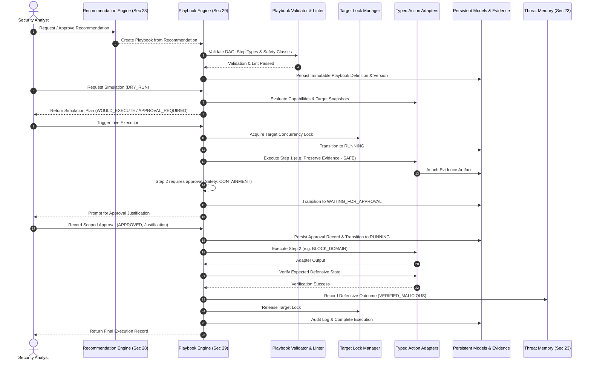

# Architecture Document 38: Section 29 — Response Playbooks

## 1. Purpose & Executive Summary

Section 28 introduced CyberGuard's advisory recommendation engine, answering:
> *"What should the human security analyst consider doing?"*

**Section 29: Response Playbooks** operationalizes those recommendations into structured, deterministic, auditable, and reversibility-aware response workflows, answering:
> *"How can an approved defensive response be executed safely, verified, and audited without autonomous destruction?"*

```
Detection (Sections 15-22)
    ↓
Analysis & Attack Reconstruction (Sections 23-26)
    ↓
Unified Risk Assessment (Section 26)
    ↓
Explainable AI (Section 27)
    ↓
Response Recommendations (Section 28)
    ↓
Response Playbooks (Section 29)
    ↓
Precondition & Target Validation
    ↓
Dry-Run Simulation
    ↓
Scoped Human Approval Boundary
    ↓
Deterministic Execution Engine
    ↓
Typed Adapters (Allowlisted Primitives)
    ↓
Defensive State Verification
    ↓
Evidence Capture & Forensic Audit Trail
    ↓
Compensating Rollback / Completion
```

---

## 2. Core Safety Principle: Strict Separation of Concerns

CyberGuard enforces an uncompromised distinction between five operational domains:

1. **Recommendation**: "What should the analyst consider doing?" (Advisory, Section 28).
2. **Playbook**: "These are the exact, controlled, pre-sequenced steps that could be performed." (Section 29 definition & versioning).
3. **Approval**: "An authorized human has explicitly signed off on this action for this target and scope." (Server-side cryptographic audit record).
4. **Execution**: "The system invoked an allowlisted, typed integration under runtime guardrails." (No arbitrary code/shell).
5. **Verification**: "The system queried the target environment to verify whether the intended defensive state was achieved." (Evidence-backed assertion).

A high risk score or critical severity recommendation **never** constitutes automated execution authorization.

---

## 3. High-Level Architecture & Sequence Diagram



---

## 4. Response Playbook Domain Models

The domain model is built on SQLAlchemy declarative models in `backend/db/models.py` with Pydantic v2 schemas in `backend/schemas/response_playbook.py`:

### `ResponsePlaybookModel` (`response_playbooks`)
- `id`: UUID primary key.
- `playbook_key`: Stable functional identifier (e.g., `phishing-containment`, `account-takeover-response`).
- `name`: Human-readable title.
- `description`: Operational intent and scope.
- `version`: Integer version (monotonically increasing, 1, 2, ...).
- `parent_version`: Pointer to predecessor version.
- `status`: Lifecycle state (`DRAFT`, `VALIDATING`, `READY`, `REVIEW_REQUIRED`, `APPROVED`, `STAGED`, `ACTIVE`, `PAUSED`, `DISABLED`, `RETIRED`, `SUPERSEDED`).
- `trigger_type`: Origin trigger (`MANUAL`, `RECOMMENDATION_APPROVED`, `INCIDENT_ESCALATION`, `AUTOMATED_HIGH_CONFIDENCE`).
- `scope_type`: Scope level (`GLOBAL`, `ORGANIZATION`, `EVENT`, `INCIDENT`, `CAMPAIGN`).
- `incident_id` / `investigation_id` / `source_recommendation_id`: Direct relational lineage.
- `approval_policy`: Policy level (`NO_APPROVAL`, `SINGLE_APPROVAL`, `PRIVILEGED_APPROVAL`, `DUAL_APPROVAL`).
- `execution_policy`: Policy (`MANUAL`, `SEMI_AUTOMATED`, `STAGED_ROLLOUT`).
- `timeout_seconds`: Wall-clock execution ceiling.
- `workspace_id`: Multi-tenant isolation partition.

### `ResponsePlaybookStepModel` (`response_playbook_steps`)
- `playbook_id`: Foreign key with cascading delete.
- `step_key`: Unique slug within playbook.
- `sequence`: Integer 1-indexed ordering.
- `step_type`: Constrained enum action type.
- `name` & `description`: Plain-language explanation of step.
- `parameters_json`: Redacted configuration parameters.
- `target_selector_json`: Target resolution criteria.
- `condition_json`: Safe AST expression tree.
- `safety_class`: Impact classification (`INFORMATIONAL`, `LOW_IMPACT`, `REVERSIBLE`, `CONTAINMENT`, `HIGH_IMPACT`, `DESTRUCTIVE`).
- `requires_approval`: Boolean guard flag.
- `verification_policy_json`: Expected post-action state and timeout.
- `rollback_policy_json`: Reversibility declaration and compensating step.
- `depends_on_json`: Array of prerequisite `step_key` items.

### `ResponsePlaybookExecutionModel` (`response_playbook_executions`)
- Tracks lifecycle: `PENDING` → `VALIDATING` → `WAITING_FOR_APPROVAL` → `READY` → `RUNNING` → `COMPLETED` / `PARTIALLY_COMPLETED` / `FAILED` / `ROLLED_BACK`.
- Stores `mode` (`DRY_RUN` vs `LIVE`), `requested_by`, `approved_by`, and timestamps.

### `ResponsePlaybookStepExecutionModel` (`response_playbook_step_executions`)
- Granular per-step execution audit: `started_at`, `completed_at`, `attempt_count`, `adapter`, `adapter_version`, `input_summary`, `output_summary`, `verification_result`, `error_code`.

### `ResponsePlaybookApprovalModel` (`response_playbook_approvals`)
- Scoped approval record binding `execution_id`, `step_id`, `scope` (`STEP` vs `EXECUTION`), `decision`, `approved_by`, and `reason`.

### `TargetLockModel` (`response_target_locks`)
- Distributed mutual exclusion lock preventing concurrent conflicting actions on the same target entity (e.g. simultaneous account modification).

---

## 5. Playbook Versioning & Immutability

Playbooks follow strict forensic immutability:
1. Once a playbook version is executed or approved, it is **frozen**.
2. Updates spawn a new record with incremented `version` and pointer `parent_version`.
3. Every execution permanently references `playbook_id` and `playbook_version`.
4. Forensic investigators can reconstruct the exact step definitions executed months earlier without risk of schema drifts.

---

## 6. Controlled Step Types & Zero Arbitrary Code Execution

To prevent weaponization, remote code execution (RCE), or LLM injection risks, CYBERGUARD rejects arbitrary execution primitives.

### Strictly Prohibited
- `run_shell(cmd)`
- `execute_python(code)`
- `execute_sql(query)`
- `curl(url)`
- `eval(expression)`
- `run_script(path)`

### Allowlisted Typed Action Taxonomy
| Domain | Step Type | Safety Class | Reversibility |
| :--- | :--- | :--- | :--- |
| **Evidence** | `PRESERVE_EVIDENCE` | INFORMATIONAL | IRREVERSIBLE |
| | `COLLECT_ARTIFACT_METADATA` | INFORMATIONAL | IRREVERSIBLE |
| | `CAPTURE_ANALYSIS_SNAPSHOT` | INFORMATIONAL | IRREVERSIBLE |
| | `EXPORT_FORENSIC_RECORD` | INFORMATIONAL | IRREVERSIBLE |
| **Investigation** | `RUN_ANALYSIS` | INFORMATIONAL | IRREVERSIBLE |
| | `REANALYZE_ARTIFACT` | INFORMATIONAL | IRREVERSIBLE |
| | `ENRICH_INDICATOR` | INFORMATIONAL | IRREVERSIBLE |
| | `CORRELATE_INCIDENT` | INFORMATIONAL | IRREVERSIBLE |
| | `CREATE_INVESTIGATION_TASK`| INFORMATIONAL | REVERSIBLE |
| **Identity / Account** | `REVOKE_SESSION` | CONTAINMENT | REVERSIBLE |
| | `FORCE_REAUTHENTICATION` | CONTAINMENT | REVERSIBLE |
| | `REQUIRE_CREDENTIAL_RESET` | HIGH_IMPACT | PARTIALLY_REVERSIBLE |
| | `DISABLE_ACCOUNT` | HIGH_IMPACT | REVERSIBLE |
| | `ENABLE_ADDITIONAL_AUTHENTICATION` | CONTAINMENT | REVERSIBLE |
| **Network** | `BLOCK_INDICATOR` | CONTAINMENT | REVERSIBLE |
| | `BLOCK_DOMAIN` | CONTAINMENT | REVERSIBLE |
| | `BLOCK_URL_PATTERN` | CONTAINMENT | REVERSIBLE |
| | `BLOCK_IP` | CONTAINMENT | REVERSIBLE |
| | `INCREASE_NETWORK_MONITORING` | INFORMATIONAL | REVERSIBLE |
| **Endpoint** | `ISOLATE_ENDPOINT` | CONTAINMENT | REVERSIBLE |
| | `COLLECT_ENDPOINT_ARTIFACT`| INFORMATIONAL | IRREVERSIBLE |
| | `INCREASE_ENDPOINT_MONITORING` | INFORMATIONAL | REVERSIBLE |
| **Communication** | `CREATE_NOTIFICATION` | INFORMATIONAL | IRREVERSIBLE |
| | `CREATE_CASE_NOTE` | INFORMATIONAL | REVERSIBLE |
| | `ESCALATE_INCIDENT` | INFORMATIONAL | REVERSIBLE |
| **Verification** | `VERIFY_ACCOUNT_STATE` | INFORMATIONAL | IRREVERSIBLE |
| | `VERIFY_SESSION_STATE` | INFORMATIONAL | IRREVERSIBLE |
| | `VERIFY_ENDPOINT_STATE` | INFORMATIONAL | IRREVERSIBLE |
| | `VERIFY_NETWORK_CONTROL` | INFORMATIONAL | IRREVERSIBLE |
| | `VERIFY_EVIDENCE_PRESERVATION` | INFORMATIONAL | IRREVERSIBLE |

---

## 7. Response Adapter Architecture

All operations are routed through `ResponseActionAdapter` implementations in `backend/services/playbook_adapters.py`:

```python
class ResponseActionAdapter(ABC):
    action_type: str
    capability: str
    safety_class: str
    supported_targets: List[str]
    requires_approval: bool
    supports_dry_run: bool = True
    supports_verification: bool = True
    supports_rollback: bool = True

    @classmethod
    def check_capability(cls, db: Session, workspace_id: str) -> Tuple[bool, str, str]: ...

    @classmethod
    def execute(cls, db: Session, workspace_id: str, step_key: str, target: TargetSnapshot, parameters: Dict[str, Any], mode: str, execution_context: Dict[str, Any]) -> Dict[str, Any]: ...

    @classmethod
    def verify(cls, db: Session, workspace_id: str, target: TargetSnapshot, execution_output: Dict[str, Any], mode: str) -> Dict[str, Any]: ...

    @classmethod
    def rollback(cls, db: Session, workspace_id: str, target: TargetSnapshot, execution_output: Dict[str, Any], mode: str) -> Dict[str, Any]: ...
```

### Registered Adapters
1. `EvidencePreservationAdapter` — Creates cryptographic snapshot hashes in `EvidenceModel`.
2. `DomainBlockAdapter` — Submits block policies to DNS sinkholes/web gateways.
3. `URLBlockAdapter` — Submits URL filtering patterns.
4. `IPBlockAdapter` — Configures perimeter firewall drop rules.
5. `SessionRevocationAdapter` — Invalidates IdP tokens / OAuth sessions.
6. `AccountDisableAdapter` — Suspends compromised Active Directory / IdP accounts.
7. `PasswordResetAdapter` — Flags account for mandatory re-authentication and credential reset.
8. `MFAReauthenticationAdapter` — Steps up authentication challenge.
9. `NotificationAdapter` — Dispatches alerts to SOC communication channels.
10. `EndpointIsolationAdapter` — Configures host isolation via EDR connector.

---

## 8. Capability Registry Integration

Before executing any step, the engine queries `ResponseCapabilityModel` from Section 28:
- If a capability is `DISABLED`, `MAINTENANCE`, or `REQUIRES_CONFIGURATION`, the engine halts and raises `CAPABILITY_UNAVAILABLE`.
- It never fakes success. Unavailable integrations must fail closed.

---

## 9. Target Resolution & Concurrency Locking

Targets are strongly typed (`TargetRef`):
- `target_type`: `DOMAIN`, `URL`, `IP`, `USER_ACCOUNT`, `SESSION`, `ENDPOINT_DEVICE`, `ARTIFACT`.
- `target_id`: String identifier (e.g. `malicious-domain.com`, `user@corp.com`).
- Target resolution produces an immutable `TargetSnapshot` containing `state_at_resolution`, `resolution_source`, and tenant identifier.
- `TargetLockModel` enforces leases with TTL to prevent concurrent workflows from executing conflicting state mutations against the same target.

---

## 10. Dry-Run Simulation Mode (`DRY_RUN`)

The engine provides full pre-flight simulation:
- Validates the entire DAG structure.
- Resolves all targets and snapshots.
- Audits required capabilities against the registry.
- Evaluates step conditions.
- Identifies steps requiring human approval.
- Generates a `SimulationPlan` indicating `WOULD_EXECUTE` or `APPROVAL_REQUIRED` without external side effects.

---

## 11. Scoped Human Approval Boundary

Consequential actions (`CONTAINMENT`, `HIGH_IMPACT`) require explicit analyst approval:
- Approvals are strictly scoped to `(execution_id, step_id, target_snapshot)`.
- An approval for `domain-a.com` in Incident 1 cannot authorize actions on `domain-b.com` in Incident 2.
- Approval requires an audit justification note (`reason`).

---

## 12. Verification & State Assertion

CYBERGUARD does not report success merely because an HTTP request returned 200:
- Every consequential action requires a `VerificationPolicy`.
- Adapters query the integration target to confirm the defensive state was achieved (e.g., `CONTROL_BLOCK_ACTIVE`, `SESSION_REVOKED`, `HOST_NETWORK_ISOLATED`).
- State verification failure marks the step `VERIFICATION_FAILED` and halts progression.

---

## 13. Compensating Rollback Architecture

Where actions are reversible, adapters implement `rollback`:
- `BLOCK_DOMAIN` → `UNBLOCK_DOMAIN`
- `DISABLE_ACCOUNT` → `ENABLE_ACCOUNT`
- `ISOLATE_ENDPOINT` → `RECONNECT_ENDPOINT`
- If an execution fails mid-pipeline, completed reversible steps are compensated in reverse sequence.

---

## 14. Forensic Evidence & Threat Memory Integration

1. **Evidence Model**: Pre-action evidence preservation generates immutable `EvidenceModel` records.
2. **Audit Logging**: Every state transition generates an `AuditLogModel` entry.
3. **Threat Memory (Section 23)**: Completed defensive outcomes create `ThreatMemoryEntryModel` and `ThreatMemoryDecisionModel` records with provenance.

---

## 15. Reference Playbook Implementations

Three production-ready playbooks are seeded out of the box:
1. `phishing-containment` (v1): Evidence preservation → Domain block → Control verification → Notification.
2. `account-takeover-response` (v1): Telemetry preservation → Session revocation → Credential reset → MFA step-up.
3. `endpoint-containment` (v1): Volatile host artifact collection → EDR host isolation.

---

## 16. REST API Endpoints

Mounted under `/api/v1/playbooks`:

| Method | Path | Description |
| :--- | :--- | :--- |
| `GET` | `/api/v1/playbooks` | List playbooks in workspace (auto-seeds defaults) |
| `POST` | `/api/v1/playbooks` | Register a new response playbook definition |
| `GET` | `/api/v1/playbooks/{id}` | Retrieve playbook definition and steps |
| `POST` | `/api/v1/playbooks/{id}/validate` | Run deterministic validator and linter |
| `POST` | `/api/v1/playbooks/{id}/simulate` | Generate pre-flight dry-run simulation plan |
| `POST` | `/api/v1/playbooks/{id}/execute` | Launch playbook execution (`DRY_RUN` or `LIVE`) |
| `POST` | `/api/v1/playbooks/from-recommendation/{id}` | Convert Section 28 recommendation into playbook |
| `GET` | `/api/v1/playbooks/executions` | List executions in workspace |
| `GET` | `/api/v1/playbooks/executions/{id}` | Get execution status and step executions |
| `POST` | `/api/v1/playbooks/executions/{id}/approve` | Record human approval for execution |
| `GET` | `/api/v1/playbooks/executions/{id}/audit` | Retrieve execution audit events |

---

## 17. Frontend Workflow: Progressive Disclosure

The frontend integrates directly into the existing forensic response workspace:
1. **Advisory Banner**: Explains the approval boundary.
2. **Playbooks Button**: Launches the playbook execution drawer.
3. **Run Playbook Action**: Each recommendation card has a direct launch button.
4. **Playbook Execution Modal** (`PlaybookExecutionModal.tsx`):
   - Compact view with progressive disclosure.
   - Simulation plan preview.
   - Real-time step progress with verification details.
   - Inline approval prompt with mandatory justification textarea.

---

## 18. Testing & Verification

Comprehensive test suites cover all functional and adversarial paths:
- `backend/tests/test_response_playbook.py` (11 unit/integration tests).
- `backend/tests/test_response_playbook_api.py` (5 FastAPI API integration tests).
- `npm run build` (TypeScript compilation & Vite bundle validation).

---

## 19. Security Boundaries & Guardrails

- **Multi-Tenant Isolation**: Verified across `workspace_id`. Cross-tenant execution is rejected.
- **Fail Closed**: Missing capabilities, locked targets, or validation errors fail closed.
- **Secret Redaction**: API keys and authorization headers are scrubbed from summaries, logs, and database JSON.

---

## 20. Limitations & Scope Boundary Confirmation

- **Section 30 (LLM SOC Copilot)** is **NOT** implemented in this section.
- Playbooks do not perform offensive or autonomous destructive actions.
