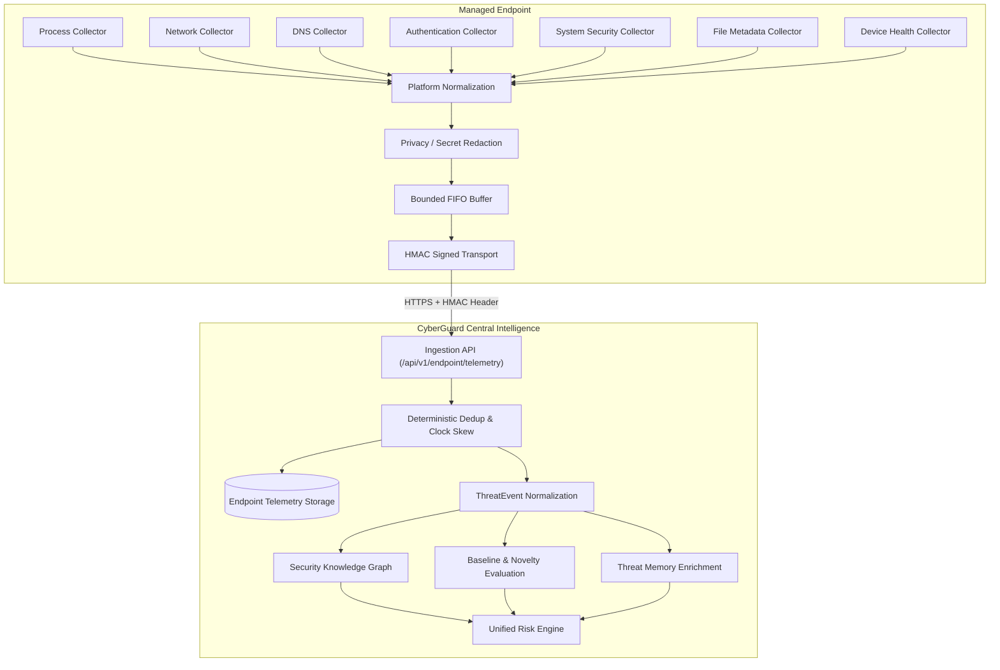
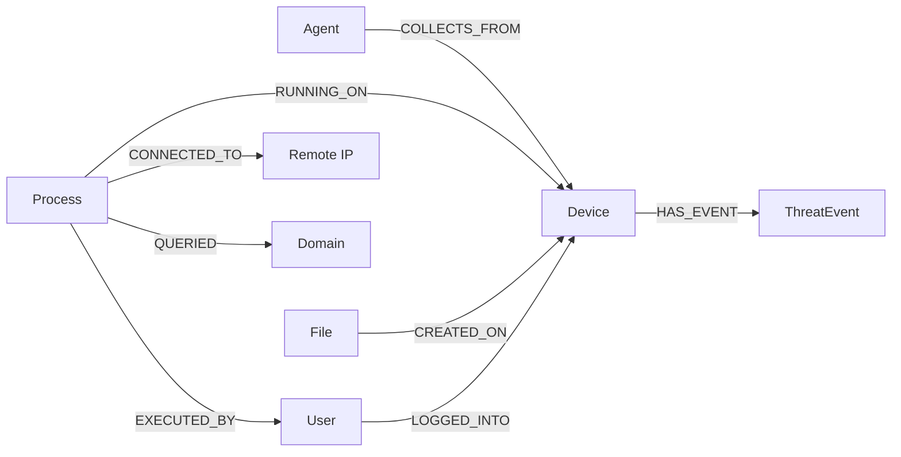

# Section 32: Endpoint Telemetry Architecture

## 1. Executive Summary & Architecture Overview

Section 32 implements the platform-aware host observation layer of CyberGuard, transforming the defensive endpoint agent architecture (Section 31) into an operational telemetry pipeline. The subsystem collects authorized, non-invasive operating system security observations across macOS (Darwin), Linux, and Windows systems, normalizes them into CyberGuard's canonical data model, redacts sensitive data, enforces deterministic deduplication, and feeds observations into the **Security Knowledge Graph**, **Behavioral Baseline Engine**, **Novelty Engine**, and **Threat Memory**.

### Guiding Architectural Principle: Observation vs. Detection
> **"Telemetry is observation. Detection, correlation, risk scoring, explainability, and response remain the sole responsibility of CyberGuard's centralized intelligence architecture."**

The endpoint agent is strictly a defensive sensor. It is **NOT** a remote shell, RAT, persistence mechanism, vulnerability scanner, credential interceptor, packet sniffer, or destructive containment actuator.



---

## 2. Standardized Collector Contract

All telemetry collectors adhere to the unified `BaseTelemetryCollector` interface inheriting from `EndpointCollector`:

```python
class BaseTelemetryCollector(EndpointCollector):
    collector_id: str
    collector_type: str
    platform: str
    version: str
    capability_state: CollectorCapabilityStateEnum
    sampling_rate: float
    max_events_per_cycle: int

    def initialize(self, config: Dict[str, Any]) -> bool: ...
    def start(self) -> bool: ...
    def stop(self) -> bool: ...
    def should_sample_event(self, priority: EventPriorityEnum) -> bool: ...
    def health(self) -> Dict[str, Any]: ...
    def collect(self) -> List[Dict[str, Any]]: ...
```

### Collector Hierarchy
```
BaseTelemetryCollector
├── ProcessTelemetryCollector          (Lifecycle, ppid/pid, args, SHA-256 binary hash)
├── NetworkTelemetryCollector          (TCP/UDP 5-tuple, state, direction, RFC-1918 filter)
├── DNSTelemetryCollector              (Normalized FQDN, query type, resolver posture)
├── AuthenticationTelemetryCollector   (Session tracking, logins, privilege escalations)
├── SystemSecurityTelemetryCollector   (SIP/posture status, OS policy baseline)
├── FileMetadataTelemetryCollector     (Path, size, mtime, hash; zero document body)
└── DeviceHealthTelemetryCollector     (RSS RAM, disk headroom, load avg, queue pressure)
```

---

## 3. Explicit Capability State Engine

Collectors report explicit operational states rather than pretending unsupported capabilities exist:

| Capability State | Meaning | Collector Behavior |
| :--- | :--- | :--- |
| `AVAILABLE` | OS platform API is fully supported, authorized, and functional. | Collector actively gathers real host metrics. |
| `UNAVAILABLE` | OS or platform does not support this telemetry mechanism (e.g., Windows EventLog on macOS). | Collector halts gracefully; emits 0 synthetic events. |
| `DISABLED` | Disabled via administrator policy in signed configuration. | Registered but not scheduled. |
| `REQUIRES_PERMISSION` | Requires additional OS entitlements (e.g., Full Disk Access or root). | Reports state in health diagnostics without crashing. |
| `REQUIRES_CONFIGURATION`| Collector needs prerequisite configuration (e.g., monitored path list). | Pauses until valid configuration delivered. |
| `DEGRADED` | Operating under resource backpressure or partial API failure. | Samples low-priority events, preserves criticals. |
| `ERROR` | Collector experienced unrecoverable fault during collection cycle. | Isolated via registry; other collectors continue operating. |

---

## 4. Platform Adapter Architecture

Platform-specific OS calls are encapsulated behind the `PlatformAdapter` contract:

```
PlatformAdapter (Abstract Interface)
├── MacOSAdapter  (Darwin: ps, netstat, /etc/resolv.conf, csrutil status, os.stat, getrusage)
├── LinuxAdapter  (POSIX: /proc, /sys, /etc/resolv.conf, ss/iproute2, stat)
└── WindowsAdapter(Win32: Windows Event Log, documented net/proc APIs)
```

### Factory Resolution
`get_platform_adapter(force_platform=None)` selects the active system adapter. When querying capabilities cross-platform (e.g. `platform=windows` queried against macOS), the adapter cleanly reports `is_supported() == False` and `capability_state == UNAVAILABLE` without raising errors.

---

## 5. Normalized Endpoint Observation Schema

All events produced by collectors adhere to CyberGuard's validated `RawEndpointTelemetryEvent` schema:

* `event_id`: Unique client-generated event identifier (`ev-<uuid>`).
* `sequence_number`: Monotonically increasing agent sequence counter.
* `event_type`: Event category (`PROCESS`, `NETWORK`, `DNS`, `AUTHENTICATION`, `FILE_METADATA`, `SYSTEM_SECURITY`, `DEVICE_HEALTH`).
* `event_time`: Precise timestamp recorded at observation origin.
* `collector_id`: Originating collector identifier.
* `collector_version`: Collector semantic version (`1.0.0`).
* `configuration_version`: Configuration version active during collection.
* `agent_version`: Agent build version.
* `schema_version`: Data contract schema version (`1.0.0`).
* `priority`: Queue priority (`CRITICAL`, `HIGH`, `NORMAL`, `LOW`).
* `payload`: Structured dictionary containing normalized event attributes.
* `integrity_hash`: Optional client-computed SHA-256 payload checksum.

---

## 6. Privacy & Redaction Pipeline

Data minimization and privacy redaction execute **on the endpoint before events enter the local buffer or network**:

1. **Path & Process Exclusions**:
   - Monitored paths exclude user privacy zones: `*/Documents/Personal/*`, `*/.ssh/*`, `*/Keychains/*`, `*/AppData/*`.
   - Sensitive password managers are excluded from process inspection: `1Password*`, `Bitwarden*`, `KeePass*`.
2. **Deterministic Command-Line Secret Scrubbing**:
   - Regex scrubbing of embedded credentials:
     - `curl -u user:password` -> `user:[REDACTED]`
     - `--password=secret`, `-p secret` -> `[REDACTED]`
     - `Bearer <token>` -> `Bearer [REDACTED]`
     - `Basic <base64>` -> `Basic [REDACTED]`
     - `(key|secret|token|password)=<val>` -> `\1=[REDACTED]`
     - `AKIA[0-9A-Z]{16}` -> `[REDACTED_AWS_KEY]`
     - Private key blocks -> `[REDACTED_PRIVATE_KEY]`
3. **Strict Credential Prohibition**:
   - Zero password collection, zero password hash collection, zero MFA secret collection, zero cookie or web session token extraction.

---

## 7. Bounded Binary Hashing Cache (`BinaryHashCache`)

To prevent blocking the primary telemetry collection thread and avoid redundant disk I/O, binary SHA-256 computation is protected by a thread-safe LRU cache:
- **Key**: Normalized filesystem path.
- **Validation**: Compares current file size and `mtime` with cached values; invalidates on discrepancy.
- **Size Bounds**: Files exceeding 50 MB are skipped (`OVERSIZED_SKIPPED`).
- **Safety Invariants**:
  - Never executes binaries.
  - Never executes dynamic inspection.
  - Never uploads binaries to calculate hashes.

---

## 8. Network Connection Telemetry

The `NetworkTelemetryCollector` observes connection metadata only:
- Protocols: TCP, UDP.
- 5-tuple: `local_address`, `local_port`, `remote_address`, `remote_port`, `connection_state`.
- Direction: `OUTBOUND`, `INBOUND`.
- RFC-1918 Filter: Differentiates internal RFC-1918 traffic from external public internet destinations. External destinations receive `HIGH` priority.
- Synthetic Fixtures: RFC 5737 documentation subnets (`192.0.2.0/24`, `198.51.100.0/24`, `203.0.113.0/24`) are treated as external synthetic endpoints for defensive testing.
- **Zero Packet Inspection**: Zero packet payload sniffing, zero protocol decryption, zero covert surveillance.

---

## 9. DNS Telemetry

The `DNSTelemetryCollector` provides authoritative observation of domain resolution:
- Normalization: Lowercase conversion, stripped trailing dots (FQDN canonicalization).
- Types: A, AAAA, CNAME, TXT, MX.
- NXDOMAIN Escalation: Queries resolving to NXDOMAIN receive elevated `HIGH` queue priority.
- Resolver Posture: Detects changes in host resolver configuration (`/etc/resolv.conf`) and generates `RESOLVER_CONFIG_CHANGED` audit records.

---

## 10. Authentication & Session Telemetry

The `AuthenticationTelemetryCollector` captures authorized user session state:
- Active Sessions: Tracks active terminal and console logins (`SESSION_START`, `SESSION_END`).
- Security Events: Records `LOGIN_SUCCESS`, `LOGIN_FAILURE`, `LOCKOUT`, `PRIVILEGE_CHANGE`.
- Security-critical events (`LOGIN_FAILURE`, `LOCKOUT`) receive `HIGH` event priority.
- Zero credential material is retained.

---

## 11. System Security Posture Telemetry

The `SystemSecurityTelemetryCollector` monitors operating system integrity:
- Posture Baseline: Establishes baseline security posture on agent start.
- Integrity Monitoring: Inspects System Integrity Protection (SIP) on macOS Darwin.
- Compromise Warning: When SIP or security control state degrades, emits `CRITICAL` priority telemetry.

---

## 12. Filesystem Metadata Telemetry

The `FileMetadataTelemetryCollector` observes security-relevant filesystem operations:
- Actions: `FILE_CREATED`, `FILE_MODIFIED`, `FILE_RENAMED`, `FILE_DELETED`.
- Attributes: File path, basename, extension, file size, SHA-256 hash.
- Sensitive Path Exclusions: User documents and SSH keys are explicitly excluded.
- Zero file content exfiltration: Only metadata is transmitted.

---

## 13. Device Health Telemetry

The `DeviceHealthTelemetryCollector` reports lightweight operational metrics:
- Process memory RSS (MB).
- Disk free headroom (MB).
- 1-minute system load average.
- Agent process uptime.
- Pressure warning: Elevated to `HIGH` priority when disk space falls below 500 MB or memory exceeds 250 MB.

---

## 14. Event Volume Management & Sampling Policy

To prevent endpoint resource exhaustion:
1. **Critical Preservation Guarantee**:
   `CRITICAL` and `HIGH` priority events are **NEVER** dropped or sampled.
2. **Configurable Sampling**:
   `NORMAL` and `LOW` priority events are sampled according to the active `sampling_rate` (default 1.0 = 100%).
3. **Bounded Collection Cycles**:
   Collectors enforce `max_events_per_cycle` (default 100) per poll.

---

## 15. Sequence Numbers, Deduplication, and Clock Skew

1. **Clock Skew Calculation**:
   The ingestion API computes server-to-client delta: `(server_time - client_time) * 1000 ms` and persists `clock_offset_ms` on the agent record without rewriting the original client `event_time`.
2. **Deterministic Deduplication**:
   Composite key check: `(agent_id, sequence_number, event_id)` against `EndpointTelemetryEventModel`.
3. **Idempotent Acknowledgment**:
   Duplicate events return HTTP 200 with `duplicate_count > 0` and the event ID included in `accepted_event_ids`. This prevents the agent from entering infinite retry loops.

---

## 16. Security Knowledge Graph Integration

Telemetry observations automatically synthesize multi-hop relationships in `RelationshipModel` backed by direct observation provenance:



### Provenance Attributes
Every graph relationship carries:
- `origin = "OBSERVED"`
- `method = "ENDPOINT_TELEMETRY"`
- `evidence_reference = raw_ev.event_id`
- `workspace_id = agent.workspace_id`

---

## 17. Behavioral Baseline & Novelty Integration

1. **Novelty Evaluation**:
   When a process is observed on a device for the first time (`prior_count <= 1`), the ingestion pipeline flags:
   `is_novel_process: True`
   and elevates baseline risk to `MEDIUM`.
2. **Behavioral Baseline Engine**:
   Observations feed the Section 21 baseline engine without inventing duplicate baseline algorithms inside collectors.

---

## 18. Threat Memory Indicator Matching

Before creating normalized `ThreatEventModel` records, the ingestion pipeline queries `ThreatMemoryService.lookup_indicator()` for observed binary hashes, destination IPs, and queried domains:
- If a match exists in historical memory:
  - Severity is elevated to `CRITICAL`.
  - Risk score is boosted to 90.0.
  - Event summary includes alert: `[ALERT: Matched prior Threat Memory <canonical_key>]`.
  - Structured match details are embedded in `metadata_json.threat_memory_match`.

---

## 19. Ingestion REST APIs

Mounts under `/api/v1/endpoint`:

* `POST /api/v1/endpoint/telemetry` (or `/events`):
  Authenticated batch telemetry ingestion with HMAC verification.
* `GET /api/v1/endpoint/capabilities`:
  Returns capability states and health diagnostics across all 7 collectors. Supports `?platform=<os>` query parameter.
* `GET /api/v1/endpoint/telemetry`:
  Forensic query endpoint supporting pagination (`limit`, `offset`) and filtering by `workspace_id`, `device_id`, `agent_id`, and `event_type`.

---

## 20. Security Boundaries & Invariants

| Boundary | Enforcement |
| :--- | :--- |
| **No Remote Code Execution** | Collectors contain zero shell execution, script runners, or dynamic eval primitives. |
| **No Packet Capture** | Network collector captures socket metadata only; no raw packet sniffing or promiscuous mode. |
| **No Credential Access** | Zero access to keychain, password hashes, web browser credential stores, or cookies. |
| **Tenant Isolation** | All agent queries, ingestion operations, and graph relationships enforce strict `workspace_id` boundaries. |
| **Server-Side Validation** | Severity, risk scores, and device IDs are validated server-side; client metadata cannot tamper with security posture. |

---

## 21. Verification & Test Coverage Summary

- **Unit Tests (`test_endpoint_telemetry_collectors.py`)**: 17 tests covering `BinaryHashCache` hit/miss/invalidation, `BaseTelemetryCollector` sampling, `PlatformAdapter`s, Darwin inspections, secret redaction, path exclusions, and health diagnostics.
- **Pipeline Tests (`test_endpoint_telemetry_pipeline.py`)**: 4 tests covering end-to-end multi-hop graph generation, deduplication replay, Threat Memory indicator alerts, capabilities queries, and forensic filtering.
- **Regression Suite**: All 82 tests across Section 23-31 (Response Playbooks, SOC Copilot, Explainable AI, Threat Memory, Knowledge Graph, Risk Engine) pass with 100% success rate.
