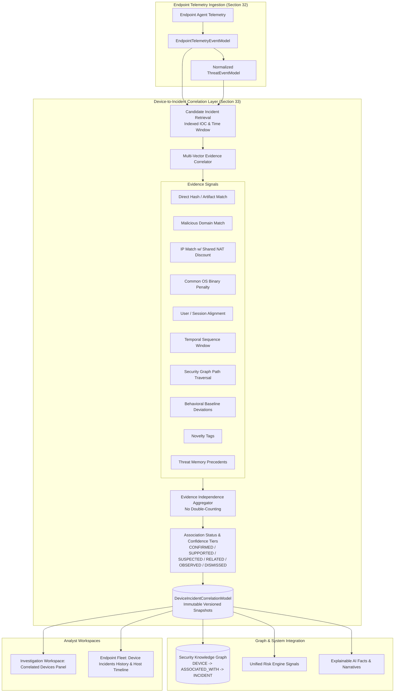

# Architecture Specification: Section 33 — Device-to-Incident Correlation

## 1. Purpose

The Device-to-Incident Correlation layer bridges endpoint telemetry (Section 32) and host identities (Section 31) with CyberGuard's core investigation infrastructure:
- Incident Management System
- Security Knowledge Graph (SKG)
- ThreatEvent Evidence Models
- Temporal Correlation Engine (Section 16)
- Behavioral Baselines (Section 21)
- Novelty Detection (Section 22)
- Institutional Threat Memory (Section 23)
- Attack Reconstruction & Path Confidence (Section 17/18)
- MITRE ATT&CK Mapping (Section 19)
- Unified Risk Engine (Section 26)
- Explainable AI (Section 27)

Its primary objective is answering the fundamental bidirectional SOC questions:
1. *"Which endpoint/device activity is relevant to this incident?"*
2. *"Which incidents are relevant to this device?"*

**Core Architectural Invariant**:
> An association is an evidence-backed factual relationship between observed telemetry and incident indicators. It is **never** an arbitrary assumption or an automatic verdict that the device is compromised. Compromise assessment remains a downstream analytical conclusion driven by the Unified Risk Engine and human SOC analysts.

---

## 2. Architecture & Data Flow



---

## 3. Correlation Model

Correlations are persisted canonically in the `device_incident_correlations` table using `DeviceIncidentCorrelationModel`.

```python
class DeviceIncidentCorrelationModel(Base):
    id: str                            # UUID primary key
    workspace_id: str                  # Strict tenant boundary key
    device_id: str                     # Foreign key to devices.id
    incident_id: str                   # Foreign key to incidents.id
    correlation_type: str              # DIRECT_IDENTIFIER, INDICATOR_MATCH, etc.
    correlation_score: float           # 0.0 - 1.0 (Strength of association)
    confidence: float                  # 0.0 - 1.0 (Evidence confidence after discounts)
    status: str                        # CONFIRMED, SUPPORTED, SUSPECTED, RELATED, OBSERVED, DISMISSED
    version: int                       # Incremental snapshot version (1, 2, 3...)
    is_current: bool                   # True for the active assessment snapshot
    first_observed_at: datetime        # Earliest overlapping observation timestamp
    last_observed_at: datetime         # Latest observation timestamp
    supporting_event_ids_json: str     # Raw client telemetry event IDs (deduplicated)
    supporting_evidence_ids_json: str  # Associated finding_evidence IDs
    supporting_entity_ids_json: str    # Graph entity keys (e.g. hash:..., domain:...)
    supporting_relationship_ids_json: str # SKG relationship IDs traversed
    matched_indicators_json: str       # Array of MatchedIndicatorItem dictionaries
    matched_behaviors_json: str        # Array of matched BehavioralDeviation references
    temporal_context_json: str         # Delta seconds, clock skew, sequence relationship
    reason_codes_json: str             # Machine-readable reasons (EXACT_HASH_MATCH, etc.)
    counter_evidence_json: str         # Array of CounterEvidenceItem (SHARED_NAT, etc.)
    limitations_json: str              # Transparent retention boundary statements
    structured_explanation_json: str   # Factual premises, positive/negative signals, narrative
    correlation_engine_version: str    # Engine version string (e.g. "1.0.0")
    reviewed_by: Optional[str]         # Analyst ID who reviewed/overrode status
    reviewed_at: Optional[datetime]    # Review timestamp
    review_notes: Optional[str]        # Human rationale audit entry
```

---

## 4. Correlation Types

| Correlation Type | Evidentiary Basis | Baseline Strength |
| :--- | :--- | :--- |
| `DIRECT_IDENTIFIER` | Exact host UID, agent credential key, or process UID. | High (0.90 - 1.00) |
| `FILE_HASH_MATCH` | Process executable or file metadata SHA-256 matches incident artifact. | High (0.90 - 0.95) |
| `PROCESS_MATCH` | Process binary name and path match confirmed malicious execution. | Medium-High (0.75 - 0.90) |
| `DOMAIN_MATCH` | DNS query or HTTP Host header matches confirmed malicious domain. | Medium-High (0.80 - 0.90) |
| `IP_MATCH` | Outbound socket connection to external non-shared IP indicator. | Medium (0.65 - 0.75) |
| `USER_MATCH` | Active session user account matches incident victim/threat identity. | Low-Medium (0.35 - 0.50) |
| `TEMPORAL_SEQUENCE` | Telemetry aligns tightly within incident temporal window. | Supportive Modifier |
| `BEHAVIORAL_DEVIATION` | Host exhibited statistical behavioral anomaly aligned with incident. | Supportive Modifier |
| `GRAPH_PATH` | Host connected via multi-hop path (Device -> Process -> IP <- Incident). | Supportive Modifier |
| `THREAT_MEMORY_MATCH` | Observed indicator previously confirmed malicious in historical cases. | Contextual Modifier |
| `MULTI_SIGNAL_CORRELATION`| Two or more distinct signal families independently corroborate association. | Very High (0.85 - 1.00) |
| `OBSERVED` | Co-occurrence observed in telemetry window with minimal direct linkage. | Low (< 0.35) |

---

## 5. Candidate Retrieval

To prevent expensive full-database scans across high-volume endpoint events, candidate selection relies on indexed key lookups bounded by a configurable temporal window (default: 72 hours):
1. **Telemetry Indicator Extraction**: The host's recent telemetry is indexed by SHA-256 hashes, queried domains, destination IPs, and usernames.
2. **Incident Key Overlap**: Incidents within the temporal window are filtered by matching:
   - Direct `ThreatEvent` links mentioning `device_id`.
   - Threat event artifact hashes, domains, and IPs matching extracted device indicators.
   - Legacy case emails, phishing attachments, and indicators.
3. **Graph Neighborhood Traversal**: Identifies incidents that share connected nodes in the Security Knowledge Graph within 2 hops.

---

## 6. IOC Matching

When comparing endpoint events with incident indicators, the engine matches across canonical indicator types:
- **SHA-256**: Matched case-insensitively with 64-hex validation. Direct hash match provides conclusive binary identity.
- **Domain**: Strips trailing dots, normalizes to lowercase, and checks for exact FQDN matches as well as subdomain delegation.
- **IP Address**: Compares external destination IPs, checking against routing tables and shared infrastructure lists.
- **User / Account**: Normalizes usernames, ignoring system accounts (`root`, `SYSTEM`, `nobody`, `daemon`).

---

## 7. Temporal Correlation

Reuses Section 16's temporal correlation engine without reimplementing time-series clustering:
- `CAUSALLY_SUPPORTED`: Observation delta $\le 15$ minutes ($900\text{s}$) between incident trigger and endpoint activity.
- `TEMPORALLY_SUPPORTIVE`: Delta $\le 60$ minutes ($3600\text{s}$).
- `TEMPORALLY_ADJACENT`: Delta $\le 72$ hours ($259200\text{s}$).
- `TEMPORAL_MISMATCH`: Delta $> 72$ hours triggers a negative discount penalty ($-0.20$) and records `TEMPORAL_MISMATCH` counter-evidence.

---

## 8. Event-Time Uncertainty

Endpoint telemetry can experience clock skew, network offline queuing, or delayed batched delivery:
- Evaluates `event_time` (recorded on endpoint) while logging `received_at` (server ingestion timestamp).
- Captures `clock_skew_ms` reported during agent heartbeat and adjusts sequence comparisons accordingly.
- Preserves raw event ordering using monotonic agent `sequence_number`.

---

## 9. Behavioral Correlation

Consumes `BehavioralDeviationModel` records from Section 21:
- Queries whether the device generated statistical deviations (e.g., unusual login time, atypical process launch, high outbound transfer volume) concurrent with the incident window.
- If present, attaches `BEHAVIORAL_DEVIATION_ALIGNED` reason code without recomputing statistical z-scores.

---

## 10. Novelty Correlation

Consumes `NoveltyAssessmentModel` records from Section 22:
- Checks if the observed process executable, parent process, or outbound destination was flagged as `NOVEL`.
- **Precaution**: Follows the strict tenet: *Novel $\ne$ Malicious*. Novelty contributes contextual reason codes, but does not unilaterally elevate confidence without supporting IOC matches.

---

## 11. Threat Memory Correlation

Queries `ThreatMemoryEntryModel` from Section 23:
- Inspects whether the process hash, domain, or IP was previously evaluated in past investigations.
- If historically confirmed malicious, awards `THREAT_MEMORY_MATCH` reason code and boosts base correlation strength by $+0.05$.
- If historically marked benign, attaches counter-evidence to mitigate false positives.

---

## 12. Security Graph Correlation

Integrates directly with the polymorphic `relationships` table:
- Traverses 2 hops from the `Device` node: `Device -> Process -> IP <- Incident`.
- Traverses identity paths: `Device -> User -> Session <- Incident`.
- On established correlation, synchronizes a canonical relationship edge:
  - `source_type`: `"DEVICE"`, `source_id`: `device_id`
  - `target_type`: `"INCIDENT"`, `target_id`: `incident_id`
  - `relationship_type`: `"ASSOCIATED_WITH"`
  - `confidence`: Calibrated correlation confidence score.

---

## 13. Evidence Independence & Anti-Double-Counting

To prevent double-counting dependent observations:
- A single raw telemetry event (e.g., an outbound HTTPS connection containing both a domain and an IP) is recorded under a single `event_id` in `supporting_event_ids_json`.
- The multi-signal classifier checks for distinct **families** of evidence (e.g., binary hash vs. network connection vs. graph path) rather than counting multiple fields from the same raw payload.

---

## 14. Counter-Evidence & Discounts

The engine actively records evidence against an association:
- `SHARED_NAT`: Outbound connection was to an RFC-1918 private IP or recognized NAT gateway.
- `COMMON_INFRASTRUCTURE`: Outbound connection was to a public DNS resolver (e.g., `8.8.8.8`, `1.1.1.1`). Applies high discount penalty ($-0.45$).
- `COMMON_SOFTWARE`: Process name belongs to standard OS binaries (`launchd`, `svchost.exe`, `explorer.exe`) without an exact malicious hash match. Applies penalty ($-0.15$).
- `TEMPORAL_MISMATCH`: Telemetry observed $> 72$ hours outside incident active window ($-0.20$).
- `INSUFFICIENT_TELEMETRY`: Host had active offline periods or missing telemetry sequences.

---

## 15. Shared Infrastructure Handling

Shared infrastructure is a major cause of false-positive host attribution in SOCs. The engine implements explicit discounting:
- Recognizes public DNS resolvers and RFC-1918 addresses via `ipaddress.ip_address`.
- Automatically assigns `SHARED_NAT` and `COMMON_INFRASTRUCTURE` counter-evidence.
- Caps correlation status to `RELATED` or `OBSERVED`, strictly preventing `CONFIRMED` or `SUPPORTED` verdicts based solely on shared IP connections.

---

## 16. Shared Software Handling

Common operating system binaries are present on virtually all fleet workstations:
- Checks binary names against `COMMON_SOFTWARE_NAMES` (`launchd`, `svchost.exe`, `systemd`, `explorer.exe`, etc.).
- Unless the binary's cryptographic SHA-256 matches the incident's malicious payload hash, flags `COMMON_SOFTWARE` counter-evidence and discounts correlation strength.

---

## 17. User / Account Correlation

Legitimate users frequently operate multiple workstations, laptops, and virtual desktops:
- User overlap alone only assigns `USER_MATCH` with low base score ($0.35$).
- Requires additional network, file, or temporal signals before escalating association status.

---

## 18. Incident Scoping & Association Statuses

Each correlation is assigned an explicit, calibrated status:
1. `CONFIRMED`: Verified direct cryptographic hash match or $\ge 3$ distinct supporting signal families with no disqualifying counter-evidence.
2. `SUPPORTED`: High correlation strength ($\ge 0.65$) supported by verified domain, IP, or graph path matches.
3. `SUSPECTED`: Moderate correlation strength ($\ge 0.40$), pending additional telemetry.
4. `RELATED`: Weak or circumstantial linkage ($\ge 0.15$), such as shared user account or shared infrastructure.
5. `OBSERVED`: Device had activity in the incident timeframe, but no direct matching indicators.
6. `DISMISSED`: Explicitly dismissed by SOC analyst review or disqualified by counter-evidence.

---

## 19. Correlation Confidence Semantics

- **Correlation Confidence**: Measures how reliably the available telemetry establishes that the device and incident are connected.
- **Risk Score / Compromise Probability**: Handled separately by the Section 26 Unified Risk Engine. A device may be `CONFIRMED` as associated with an incident (e.g., received an email with a blocked attachment) without being compromised.

---

## 20. Structured Reason Codes

Deterministic, machine-readable reason codes are stored in `reason_codes_json`:
- Positive: `EXACT_HASH_MATCH`, `KNOWN_MALICIOUS_DOMAIN_OBSERVED`, `INCIDENT_IP_OBSERVED`, `SAME_USER_SESSION`, `TEMPORALLY_ALIGNED_SEQUENCE`, `GRAPH_PATH_SUPPORTED`, `BEHAVIORAL_DEVIATION_ALIGNED`, `THREAT_MEMORY_MATCH`, `CAMPAIGN_ASSOCIATION`, `MULTI_SIGNAL_SUPPORT`.
- Negative: `SHARED_NAT`, `COMMON_INFRASTRUCTURE`, `COMMON_SOFTWARE`, `TEMPORAL_MISMATCH`, `STALE_INDICATOR`, `INSUFFICIENT_TELEMETRY`, `CONTRADICTORY_EVIDENCE`.

---

## 21. Correlation Explanation (XAI Integration)

Feeds structured premises into Explainable AI (Section 27):
```json
{
  "device_name": "macbook-exec",
  "incident_number": "INC-042",
  "facts": [
    "Process/file executable hash 'a3f5b7...' observed on macbook-exec matches incident artifact.",
    "DNS query for domain 'c2-threat.com' observed within 5 minutes of incident trigger."
  ],
  "positive_signals": ["Direct SHA-256 match", "Matching DNS query"],
  "negative_signals": [],
  "narrative": "Device 'macbook-exec' (macos) is associated with incident INC-042 with status CONFIRMED (correlation strength 92%). Identified 2 supporting observations and 0 counter-evidence factors."
}
```

---

## 22. Attack Reconstruction Integration

Supplies enriched host telemetry relationships to Section 17 (Attack Reconstruction):
- Adds host execution hops to the incident kill chain:
  $$\text{Phishing Email} \longrightarrow \text{URL} \longrightarrow \text{Host Process} \longrightarrow \text{Host DNS Query} \longrightarrow \text{C2 Network Connection}$$
- Supplies edge confidences and timestamps for attack-path confidence calculation (Section 18).

---

## 23. Unified Risk Engine Integration

Provides structured signals to Section 26 (Unified Risk Engine):
- Exposes `device_id`, `correlation_score`, `confidence`, `status`, and `reason_codes`.
- The Risk Engine ingests these signals to compute overall incident severity and host impact without arbitrary score multipliers inside the correlation module.

---

## 24. Device Activity Timeline

Exposes a unified chronological timeline via `GET /api/v1/devices/{device_id}/timeline`:
- Returns endpoint events with exact timestamps, event types (`PROCESS`, `NETWORK`, `DNS`, etc.), source collectors, priority tiers, and descriptions.
- Preserves client `event_time` alongside server `received_at`.

---

## 25. Immutable Versioning & Reassessment

Correlation records are versioned rather than destructively overwritten:
- When new telemetry arrives or correlation is re-evaluated, the existing active record is archived with `is_current = False`.
- A new record is created with `version = previous_version + 1`, `is_current = True`, preserving complete historical auditability.
- Analyst feedback overrides update the active record with `reviewed_by`, `reviewed_at`, and `review_notes` while generating audit logs.

---

## 26. Data Retention & Truthful Empty States

- All correlation queries and UI displays enforce a transparent limitation notice:
  > *"Telemetry evaluation constrained to available 30-day retention window."*
- When no telemetry correlates with an incident, the system states:
  > *"No matching telemetry was observed between active endpoints and this incident within the 30-day retention window."*
- The system never makes unverified claims such as *"Device never interacted with incident"* or *"0 threats detected"*.

---

## 27. Privacy & Tenant Boundary Enforcement

- All database queries and writes require `workspace_id`.
- `correlate_device_with_incident` rejects cross-workspace correlation requests with a strict `ValueError("Cross-tenant correlation rejected: workspace boundary violation.")`.
- Host telemetry payloads redact sensitive credentials and auth tokens prior to correlation matching.

---

## 28. REST API Reference

| Method | Endpoint | Description |
| :--- | :--- | :--- |
| `GET` | `/api/v1/incidents/{incident_id}/devices` | Incident-centric summary of all correlated devices, counts by status, and retention notices. |
| `GET` | `/api/v1/devices/{device_id}/incidents` | Device-centric history of all correlated incidents with status and evidence counts. |
| `GET` | `/api/v1/incidents/{incident_id}/correlations` | Full list of active correlation objects for an incident. |
| `GET` | `/api/v1/devices/{device_id}/correlations` | Full list of active correlation objects for a device. |
| `POST`| `/api/v1/correlations/{correlation_id}/review` | Submits analyst feedback (`CONFIRM_ASSOCIATION`, `DISMISS_ASSOCIATION`, `MARK_RELATED`). |
| `GET` | `/api/v1/devices/{device_id}/timeline` | Returns chronological host activity timeline with collector provenance. |
| `POST`| `/api/v1/devices/{device_id}/correlate` | Triggers on-demand candidate retrieval and correlation for a device. |
| `POST`| `/api/v1/incidents/{incident_id}/correlate` | Triggers on-demand candidate retrieval and correlation for an incident. |

---

## 29. Frontend Integration

Integrated directly into the Investigation Workspace under the **Correlated Devices** subtab (`devices`):
- **Fleet Summary**: Shows total associated devices with status badges (`CONFIRMED`, `SUPPORTED`, `SUSPECTED`, `RELATED`, `OBSERVED`, `DISMISSED`).
- **Progressive Disclosure**: Selecting a device displays:
  - Factual premises and supported forensic facts.
  - Counter-evidence factors and shared infrastructure discounts.
  - Human-readable XAI narrative.
  - Interactive Host Timeline.
  - Analyst Review actions with rationale input.
- **Truthful Empty State**: Shows retention window disclosure when no endpoints correlate.

---

## 30. Testing & Verification

Comprehensive test coverage implemented in `backend/tests/test_device_incident_correlation.py`:
- `test_exact_hash_correlation`: Exact SHA-256 match produces `EXACT_HASH_MATCH` and creates SKG edge.
- `test_malicious_domain_correlation`: DNS query to malicious domain yields `KNOWN_MALICIOUS_DOMAIN_OBSERVED`.
- `test_shared_infrastructure_discounting`: Public DNS resolver / private NAT IP triggers `SHARED_NAT`, applying a discount penalty and capping status to `RELATED`/`OBSERVED`.
- `test_common_software_discounting`: Standard OS binaries (`launchd`) receive `COMMON_SOFTWARE` penalty without exact hash match.
- `test_temporal_alignment_and_mismatch`: Validates tight sequence alignment vs. $>72\text{h}$ `TEMPORAL_MISMATCH`.
- `test_evidence_independence_no_double_counting`: Multiple fields on a single raw event do not artificially inflate independent signal counts.
- `test_bidirectional_lookup_apis`: Verifies Incident $\to$ Devices and Device $\to$ Incidents endpoints.
- `test_analyst_review_workflow`: Tests analyst confirmation and dismissal lifecycle.
- `test_correlation_immutable_versioning`: Verifies immutable version incrementation upon reassessment.
- `test_device_timeline_endpoint`: Validates chronological host timeline ordering and collector provenance.
- `test_strict_tenant_isolation`: Verifies that cross-workspace correlation is rejected.
- `test_truthful_empty_state_and_retention`: Verifies retention notice disclosures.

---

## 31. Known Limitations & Next Steps

1. **Active Retention Horizon**: Telemetry correlation is bounded by the active 30-day endpoint buffer; historical investigations beyond 30 days rely exclusively on persisted Threat Memory.
2. **Offline Buffer Delivery**: Devices that remain offline for extended periods will trigger reassessment upon buffer sync, creating a new correlation snapshot version.
3. **Next Section Integration (Section 34)**: Correlated device associations directly feed the upcoming Continuous Threat Hunting & Host Containment orchestration pipeline.
