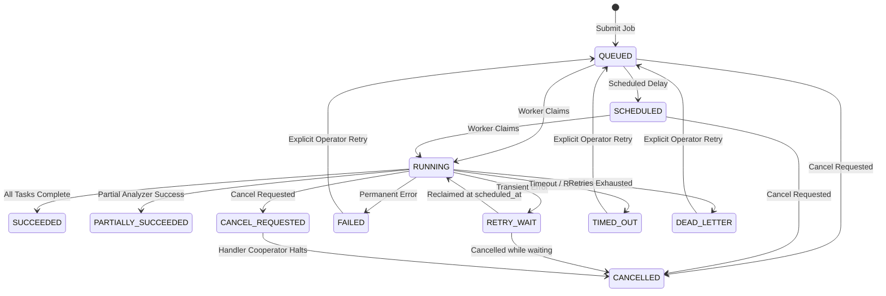

# Section 45 — Background Jobs Architecture & Specification

## 1. Executive Summary & Queue Architecture

CyberGuard processes multi-modal artifacts (RFC-822 emails, URLs, files, images, authentication sequences, and endpoint telemetry), performs multi-stage dependency graph analysis, executes cross-incident correlation, and generates immutable forensic reports. None of these long-running operations can rely on keeping an open synchronous HTTP request alive.

Section 45 introduces a **production-grade, persistent, transactional background-job subsystem** built directly on top of CyberGuard's existing PostgreSQL/SQLite and SQLAlchemy architecture.

```text
User / Agent / API Submits Work
               │
               ▼
   JobSubmissionService
   ┌───────────────────────────────────────────────┐
   │ • Validate Job Type against allowlist         │
   │ • Verify Resource Access & Tenant Isolation   │
   │ • Check Idempotency Key (Return on duplicate) │
   │ • Strip Sensitive Secrets from Payload        │
   │ • Persist BackgroundJobModel (Status=QUEUED)  │
   │ • Emit Auditable BackgroundJobEventModel      │
   └───────────────────────────────────────────────┘
               │
               ▼
   Transactional Job Store (background_jobs table)
   ┌───────────────────────────────────────────────┐
   │ Bounded query with Index:                     │
   │ ix_bg_jobs_claim (status, scheduled_at, prio) │
   └───────────────────────────────────────────────┘
               ▲
               │ Atomic Claim (Compare-and-Swap / Locking)
               │
   BackgroundJobWorker
   ┌───────────────────────────────────────────────┐
   │ • Worker ID: worker-<hostname>-<uuid>         │
   │ • Heartbeat loop refreshing lease (60s lease) │
   │ • Cooperative cancellation checks             │
   │ • Real stage milestones & monotonic progress  │
   │ • Registered Handlers Execution               │
   └───────────────────────────────────────────────┘
        │                 │                 │
        ▼                 ▼                 ▼
  ARTIFACT_ANALYSIS  REPORT_GENERATION  CROSS_INCIDENT...
```

---

## 2. Queue Technology Decision & Rationale

| Requirement | Evaluation | Selected Solution |
| :--- | :--- | :--- |
| **Persistence & Durability** | Must survive API process restarts and network drops without in-memory state loss. | Database-backed persistent queue table (`background_jobs`). |
| **Consistency Guarantee** | Prevent lost-update and dual-write divergence between business entities and job states. | Single database transaction: creating an investigation/analysis run and its background job commit atomically. |
| **Infrastructure Overhead** | Avoid adding external message broker dependencies (Redis, RabbitMQ, Kafka) unless required. | Zero new external runtime dependencies. Compatible with existing PostgreSQL deployment and local SQLite dev. |
| **Concurrency Safety** | Multi-worker safe without race conditions or duplicate execution. | Atomic Compare-And-Swap (CAS) state updates: `UPDATE background_jobs SET status='RUNNING', worker_id=:wid WHERE id=:id AND status IN ('QUEUED', 'RETRY_WAIT')`. |

---

## 3. Persistent Job Model Schema

Persisted in `background_jobs`:

| Column | Type | Nullable | Description |
| :--- | :--- | :--- | :--- |
| `id` | String(36) | No | Primary Key UUID. |
| `workspace_id` | String(64) | No | Multi-tenant isolation partition (indexed). |
| `job_type` | String(64) | No | Registered job type name. |
| `status` | String(32) | No | Current lifecycle state (QUEUED, RUNNING, etc.). |
| `priority` | String(20) | No | Priority label (CRITICAL, HIGH, NORMAL, LOW). |
| `priority_weight` | Integer | No | Numerical rank: CRITICAL=4, HIGH=3, NORMAL=2, LOW=1. |
| `requested_by` | String(100) | No | Identity of submitting user or system service. |
| `resource_type` | String(50) | Yes | Target resource type (ARTIFACT, REPORT, INCIDENT, etc.). |
| `resource_id` | String(128) | Yes | Resource identifier. |
| `analysis_run_id` | String(36) | Yes | Foreign key to `analysis_runs.id`. |
| `report_id` | String(36) | Yes | Foreign key to `reports.id`. |
| `payload_json` | Text | No | Sanitized JSON parameters (secrets redacted). |
| `attempt_count` | Integer | No | Count of attempts executed so far (starts at 0). |
| `max_attempts` | Integer | No | Maximum retry attempts before dead-lettering (default 3). |
| `created_at` | DateTime | No | UTC timestamp of initial job creation. |
| `scheduled_at` | DateTime | No | UTC timestamp when job is eligible for execution. |
| `started_at` | DateTime | Yes | UTC timestamp when worker first claimed job. |
| `heartbeat_at` | DateTime | Yes | UTC timestamp of last worker heartbeat. |
| `completed_at` | DateTime | Yes | UTC timestamp of terminal conclusion. |
| `updated_at` | DateTime | No | UTC timestamp of last state modification. |
| `timeout_seconds` | Integer | No | Maximum execution window before timing out. |
| `timeout_at` | DateTime | Yes | UTC timestamp when current execution expires. |
| `worker_id` | String(100) | Yes | Identifier of claiming worker. |
| `lease_expires_at` | DateTime | Yes | Lease expiry timestamp for worker heartbeat. |
| `idempotency_key` | String(128) | Yes | Unique idempotency key per workspace. |
| `progress_percent` | Float | Yes | Monotonic percentage (0.0 to 100.0). |
| `current_stage` | String(100) | Yes | Human-readable stage name. |
| `error_code` | String(64) | Yes | Error code category (e.g., TIMEOUT, PERMANENT_ERROR). |
| `sanitized_error_message`| Text | Yes | Redacted error message safe for display. |
| `result_json` | Text | No | Structured output dictionary. |

### Auditable Event Model (`background_job_events`)

Each state change and progress milestone creates an immutable event record:
- `id`: UUID
- `job_id`: FK to `background_jobs.id`
- `workspace_id`: Tenant identifier
- `event_type`: `JOB_QUEUED`, `JOB_STARTED`, `JOB_PROGRESS`, `JOB_RETRY_SCHEDULED`, `JOB_SUCCEEDED`, `JOB_FAILED`, etc.
- `stage`: Current stage
- `progress_percent`: Numerical progress
- `message`: Descriptive message
- `metadata_json`: Structured context
- `timestamp`: UTC datetime

---

## 4. Supported Job Types & Registered Handlers

| Job Type | Registered Handler | Default Timeout | Integration Target |
| :--- | :--- | :--- | :--- |
| `ARTIFACT_ANALYSIS` | `handle_artifact_analysis` | 300s | `AnalysisOrchestrator.execute_run(db, run_id)` |
| `REPORT_GENERATION` | `handle_report_generation` | 120s | `ReportProjectionService` & `ReportService` vector PDF |
| `CROSS_INCIDENT_CORRELATION` | `handle_cross_incident_correlation` | 180s | `CrossIncidentCorrelationEngine` |
| `ATTACK_PATH_RECONSTRUCTION` | `handle_attack_path_reconstruction` | 180s | `AttackReconstructionEngine.reconstruct_incident` |
| `ENDPOINT_TELEMETRY_PROCESSING` | `handle_endpoint_telemetry` | 120s | Endpoint telemetry batch normalization |
| `EVIDENCE_EXPORT` | `handle_evidence_export` | 180s | Forensic evidence bundle archiver |
| `MAINTENANCE` | `handle_maintenance` | 600s | Cache cleanup, scratch pruning, lease recovery |

---

## 5. Lifecycle States & Legal State Transition Graph



---

## 6. Worker Architecture & Safe Claiming

1. **Worker Identity**: Each worker process generates a unique ID on boot: `worker-{hostname}-{uuid[:8]}`.
2. **Safe Atomic Claiming**:
   - Query up to 10 eligible candidate job IDs: `status IN ('QUEUED', 'RETRY_WAIT') AND scheduled_at <= now() ORDER BY priority_weight DESC, scheduled_at ASC, created_at ASC`.
   - Execute atomic Compare-And-Swap query:
     ```sql
     UPDATE background_jobs
     SET status = 'RUNNING',
         worker_id = :worker_id,
         started_at = COALESCE(started_at, :now),
         heartbeat_at = :now,
         lease_expires_at = :now + interval '60 seconds',
         timeout_at = :now + interval :timeout_seconds,
         attempt_count = attempt_count + 1,
         current_stage = 'CLAIMED',
         updated_at = :now
     WHERE id = :candidate_id
       AND status IN ('QUEUED', 'RETRY_WAIT')
     ```
   - Only if `rowcount == 1` does the worker proceed to execution. This ensures that even under high concurrency across multiple replicas, **no two workers claim the same job**.

---

## 7. Retry, Backoff, Timeouts & Stuck-Job Recovery

### Transient vs Permanent Failures
- **Permanent Errors** (`PermanentJobError`):
  Missing input, unauthorized resources, malformed payloads, non-existent foreign keys.
  Action: Immediate transition to `FAILED` with sanitized error message. Retry budget is not wasted.
- **Transient Errors** (`TransientJobError` / network timeouts / database locks):
  Recoverable errors qualify for exponential backoff retries.

### Bounded Exponential Backoff with Jitter
```text
Delay = min(300, (2 ^ (attempt - 1)) * 5 + uniform_random(1, 4)) seconds
```
- Attempt 1: ~6–9 seconds
- Attempt 2: ~11–14 seconds
- Attempt 3: ~21–24 seconds
- Attempt >= max_attempts: Transitions to `DEAD_LETTER`.

### Stuck-Job Reaper
Workers periodically run `reap_stuck_jobs`:
- Identifies jobs in `RUNNING` status where `heartbeat_at < now - 60s` or `timeout_at < now`.
- If `attempt_count < max_attempts`: resets `worker_id=None`, sets `status=RETRY_WAIT`, schedules retry.
- If `attempt_count >= max_attempts`: marks `TIMED_OUT`.

---

## 8. Cancellation Semantics

- **Queued / Scheduled / Retry-Wait Jobs**: Immediately marked `CANCELLED`.
- **Running Jobs**: Marked `CANCEL_REQUESTED`.
- **Cooperative Cancellation**: Handlers check `ctx.is_cancelled(db)` at natural milestones (e.g., between DAG tasks or PDF assembly steps). If cancellation is requested, execution halts safely, partial results are preserved, and the job transitions to `CANCELLED`.

---

## 9. Security & Tenant Isolation

- **Tenant Boundary**: All job endpoints and worker queries enforce `workspace_id` filtering. A user in `workspace_A` cannot view, cancel, or retry a job in `workspace_B`.
- **Input Allowlist**: Only registered job types are permitted; arbitrary scripts or handler names are rejected.
- **Secret Redaction**:
  - `JobSubmissionService` strips sensitive keys (`password`, `secret`, `token`, `api_key`) from job payloads.
  - Failure messages pass through `sanitize_log_text` to remove bearer tokens, connection strings, and credentials.
- **Rate Limiting**: Protected by global HTTP middleware.

---

## 10. Deployment & Worker Configuration

### Options
1. **Embedded In-Process Worker** (Default in FastAPI Lifespan):
   Controlled by environment variable `BACKGROUND_WORKER_ENABLED=true`. Runs as an `asyncio.Task` inside the FastAPI service.
2. **Dedicated Worker Container** (`docker-compose.yml`):
   A dedicated service `mailtrace-worker` running `python -m backend.worker` with configurable `WORKER_CONCURRENCY=4` and `WORKER_POLL_INTERVAL=1.0`.

---

## 11. Verification & Test Coverage

Verified with 12 targeted unit and integration tests in `backend/tests/test_section45_background_jobs.py`:
- Job submission & idempotency deduplication
- Unsupported job type rejection
- State transition validation and illegal transition prevention
- Atomic Compare-And-Swap claiming concurrency safety
- Permanent failure immediate termination without retry
- Retry budget exhaustion and dead-lettering
- Stuck-job reaper recovery of expired leases
- Cooperative cancellation of queued and running jobs
- Real `ARTIFACT_ANALYSIS` DAG execution integration
- Tenant isolation boundaries (cross-tenant access rejected)
- REST API CRUD and metrics aggregation
