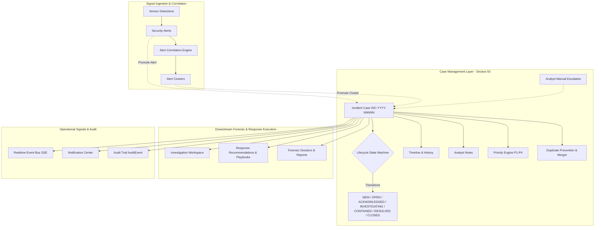

# Section 50 — Incident Management & Case Lifecycle Subsystem

## 1. Purpose & Overview

The **Incident Management & Case Lifecycle subsystem** sits at the operational apex of CyberGuard's defense stack. It establishes a dedicated operational case-management layer that coordinates alerts, clusters, investigations, response actions, and reports without duplicating or replacing their underlying domain engines.

The end-to-end operational flow is structured as:

```text
Detection (Engines & Sensors)
    ↓
Alert (Security Signal: NotificationModel / SECURITY_ALERT)
    ↓
Alert Cluster (Section 49: Correlation of Related Alerts)
    ↓
Incident (Section 50: Authoritative Operational Case)
    ↓
Investigation (Forensic Workspace: Timeline, Graph, Attack Path)
    ↓
Response (Response Workspace & Playbooks: Containment & Remediation)
    ↓
Resolution (Verified Containment & Root-Cause Remediation)
    ↓
Post-Incident Record / Report (Section 42: Forensic Dossier)
```

The **Incident** represents the operational security case actively tracked, triaged, and owned by a security analyst or SOC team. In contrast, the **Investigation** remains the deeper technical analytical workspace.

---

## 2. Architecture Diagram



---

## 3. Core Conceptual Distinctions

CyberGuard strictly distinguishes between the operational abstractions across its security pipeline:

| Concept | Responsibility | Authoritative Store |
| :--- | :--- | :--- |
| **Alert** | Raw detection signal (e.g. Malicious URL detected, beaconing observed) | `notifications` (Category: `SECURITY_ALERT`) |
| **Alert Cluster** | Multi-alert correlation sharing campaign, identity, or temporal heuristics | `alert_clusters` & `alert_cluster_members` |
| **Incident** | The operational case tracking ownership, SLA, containment, and resolution | `incidents` (Section 50) |
| **Investigation** | The deep analytical workspace (timeline, graphs, attack path reconstruction) | `cases` / `investigations` |
| **Response** | Actions recommended, approved, and executed to contain or remediate | `response_actions` & `response_playbooks` |
| **Report** | Formalized forensic records and executive summaries | `reports` |

---

## 4. Incident Lifecycle & State Machine

The Incident subsystem enforces a validated, deterministic server-side state machine. Arbitrary status changes are rejected with structured HTTP 400 errors.

### State Transitions

```text
       ┌───────────┐
       │    NEW    │
       └─────┬─────┘
             │
       ┌─────▼─────┐
       │   OPEN    │◄──────────────┐
       └─────┬─────┘               │
             │                     │
       ┌─────▼─────┐               │
       │ACKNOWLEDGED│              │
       └─────┬─────┘               │
             │                     │
       ┌─────▼─────┐          (Reopen)
       │INVESTIGATING│             │
       └─────┬─────┘               │
             │                     │
       ┌─────▼─────┐               │
       │ CONTAINED │               │
       └─────┬─────┘               │
             │                     │
       ┌─────▼─────┐               │
       │ RESOLVED  │───────────────┤
       └─────┬─────┘               │
             │                     │
       ┌─────▼─────┐               │
       │  CLOSED   │───────────────┘
       └───────────┘
```

**Alternate Terminal States:**
- `OPEN` / `ACKNOWLEDGED` / `INVESTIGATING` → `FALSE_POSITIVE`
- `OPEN` / `ACKNOWLEDGED` / `INVESTIGATING` → `DUPLICATE`
- `OPEN` / `ACKNOWLEDGED` / `INVESTIGATING` → `CANCELLED`

### Allowed Transitions Matrix

| From State | Allowed Target States |
| :--- | :--- |
| `NEW` | `OPEN`, `ACKNOWLEDGED`, `INVESTIGATING`, `FALSE_POSITIVE`, `DUPLICATE`, `CANCELLED` |
| `OPEN` | `ACKNOWLEDGED`, `INVESTIGATING`, `CONTAINED`, `FALSE_POSITIVE`, `DUPLICATE`, `CANCELLED` |
| `ACKNOWLEDGED` | `INVESTIGATING`, `CONTAINED`, `RESOLVED`, `FALSE_POSITIVE`, `DUPLICATE`, `CANCELLED` |
| `INVESTIGATING` | `CONTAINED`, `RESOLVED`, `FALSE_POSITIVE`, `DUPLICATE` |
| `CONTAINED` | `INVESTIGATING`, `RESOLVED` |
| `RESOLVED` | `CLOSED`, `INVESTIGATING`, `OPEN` |
| `CLOSED` | `OPEN`, `INVESTIGATING` |
| `FALSE_POSITIVE` | `OPEN` |
| `DUPLICATE` | `OPEN` |
| `CANCELLED` | `OPEN` |

---

## 5. Promotion & Provenance Rules

Incidents originate through three validated workflows:

1. **Promotion from Alert Cluster**:
   - Multiple correlated security alerts clustered in Section 49 can be promoted to an operational case.
   - The Incident retains `primary_cluster_id`.
   - All cluster members have their investigation and operational linkage updated.
   - Cluster status transitions to `INVESTIGATING`.
2. **Promotion from Standalone Alert**:
   - Critical or high-severity alerts can be directly escalated to an Incident.
   - The Incident retains `primary_alert_id`.
   - Alert status is updated to `ACKNOWLEDGED` or `INVESTIGATING`.
3. **Analyst Manual Escalation**:
   - Analysts can create cases directly from the Incident Queue with custom titles, initial severity, priority, and category.

### Duplicate Incident Prevention
Before creating an incident from an alert or cluster:
- If `primary_alert_id` already belongs to an active (non-closed) incident in the tenant workspace, the existing incident is returned without creating redundant records.
- If `primary_cluster_id` already has an active incident, the existing incident is returned.
- If marked as `DUPLICATE`, the incident record links to `duplicate_of_id` and records the canonical reference in its audit history.

---

## 6. Priority vs Severity vs Risk

CyberGuard strictly maintains the architectural separation between Severity, Risk, and Priority:

- **Severity (`CRITICAL`, `HIGH`, `MEDIUM`, `LOW`, `INFO`)**: Technical severity of the detected threat signal.
- **Risk (`0.0 - 100.0`)**: Composite statistical impact and threat probability.
- **Priority (`P1_CRITICAL`, `P2_HIGH`, `P3_MEDIUM`, `P4_LOW`)**: Operational urgency for the SOC team to handle the case.
  - Calculated deterministically based on severity, risk thresholds, category criticality (e.g. Account Takeover, Credential Compromise, Data Exfiltration), and asset exposure.

---

## 7. Timeline & Case History

Case history is maintained in the dedicated `incident_timeline_events` table (`IncidentTimelineEventModel`). Each entry records:
- `event_type`: e.g. `INCIDENT_CREATED`, `ALERT_LINKED`, `CLUSTER_LINKED`, `STATUS_CHANGED`, `ANALYST_ASSIGNED`, `NOTE_ADDED`, `CONTAINED`, `RESOLVED`, `REOPENED`
- `timestamp`: UTC datetime of the action
- `actor`: Identity of the analyst or system service that performed the transition
- `source_type`: Provenance source (e.g. `INCIDENT`, `ALERT`, `CLUSTER`, `PLAYBOOK`, `AUDIT`)
- `summary`: Human-readable summary of the milestone
- `metadata`: Structured JSON payload with transition context (previous status, new status, justification reason)

---

## 8. Case Notes & Evidence Immutability

- **Analyst Notes**: Stored in `incident_notes` (`IncidentNoteModel`). Notes record author, timestamp, and text.
- **Evidence Immutability**: Incidents do not copy or alter underlying raw evidence. They reference findings, evidence records, and artifacts by ID, preserving the forensic chain of custody.

---

## 9. Resolution, Closure, and Reopening

- **Resolution Requirements**: An incident cannot be resolved without a structured resolution reason (`THREAT_CONTAINED`, `THREAT_REMEDIATED`, `FALSE_POSITIVE`, `DUPLICATE`, `BENIGN_ACTIVITY`, `INSUFFICIENT_EVIDENCE`, `OTHER`).
- **Closure**: Closes the case after review; records `closed_at`.
- **Reopening**: Reopening a closed or resolved incident resets `closed_at` and `resolved_at`, transitions status back to `OPEN`, logs an `INCIDENT_REOPENED` timeline event, and notifies the assigned analyst.

---

## 10. Multi-Tenant Isolation & RBAC

- Every query strictly filters by `workspace_id` (`X-Workspace-ID` header or authenticated session).
- Cross-tenant lookups, assignments, or status mutations return HTTP 404.
- Role-based access control enforces that only authorized analysts can perform containment, resolution, or closure actions.

---

## 11. Real-Time & Notification Integrations

- **Real-Time Bus (SSE)**: Emits events on status changes (`INCIDENT_CREATED`, `INCIDENT_UPDATED`, `INCIDENT_STATUS_CHANGED`, `INCIDENT_ASSIGNED`, `INCIDENT_RESOLVED`).
- **Persistent Notifications**: Triggers notifications for high-priority events (e.g. `INCIDENT_ASSIGNED`, critical incident creation).
- **Audit System**: Every state transition calls `AuditService.log_audit` with full provenance and client IP.

---

## 12. REST API Reference

| Method | Endpoint | Description |
| :--- | :--- | :--- |
| `GET` | `/api/incidents` | List paginated incidents with status, severity, priority, and category filters |
| `POST` | `/api/incidents` | Manually escalate an operational incident case |
| `POST` | `/api/incidents/promote-alert` | Promote a standalone security alert to an incident |
| `POST` | `/api/incidents/promote-cluster` | Promote an alert cluster to an incident |
| `GET` | `/api/incidents/metrics` | Get aggregated case management metrics (open, critical, contained, SLA) |
| `GET` | `/api/incidents/{id}` | Get full forensic and operational details for an incident |
| `PATCH` | `/api/incidents/{id}` | Update incident attributes (title, description, severity, priority) |
| `POST` | `/api/incidents/{id}/status` | Execute validated lifecycle transition |
| `POST` | `/api/incidents/{id}/assign` | Assign or reassign analyst or team ownership |
| `POST` | `/api/incidents/{id}/resolve` | Resolve incident with structured resolution category and reason |
| `POST` | `/api/incidents/{id}/close` | Close resolved incident case |
| `POST` | `/api/incidents/{id}/reopen` | Reopen resolved or closed incident |
| `POST` | `/api/incidents/{id}/notes` | Append analyst case note |
| `GET` | `/api/incidents/{id}/history` | Retrieve immutable case history timeline events |

---

## 13. Frontend Architecture

- **`IncidentListPage` (`/incidents`)**:
  - Live metrics ribbon: Open, Critical, Investigating, Contained, Resolved, Unassigned.
  - Interactive queue with multi-attribute filtering (Status, Severity, Priority, Category, Search).
  - Quick action to manually escalate cases or inspect details.
- **`IncidentDetailPage` (`/incidents/:id`)**:
  - Main header with human-readable case number (`INC-2026-00042`), priority/severity badges, owner dropdown, and lifecycle transition buttons.
  - Next Best Action card recommending immediate response steps.
  - Tabbed workspace:
    - *Facts & Entities*: Affected users, endpoints, domains, IPs, findings, and evidence.
    - *Related Alerts & Clusters*: Contributing alerts with deep links to the Alert Workspace.
    - *Timeline & History*: Immutable audit trail of operational milestones.
    - *Case Notes*: Analyst discussion thread with note creation form.
    - *Investigation & Response*: One-click handoff to Investigation Workspace, Response Workspace, and Forensic Reports.
- **Navigation Integration**:
  - `Sidebar.tsx` includes **Incidents** (`/incidents`) in primary navigation.
  - `AlertWorkspace.tsx` and `AlertClusterDetailModal.tsx` include **Promote to Incident** actions.

---

## 14. Verification & Testing

- **Backend Unit & Integration Tests**: `backend/tests/test_section50_incident_management.py` (11 tests covering creation, sequential ID generation, alert/cluster promotion, duplicate prevention, state machine transitions, invalid transition rejections, reopening, false positive handling, notes, tenant isolation, and REST APIs).
- **Temporal Correlation Compatibility**: Verified existing temporal sequence routes in `test_temporal_correlation.py`.
- **Full Suite**: 1,164 backend tests executed with 100% pass rate.
- **Frontend TypeScript & Vite Build**: `tsc -b && vite build` passed cleanly with 0 errors.
