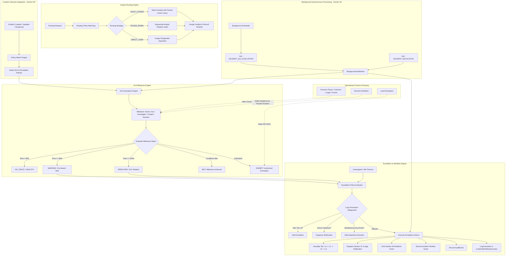
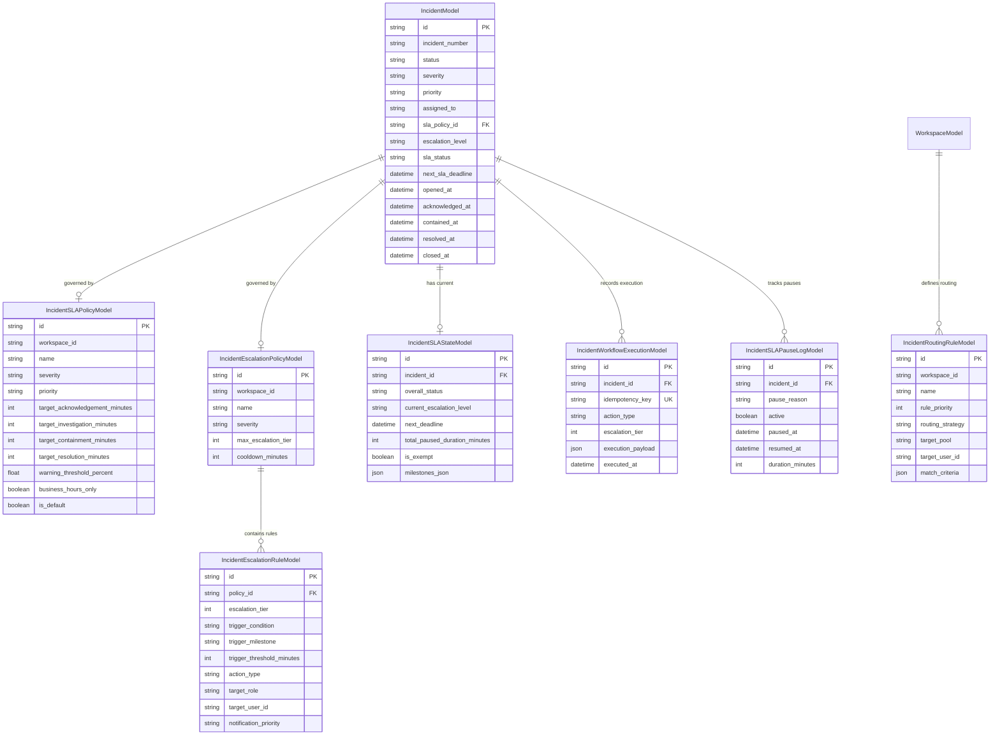

# Section 51 — Incident SLA, Escalation & Analyst Workflow Automation Subsystem

## 1. Purpose & Overview

The **Incident SLA, Escalation & Analyst Workflow Automation subsystem** expands the operational case management capabilities of CyberGuard (established in Section 50). It guarantees that security incidents are acknowledged within defined organizational commitments, assigned to the optimal analysts based on operational load and domain expertise, escalated systematically when triage or containment is delayed, and audited across their entire lifecycle.

The end-to-end operational pipeline is structured as follows:

```text
Detection (Sensors & Analytical Engines)
    ↓
Alert (Security Signal: NotificationModel / SECURITY_ALERT)
    ↓
Alert Cluster (Section 49: Correlation of Related Alerts)
    ↓
Incident (Section 50: Authoritative Operational Case)
    ↓
Assignment (Section 51: Frontline & Specialized Analyst Routing)
    ↓
SLA / Escalation (Section 51: Milestone Clocks, Warnings, Multi-Tier Escalations)
    ↓
Investigation (Forensic Workspace: Timeline, Graph, Attack Path)
    ↓
Response (Response Workspace & Playbooks: Containment & Remediation)
    ↓
Resolution (Verified Containment & Root-Cause Remediation)
```

### Critical Boundaries & Principles
1. **Workflow Automation, Not Destructive Remediation**: This subsystem automates *human workflow, task routing, notifications, and operational escalation*. It does **not** perform automated destructive remediation (e.g., account disabling, host isolation, or firewall blocks), which strictly remain governed by human-in-the-loop Response Playbooks (Section 38).
2. **Reuse Existing Infrastructure**: Integrates natively with the existing Section 45 Background Jobs engine (`INCIDENT_SLA_EVALUATION`, `INCIDENT_ESCALATION`), Section 46 Realtime SSE publisher, Section 47 In-App Notifications, and Section 50 Incident Lifecycle state machine.
3. **Authoritative Server Clocks**: All elapsed durations, deadlines, and milestone statuses are computed exclusively using UTC server timestamps. Client-side timers have zero authority.
4. **Idempotent Multi-Tier Escalation**: Strict loop-prevention safeguards ensure incidents cannot bounce between tiers or flood analysts with duplicate escalation notifications.

---

## 2. Architecture Diagram



---

## 3. Data Models & Entity Relationships

The subsystem introduces 6 specialized models alongside enhancements to `IncidentModel`:



---

## 4. SLA Milestone Clocks & Computation Rules

SLA clocks measure operational response targets against 4 industry-standard milestones:

| Milestone | Target Definition | Completion Condition | Default Target (Critical) |
| :--- | :--- | :--- | :--- |
| **Acknowledgement** | Time from case opening until an analyst acknowledges or begins investigation | Incident transitioned to `ACKNOWLEDGED`, `INVESTIGATING`, `CONTAINED`, `RESOLVED`, or `CLOSED` | 15 minutes |
| **Investigation** | Time until active forensic analysis commences or is completed | Incident transitioned to `INVESTIGATING`, `CONTAINED`, `RESOLVED`, or `CLOSED` | 60 minutes |
| **Containment** | Time until threat containment is verified | Incident transitioned to `CONTAINED`, `RESOLVED`, or `CLOSED` (`contained_at` populated) | 120 minutes |
| **Resolution** | Time until complete incident remediation | Incident transitioned to `RESOLVED` or `CLOSED` (`resolved_at` populated) | 240 minutes |

### Calculation Mechanics
- **Base Elapsed Time**: `elapsed_minutes = (current_server_time - start_time) - total_paused_minutes`.
- **Milestone Warning Threshold**: Defined at 80% of milestone target duration by default (`warning_minutes = target_minutes * 0.80`).
- **Milestone Status Progression**:
  - `MET`: Satisfied before deadline expiry.
  - `ON_TRACK`: Elapsed time < 80% of target.
  - `WARNING`: Elapsed time $\ge$ 80% and < 100% of target.
  - `BREACHED`: Elapsed time $\ge$ 100% without satisfying milestone.
  - `EXEMPT`: Formally excused by SOC Lead authorization.
  - `PAUSED`: Under active forensic pause.
- **Overall Incident SLA Status**: Determined as the worst-case status across all applicable incomplete milestones (`BREACHED` > `WARNING` > `PAUSED` > `HEALTHY` > `MET` > `EXEMPT`).

---

## 5. Forensic SLA Pausing & Authorized Exemptions

In enterprise incident response, investigations often stall due to external factors outside the SOC's control. CyberGuard supports structured forensic pausing and authorized exemptions with mandatory audit logs:

### Legitimate Pause Reason Codes
- `AWAITING_CUSTOMER`: Pending external client confirmation, log exports, or user verification.
- `AWAITING_VENDOR`: Pending software vendor patch, zero-day threat analysis, or cloud provider support response.
- `FORENSIC_FREEZE`: Legal evidence preservation hold or forensic memory capture in progress.
- `THIRD_PARTY_DEPENDENCY`: Pending external law enforcement or CERT coordination.
- `LEGAL_HOLD`: Active regulatory or corporate legal review.

### Resume Mechanics
When an analyst resumes an incident:
1. The active pause record is marked `active = False` with `resumed_at = now`.
2. The pause interval is calculated and accumulated into `IncidentSLAStateModel.total_paused_duration_minutes`.
3. All pending milestone deadlines and `IncidentModel.next_sla_deadline` are shifted forward by the exact paused duration.
4. An `INCIDENT_SLA_RESUMED` timeline event is logged.

### Lead Exemption
For false positives, duplicate campaigns, or authorized red-team drills, SOC leads can formally exempt an incident:
- Clocks permanently freeze; overall status transitions to `EXEMPT`.
- Mandatory analyst justification recorded in `IncidentTimelineEvent` and immutable `AuditEventModel`.

---

## 6. Multi-Tier Escalation & Loop Prevention Safeguards

Escalation chains ensure incidents receive escalating visibility if not handled promptly. CyberGuard implements strict multi-tier escalation (L0 through L3):

| Tier | Designation | Typical Target Roles | Permitted Actions |
| :--- | :--- | :--- | :--- |
| **L0** | Frontline Triage | Tier 1 SOC Analyst | Initial routing, auto-assignment, pre-warning reminders |
| **L1** | Incident Response | Tier 2 IR Specialist | Pre-breach warning alert, re-assignment to specialized responder |
| **L2** | Senior Forensics | Lead IR / DFIR Specialist | Breach notification, tier escalation to Tier 3, team broadcast |
| **L3** | SOC Lead & Exec | SOC Manager / CISO | Executive notification, cross-team incident commander engagement |

### Loop Prevention & Anti-Flapping Safeguards
To eliminate infinite escalation loops and notification storms:
1. **Tier Capping**: Escalations are capped strictly at `max_escalation_tier` (default L3). Attempts to escalate past L3 are rejected.
2. **Cooldown Windows**: Escalation rules enforce a configurable cooldown (e.g., 30–60 minutes). Subsequent evaluations within the cooldown window suppress duplicate alerts.
3. **Deterministic Idempotency Key**: Every workflow execution writes to `incident_workflow_executions` with a deterministic composite key:
   $$\text{idempotency\_key} = \text{inc\_}\{\text{incident\_id}\}\text{:rule\_}\{\text{rule\_id}\}\text{:tier\_}\{\text{tier}\}\text{:}\{\text{bucket}\}$$
   Duplicate attempts are dropped atomically at the database constraint level.
4. **Terminal State Immunity**: Incidents in `RESOLVED` or `CLOSED` status immediately suppress all active escalations.

---

## 7. Intelligent Analyst Routing & Load Balancing

CyberGuard supports automated and policy-driven analyst assignment across 3 deterministic strategies:

1. **LEAST_LOADED**:
   - Queries all eligible analysts in the target pool (e.g., `tier1_analysts`, `ir_specialists`).
   - Counts currently active cases per analyst (`status IN ('OPEN', 'INVESTIGATING', 'CONTAINED')`).
   - Assigns the incident to the analyst with the lowest active incident load, distributing workload evenly.
2. **ROUND_ROBIN**:
   - Tracks a sequential rotational index per workspace.
   - Rotates cyclically through active team members, guaranteeing uniform case distribution over time.
3. **DIRECT_USER**:
   - Deterministically assigns specific incident categories or critical assets to a designated specialist (e.g., Ransomware $\to$ Lead DFIR Specialist).

---

## 8. Safe Policy Dry-Run Simulation

To enable SOC administrators to safely author and validate complex SLA and escalation policies without risking production state or generating spurious alerts:
- **Endpoint**: `POST /api/incidents/sla/simulate`
- **Execution Mode**: Evaluates incoming criteria against candidate policies in-memory without creating database records or triggering external notifications.
- **Output Report**:
  - Matched SLA policy name and matched Escalation policy name.
  - Calculated milestone target durations and simulated milestone status (e.g., `BREACHED`, `WARNING`, `ON_TRACK`).
  - List of triggered escalation rules with projected actions (notifications, reassignments, broadcasts).

---

## 9. Background Job & Asynchronous Architecture

Integration with Section 45 Persistent Background Jobs ensures that SLA monitoring operates reliably at enterprise scale:

- **`INCIDENT_SLA_EVALUATION`**:
  - Runs periodically via scheduled background worker or on-demand for batch evaluation.
  - Scans active, unexempted incidents, re-evaluates milestone clocks against current UTC server time, and detects warning and breach thresholds.
  - Updates indexed `next_sla_deadline` and `sla_status` fields for low-latency SOC dashboard queries.
- **`INCIDENT_ESCALATION`**:
  - Triggered upon SLA breach, warning threshold expiry, or idle unassigned timeouts.
  - Evaluates applicable escalation rules, verifies cooldown and tier limits, dispatches Section 47 notifications, and publishes Section 46 realtime events.

---

## 10. Realtime Events & Notification Integration

All workflow transitions emit high-priority asynchronous events:

| Event Type | System Trigger | Realtime Topic (Section 46) | In-App Notification (Section 47) |
| :--- | :--- | :--- | :--- |
| `INCIDENT_SLA_WARNING` | Clock exceeds 80% threshold | `workspace:{id}:sla_warning` | Warning alert to assignee & lead |
| `INCIDENT_SLA_BREACHED` | Clock exceeds 100% threshold | `workspace:{id}:sla_breached` | High-priority breach notification |
| `INCIDENT_ESCALATED` | Multi-tier escalation executed | `workspace:{id}:incident_escalated` | Urgent escalation notice to target tier |
| `INCIDENT_ROUTED` | Auto-assignment completed | `workspace:{id}:incident_assigned` | Assignment notification to analyst |
| `INCIDENT_SLA_PAUSED` | Forensic pause initiated | `workspace:{id}:sla_paused` | Informational timeline update |
| `INCIDENT_SLA_RESUMED` | Forensic pause resumed | `workspace:{id}:sla_resumed` | Informational timeline update |

---

## 11. Security, Multi-Tenancy & Observability

1. **Strict Multi-Tenant Boundary**: All SLA policies, escalation policies, routing rules, execution logs, and incident state records strictly require `workspace_id`. Cross-tenant queries return HTTP 404.
2. **Comprehensive Audit Trail**: All privileged actions (SLA pause, SLA resume, SLA exemption, manual tier escalation, policy creation/update) generate immutable `AuditEventModel` records with actor attribution, client IP, and contextual metadata.
3. **SOC Overview Posture**: Exposes aggregate operational health metrics via the SOC Overview Ribbon (Healthy SLAs, Active Warnings, Breached Incidents, and Escalated Cases).

---

## 12. Verification & Test Suite Summary

The Section 51 implementation is verified by 14 comprehensive automated pytest test cases covering the entire operational domain:

| Test Name | Operational Verification |
| :--- | :--- |
| `test_sla_policy_seeding_and_matching` | Policy initialization and priority-based matching |
| `test_sla_clocks_and_milestones_calculation` | Authoritative milestone calculations (Ack, Investigate, Contain, Resolve) |
| `test_sla_warning_and_breach_detection` | 80% warning threshold and deterministic breach detection |
| `test_sla_met_transitions` | Timely status changes mark milestones as `MET` |
| `test_sla_pause_and_resume_duration_adjustment` | Forensic pause/resume extends deadline by exact paused duration |
| `test_sla_exemption_stops_clocks_with_audit` | Lead authorization halts clocks and writes audit log |
| `test_escalation_chain_and_loop_prevention` | L1 $\to$ L2 $\to$ L3 tier progression, cooldown enforcement, and max tier capping |
| `test_idempotent_workflow_execution` | Deterministic composite idempotency keys prevent duplicate executions |
| `test_analyst_routing_least_loaded` | Workload-balanced assignment based on active incident counts |
| `test_closed_incident_stops_active_escalation` | Terminal incident states halt pending escalations |
| `test_reopened_incident_re_evaluates_operational_cycle` | Case reopening clears `resolved_at` and restarts operational SLA cycle |
| `test_background_job_sla_evaluation_worker` | Section 45 `BackgroundJobWorker` batch evaluation execution |
| `test_policy_simulation_dry_run` | Non-destructive dry-run policy evaluation without database alteration |
| `test_sla_api_endpoints_and_tenant_isolation` | REST API routes, parameter validation, and cross-tenant isolation enforcement |
