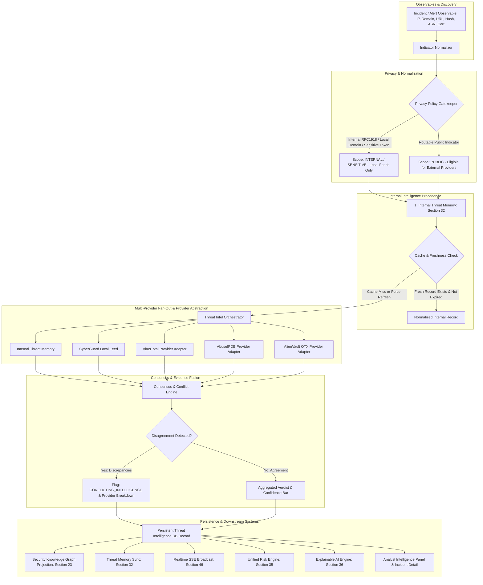

# Section 52 — Threat Intelligence & External Intelligence Enrichment Subsystem

## 1. Overview & Operational Architecture

The **Threat Intelligence & External Intelligence Enrichment subsystem** introduces production-grade, multi-provider threat intelligence enrichment to CyberGuard. It transforms raw incident and alert indicators into contextualized, normalized security evidence while preserving strict provenance, privacy safeguards, tenant boundaries, and conflict transparency.

The operational flow within CyberGuard is structured as:

```text
Input (Sensors, Ingestion Gateway, Endpoints)
  ↓
Detection (Multi-engine analytical detectors)
  ↓
Alert (Security Signal: NotificationModel / SECURITY_ALERT)
  ↓
Correlation (Alert Correlation & Incident Clustering: Section 49)
  ↓
Incident (Operational Case Lifecycle: Section 50 & Section 51)
  ↓
Threat Intelligence Enrichment (Section 52: Multi-provider evidence layer)
  ↓
Investigation (Forensic Workspace, Attack Path, Timeline)
  ↓
Risk / Explainability (Unified Risk Engine: Section 35 & Explainable AI: Section 36)
  ↓
Response (Response Recommendation & Playbooks: Section 37 & 38)
```

### Core Principle: Evidence Enrichment, Not Independent Verdicts
Threat intelligence serves strictly as an **evidence enrichment layer**. It answers:
> *"What is already known about this indicator across internal observations and configured threat intelligence providers?"*

It does **not** unilaterally declare an indicator malicious, nor does it compute a competing global risk score. The existing **Unified Risk Engine** (Section 35) consumes intelligence confidence, provider consensus, and historical observations alongside internal behavioral detections to calculate overall risk.

---

## 2. Architecture Diagram



---

## 3. Provider Abstraction

All external and internal providers implement the standard interface `BaseThreatIntelProvider`:

```python
class BaseThreatIntelProvider(ABC):
    @property
    @abstractmethod
    def name(self) -> str: ...

    @property
    @abstractmethod
    def supported_types(self) -> set[IndicatorTypeEnum]: ...

    @abstractmethod
    async def lookup(self, indicator: NormalizedIndicator) -> ProviderIntelligenceItem: ...

    @abstractmethod
    async def health_check(self) -> dict[str, Any]: ...
```

### Configured Providers:
1. **Internal Threat Memory (`internal_threat_memory`)**:
   - Queries historical tenant observations, malicious campaigns, and analytical findings recorded in Section 32 Threat Memory.
   - Always evaluated first; prioritized over external APIs.
2. **CyberGuard Local Feed (`cyberguard_local_feed`)**:
   - High-confidence curated local threat feed covering known command-and-control IPs, phishing domains, and malware hashes.
3. **VirusTotal (`virustotal`)**:
   - Commercial reputation provider for file hashes (MD5, SHA1, SHA256), domains, URLs, and IP addresses.
4. **AbuseIPDB (`abuseipdb`)**:
   - Specialized IP abuse reputation provider returning abuse confidence scores, reports count, and ISP attribution.
5. **AlienVault OTX (`alienvault_otx`)**:
   - Open Threat Exchange provider enriching indicators with threat pulses, malware families, and adversary campaign tags.

---

## 4. Indicator Normalization & Supported Types

The `IndicatorNormalizer` sanitizes and converts raw observables into deterministic canonical forms before lookup or caching:

| Indicator Type | Normalization Actions | Example Input | Normalized Output |
| :--- | :--- | :--- | :--- |
| **IP** | Strips ports, expands/compresses IPv4 and IPv6 to canonical format | `198.51.100.25:8080` | `198.51.100.25` |
| **DOMAIN** | Lowercase, strips trailing dot, encodes IDN to Punycode | `EXAMPLE.COM.` / `münchen.de` | `example.com` / `xn--mnchen-3ya.de` |
| **URL** | Lowercase scheme/host, drop default ports (80/443), collapse slashes, sort query parameters deterministically | `HTTP://Example.COM:80/path//to/f.php?b=2&a=1#frag` | `http://example.com/path/to/f.php?a=1&b=2` |
| **SHA256 / SHA1 / MD5** | Validate hexadecimal length (64, 40, 32 chars) and convert to lowercase | `4A7D1ED4...` | `4a7d1ed4...` |
| **EMAIL** | Lowercase, strip angles, normalize domain label | `<Phish@Example.COM>` | `phish@example.com` |
| **CERTIFICATE** | Clean hex formatting, strip delimiters (`:`, `-`, spaces) | `AA:BB:CC:DD:...` | `aabbccdd...` |
| **ASN** | Strip `AS` / `asn` prefix, canonical integer string | `AS15169` | `15169` |
| **HOSTNAME** | Strip scheme/port, lowercase, punycode encode | `server01.corp.internal` | `server01.corp.internal` |

---

## 5. Indicator Privacy & SSRF Protection

To prevent sensitive enterprise data leakage and Server-Side Request Forgery (SSRF):
1. **RFC1918 & Loopback Blocking**:
   - Private IP ranges (`10.0.0.0/8`, `172.16.0.0/12`, `192.168.0.0/16`, `127.0.0.1`, `::1`, link-local `169.254.0.0/16`) are classified as `PrivacyScopeEnum.INTERNAL`.
   - **External lookups are strictly prohibited**. Only internal feeds and threat memory are checked.
2. **Corporate & Non-Public Suffixes**:
   - Suffixes like `.local`, `.internal`, `.corp`, `.lan`, `.home`, and single-label hostnames are classified as `INTERNAL`.
3. **Sensitive Credential Scrubbing**:
   - URLs containing embedded authentication credentials (`user:pass@host`), or query parameters matching `token=`, `auth=`, `key=` are marked as `SENSITIVE`.
4. **SSRF Guardrails**:
   - Outbound HTTP requests to external provider APIs are restricted to allowlisted provider endpoints.
   - Arbitrary attacker-controlled URLs are **never fetched directly via raw GET/cURL** from the CyberGuard backend. Reputation is checked exclusively via hash or structured metadata API endpoints.

---

## 6. Caching & Freshness Management

Threat intelligence queries are cached in PostgreSQL/SQLite (`ThreatIntelligenceRecordModel`) to respect external rate limits and reduce latency:
- **Cache Key**: `(tenant_id, indicator_type, normalized_value)`.
- **Default TTL**: Configurable per provider (default: 86,400 seconds / 24 hours).
- **Freshness States**:
  - `FRESH`: Retrieved recently, within configured provider TTL.
  - `STALE`: Older than TTL. The UI visually marks the record with an amber badge and offers an asynchronous `[Refresh]` trigger.
  - `EXPIRED`: Explicitly invalidated records.
- **Cache Bypass**: Analysts can trigger a force refresh via `POST /api/intelligence/{type}/{indicator}/refresh`, which executes asynchronously via Background Jobs.

---

## 7. Multi-Provider Conflict Handling & Provenance

When multiple providers return conflicting assessments (e.g., Provider A reports `MALICIOUS` while Provider B reports `CLEAN`):
- **No Silent Favoritism**: CyberGuard **never silently picks one provider**.
- **Explicit Conflict Surfacing**: If both `MALICIOUS` and `CLEAN` verdicts are present across active sources, the consensus verdict is tagged as:
  ```json
  {
    "verdict": "suspicious",
    "has_conflicts": true,
    "conflict_details": "Conflicting intelligence detected across 2 providers: virustotal=malicious; alienvault_otx=clean"
  }
  ```
- **Provenance Preservation**: Every provider's raw verdict, score, confidence, observed timestamp, and reference URL are saved in `provider_breakdown` so analysts can trace exactly which external agency reported the finding.

---

## 8. Internal Intelligence Precedence & Threat Memory

Before dispatching external network requests, the orchestrator queries internal threat memory:
- **Historical Observations**: Previous security alerts, incidents, sandbox detonations, or analytical findings concerning the indicator within the tenant or global CyberGuard corpus.
- **Precedence**: If an authoritative high-confidence internal record exists, external calls may be skipped or used strictly for supplemental enrichment.
- **Bi-directional Sync**: Newly enriched external intelligence is synced back into Threat Memory (Section 32) and projected into the Security Knowledge Graph (Section 23).

---

## 9. Security Knowledge Graph Integration

When an indicator is enriched:
1. **Graph Nodes**: The indicator entity node (`domain`, `ip_address`, `file_hash`, `asn`) is located or created in the Knowledge Graph.
2. **Relationships**: External relationships returned by providers are linked:
   - `domain` → `RESOLVES_TO` → `ip_address`
   - `ip_address` → `ANNOUNCED_BY` → `asn`
   - `file_hash` → `ASSOCIATED_WITH` → `malware_family` / `campaign`
3. **No Duplicate Nodes**: Entities are deduplicated by canonical normalized value.

---

## 10. Unified Risk Engine & Explainability Integration

- **Distinct Concepts**: Threat Intelligence Confidence ($\in [0, 100]$) is strictly distinct from Unified Risk Score ($\in [0, 100]$). Confidence represents provider certainty in their observation; Risk represents organizational impact and threat severity.
- **Unified Risk Engine (Section 35)**: The Risk Engine ingests threat intel consensus as an *evidence factor* alongside behavioral signals (e.g. impossible travel, credential dumping, lateral movement).
- **Explainable AI (Section 36)**: Explanations provide explicit attribution:
  > *"Threat intelligence increased indicator suspicion because 2 independent providers (VirusTotal, AbuseIPDB) reported phishing infrastructure within the last 48 hours."*

---

## 11. Background Job Integration

Long-running enrichment tasks are offloaded to the Section 45 Background Job Queue:
- **`JobTypeEnum.INDICATOR_ENRICHMENT`**: Asynchronously enriches observables discovered during ingestion or incident promotion.
- **`JobTypeEnum.INTELLIGENCE_REFRESH`**: Triggered when an analyst requests an on-demand refresh.
- **`JobTypeEnum.BATCH_ENRICHMENT`**: Multi-observable enrichment batches for threat hunting or campaign investigation.
- **Retry & Isolation**: Handlers employ exponential backoff with jitter for transient 429/503 errors and permanently fail on 401/403 authorization issues without looping.

---

## 12. Realtime SSE & Notifications Integration

- **Event**: `THREAT_INTEL_ENRICHED` is broadcast over the Section 46 Server-Sent Events channel (`/api/realtime/events`).
- **In-App Alerts**: High-severity malicious intelligence discovered on active incident observables generates a Section 47 In-App Notification alerting the assigned incident commander.

---

## 13. Multi-Tenant Isolation

- **Tenant Scoping**: All records in `threat_intelligence_records` and `threat_intel_provider_configs` enforce `tenant_id` partitioning.
- **Cross-Tenant Guardrail**: A query for tenant `ws-tenant-a` will never read or overwrite private observations recorded for tenant `ws-tenant-b`.

---

## 14. API Endpoints

Mounted under `/api/intelligence`:
- `GET /api/intelligence/{indicator_type}/{indicator}`: Retrieve current intelligence record, cached results, and provider breakdown.
- `POST /api/intelligence/{indicator_type}/{indicator}/enrich`: Perform on-demand enrichment across configured providers.
- `POST /api/intelligence/{indicator_type}/{indicator}/refresh`: Invalidate cache and trigger fresh background enrichment.
- `GET /api/intelligence/{indicator_type}/{indicator}/history`: Retrieve chronological observation audit trail.
- `POST /api/intelligence/classify`: Check privacy policy and routability for an indicator.
- `POST /api/intelligence/batch-enrich`: Submit a batch of observables for background enrichment.
- `GET /api/intelligence/providers`: List configured providers, enabled status, priority, and rate limits (secrets redacted).
- `PUT /api/intelligence/providers/{provider_name}`: Update provider configuration (priority, status, API key).
- `POST /api/intelligence/providers/{provider_name}/health`: Execute live provider health check.

---

## 15. Frontend User Interface

1. **Indicator Intelligence Panel (`src/components/intelligence/IndicatorIntelligencePanel.tsx`)**:
   - Compact and progressive disclosure view.
   - Verdict badge (`Clean`, `Suspicious`, `Malicious`, `Unknown`).
   - Confidence bar and privacy scope tag (`Public`, `Internal`, `Sensitive`).
   - Warning banner for **Conflicting Intelligence** with full source breakdown.
   - Single-click **Refresh** button with live spinner.
   - Modal for **Observation Timeline** audit history.
2. **Threat Intelligence Hub (`src/pages/ThreatIntelligence.tsx`)**:
   - Global observable lookup bar supporting all 10 indicator types.
   - Provider status ribbon indicating health and latency.
3. **Incident Integration (`src/pages/incidents/IncidentDetailPage.tsx`)**:
   - Dedicated **Threat Intelligence** tab inside the incident investigation workspace allowing instant enrichment of incident observables.
4. **Admin Provider Settings (`src/components/settings/ThreatIntelligenceSettings.tsx`)**:
   - Provider priority reordering and toggle switches.
   - Secure server-side API key configuration modal (keys never echoed back).
   - Interactive privacy policy test tool.

---

## 16. Observability & Metrics

Prometheus-compatible counters and gauges:
- `intelligence_lookup_total`: Total lookups requested.
- `intelligence_lookup_success_total`: Successful enrichments.
- `intelligence_lookup_failure_total`: Failed provider attempts.
- `intelligence_cache_hit_total` / `intelligence_cache_miss_total`: Cache efficiency.
- `intelligence_provider_rate_limit_total`: Rate-limiting events encountered.
- `intelligence_conflict_total`: Multi-provider disagreements flagged.
- `intelligence_stale_total`: Queries returning stale data requiring refresh.

---

## 17. Limitations & Future Roadmap

1. **Sandboxed Detonation**: Dynamic behavioral sandbox detonation of binary payloads is handled separately by the File Security Analyzer (Section 17) and is not executed during metadata-only threat intelligence lookups.
2. **Offline Air-Gapped Environments**: External providers (VirusTotal, AbuseIPDB, OTX) require egress connectivity or forward proxy configuration. For air-gapped deployments, internal threat memory and local feeds operate autonomously.
