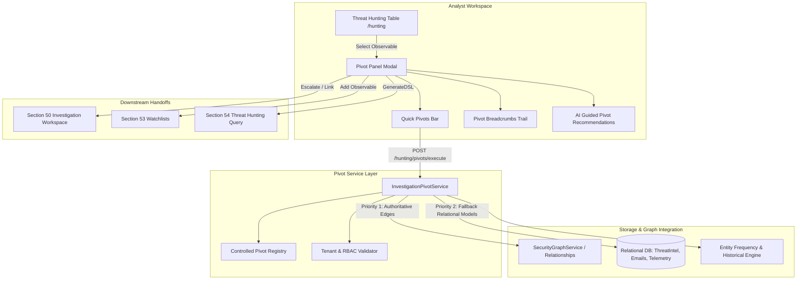

# Section 55 — Advanced Threat Hunting & Investigation Pivots

## 1. Overview & Architectural Role

The **Advanced Threat Hunting & Investigation Pivots** engine extends CyberGuard's proactive query layer (Section 54) into an interactive, multi-dimensional graph and relational pivot workflow. Rather than creating redundant search or graph engines, Section 55 binds existing systems together into a cohesive analyst workflow:

$$\text{Hunt} \longrightarrow \text{Pivot} \longrightarrow \text{Expand} \longrightarrow \text{Correlate} \longrightarrow \text{Hypothesize} \longrightarrow \text{Investigate} \longrightarrow \text{Watch} \longrightarrow \text{Respond}$$

### The Core Doctrine of Non-Fabrication & Neutral Provenance
A pivot is **not automatically a conclusion or attribution**:
- If Domain $A$ resolves to IP $B$, CyberGuard asserts: *"Domain $A$ is associated with IP $B$ according to observed DNS/infrastructure intelligence."* It never claims *"Domain $A$ and IP $B$ belong to the same attacker"*.
- If an entity shares an ASN or certificate, CyberGuard surfaces: *"Shared infrastructure observed."* Attribution remains uncertain without authoritative evidence.
- Relationships preserve full provenance, confidence, observation windows, and evidence references.

---

## 2. Pivot Workflow Architecture

---

## 3. Controlled Pivot Registry

All pivot actions are governed by a centralized, typed catalog in `InvestigationPivotService` (`PIVOT_REGISTRY`), preventing ad-hoc unindexed queries across the database:

| Source Type | Pivot Type | Target Type | Category | Relationship Description | Cost Class | Multi-Hop |
|---|---|---|---|---|---|---|
| `DOMAIN` | `RESOLVED_IPS` | `IP` | `INFRASTRUCTURE` | Resolves to IP address | `FAST` | Yes |
| `DOMAIN` | `ASSOCIATED_CERTIFICATES`| `CERTIFICATE` | `INFRASTRUCTURE` | Presents SSL/TLS Certificate | `FAST` | Yes |
| `DOMAIN` | `BELONGS_TO_ASN` | `ASN` | `INFRASTRUCTURE` | BGP Route Autonomous System | `FAST` | Yes |
| `DOMAIN` | `NAMESERVERS` | `DOMAIN` | `INFRASTRUCTURE` | Authoritative Name Server | `FAST` | Yes |
| `DOMAIN` | `REGISTRAR` | `DOMAIN` | `INFRASTRUCTURE` | Domain Registrar entity | `FAST` | No |
| `DOMAIN` | `RELATED_EMAILS` | `EMAIL` | `ACTIVITY` | Observed in email sender/links | `NORMAL` | Yes |
| `IP` | `REVERSE_DNS_DOMAINS` | `DOMAIN` | `INFRASTRUCTURE` | Reverse DNS PTR hostname | `FAST` | Yes |
| `IP` | `BELONGS_TO_ASN` | `ASN` | `INFRASTRUCTURE` | Routed by Autonomous System | `FAST` | Yes |
| `IP` | `SHARED_IP_DOMAINS` | `DOMAIN` | `INFRASTRUCTURE` | Co-hosted domains on shared IP | `NORMAL` | Yes |
| `IP` | `NETWORK_ACTIVITY` | `IP` | `ACTIVITY` | Observed network flow peer | `EXPENSIVE`| Yes |
| `CERTIFICATE`| `SHARED_CERTIFICATE_DOMAINS`| `DOMAIN` | `INFRASTRUCTURE` | Subject Alternative Name domain | `FAST` | Yes |
| `EMAIL` | `EMAIL_RECIPIENTS` | `USER` | `ACTIVITY` | Targeted recipient identity | `FAST` | Yes |
| `EMAIL` | `EMAIL_ATTACHMENTS` | `HASH` | `ACTIVITY` | Attachment cryptographic hash | `FAST` | Yes |
| `HASH` | `ARTIFACT_OBSERVATIONS`| `ARTIFACT` | `ACTIVITY` | Observed in analyzed payload | `NORMAL` | Yes |
| `HASH` | `ENDPOINT_ACTIVITY` | `DEVICE` | `ACTIVITY` | Process execution on host | `EXPENSIVE`| Yes |
| Any Observable| `RELATED_ALERTS` | `ALERT` | `SECURITY` | Associated security alert | `FAST` | No |
| Any Observable| `RELATED_INVESTIGATIONS`| `INCIDENT`| `SECURITY` | Case docket participation | `FAST` | No |
| Any Observable| `ASSOCIATED_CAMPAIGNS` | `CAMPAIGN` | `SECURITY` | Clustered threat campaign | `FAST` | Yes |
| Any Observable| `KNOWLEDGE_GRAPH_NEIGHBORS`| `INDICATOR`| `SECURITY` | Knowledge Graph topology edges | `NORMAL` | Yes |

---

## 4. Multi-Hop Traversal & Cycle Prevention

The pivot engine supports multi-hop exploratory expansions ($1$ to $3$ hops):
- **Hop 1**: Direct edges/relationships from the source observable.
- **Hop 2 / Hop 3**: Controlled Breadth-First Expansion (BFS) over top-$10$ parent targets.
- **Cycle Prevention**: Visited node tracking prevents infinite loops and recursive explosion ($A \rightarrow B \rightarrow A$).
- **Combinatorial Guardrails**: Hard limit of maximum $100$ graph nodes and $200$ edges per traversal run.

---

## 5. Cost Classification & Execution Model

Pivots are classified into four runtime profiles:
1. **`FAST`**: Sub-second in-memory or indexed single-table lookups (e.g., indicator-to-alert, domain-to-IP). Executed synchronously in the HTTP request thread.
2. **`NORMAL`**: Cross-table relational joins or knowledge graph neighbor lookups (e.g., shared certificates, email observations). Executed synchronously within bounded time windows.
3. **`EXPENSIVE`**: Large-scale telemetry queries (e.g., historical endpoint events, network flow aggregates). Warned to analysts in the UI with execution cost indicators.
4. **`BACKGROUND`**: Dispatched to `BackgroundJobWorker` (`JobTypeEnum.ADVANCED_PIVOT_EXECUTION`), tracking durable state in `pivot_executions` table and streaming lifecycle updates via Section 46 Realtime WebSockets (`PIVOT_STARTED`, `PIVOT_PROGRESS`, `PIVOT_COMPLETED`, `PIVOT_FAILED`).

---

## 6. Entity Frequency & Historical Metrics

For any observable, the pivot engine calculates factual historical metrics without subjective inference:
- **`first_seen` / `last_seen`**: Exact earliest and latest observation timestamps across intelligence, email, and telemetry records.
- **`observed_days_span`**: Total chronological span in days.
- **`artifact_count`**: Number of unique ingested artifacts containing the indicator.
- **`alert_count`**: Number of security alerts referencing the entity.
- **`investigation_count`**: Number of active or resolved investigations involving the indicator.
- **`is_watchlist_monitored`**: Real-time membership status in Section 53 Watchlists.

---

## 7. Analyst Hypothesis & Evidence Classification

To structure the analyst's investigative thinking, Section 55 introduces the **Analyst Hypothesis Drawer**:
- **Hypothesis Definition**: Analysts record a working statement (e.g., *"Domains are secondary staging nodes for spearphishing campaign"*).
- **Hypothesis Status**: `PROPOSED`, `INVESTIGATING`, `CONFIRMED`, `DISPROVED`, `ABANDONED`.
- **Tri-State Evidence Classification**: As analysts inspect pivot results, they can categorize items directly:
  - **`SUPPORTING`**: Validates the hypothesis.
  - **`CONTRADICTING`**: Refutes or casts doubt on the hypothesis.
  - **`NEUTRAL`**: Informational or unconfirmed background context.
- **Principle of Analyst Sovereignty**: The system never automatically confirms or disproves hypotheses; conclusion remains in human hands.

---

## 8. AI-Assisted Pivot Recommendations

Heuristic-backed recommendations suggest optimal next analytical hops:
- **Domain with DNS records** $\rightarrow$ Suggests resolving related IPs to detect shared hosting infrastructure.
- **Domain with SSL certs** $\rightarrow$ Suggests inspecting Subject Alternative Names (SANs) for sibling domains.
- **Hash observed in attachments** $\rightarrow$ Suggests querying endpoint process executions for host impact.
- **Safety Boundaries**: The recommendation engine only presents candidate hops with analytical rationales. The AI **cannot** execute response actions, bypass RBAC, traverse cross-tenant data, or declare unverified attribution.

---

## 9. Security, Multi-Tenant Isolation & Audit

- **Strict Workspace Scoping**: All queries require an active `X-Workspace-ID`. Results from other tenants are strictly isolated. Canonical IOC records (`IndicatorModel`) are resolved globally by normalized value while relationship and incident models remain tenant-partitioned.
- **RBAC**: Requires authenticated analyst credentials (`X-User-ID`).
- **Audit Logging**: Hypothesis recordings, investigation escalations, and watchlist promotions emit structured audit records with actor IDs and timestamp provenance.
- **Response Segregation**: Pivot interfaces provide analytical handoffs only; destructive response actions (e.g., quarantine, kill process) are strictly prohibited and deferred to the authorized Response Workspace (Sections 37 & 38).

---

## 10. Known Limitations

- **Passive DNS & Historic WHOIS**: Limited to observations captured during telemetry ingestion and cached Section 52 threat intelligence records; does not query arbitrary external paid APIs without configured connectors.
- **High-Volume Telemetry Truncation**: Network and endpoint telemetry pivots apply a default cap of 100 records per hop to prevent memory exhaustion and browser rendering bottlenecks.
- **Multi-Hop Max Depth**: Max depth is capped at 3 hops; deeper recursive exploration must be performed incrementally through user-initiated breadcrumb hops.
