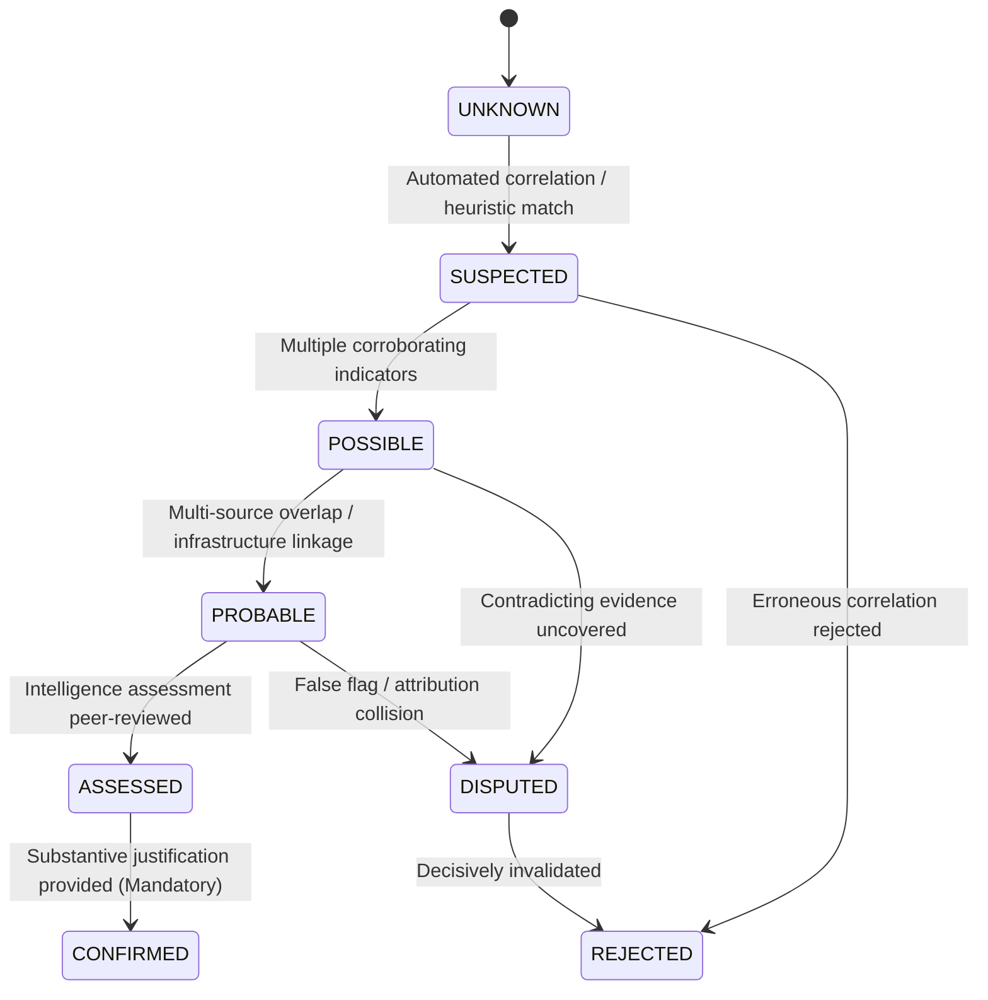

# SECTION 65 — THREAT ACTOR & CAMPAIGN WORKSPACE
## CyberGuard Architecture Reference

---

### 1. Purpose and Architectural Position
Section 65 implements an authoritative, analyst-controlled **Threat Actor & Campaign Workspace** for CyberGuard. It enables security analysts, threat intelligence specialists, and incident responders to organize, correlate, investigate, and track suspected threat actors, active campaigns, infrastructure clusters, techniques, indicators, incidents, and related evidence.

```text
Threat Signals (Emails, Telemetry, Network, Auth)
      ↓
Indicators / Infrastructure / Findings (IOCs, IPs, Domains, Lookalikes)
      ↓
Cross-Source Correlation (Sections 24, 25, 49, 61)
      ↓
Campaign Clustering & Candidate Discovery (Section 62 & 65)
      ↓
Analyst Review & Verification (Promote / Merge / Reject)
      ↓
Attribution Assessment (Suspected → Possible → Probable → Assessed → Confirmed)
      ↓
Threat Actor Workspace (Profiles, Aliases, MITRE TTPs, Lineage, Evidence)
      ↓
Operational Handoffs (Threat Hunting S54 & Detection Engineering S56-S60)
```

#### Non-Duplication Principle
CyberGuard maintains strict single-source-of-truth semantics. Section 65 **does NOT duplicate**:
- **Knowledge Graph**: Queries and mutates the authoritative `SecurityKnowledgeGraph` (Section 23). Nodes are typed `NodeType.THREAT_ACTOR` and `NodeType.CAMPAIGN`.
- **Campaign Engine**: Extends `CampaignModel` (`campaigns` table) rather than introducing a shadow campaign table.
- **Attribution Engine**: Integrates with Section 29 infrastructure attribution heuristics without replacing them.
- **Risk / Priority Engine**: Strictly separates analytic attribution confidence ($0.0 \le c \le 1.0$) from technical risk score ($0.0 \le r \le 100.0$) and operational priority ($P1 \dots P4$).
- **IOC Database**: References canonical indicators via existing entity resolution and enrichment pipelines.

---

### 2. Core Concepts & Architectural Distinctions

#### 2.1 Threat Actor vs. Campaign
| Entity | Definition | Persistence | Key Attributes |
| :--- | :--- | :--- | :--- |
| **Threat Actor** | Strategic human or organizational adversary conducting malicious cyber activity. | Enduring, multi-year entity. | Name, aliases with source confidence, motivation, adversary tier, observed techniques, attribution state, supporting/contradicting evidence. |
| **Campaign** | Coordinated set of malicious incidents, infrastructure, and lures sharing common objectives over a discrete timeframe. | Ephemeral to medium-term (weeks/months). | Campaign ID, cluster signature, attribution state, lifecycle status (`ACTIVE`, `CONTAINED`, `DORMANT`, `CLOSED`), affected assets, incidents. |

#### 2.2 Controlled Attribution States
Attribution is never stated as absolute fact without evidence. CyberGuard enforces an 8-state controlled attribution taxonomy:



- **`UNKNOWN`**: No attribution hypothesis established.
- **`SUSPECTED`**: Preliminary automated cluster or weak heuristic signal.
- **`POSSIBLE`**: Multiple technical indicators correlate with actor infrastructure or TTPs.
- **`PROBABLE`**: Substantial infrastructure, tool, and victim overlap observed.
- **`ASSESSED`**: Formal intelligence assessment conducted by analyst.
- **`CONFIRMED`**: Unambiguous, verified attribution. **Enforced Safeguard**: Requires substantive justification ($\ge 10$ characters) with source citations. Pure AI confidence can never set `CONFIRMED`.
- **`DISPUTED`**: Conflicting evidence or competing attribution hypotheses exist.
- **`REJECTED`**: Hypothesis or correlation explicitly rejected by analyst.

#### 2.3 Semantic Relationship Classifications
All relationships connecting actors, campaigns, infrastructure, and indicators are explicitly classified to eliminate ambiguity:
- **`OBSERVED`**: Direct telemetry observation (e.g., email received from IP).
- **`CORRELATED`**: Multi-signal mathematical correlation (e.g., simhash template match).
- **`INFERRED`**: Algorithmic deduction from shared infrastructure or naming scheme.
- **`HYPOTHESIZED`**: Analyst working hypothesis under investigation.
- **`ASSESSED`**: Intelligence evaluation backed by structured evidence.
- **`EXTERNAL_INTELLIGENCE`**: Ingested from external threat intel feeds/reports (MISP, Mandiant, MITRE).
- **`ANALYST_ASSERTED`**: Explicit manual analyst override.

#### 2.4 Evidence Model: Supporting vs. Contradicting
Attribution is defended through explicit evidence accounting:
```json
{
  "evidence_id": "EV-0912",
  "evidence_type": "INFRASTRUCTURE_OVERLAP",
  "source": "Passive DNS Telemetry",
  "observed_at": "2026-10-10T14:32:00Z",
  "description": "Shared C2 registrant email address with known APT29 infrastructure",
  "semantic_class": "OBSERVED",
  "is_contradicting": false,
  "confidence_weight": 0.85
}
```
Contradicting evidence is preserved alongside supporting evidence to prevent confirmation bias and enable rapid pivot to `DISPUTED` or `REJECTED`.

---

### 3. Analyst Workflows & Lifecycle Operations

#### 3.1 Candidate Review Workflow
Candidate campaign clusters generated by cross-incident correlation (Section 61) remain in a provisional candidate review queue:
- **`PROMOTE`**: Converts candidate cluster into an active, monitored campaign (`lifecycle_status: OPEN`, `activity_state: ACTIVE`).
- **`MERGE`**: Folds candidate cluster into an existing authoritative campaign, transferring all indicators, incidents, and provenance without data loss.
- **`REJECT`**: Marks candidate cluster as `REJECTED`, logging reason and preventing repeated correlation.

#### 3.2 Safe Campaign Merging
When two campaigns are determined to represent the same adversary operation:
1. Target campaign absorbs all source campaign indicators, incidents, alerts, affected assets, and MITRE techniques.
2. Source campaign status is set to `MERGED` and pointed to target campaign (`merged_into_id`).
3. Complete merge history and lineage are appended to `provenance_history_json` on both records.
4. Conflicting metadata is recorded in `source_conflicts_json` for analyst review.
5. No evidence, incident link, or audit record is destroyed.

#### 3.3 Safe Campaign Splitting
When an active campaign is determined to conflate two distinct operations:
1. A new child campaign is created with split parameters.
2. Selected indicators, incidents, and techniques are migrated to the child campaign.
3. Provenance records are written to both parent and child campaigns (`split_parent_id: ...`).
4. Attribution assessment history is linked and preserved across both branches.

#### 3.4 Analyst-Authored Hypotheses
Analysts can test competing hypotheses against active campaigns:
- Track working hypotheses (`HYPOTHESIZED`, `SUPPORTED`, `CONTRADICTED`, `RETIRED`).
- Link specific supporting and refuting indicators.
- Calculate dynamic confidence based on corroborating data.

#### 3.5 Operational Handoffs
- **Threat Hunting (Section 54)**: Generates structured search queries across IP, domain, URL, and sender IOCs with temporal windows.
- **Detection Engineering (Sections 56–60)**: Generates candidate detection rule definitions populated with observed MITRE ATT&CK techniques, indicators, and recommended thresholds.

---

### 4. Database Schema & Model Extensions

#### 4.1 Extended Campaign Table (`campaigns`)
```sql
ALTER TABLE campaigns ADD COLUMN threat_actor_id VARCHAR(64) REFERENCES threat_actors(actor_id);
ALTER TABLE campaigns ADD COLUMN attribution_state VARCHAR(32) DEFAULT 'UNKNOWN';
ALTER TABLE campaigns ADD COLUMN attribution_confidence FLOAT DEFAULT 0.0;
ALTER TABLE campaigns ADD COLUMN lifecycle_status VARCHAR(32) DEFAULT 'PROVISIONAL';
ALTER TABLE campaigns ADD COLUMN activity_state VARCHAR(32) DEFAULT 'OBSERVED';
ALTER TABLE campaigns ADD COLUMN watch_state VARCHAR(32) DEFAULT 'STANDARD';
ALTER TABLE campaigns ADD COLUMN description TEXT;
ALTER TABLE campaigns ADD COLUMN mitre_techniques_json TEXT DEFAULT '[]';
ALTER TABLE campaigns ADD COLUMN affected_assets_json TEXT DEFAULT '[]';
ALTER TABLE campaigns ADD COLUMN affected_identities_json TEXT DEFAULT '[]';
ALTER TABLE campaigns ADD COLUMN related_alerts_json TEXT DEFAULT '[]';
ALTER TABLE campaigns ADD COLUMN related_incidents_json TEXT DEFAULT '[]';
ALTER TABLE campaigns ADD COLUMN analyst_notes_json TEXT DEFAULT '[]';
ALTER TABLE campaigns ADD COLUMN source_conflicts_json TEXT DEFAULT '[]';
ALTER TABLE campaigns ADD COLUMN provenance_history_json TEXT DEFAULT '[]';
```

#### 4.2 Threat Actor Model (`threat_actors`)
```sql
CREATE TABLE threat_actors (
    id VARCHAR(64) PRIMARY KEY,
    actor_id VARCHAR(64) UNIQUE NOT NULL,
    workspace_id VARCHAR(64) NOT NULL,
    name VARCHAR(255) NOT NULL,
    actor_type VARCHAR(64) NOT NULL,
    motivation VARCHAR(64) NOT NULL,
    sophistication_tier VARCHAR(64) NOT NULL,
    attribution_state VARCHAR(32) NOT NULL DEFAULT 'SUSPECTED',
    attribution_confidence FLOAT NOT NULL DEFAULT 0.5,
    lifecycle_status VARCHAR(32) NOT NULL DEFAULT 'ACTIVE',
    country_of_origin VARCHAR(64),
    description TEXT,
    aliases_json TEXT NOT NULL DEFAULT '[]',
    observed_techniques_json TEXT NOT NULL DEFAULT '[]',
    supporting_evidence_json TEXT NOT NULL DEFAULT '[]',
    contradicting_evidence_json TEXT NOT NULL DEFAULT '[]',
    provenance_metadata_json TEXT NOT NULL DEFAULT '{}',
    first_seen TIMESTAMP NOT NULL,
    last_seen TIMESTAMP NOT NULL,
    created_at TIMESTAMP NOT NULL,
    updated_at TIMESTAMP NOT NULL
);
```

#### 4.3 Threat Hypotheses Model (`threat_hypotheses`)
```sql
CREATE TABLE threat_hypotheses (
    id VARCHAR(64) PRIMARY KEY,
    workspace_id VARCHAR(64) NOT NULL,
    subject_type VARCHAR(32) NOT NULL,
    subject_id VARCHAR(64) NOT NULL,
    title VARCHAR(255) NOT NULL,
    statement TEXT NOT NULL,
    status VARCHAR(32) NOT NULL DEFAULT 'HYPOTHESIZED',
    confidence FLOAT NOT NULL DEFAULT 0.5,
    supporting_evidence_json TEXT NOT NULL DEFAULT '[]',
    refuting_evidence_json TEXT NOT NULL DEFAULT '[]',
    analyst_author VARCHAR(128) NOT NULL,
    created_at TIMESTAMP NOT NULL,
    updated_at TIMESTAMP NOT NULL
);
```

#### 4.4 Attribution Assessment Audit Model (`threat_attribution_assessments`)
```sql
CREATE TABLE threat_attribution_assessments (
    id VARCHAR(64) PRIMARY KEY,
    workspace_id VARCHAR(64) NOT NULL,
    subject_type VARCHAR(32) NOT NULL,
    subject_id VARCHAR(64) NOT NULL,
    prior_attribution_state VARCHAR(32) NOT NULL,
    new_attribution_state VARCHAR(32) NOT NULL,
    confidence FLOAT NOT NULL,
    justification TEXT NOT NULL,
    assessed_by VARCHAR(128) NOT NULL,
    assessed_at TIMESTAMP NOT NULL
);
```

---

### 5. REST API Reference

All endpoints are mounted at `/api/v1/threat-workspace` and require tenant authentication (`X-Workspace-ID` or JWT claims) with RBAC authorization (`admin`, `analyst`, `security_lead`, `tier2`, `tier3`):

| Method | Endpoint | Description | Roles |
| :--- | :--- | :--- | :--- |
| `GET` | `/actors` | List threat actors with optional filtering (`actor_type`, `attribution_state`, `query`). | Read |
| `POST` | `/actors` | Create a new threat actor profile. | Analyst+ |
| `GET` | `/actors/{actor_id}` | Get detailed profile of a threat actor. | Read |
| `PATCH` | `/actors/{actor_id}` | Update profile, aliases, or lifecycle status. | Analyst+ |
| `POST` | `/actors/{actor_id}/assessments` | Record an attribution state transition with mandatory justification. | Analyst+ |
| `GET` | `/actors/{actor_id}/assessments` | Retrieve complete attribution assessment audit trail. | Read |
| `GET` | `/campaigns` | List campaigns with attribution states and cluster stats. | Read |
| `POST` | `/campaigns` | Create a new campaign record. | Analyst+ |
| `GET` | `/campaigns/{campaign_id}` | Retrieve comprehensive campaign workspace record. | Read |
| `POST` | `/campaigns/{campaign_id}/assessments` | Record campaign attribution state transition. | Analyst+ |
| `POST` | `/campaigns/candidates/review` | Candidate review determination (`PROMOTE`, `MERGE`, `REJECT`). | Analyst+ |
| `POST` | `/campaigns/merge` | Safe merge with conflict detection and lineage recording. | Analyst+ |
| `POST` | `/campaigns/{campaign_id}/split` | Safe split into parent and child operations. | Analyst+ |
| `GET` | `/campaigns/{campaign_id}/timeline` | Chronological multi-source incident and indicator timeline. | Read |
| `GET` | `/campaigns/{campaign_id}/graph` | Bounded graph neighborhood from SecurityKnowledgeGraph. | Read |
| `GET` | `/hypotheses` | List analyst hypotheses for actor or campaign. | Read |
| `POST` | `/hypotheses` | Record a new analyst hypothesis. | Analyst+ |
| `POST` | `/campaigns/{campaign_id}/handoff/hunting` | Export structured search queries for Threat Hunting Workspace. | Analyst+ |
| `POST` | `/campaigns/{campaign_id}/handoff/detection` | Export candidate detection rule definition for Detection Engineering. | Analyst+ |

---

### 6. Background Jobs & Realtime Integration

#### 6.1 Background Jobs
Three scheduled and on-demand job types are registered in `JobTypeEnum` and executed by `BackgroundJobWorker`:
- **`CAMPAIGN_CORRELATION_SWEEP`**: Periodically correlates orphaned incidents and indicators across time windows into candidate clusters.
- **`CAMPAIGN_ENRICHMENT_SYNC`**: Synchronizes IOC enrichments from Threat Intelligence (Section 52) and watchlists (Section 53).
- **`THREAT_ACTOR_SYNC`**: Evaluates active campaign techniques against known MITRE enterprise threat actor behaviors.

#### 6.2 Realtime Event Channels
The workspace broadcasts structured events via `RealtimeEventBus`:
- `CAMPAIGN_CREATED`, `CAMPAIGN_UPDATED`, `CAMPAIGN_STATUS_CHANGED`, `CAMPAIGN_ATTRIBUTION_CHANGED`
- `CAMPAIGN_MERGED`, `CAMPAIGN_SPLIT`
- `ACTOR_CREATED`, `ACTOR_UPDATED`, `ACTOR_ASSESSMENT_CHANGED`
- `HYPOTHESIS_CREATED`, `HYPOTHESIS_UPDATED`

---

### 7. Security Architecture & Governance Controls

1. **Mandatory Tenant Workspace Isolation**: Every actor, campaign, hypothesis, assessment, and relationship is strictly partitioned by `workspace_id`. Cross-workspace queries return 404 or empty results.
2. **Attribution Audit Immutability**: All attribution transitions are logged as permanent rows in `threat_attribution_assessments` with timestamp, analyst identifier, prior state, new state, confidence, and justification.
3. **Anti-Hallucination & Non-Attribution Safeguard**: Automated AI algorithms can suggest candidate clusters or confidence scores, but **only human analysts can transition state to `CONFIRMED`**, requiring explicit justification.

---

### 8. Verification & Acceptance Matrix

| Requirement | Test Reference | Status |
| :--- | :--- | :--- |
| Threat Actor CRUD & Aliases | `test_threat_actor_crud_and_aliases` | **PASS** |
| Substantive Justification for CONFIRMED | `test_threat_actor_attribution_assessment_justification` | **PASS** |
| Candidate Campaign Review (Promote/Reject) | `test_campaign_candidate_review_promote_and_reject` | **PASS** |
| Safe Campaign Merge with Lineage | `test_campaign_safe_merge_lineage_and_conflict_handling` | **PASS** |
| Safe Campaign Split with Lineage | `test_campaign_safe_split` | **PASS** |
| Analyst Hypotheses Lifecycle | `test_threat_hypotheses_lifecycle` | **PASS** |
| Chronological Timeline & Bounded Graph | `test_campaign_timeline_and_graph` | **PASS** |
| Threat Hunting & Detection Handoffs | `test_hunting_and_detection_handoffs` | **PASS** |
| RBAC Role Enforcement | `test_api_rbac_forbidden_for_unauthorized_roles` | **PASS** |
| Multi-Tenant Isolation | `test_api_multi_tenant_isolation` | **PASS** |
| Background Job Worker Handlers | `test_background_worker_campaign_sweep` | **PASS** |
| Frontend TypeScript & Vite Bundling | `npm run build` | **PASS** |
