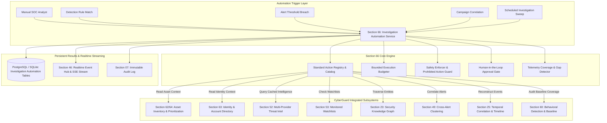

# Section 66 — Advanced Investigation Automation Architecture

## 1. Executive Summary & Core Objective

**Section 66 — Advanced Investigation Automation** establishes a deterministic, analyst-controlled, bounded workflow automation engine for CyberGuard investigations.

Modern SOC analysts face critical bottlenecks during alert triage and deep-dive incident investigations: repetitive context lookups across disparate silos (assets, identities, threat intelligence caches, watchlists, parallel incidents, and multi-hop knowledge graph relationships). However, unconstrained automated response or opaque agentic loops introduce unacceptable risks: destructive actions executed without authorization, runaway compute cycles, hallucinated telemetry when data is missing, and lost evidence provenance.

Section 66 resolves these challenges with an architecture founded on four uncompromised principles:
1. **Analyst-Controlled, Bounded Execution**: Automates contextual aggregation and analysis, but **never** performs destructive or containment actions without explicit analyst authorization.
2. **Strict Prohibition of Destructive Actions**: Containment actions (e.g. host isolation, credential revocation, account suspension, firewall blocking) are fundamentally blocked within investigation automation steps. They are designated as defensive response recommendations governed by Section 37/38.
3. **Truthful Zero-Result Semantics**: When external intelligence, asset registers, or telemetry lack records, the engine explicitly reports zero results and flags potential gaps—**never** generating synthetic entities or guessing missing evidence.
4. **Comprehensive Provenance & Resilience**: Every step records its exact parameters, timing, result count, warnings, errors, and approvals. Background jobs can pause at gated approval steps and resume seamlessly across worker restarts.

---

## 2. Architectural Position & Subsystem Integrations



---

## 3. Standard Action Registry & Catalog

Section 66 registers 16 deterministic, non-destructive investigation actions categorized by computational intensity and approval requirements:

| Action ID | Action Name | Cost Class | Approval Level | Functional Description |
| :--- | :--- | :--- | :--- | :--- |
| `GET_ASSET_CONTEXT` | Query Asset Inventory & Criticality | FAST | `READ_ONLY_AUTOMATIC` | Resolves hostnames and IPs against managed enterprise asset inventory (Section 62). |
| `GET_IDENTITY_CONTEXT` | Resolve Identity & Account Privileges | FAST | `READ_ONLY_AUTOMATIC` | Matches internal identities, department, VIP status, and privilege tiers (Section 63). |
| `GET_INDICATOR_CONTEXT` | Extract Normalized Indicators & IOCs | FAST | `READ_ONLY_AUTOMATIC` | Pulls normalized observables associated with active investigation findings. |
| `GET_THREAT_INTELLIGENCE` | Query Threat Intelligence Cache | FAST | `READ_ONLY_AUTOMATIC` | Queries multi-provider threat intelligence cache; respects RFC 1918 privacy masking. |
| `GET_WATCHLIST_CONTEXT` | Correlate Monitored Watchlists | FAST | `READ_ONLY_AUTOMATIC` | Cross-references indicators against active enterprise watchlists (Section 53). |
| `GET_RELATED_ALERTS` | Correlate Parallel Security Alerts | NORMAL | `READ_ONLY_AUTOMATIC` | Retrieves alerts clustered under the same entity or campaign (Section 48/49). |
| `GET_RELATED_INCIDENTS` | Correlate Parallel Incidents | NORMAL | `READ_ONLY_AUTOMATIC` | Identifies concurrent incidents sharing common infrastructure or indicators. |
| `GET_RELATED_FINDINGS` | Correlate Analyzer Findings | FAST | `READ_ONLY_AUTOMATIC` | Aggregates findings from file, URL, network, auth, and email detection pipelines. |
| `GET_GRAPH_RELATIONSHIPS` | Expand Knowledge Graph (2-Hop) | NORMAL | `READ_ONLY_AUTOMATIC` | Traverses security knowledge graph up to 2 hops for adjacent infrastructure (Section 23). |
| `RUN_APPROVED_HUNT` | Run Pre-Approved Threat Hunt Query | EXPENSIVE | `ANALYST_APPROVAL_REQUIRED` | Executes pre-validated telemetry hunting query against historical events (Section 54). |
| `RUN_APPROVED_PIVOT` | Execute Multi-Hop Intelligence Pivot | EXPENSIVE | `ANALYST_APPROVAL_REQUIRED` | Executes bounded pivot query on external infrastructure clusters (Section 55). |
| `GET_CAMPAIGN_CONTEXT` | Link Campaign & Threat Actor | FAST | `READ_ONLY_AUTOMATIC` | Correlates observed techniques and infrastructure with tracked campaigns (Section 65). |
| `GET_BEHAVIOR_CONTEXT` | Analyze Behavioral Baseline Anomaly | NORMAL | `READ_ONLY_AUTOMATIC` | Compares entity activity against baseline velocity and deviations (Section 60). |
| `BUILD_TIMELINE` | Reconstruct Unified Event Timeline | NORMAL | `READ_ONLY_AUTOMATIC` | Synthesizes chronologically ordered forensic timeline across telemetry sources. |
| `CHECK_DATA_COVERAGE` | Audit Telemetry Coverage & Blindspots| NORMAL | `READ_ONLY_AUTOMATIC` | Evaluates availability of email, endpoint, network, auth, cloud, and intel telemetry. |
| `GENERATE_INVESTIGATION_SUMMARY` | Synthesize Investigation Dossier | NORMAL | `READ_ONLY_AUTOMATIC` | Synthesizes verified knowns, unknowns, and actionable recommended next steps. |

---

## 4. Strict Prohibition of Destructive Actions

Investigation automation is strictly non-destructive. Any attempt to register or execute actions that alter production state or isolate infrastructure triggers an immediate `SecurityActionProhibitedError`:

```python
PROHIBITED_ACTION_PATTERNS = {
    "CONTAIN_HOST",
    "ISOLATE_ENDPOINT",
    "REVOKE_CREDENTIALS",
    "BLOCK_FIREWALL",
    "DELETE_MAILBOX",
    "DISABLE_ACCOUNT",
    "QUARANTINE_DEVICE",
    "SHUTDOWN_SERVER",
}
```

Containment, mitigation, and remediation actions are exclusively routed through **Section 37 (Response Recommendation Engine)** and **Section 38 (Response Playbooks)** with required dual-custody or authorized analyst sign-off.

---

## 5. Bounded Execution & Loop Prevention

To prevent runaway query costs and infinite graph traversals, all automation runs adhere to strict, configurable `AutomationBudget` envelopes:

```json
{
  "max_steps": 25,
  "max_depth": 3,
  "max_entities": 100,
  "max_time_seconds": 300
}
```

The service tracks a set of `visited_entities` in canonical format (`IOC:DOMAIN:malicious.com`, `ASSET:AST-001`, `IDENTITY:cfo@corp.com`). Entities already expanded in earlier steps are skipped in subsequent query iterations, guaranteeing that cyclical knowledge graph relationships cannot cause recursion or infinite loops.

---

## 6. Truthful Zero-Result Semantics & Investigation Gaps

When an automation step finds no matching assets, identities, or telemetry, it strictly records:
- `result_count = 0`
- `result_summary = { "matches": [] }`
- `warnings = [ "No managed asset matched observed network identifier 198.51.100.25" ]`

Simultaneously, the engine generates an authoritative `InvestigationGapModel` entry:
- **Category**: `TELEMETRY_MISSING`, `LOG_GAP`, `UNRESOLVED_IDENTITY`, `UNMONITORED_ASSET`, `INCOMPLETE_TIMELINE`, or `INTELLIGENCE_UNAVAILABLE`.
- **Severity**: `LOW`, `MEDIUM`, `HIGH`, `CRITICAL`.
- **Title & Remediation**: Concrete recommendations for SOC engineering (e.g. "Deploy endpoint sensor to shadow host", "Index cloud IAM authentication audit stream").

---

## 7. Human-in-the-Loop Gated Approval Workflow

For steps flagged with `ANALYST_APPROVAL_REQUIRED` or `ADMIN_APPROVAL_REQUIRED` (e.g. expensive full-corpus queries or deep pivot scans):
1. The execution engine pauses execution immediately before the gated step.
2. The step transitions to `WAITING_APPROVAL`, and the run transitions to `WAITING_FOR_ANALYST`.
3. An `INVESTIGATION_AUTOMATION_WAITING` event is broadcast across real-time streams.
4. An authorized analyst inspects the pending parameters via the UI or REST API.
5. If **approved**: The step runs, and the workflow resumes autonomously.
6. If **rejected**: The step transitions to `SKIPPED`, a note is recorded with the analyst's justification, and downstream steps proceed safely without stalling the entire investigation.

---

## 8. Failure Semantics & Resilience

- **Isolated Failures**: If an individual step encounters a network timeout or provider error, its status transitions to `FAILED`, recording the exact error message and duration.
- **Partial Completion**: Subsequent steps continue executing. If at least one step completed and at least one step failed, the overall run terminates with `PARTIALLY_COMPLETED`.
- **Evidence Preservation**: All evidence collected by preceding successful steps is fully retained and committed to the database. Cancellation or partial failure **never** deletes observed findings or telemetry.
- **Background Worker Integration**: Runs dispatched with `async_exec=True` enqueue an `INVESTIGATION_AUTOMATION_RUN` job handled by `BackgroundJobWorker`. In-flight worker timeouts or restarts preserve current step progress.

---

## 9. Real-Time Broadcasting & SSE Streaming

All state transitions emit Section 46 compliant real-time events to `/api/investigations/{id}/stream`:
- `INVESTIGATION_AUTOMATION_CREATED`
- `INVESTIGATION_AUTOMATION_STARTED`
- `INVESTIGATION_AUTOMATION_WAITING`
- `INVESTIGATION_AUTOMATION_STEP_STARTED`
- `INVESTIGATION_AUTOMATION_STEP_COMPLETED`
- `INVESTIGATION_AUTOMATION_STEP_FAILED`
- `INVESTIGATION_GAP_DISCOVERED`
- `INVESTIGATION_AUTOMATION_PARTIAL`
- `INVESTIGATION_AUTOMATION_COMPLETED`
- `INVESTIGATION_AUTOMATION_CANCELLED`

---

## 10. Verification Matrix & Test Coverage

All test cases are codified in `backend/tests/test_section66_advanced_investigation_automation.py`:

| Test ID | Test Scenario | Verification Objective | Status |
| :--- | :--- | :--- | :--- |
| `TC-66-01` | Template Catalog & Plan Creation | Verifies registration of templates and initialization of bounded queued runs. | **PASSED** |
| `TC-66-02` | Step Execution & Bounded Analysis | Verifies sequential execution of steps and accurate extraction of indicators/assets. | **PASSED** |
| `TC-66-03` | Truthful Zero-Result Handling | Verifies that unobserved entities return 0 results without hallucinations. | **PASSED** |
| `TC-66-04` | Failure Semantics (Partial Completion) | Verifies fault isolation: failing steps do not abort subsequent steps. | **PASSED** |
| `TC-66-05` | Loop Prevention & Budget Limits | Verifies deduplication of visited entities and budget cap enforcement. | **PASSED** |
| `TC-66-06` | Approval Gate Workflow | Verifies pause on `ANALYST_APPROVAL_REQUIRED` and resumption after sign-off. | **PASSED** |
| `TC-66-07` | Strict Prohibition of Destructive Actions | Verifies rejection with `SecurityActionProhibitedError` on destructive actions. | **PASSED** |
| `TC-66-08` | Telemetry Coverage & Gaps Detection | Verifies baseline telemetry audit and persistence of `InvestigationGapModel`. | **PASSED** |
| `TC-66-09` | Cancellation Preserves Evidence | Verifies cancellation retains previous step evidence and marks queued steps as CANCELLED. | **PASSED** |
| `TC-66-10` | RBAC & Tenant Isolation | Verifies 403 Forbidden for unauthorized roles and zero-leakage across workspaces. | **PASSED** |
| `TC-66-11` | Background Job Worker Execution | Verifies asynchronous execution of `INVESTIGATION_AUTOMATION_RUN` via background worker. | **PASSED** |

---

## 11. Acceptance Criteria Checklist

- [x] Analyst-controlled workspace automation with deterministic execution.
- [x] Standard action catalog with 16 contextual enrichment, correlation, and summary actions.
- [x] Absolute prohibition of destructive containment actions in automation steps.
- [x] Truthful zero-result semantics without synthetic entity hallucinations.
- [x] Bounded execution budgets preventing recursion and infinite loops.
- [x] Human-in-the-loop approval gating for expensive queries.
- [x] Investigation gap detection with concrete remediation recommendations.
- [x] Background job worker integration for asynchronous run processing.
- [x] Multi-tenant isolation with strict `X-Workspace-ID` scoping.
- [x] Frontend interactive stepper visualizer and approval workflow UI.
- [x] All 95 backend tests across Sections 61–66 passing cleanly.
- [x] Frontend production build (`npm run build`) passing cleanly with zero errors.
