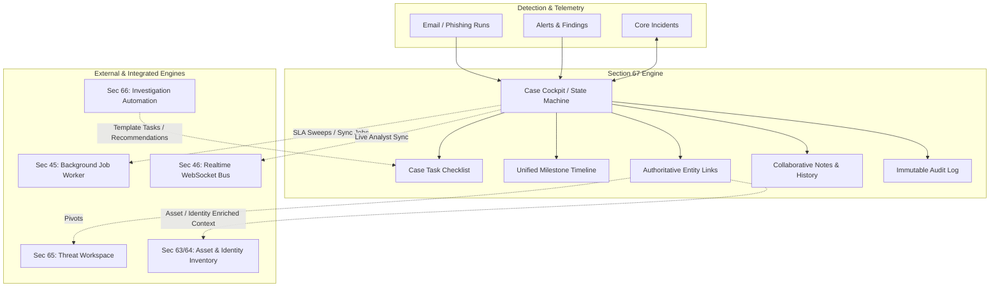
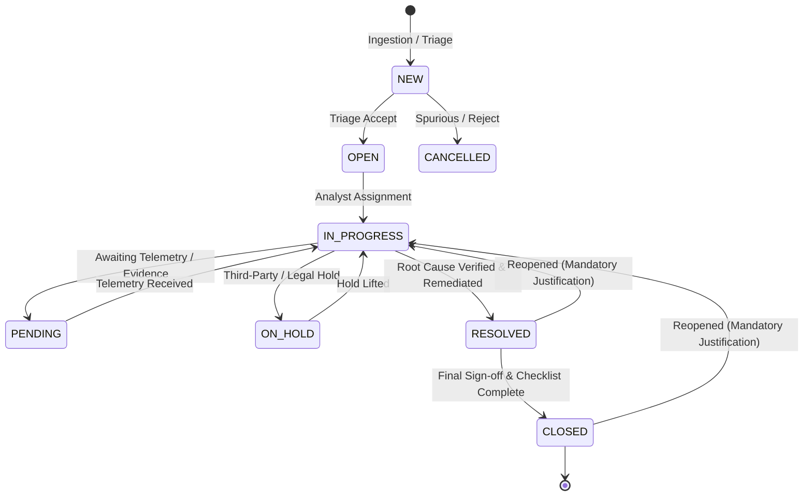

# SECTION 67 — CASE MANAGEMENT & OPERATIONAL COLLABORATION

## 1. Executive Summary & Architecture Overview

The **Case Management & Operational Collaboration** subsystem (Section 67) provides CyberGuard with an analyst-centric operational cockpit designed for tracking, investigating, resolving, and collaborating on security incidents, phishing campaigns, insider threats, and digital impersonation events.

Rather than duplicating CyberGuard's underlying engines, Section 67 **unifies existing capabilities** into an operational workflow engine:
- Connects directly to **Incidents** (Section 50/51) as the operational wrapper for SOC analysts.
- Coordinates with **Investigation Automation** (Section 66) to auto-generate investigative checklists and task recommendations.
- Integrates with **Threat Actor & Campaign Workspaces** (Section 65) for attribution pivots and threat actor associations.
- Preserves **Evidence Ledger** integrity (Section 12) with cryptographic SHA-256 verifications.
- Enforces strict **SLA Tracking, Escalation Rules, Optimistic Concurrency Control**, and **Immutable Audit Trails**.

---

## 2. Core Entities & State Machine

### 2.1 Case vs Incident vs Threat Workspace Distinction

| Layer | Responsibility | Primary Key / Id Scheme |
|---|---|---|
| **Incident (Sec 50)** | Technical security incident object grouping alerts and detection events | `incident_id` (`INC-2026-XXXX`) |
| **Operational Case (Sec 67)** | SOC analyst investigation workspace, workflow state machine, checklists, handoffs, SLA tracking, and resolution sign-offs | `case_number` (`CASE-2026-XXXX`) / `id` (UUID) |
| **Threat Workspace (Sec 65)** | Strategic threat actor dossiers, campaigns, hypotheses, and attribution assessments | `actor_id` (`TA-XXX`) / `campaign_id` (`CAMP-XXX`) |

### 2.2 Controlled Case State Machine

### 2.3 SLA Targets by Case Priority

| Priority | First Response SLA | Investigation SLA | Remediation SLA | Escalation Triggers |
|---|---|---|---|---|
| **P1_CRITICAL** | 15 minutes | 1 hour | 4 hours | Auto-page On-Call Lead at 75% SLA threshold |
| **P2_HIGH** | 30 minutes | 4 hours | 12 hours | Escalate to SOC Tier 2 Lead |
| **P3_MEDIUM** | 2 hours | 24 hours | 72 hours | Notify Assignee via notification queue |
| **P4_LOW** | 8 hours | 72 hours | 168 hours | Daily queue sweep |

---

## 3. Case Task Management & Automation Coupling

### 3.1 Task Lifecycle
Operational tasks represent action items, playbook procedures, and investigative queries assigned to analysts or automated runners.
- **Statuses**: `PENDING`, `IN_PROGRESS`, `BLOCKED`, `COMPLETED`, `CANCELLED`
- **Priorities**: `CRITICAL`, `HIGH`, `MEDIUM`, `LOW`
- **Automation Link**: Optional `investigation_plan_id` or `automation_run_id` links tasks directly to automated investigation plans executed via Section 66.

### 3.2 Automated Task Recommendations
Analysts can request automated task recommendations from CyberGuard. The system analyzes case context (category, severity, indicators, affected assets, and detected techniques) to generate:
- Evidence collection checklists (e.g. host memory triage, firewall log correlation).
- Containment verification tasks (e.g. OAuth token revocation, account disablement).
- Remediation retrospectives and threat hunting queries.

---

## 4. Multi-Entity Linking & Unified Timeline

### 4.1 Linked Entity Categories
Cases maintain authoritative JSON arrays of linked references without creating duplicate entity tables:
- **Alerts** (`related_alerts`): Detection alerts linked to the case.
- **Assets** (`affected_assets`): Critical infrastructure, endpoints, servers, databases.
- **Identities** (`affected_identities`): Compromised VIP accounts, service principals, emails.
- **Threat Actors & Campaigns** (`threat_actor_ids`, `campaign_ids`): Strategic attribution references.
- **Evidence Artifacts** (`evidence_ids`): Cryptographically hashed files, PCAPs, raw RFC822 messages.

### 4.2 Unified Milestone Timeline
The Case Timeline merges chronological events from 6 distinct operational streams:
1. **Case State Milestones**: Creation, status shifts, priority escalations, ownership handoffs.
2. **Task Progress**: Task assignment, blocking conditions, completions.
3. **Evidence Ingestion**: Linked emails, file hash acquisitions, forensic captures.
4. **Forensic Findings**: Lookalike domain verifications, credential harvesting discoveries.
5. **Collaborative Notes**: Analyst observations, hypotheses, peer comments.
6. **Immutable Audit Entries**: Optimistic lock touches, manual edits, permission checks.

---

## 5. Safe Case Merging & Provenance Preservation

When duplicate incidents are detected (e.g., mass phishing attacks reported by multiple employees):
1. **Destination Case Selected**: Primary active case retains authority.
2. **Source Case Closed**: Source cases transition to `CLOSED` with resolution code `DUPLICATE`.
3. **Artifact Forwarding**: Emails, findings, indicators, tasks, assets, identities, and evidence references are merged into the destination case.
4. **Non-Destructive Lineage**: `merged_into_case_id` is recorded on source cases; source case references are preserved in `provenance_history_json` on the target case.
5. **No Evidence Destruction**: Original audit histories and evidence hashes remain fully intact.

---

## 6. Concurrency Control & Collaborative Editing

### 6.1 Optimistic Concurrency Control (OCC)
- Every case maintains an integer `version` field.
- Critical updates (status changes, priority changes, mergers) submit the `expected_version`.
- If another analyst modified the case concurrently, the API returns `409 Conflict`, prompting the UI to refresh without overwriting operational data.

### 6.2 Collaborative Note Versioning
- Case notes support editing without destroying prior drafts.
- When an analyst edits a note, a revision object `{ old_text, new_text, edited_at, edited_by }` is appended to `edit_history_json`.
- The UI exposes previous versions for total investigative transparency and legal defensibility.

---

## 7. Background Jobs & Realtime Collaboration

### 7.1 Background Job Handlers (`handle_case_management_jobs`)
- **`CASE_SLA_SWEEP`**: Recurring sweep checking all open cases for SLA warning (>75% elapsed) or breach (>100% elapsed) conditions, updating `sla_status` and triggering escalation events.
- **`CASE_AUTO_ESCALATION`**: Automatic escalation of breached P1/P2 cases to on-call duty managers.
- **`CASE_CLOSURE_CLEANUP`**: Periodic sweep ensuring all open tasks on resolved/closed cases are properly archived.

### 7.2 Realtime WebSockets (`publish_realtime_event`)
- Realtime events are published on scope `CASE` for instant multi-analyst UI updates:
  - `CASE_CREATED`, `CASE_UPDATED`, `CASE_STATUS_CHANGED`, `CASE_ASSIGNED`
  - `CASE_TASK_CREATED`, `CASE_TASK_UPDATED`, `CASE_MERGED`, `CASE_RESOLVED`, `CASE_CLOSED`, `CASE_REOPENED`

---

## 8. Security & Multi-Tenant Isolation

### 8.1 Role-Based Access Control (RBAC)
- **`admin` / `lead_analyst`**: Full administrative authority (create, update, assign, resolve, close, reopen, merge, delete tasks).
- **`soc_analyst` / `analyst`**: Full investigative authority (create cases, update tasks, add notes, link entities, resolve cases).
- **`auditor` / `viewer` / `read_only`**: Strictly read-only access (GET endpoints). Mutation attempts return `403 Forbidden`.

### 8.2 Tenant Isolation
- All case queries, task updates, timeline assemblies, and merges enforce strict `tenant_id` filtering.
- Attempting to inspect or merge cases across tenant boundaries returns `404 Not Found` or `400 Bad Request`.

---

## 9. Verification & Acceptance Matrix

| Capability | Specification | Verification Test | Status |
|---|---|---|---|
| **Case Creation & Numbering** | `CASE-YYYY-NNNN` sequence with auto-calculated SLAs | `test_case_creation_and_numbering` | Verified |
| **State Machine** | Strict valid transitions; invalid transitions rejected | `test_case_state_machine_transitions` | Verified |
| **Resolution & Closure** | Mandatory resolution code and summary; open task checks | `test_case_resolution_and_closure` | Verified |
| **Reopening Workflow** | Mandatory justification; transitions to `IN_PROGRESS` | `test_case_reopening_with_justification` | Verified |
| **Task Lifecycle & Recommendations** | CRUD tasks + dynamic automated recommendations | `test_case_task_lifecycle_and_gap_recommendations` | Verified |
| **Multi-Entity Linking & Timeline** | Assets, identities, alerts + unified multi-stream timeline | `test_case_multi_entity_linking_and_timeline` | Verified |
| **Safe Case Merging** | Provenance preservation; duplicate closure; non-destructive | `test_case_safe_case_merging_preserves_provenance` | Verified |
| **Optimistic Concurrency** | Version increment on mutate; 409 Conflict on stale version | `test_case_optimistic_concurrency_control` | Verified |
| **Collaborative Note History** | Revision history tracked on note edits | `test_case_note_editing_with_audit_history` | Verified |
| **RBAC & Tenant Isolation** | Role checks and multi-tenant isolation enforced | `test_case_rbac_and_tenant_isolation` | Verified |
| **Background Job Worker** | `CASE_SLA_SWEEP` processes and flags breaches | `test_background_job_case_operations` | Verified |
| **Frontend Production Build** | TypeScript and Vite production bundle compiles cleanly | `npm run build` | Verified |
