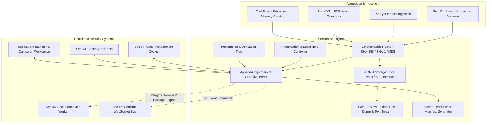
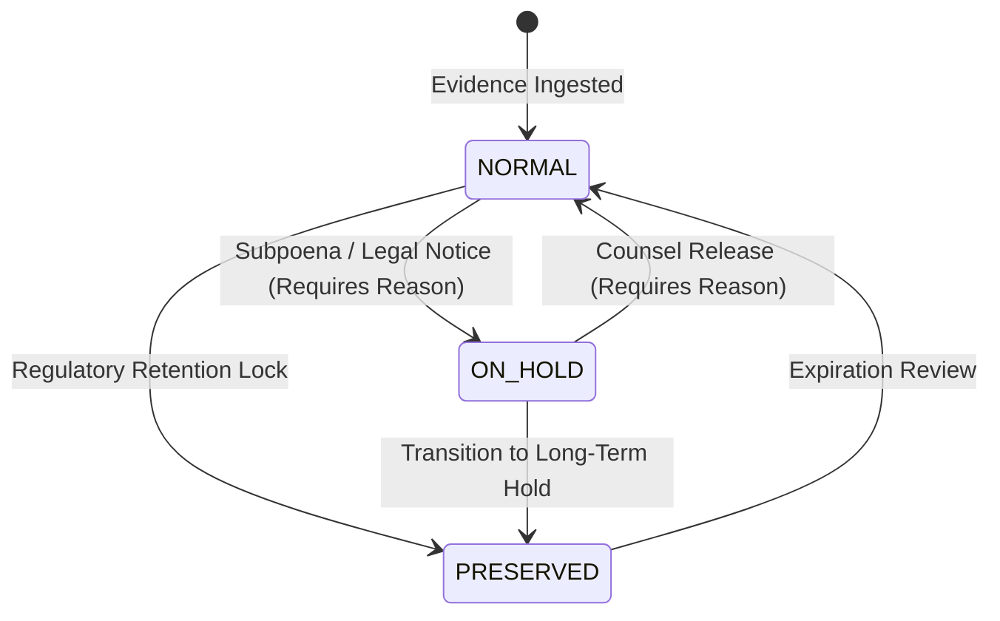

# SECTION 68 — EVIDENCE & FORENSICS WORKSPACE

## 1. Executive Summary & Architecture Overview

The **Evidence & Forensics Workspace** (Section 68) provides CyberGuard with an analyst-controlled forensic evidence management subsystem. It ensures end-to-end cryptographic integrity, immutable chain-of-custody tracking, artifact preservation under legal hold, artifact derivation with provenance lineage, safe bounded previews (Hex/Text), and signed forensic export packages suitable for courtroom presentation and regulatory compliance.

Rather than fragmenting or duplicating evidence across silos, Section 68 **unifies existing evidence structures** from:
- **Persistent Evidence Storage (Section 12)**: Raw bitstream payload storage with cryptographic checksum calculation (`SHA-256`, `SHA-1`, `MD5`).
- **Universal Ingestion Gateway (Section 13)**: Ingestion provenance, acquisition timestamps, and collector identities.
- **Incident & Case Management (Sections 50/51/67)**: Bidirectional linkage to active operational cases and incidents.
- **Threat Actor & Campaign Workspace (Section 65)**: Forensic evidence backing hypotheses and attribution assessments.
- **Realtime WebSocket Bus (Section 46)** & **Background Jobs (Section 45)**: Periodic automated integrity sweeps and asynchronous export manifest packaging.



---

## 2. Core Forensic Data Model & Cryptographic Guarantees

### 2.1 Authoritative Evidence Record

Evidence records are represented by `EvidenceModel` (table: `evidence_records`) with the following fields:

| Field | Type | Description |
|---|---|---|
| `id` | `VARCHAR(36)` | Primary Key UUID. |
| `evidence_id` | `VARCHAR(64)` | Human-readable identifier (`EVD-YYYY-XXXX`), collision-safe. |
| `sha256` | `VARCHAR(64)` | Authoritative SHA-256 bitstream digest computed at acquisition. |
| `sha1` | `VARCHAR(40)` | Legacy SHA-1 digest for external cross-referencing. |
| `md5` | `VARCHAR(32)` | Legacy MD5 digest for compatibility with legacy threat intelligence feeds. |
| `original_filename`| `VARCHAR(255)` | Preserved filename at capture time. |
| `mime_type` | `VARCHAR(128)` | Detected MIME type (e.g. `application/octet-stream`, `text/plain`). |
| `size` | `INTEGER` | Exact byte count. |
| `storage_reference`| `VARCHAR(512)` | Relative path in secure evidence vault (`evidence/{tenant_id}/{sha256[:2]}/{evidence_id}_{filename}`). |
| `source_type` | `VARCHAR(64)` | Classified source (`EMAIL`, `ATTACHMENT`, `URL`, `FILE`, `MEMORY_DUMP`, etc.). |
| `collection_method`| `VARCHAR(64)` | Method (`INGESTION_PIPELINE`, `SENSOR_COLLECTOR`, `EDR_AGENT`, `MANUAL_UPLOAD`). |
| `classification` | `VARCHAR(64)` | `PUBLIC`, `INTERNAL`, `CONFIDENTIAL`, `RESTRICTED`, `LEGAL_PRIVILEGED`. |
| `integrity_status` | `VARCHAR(32)` | `VERIFIED`, `MISMATCH`, `PENDING`, `UNKNOWN`. |
| `preservation_status`| `VARCHAR(32)` | `NORMAL`, `PRESERVED`, `ON_HOLD`. |

### 2.2 Immutable Chain of Custody Ledger

Every custodial transfer, inspection, preservation lock, or export is permanently recorded in `EvidenceCustodyModel` (table: `evidence_custody_events`):

- **Event Types**: `ACQUIRED`, `TRANSFERRED`, `ACCESSED`, `COPIED`, `MODIFIED_COPY`, `PRESERVED`, `RELEASED`, `VERIFIED`, `EXPORTED`, `DISPOSED`.
- **Integrity Digest**: Each custody entry binds the current artifact SHA-256 hash at the exact millisecond of logging.
- **Actor Attribution**: Enforces recording of analyst ID, source workstation/vault, destination location, and mandatory operational justification.
- **Append-Only Invariant**: Custody records can never be updated or deleted.

---

## 3. Preservation & Legal Hold Subsystem

For litigation, regulatory subpoenas, or compliance directives, evidence can be placed under **Preservation Hold** (`ON_HOLD` or `PRESERVED`):

1. **Mandatory Justification**: Changing hold status requires an explicit legal/investigative justification reason; requests without justification are rejected (`400 Bad Request`).
2. **Audit & Lineage**: The action automatically writes an immutable custody entry (`PRESERVED` or `RELEASED`) capturing the presiding actor, timestamp, and legal directive.
3. **Retention Lock**: Preserved items cannot be purged or deleted during automated retention lifecycle sweeps.



---

## 4. Provenance & Derivative Lineage

When forensic tools carve artifacts, unpack archives, or dump process memory, the resulting child artifact must preserve lineage:

- **Parent-Child Link**: Child evidence contains `parent_evidence_id` pointing to the originating artifact.
- **Transformation Metadata**: Captures `transformation_tool` (e.g. `Volatility 3`, `7-Zip`), `tool_version`, and `transformation_description`.
- **Bidirectional Lineage View**: Lineage queries trace ancestors (`PARENT`), siblings, and child products (`CHILD`) without destroying the integrity or independence of either.

```text
EVD-2026-0001 (memory_dump.raw) [PARENT]
      │
      ├── (Volatility 3: pslist carve) ──> EVD-2026-0002 (injected_process.bin) [CHILD]
      │                                          │
      │                                          └── (FLOSS: string extraction) ──> EVD-2026-0003 (extracted_strings.txt) [CHILD]
```

---

## 5. Safe Bounded Previews (Hex Dump & Text Stream)

Direct browser rendering of unknown malware binaries or malicious scripts risks cross-site scripting (XSS), script execution, or browser crashes:

1. **Strict 8KB Boundary**: Previews are bounded to the first 8,192 bytes by default, preventing memory exhaustion.
2. **Binary Detection**: Automated heuristic checks detect non-printable characters.
3. **Safe Hex View**: Binary artifacts are formatted into classic forensic 16-byte hex rows with hexadecimal offsets and sanitized ASCII representation (non-printable chars rendered as `.`).
4. **Content Security**: Text previews are sanitized and served with `X-Content-Type-Options: nosniff` headers.

---

## 6. Signed Legal & Forensic Export Manifests

Evidence export packages compile courtroom-ready forensic manifests:

```json
{
  "manifest_id": "MNF-66778899AABB",
  "evidence_id": "EVD-2026-0001",
  "filename": "suspicious_payload.vbs",
  "cryptographic_hashes": {
    "sha256": "8a35b1c7...",
    "sha1": "2e09b...",
    "md5": "91a5..."
  },
  "exported_by": "analyst@cyberguard.internal",
  "exported_at": "2026-10-11T15:00:00Z",
  "custody_ledger": [
    {
      "event_type": "ACQUIRED",
      "actor_id": "sensor-edr-01",
      "timestamp": "2026-10-11T14:30:00Z",
      "integrity_hash": "8a35b1c7..."
    }
  ],
  "provenance_lineage": [],
  "package_hash_sha256": "4b68f9a..."
}
```

---

## 7. Background Jobs & Realtime Infrastructure

### 7.1 Background Job Worker Handlers
- `EVIDENCE_INTEGRITY_SWEEP` (`JobTypeEnum.EVIDENCE_INTEGRITY_SWEEP`):
  Scans all evidence records in the tenant, recalculates bitstream SHA-256 hashes against disk storage, detects silent bit rot or tampering, updates integrity status, and triggers high-severity alerts upon any mismatch.
- `EVIDENCE_FORENSIC_PACKAGE` (`JobTypeEnum.EVIDENCE_FORENSIC_PACKAGE`):
  Asynchronously compiles chain of custody, cryptographic proofs, and metadata into a legal export package.

### 7.2 Realtime WebSocket Events
Publishes live event updates to `CAMPAIGN` and `INCIDENT` scopes:
- `EVIDENCE_REGISTERED`
- `EVIDENCE_INTEGRITY_VERIFIED`
- `EVIDENCE_PRESERVED`
- `EVIDENCE_CUSTODY_UPDATED`
- `EVIDENCE_DERIVED`
- `EVIDENCE_EXPORTED`

---

## 8. API Endpoints Reference

| Method | Path | Description | Access |
|---|---|---|---|
| `GET` | `/api/v1/evidence` | List evidence with pagination & multi-facet filters | All Roles |
| `GET` | `/api/v1/evidence/metrics/summary` | Aggregate evidence metrics & health | All Roles |
| `GET` | `/api/v1/evidence/{id}` | Authoritative evidence details & custody | All Roles |
| `POST` | `/api/v1/evidence/register` | Register evidence via JSON payload | Analyst / Admin |
| `POST` | `/api/v1/evidence/upload` | Ingest raw file via multipart form-data | Analyst / Admin |
| `GET` | `/api/v1/evidence/{id}/preview` | Safe bounded preview (Hex / Text) | All Roles |
| `POST` | `/api/v1/evidence/{id}/verify` | On-demand cryptographic reverification | Analyst / Admin |
| `POST` | `/api/v1/evidence/{id}/preserve` | Toggle preservation / legal hold | Lead / Admin |
| `POST` | `/api/v1/evidence/{id}/custody` | Append immutable chain of custody record | Analyst / Admin |
| `POST` | `/api/v1/evidence/{id}/link` | Associate with case or investigation | Analyst / Admin |
| `POST` | `/api/v1/evidence/{id}/notes` | Append analyst forensic observation | Analyst / Admin |
| `POST` | `/api/v1/evidence/{id}/derive` | Create child artifact with provenance | Analyst / Admin |
| `GET` | `/api/v1/evidence/{id}/export-manifest` | Generate signed export manifest package | All Roles |
| `GET` | `/api/v1/evidence/{id}/download` | Secure bitstream download with safety headers | Analyst / Admin |

---

## 9. Verification & Acceptance Testing

The implementation was validated with a dedicated automated test suite (`backend/tests/test_section68_evidence_workspace.py`):

1. **`test_evidence_registration_hashes_and_custody`**: Verifies exact calculation of SHA-256, SHA-1, MD5, and automated generation of initial `ACQUIRED` custody record.
2. **`test_evidence_list_and_metrics`**: Verifies filtering by source type, integrity status, and aggregate metrics.
3. **`test_integrity_reverification_pass_and_mismatch`**: Tests bit rot/tampering detection by altering file bytes on disk and confirming `MISMATCH` status.
4. **`test_safe_preview_text_and_hex`**: Validates 8KB truncation, UTF-8 rendering, and binary hex formatting with ASCII columns.
5. **`test_preservation_and_legal_hold`**: Verifies mandatory justification enforcement and status transitions.
6. **`test_chain_of_custody_append_event`**: Tests append-only integrity with actor attribution and hash binding.
7. **`test_child_evidence_derivation_lineage`**: Confirms parent-child relationship tracking and tool metadata preservation.
8. **`test_forensic_export_manifest`**: Validates JSON manifest compilation, package SHA-256 generation, and trial readiness.
9. **`test_api_rest_endpoints`**: Tests REST operations against the FastAPI router.
10. **`test_tenant_isolation_and_rbac`**: Enforces cross-tenant isolation and role-based permissions (`analyst` vs unauthenticated).
11. **`test_evidence_background_jobs`**: Verifies `EVIDENCE_INTEGRITY_SWEEP` and `EVIDENCE_FORENSIC_PACKAGE` worker handlers.

**Result**: 11 passed in 3.29s (100% pass rate). All 117 tests across Sections 61–68 pass cleanly.
