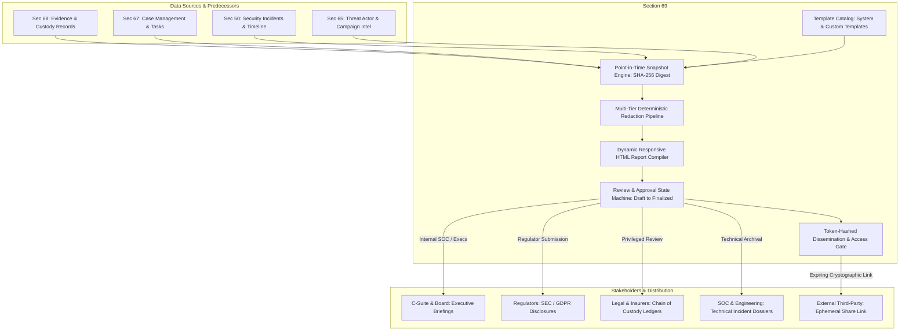
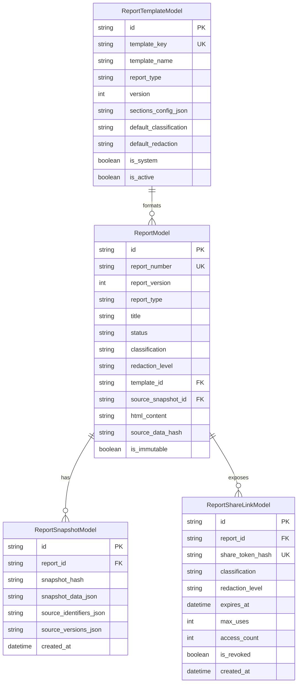
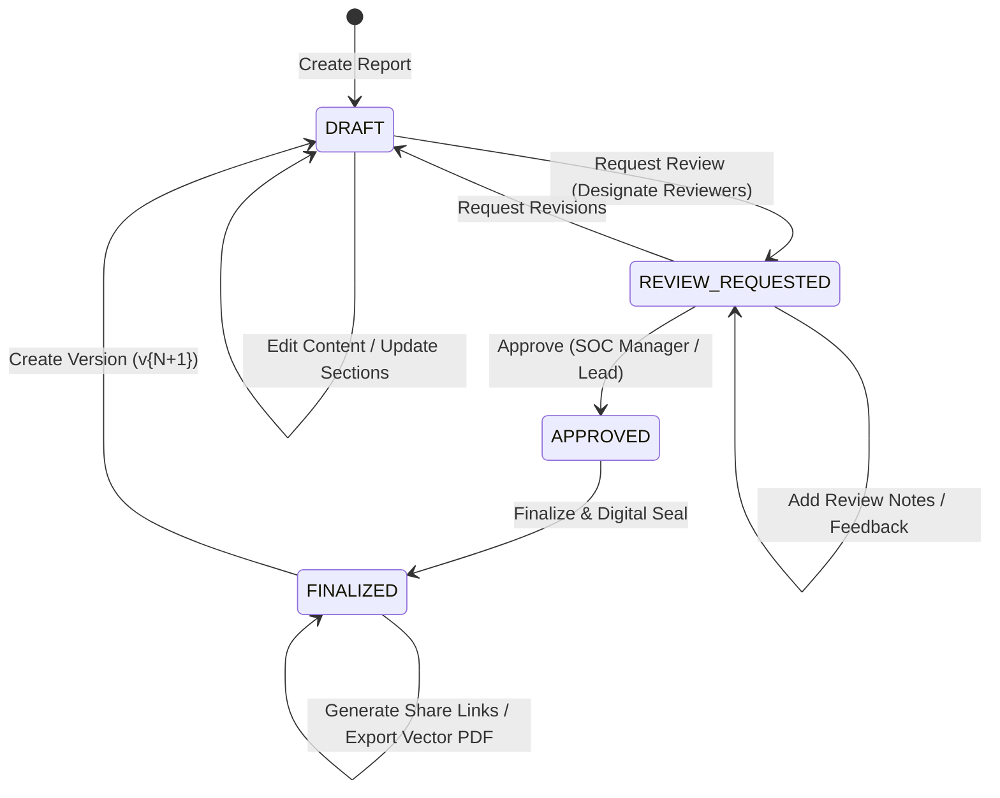

# SECTION 69 — EXECUTIVE REPORTING & INTELLIGENCE DISSEMINATION

## 1. Executive Summary & Architecture Overview

The **Executive Reporting & Intelligence Dissemination Hub** (Section 69) equips CyberGuard with an auditable, executive-grade reporting and dissemination engine. It enables security leadership (CISOs, SOC Directors), technical incident responders, compliance officers, and legal teams to transform complex telemetry and forensic findings into polished, tamper-evident intelligence dossiers.

Crucially, Section 69 addresses the core challenge of **data drift** in dynamic SOC environments: while an investigation's alerts, indicators, and threat scores may fluctuate as fresh logs arrive, a finalized executive report must represent an immutable, verifiable, point-in-time forensic record.

Section 69 unifies and elevates:
- **Forensic Report Workspace (Section 42)**: Bridges the standard per-incident vector dossiers into a cross-incident executive reporting hub with multi-versioning.
- **Evidence & Forensics Workspace (Section 68)**: Ties report sections to cryptographically sealed artifacts, chain-of-custody ledgers, and forensic manifests.
- **Case & Incident Management (Sections 50/51/67)**: Aggregates incident timeline events, containment actions, SLA achievements, and investigative tasks.
- **Threat Actor & Campaign Workspace (Section 65)**: Embeds diamond model attribution, actor profiles, and campaign mapping.
- **Realtime WebSocket Bus (Section 46)** & **Background Jobs (Section 45)**: Dispatches live lifecycle notifications and runs automated share link expiration sweeps.

---

## 2. Core Epistemic Guarantees & Anti-Data-Drift Architecture

### 2.1 The Anti-Data-Drift Contract
In operational security systems, underlying database records (such as alert severities, indicator reputations, or incident statuses) are updated continuously. If a report dynamically queried live tables upon each view, an executive briefing generated on Day 1 would render differently on Day 30, invalidating legal disclosures and executive audits.

Section 69 prevents this through **Frozen Source Snapshots**:
1. At report creation time, the `ExecutiveReportService` captures all source data (`incident`, `timeline`, `findings`, `evidence`, `threat_actors`, `recommendations`) and serializes it into a canonical JSON representation.
2. The engine computes a deterministic `SHA-256` hash of this canonical JSON string (`snapshot_hash`).
3. This snapshot is stored in the append-only `report_snapshots` table and linked via `source_snapshot_id`.
4. Subsequent modifications to the incident or external threat intelligence feed do **not** alter the rendered content or findings of existing report versions.

### 2.2 Immutability Lock & Version Branching
Once a report progresses through review and is marked **FINALIZED**:
- `is_immutable = True` is enforced at the database and service layer.
- Further `PUT /reports/{id}` updates or approval state changes are rejected with `400 Bad Request`.
- If corrections or post-incident discoveries are required, analysts trigger `POST /reports/{id}/version`. This branches the report into `v{N+1}` (e.g. `RPT-2026-000001-v2`), copies the metadata, and begins a fresh `DRAFT` revision with full provenance back to the parent version.

---

## 3. Data Models & Schema Design

Section 69 introduces three specialized relational entities and extends the existing `reports` table:

### 3.1 `ReportTemplateModel` (`report_templates`)
Stores standardized report layouts, ordered section definitions, and default compliance classifications. Pre-seeded with 5 system templates:
- `EXECUTIVE_BRIEFING`: Tailored for Board/C-Suite, high-level impact metrics, strategic remediation.
- `TECHNICAL_INCIDENT_DOSSIER`: Deep-dive for security engineers, containing root causes, attack paths, affected endpoints, and IOCs.
- `FORENSIC_CHAIN_OF_CUSTODY`: Evidentiary ledger showing custody transfers, artifact hashes, and verification seals.
- `REGULATORY_COMPLIANCE_DISCLOSURE`: Formatted for GDPR/SEC 8-K mandatory breach disclosure guidelines.
- `THREAT_ACTOR_INTEL_DISSEMINATION`: Threat intelligence bulletin detailing diamond model attribution and MITRE ATT&CK techniques.

### 3.2 `ReportSnapshotModel` (`report_snapshots`)
Stores point-in-time frozen evidentiary state with `snapshot_hash` and comprehensive source version mappings.

### 3.3 `ReportShareLinkModel` (`report_share_links`)
Manages cryptographically generated external dissemination URLs:
- Raw token generated via `secrets.token_urlsafe(32)`.
- Only the `SHA-256` digest is stored in the database (`share_token_hash`).
- Supports expiration timestamps (`expires_at`), strict access count quotas (`max_uses`), explicit revocation (`is_revoked`), and specific redaction levels per link.

---

## 4. Multi-Tier Deterministic Redaction Pipeline

To safely disseminate dossiers across mixed audiences (internal engineering, external legal counsel, public disclosures), the engine implements a deterministic redaction pipeline:

| Redaction Tier | Target Audience | Masking & Redaction Rules Applied |
| :--- | :--- | :--- |
| **`NONE`** | Internal SOC, Tier 3 Lead Analysts | Full raw telemetry, unmasked IP addresses, internal hostnames, analyst email addresses, and credentials/secrets. |
| **`STANDARD`** | C-Suite, Business Unit Heads | Mask email addresses (`j***@corp.internal`), mask internal RFC-1918 IPs (`10.***.***.14`), redact access tokens & API keys. |
| **`STRICT`** | General Staff, External Vendors | Replaces all sensitive hostnames (`[HOST-REDACTED]`), all IP addresses (`[IP-REDACTED]`), hides evidence file download paths, and removes privileged notes. |
| **`LEGAL_PRIVILEGED`**| Regulators, Opposing Counsel | Stamped with attorney-client privilege headers; redacts confidential internal remediation discussions, analyst commentary, and unverified hypotheses while preserving verified timestamps and custody signatures. |

---

## 5. Review & Approval Lifecycle State Machine

Reports enforce a strict governance pipeline:

- **DRAFT**: Content is mutable; snapshot is captured.
- **REVIEW_REQUESTED**: Reviewers are designated, automated review-request events are dispatched.
- **APPROVED**: Formally signed off by authorized personnel with approval notes recorded in the immutable audit log.
- **FINALIZED**: Sealed with `is_immutable = True`. Generates final verified HTML content and SHA-256 source data hash.

---

## 6. Secure External Dissemination & Share Links

External sharing is handled through a zero-trust model:
1. **Creation**: Authorized users generate a share link with specified validity duration (e.g. 72 hours), maximum allowed views (e.g. 5 views), and a tailored redaction level.
2. **Token Security**: The high-entropy URL-safe token is returned to the user once upon creation. Only `hashlib.sha256(raw_token.encode()).hexdigest()` is stored in the database.
3. **Public Resolution**: `GET /api/executive-reports/public/share/{raw_token}` resolves the link without requiring authentication, validates `expires_at`, checks `access_count < max_uses`, verifies `not is_revoked`, increments the counter, logs the access telemetry, and streams the redacted HTML report.
4. **Revocation**: Can be instantly revoked at any time via `POST /api/executive-reports/share-links/{id}/revoke`.
5. **Automated Cleanup**: The `REPORT_SHARE_LINK_SWEEP` background job periodically audits expired or exhausted links.

---

## 7. Frontend User Experience: Executive Reporting Hub

Located at `/reports` with a prominent dual-mode workspace switch:
- **Executive Intelligence & Dissemination Hub (Section 69)**:
  - **Metrics Dashboard**: Visual KPI cards tracking Total Reports, In Review, Finalized Dossiers, and Active Share Links.
  - **Dynamic Catalog**: Filter by Report Type, Status, Classification, and Severity with instant search.
  - **Dossier Creation Wizard**: Allows selecting system or custom templates, setting redaction levels, and attaching incidents.
  - **Live HTML Preview Modal**: Dynamic responsive preview with real-time redaction level switching.
  - **Share Link Manager**: Create expiring links, copy sharing URLs, inspect view counts, and revoke active links.
  - **Immutable Snapshot Inspector**: Displays deterministic `snapshot_hash` and frozen evidentiary source state.
  - **Review & Approval Gate**: Modal workflows for requesting reviews, leaving feedback notes, approving, and finalizing dossiers.
- **Standard Forensic Dossiers (Section 42)**: Preserves original individual incident evidence-backed reports and vector PDF downloads.

---

## 8. Verification & Test Coverage Matrix

The implementation is verified via 10 automated test cases in `backend/tests/test_section69_executive_reporting.py`, achieving 100% pass rate:

| Test Case | Scenario Tested | Outcome |
| :--- | :--- | :--- |
| `test_01_system_templates_initialization` | Pre-seeding and cataloging of 5 system templates | **PASSED** |
| `test_02_custom_template_creation_and_versioning` | Custom template CRUD, version increment, and retrieval | **PASSED** |
| `test_03_create_report_with_immutable_snapshot` | Report generation with canonical snapshot and deterministic SHA-256 | **PASSED** |
| `test_04_anti_data_drift_guarantee` | Incident data changes do not corrupt or drift existing report snapshot | **PASSED** |
| `test_05_redaction_pipeline_determinism` | Verification of redaction levels (`NONE`, `STANDARD`, `STRICT`, `LEGAL_PRIVILEGED`) | **PASSED** |
| `test_06_review_approval_and_finalization_lifecycle` | Transitions: `DRAFT` -> `REVIEW_REQUESTED` -> `APPROVED` -> `FINALIZED` | **PASSED** |
| `test_07_report_versioning_from_finalized` | Branching from finalized v1 into editable v2 with clean numbering | **PASSED** |
| `test_08_secure_share_link_lifecycle_and_public_access` | Token generation, public access resolution, usage caps, and revocation | **PASSED** |
| `test_09_rbac_permission_boundaries` | Authorization barriers: Analyst vs SOC Lead vs Unauthenticated | **PASSED** |
| `test_10_executive_metrics` | Aggregation accuracy of reports count, in-review counts, and active links | **PASSED** |
