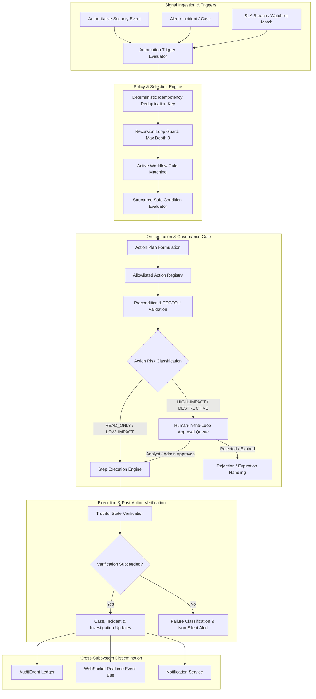
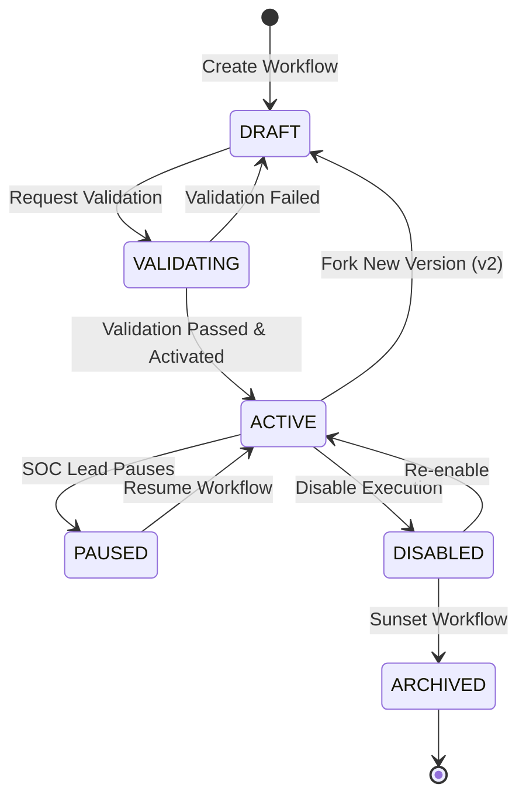

# SECTION 70 — SECURITY OPERATIONS AUTOMATION (SOAR) & WORKFLOW ORCHESTRATION

## 1. Executive Summary & Architecture Overview

The **Security Operations Automation (SOAR) layer** (Section 70) coordinates CyberGuard's distributed capabilities—threat detection, alert triage, incident response, investigation automation, case management, digital forensics, and executive reporting—into controlled, verifiable, auditable workflows.

The objective is to move CyberGuard from manual triage cycles:
$$\text{Detect} \longrightarrow \text{Alert} \longrightarrow \text{Investigate} \longrightarrow \text{Respond}$$
toward a closed-loop, verifiable SOC automation pipeline:
$$\text{Detect} \longrightarrow \text{Alert} \longrightarrow \text{Triage} \longrightarrow \text{Investigate} \longrightarrow \text{Decision} \longrightarrow \text{Approved Automation} \longrightarrow \text{Response} \longrightarrow \text{Verification} \longrightarrow \text{Case/Incident Update} \longrightarrow \text{Report} \longrightarrow \text{Closure}$$

Crucially, Section 70 enforces the **Absolute Non-Duplication Rule**: it orchestrates existing systems rather than recreating them. Consequential actions (such as endpoint isolation, credential revocation, or firewall modification) enforce human authorization boundaries, strict TOCTOU checks, and post-action verification.

---

## 2. Workflow Model

Workflows are modeled via `AutomationWorkflowModel`, backed by versioned snapshots in `AutomationWorkflowVersionModel`.

### Core Fields
- `id`: Unique UUIDv4 identifier.
- `tenant_id` / `workspace_id`: Tenant boundary for strict multi-tenant isolation.
- `name`: Workflow title (e.g., `Phishing High-Risk Triage & Containment`).
- `description`: Operational intent and playbook mapping.
- `workflow_type`: Categorized by domain (`ALERT_TRIAGE`, `INCIDENT_RESPONSE`, `PHISHING_INVESTIGATION`, `ACCOUNT_TAKEOVER`, `MALWARE_CONTAINMENT`, `SLA_ESCALATION`, `THREAT_HUNTING`).
- `status`: Lifecycle state (`DRAFT`, `VALIDATING`, `ACTIVE`, `PAUSED`, `DISABLED`, `ARCHIVED`).
- `version`: Monotonically incrementing integer.
- `trigger_type`: Authoritative event type (`ALERT_CREATED`, `INCIDENT_CREATED`, `SLA_BREACH`, etc.).
- `conditions`: Structured JSON conditions enforcing zero arbitrary code.
- `actions`: Sequential or branch-mapped steps invoking the Action Registry.
- `execution_limits`: Bounded resource constraints (`max_steps: 20`, `max_execution_time_seconds: 300`, `timeout_seconds: 120`, `max_retries: 3`).

---

## 3. Workflow Versioning & Lifecycle State Machine

Active workflows are strictly immutable. Any modification creates a new draft version or branches a new workflow entity.

- **DRAFT**: Editable definition. Cannot execute under any circumstances.
- **VALIDATING**: Automated validation verifies node connections, action existence, conditions syntax, and RBAC permissions.
- **ACTIVE**: Immutable version snapshot saved in `AutomationWorkflowVersionModel`. Only ACTIVE workflows can be triggered.
- **PAUSED / DISABLED**: Suspended from new triggers. Running instances may finish or pause.
- **ARCHIVED**: Read-only historical retention.

---

## 4. Trigger System

Triggers are derived strictly from authoritative backend models, not ephemeral client events.

### Supported Triggers
- `ALERT_CREATED`: Fired when an alert is ingested by Section 48.
- `ALERT_ESCALATED`: Fired upon severity escalation.
- `INCIDENT_CREATED`: Fired upon cluster correlation in Section 50.
- `INCIDENT_SEVERITY_CHANGED`: Fired when risk engine recomputes composite risk.
- `SLA_WARNING` & `SLA_BREACH`: Fired by Section 51 SLA monitoring sweep.
- `THREAT_INTELLIGENCE_CHANGED`: Fired when Section 52 updates indicator reputation.
- `WATCHLIST_MATCHED`: Fired when Section 53 detects an entity match.
- `DETECTION_RULE_MATCHED`: Fired by Section 56-59 detection pipeline.
- `BEHAVIORAL_ANOMALY_DETECTED`: Fired by Section 60 anomaly detector.
- `CASE_CREATED`: Fired by Section 67 case creation.
- `INVESTIGATION_COMPLETED`: Fired by Section 66 investigation completion.

---

## 5. Condition System & Absolute Code Safety

Arbitrary Python, JavaScript, SQL, or shell execution is strictly disallowed. Conditions are parsed into bounded AST-free expressions evaluating only trusted properties:

### Supported Operators
- `eq` ($==$): Equality check.
- `neq` ($\neq$): Inequality check.
- `gt` ($>$), `gte` ($\ge$): Numeric comparisons.
- `lt` ($<$), `lte` ($\le$): Numeric comparisons.
- `in`: Membership test against predefined lists.
- `contains`: String substring search or collection membership.

Conditions are bounded by tenant scope, validated server-side, and evaluated deterministically.

---

## 6. Action Registry

All executable capabilities are cataloged in `backend/services/automation_action_registry.py`. Workflows cannot execute arbitrary commands; they must invoke registered action handlers.

| Action Identifier | Risk Class | Approval Required | Subsystem Invoked | Verification Method |
| :--- | :--- | :--- | :--- | :--- |
| `CREATE_CASE` | `LOW_IMPACT` | Automatic | Section 67 (Cases) | Checks case existence in DB |
| `ADD_CASE_TASK` | `LOW_IMPACT` | Automatic | Section 67 (Tasks) | Checks task record in DB |
| `ADD_CASE_NOTE` | `READ_ONLY` | Automatic | Section 67 (Notes) | Checks note creation in DB |
| `UPDATE_ALERT_STATUS` | `LOW_IMPACT` | Automatic | Section 48 (Alerts) | Checks alert status in DB |
| `ESCALATE_INCIDENT` | `MODERATE_IMPACT` | Automatic | Section 50 (Incidents) | Checks incident severity in DB |
| `TRIGGER_INVESTIGATION_AUTOMATION` | `MODERATE_IMPACT` | Automatic | Section 66 (Investigations) | Checks automation run in DB |
| `ENRICH_INDICATOR` | `READ_ONLY` | Automatic | Section 52 (Threat Intel) | Validates enrichment payload |
| `GENERATE_EXECUTIVE_REPORT` | `LOW_IMPACT` | Automatic | Section 69 (Reporting) | Verifies report snapshot ID |
| `SEND_NOTIFICATION` | `READ_ONLY` | Automatic | Section 47 (Notifications) | Verifies notification delivery |
| `ISOLATE_ENDPOINT` | `HIGH_IMPACT` | `SENIOR_ANALYST_APPROVAL` | Section 40 (Endpoint Agent) | Re-queries endpoint agent status |
| `REVOKE_SESSION` | `HIGH_IMPACT` | `SENIOR_ANALYST_APPROVAL` | Section 18 (Auth / Identity) | Validates revocation marker |
| `START_APPROVED_PLAYBOOK` | `MODERATE_IMPACT` | Automatic | Section 29 (Playbooks) | Checks playbook execution record |

---

## 7. Action Risk Classification

1. `READ_ONLY`: Queries, intelligence enrichment, context collection.
2. `LOW_IMPACT`: Adding notes, creating cases, generating draft reports.
3. `MODERATE_IMPACT`: Reassigning analysts, starting investigation automation, escalating incidents.
4. `HIGH_IMPACT`: Isolating workstations, revoking credentials, blocking IP ranges.
5. `DESTRUCTIVE`: Purging data, deleting infrastructure (forbidden by default).

---

## 8. Human-in-the-Loop Approval Model

For all `HIGH_IMPACT` and `DESTRUCTIVE` actions, the automation engine creates an `ApprovalRequestModel` record and shifts the run state to `WAITING_FOR_APPROVAL`:

1. **State Preservation**: The workflow execution state is saved to the DB.
2. **Notification & WebSocket**: Realtime alerts are sent to Senior Analysts and Administrators.
3. **Role Validation**: Only authorized roles (`senior_analyst`, `admin`, `soc_lead`) can submit approvals.
4. **24-Hour Expiration**: Approvals not decided within 24 hours transition to `EXPIRED`. Stale approvals cannot be executed.
5. **Auditing**: Every approval or rejection records `approver_id`, `decision`, `reason`, and a SHA-256 fingerprint in the `AuditEvent` ledger.

---

## 9. Execution Engine & Modes

Workflows can be executed in 4 distinct operational modes:

1. `PRODUCTION`: Full authoritative execution, enforcing approvals and state mutations.
2. `DRY_RUN`: Evaluates triggers and conditions, formulates step plans, but skips state mutations.
3. `SIMULATION`: Synthetic testing mode clearly marked in execution records and UI badges.
4. `TEST`: User-initiated test run against a sandbox or staging resource.

---

## 10. Preconditions & TOCTOU Defense

Between planning and execution (especially during human approval delays), target resource states can change. The Action Registry executes:
- **Pre-execution validation**: Verifies target existence, tenant isolation, and current status.
- **TOCTOU check**: Ensures alert or incident has not already been resolved or closed.
- **Double-action guard**: Prevents duplicate executions (e.g. isolating an already isolated endpoint).

---

## 11. Truthful State Verification

CyberGuard never assumes provider acceptance equals operational success. Following action dispatch, the verification handler queries the actual target state:
$$\text{Provider Accepted Request} \neq \text{Action Verified}$$
If an endpoint isolation API responds with `200 OK`, but a subsequent query indicates the agent remains `ACTIVE`, the action step is classified as `FAILED` with failure category `RESOURCE_STATE_CONFLICT`.

---

## 12. Idempotency & Concurrency Control

- **Trigger Deduplication**: Deterministic idempotency key:
  $$\text{Key} = \text{SHA256}(\text{tenant\_id} + \text{workflow\_id} + \text{trigger\_type} + \text{resource\_id})$$
- **Duplicate Prevention**: If an active or completed run exists with the same key within a 5-minute window, redundant runs are discarded.
- **Worker Leases**: Concurrency locks ensure only one background worker executes a run at a given time.

---

## 13. Loop & Recursion Guards

To prevent recursive loops (e.g. Workflow updates Alert $\rightarrow$ Alert Updated triggers Workflow $\rightarrow \dots$):
- Runs track `execution_context["recursion_depth"]`.
- Workflows that exceed `max_recursion_depth = 3` are terminated with `FAILURE_RECURSION_LIMIT_EXCEEDED`.

---

## 14. Partial Success & Truthful Metrics

If Step 1 and Step 2 succeed, but Step 3 fails, the overall workflow status transitions to `PARTIALLY_COMPLETED`. It is never masked as `COMPLETED`.
All UI dashboards and metric aggregators compute rates directly from database records without fabricated percentages.

---

## 15. Cross-Subsystem Integrations

- **Alerts (Sec 48)**: Ingests alert events, enriches metadata, updates status upon triage completion.
- **Incidents (Sec 50/51)**: Escalates incidents, updates severity, monitors SLA breaches.
- **Cases (Sec 67)**: Creates cases, assigns owners, attaches notes and remediation tasks.
- **Investigations (Sec 66)**: Dispatches automated investigation playbooks and collects telemetry.
- **Evidence (Sec 68)**: References cryptographically hashed forensic evidence without duplication.
- **Response (Sec 29)**: Executes approved playbooks via the Response Recommendation Engine.
- **Reports (Sec 69)**: Dispatches executive report generation with tamper-evident snapshots.
- **Notifications (Sec 47)**: Emits high-priority alerts for approvals and critical failures.
- **Realtime (Sec 46)**: Publishes live WebSocket updates on `TOPIC_AUTOMATION`.
- **Background Jobs (Sec 45)**: Dispatches asynchronous workflow execution and approval sweeps.

---

## 16. Security & Tenant Isolation

- **Tenant Scoping**: Every workflow, version, run, and step explicitly checks `tenant_id` and `workspace_id`.
- **No Cross-Tenant Leaks**: A workflow in Tenant A cannot query or mutate resources in Tenant B.
- **Secrets Management**: Workflows never store credentials, tokens, or private keys; integrations rely on the centralized secrets vault.
- **Prompt Injection Defense**: Untrusted external telemetry (phishing emails, URLs) is never evaluated as workflow control logic.
- **LLM Safety Boundaries**: AI assistants may recommend playbooks or summarize execution traces, but cannot directly trigger privileged actions or approve high-impact gates.

---

## 17. Frontend Architecture

The frontend is located at `src/components/automation/AutomationWorkspace.tsx` and routed via `/automation`:
- **KPI Metrics Ribbon**: Displays authoritative counts for Active Workflows, Total Runs, Success Rate, and Pending Approvals.
- **Workflows Catalog**: Interactive table with status badges, version indicators, trigger badges, and pause/activate toggles.
- **Execution Runs Ledger**: Realtime run history with status pills, execution modes (`PRODUCTION`, `DRY_RUN`), and duration.
- **Human Approval Queue**: Actionable approval cards displaying target resource, risk classification, requester, and Approve/Reject controls.
- **Execution Trace Modal**: Visual step-by-step inspector displaying individual action states, verification results, and raw payloads.
- **Dry-Run / Trigger Modal**: Allows SOC analysts to run manual simulations against specific alerts or incidents.

---

## 18. Testing & Validation Matrix

| Test Suite | Coverage | Result |
| :--- | :--- | :--- |
| `test_01_workflow_creation_validation_activation` | Workflow lifecycle & immutable version snapshots | **PASS** |
| `test_02_draft_workflows_cannot_execute` | Enforces that draft/unvalidated workflows never run | **PASS** |
| `test_03_structured_condition_evaluator_safety` | AST-free condition evaluation & injection defense | **PASS** |
| `test_04_authoritative_trigger_evaluation_and_deduplication` | Deterministic SHA-256 trigger idempotency | **PASS** |
| `test_05_recursion_and_loop_prevention_guard` | Enforces max recursion depth limit of 3 | **PASS** |
| `test_06_action_registry_preconditions_and_toctou_defense` | TOCTOU validation & action registry allowlist | **PASS** |
| `test_07_high_impact_consequential_action_approval_gate` | High-impact action approval requirement | **PASS** |
| `test_08_approval_expiration_enforcement` | 24-hour approval expiration enforcement | **PASS** |
| `test_09_manual_override_cancellation_preserves_evidence` | Run cancellation without data loss | **PASS** |
| `test_10_soar_metrics_truthfulness` | Database-backed KPI metrics verification | **PASS** |
| `npm run build` | TypeScript and Vite frontend compilation | **PASS** |
| Full Regression Suite (Sec 45, 46, 66, 67, 68, 69, 70) | Cross-subsystem regression tests (75 tests total) | **PASS** |

---

## 19. Known Limitations

1. **Distributed Workflows**: Workflow execution runs asynchronously via Section 45 background workers; distributed multi-cluster execution with Raft consensus is not yet implemented.
2. **Third-Party Integrations**: External API calls are limited to allowlisted registry handlers; generic open HTTP request actions are intentionally omitted for SSRF safety.
3. **Visual DAG Drag-and-Drop**: The current UI uses a step-by-step guided wizard rather than a freeform canvas DAG editor to prevent invalid cyclic node topologies.
