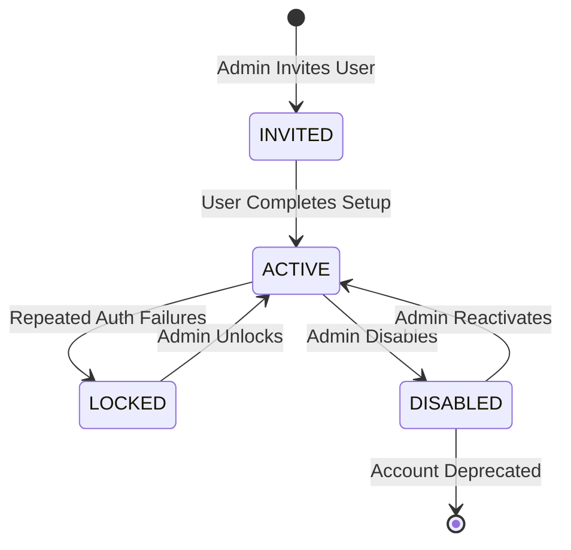
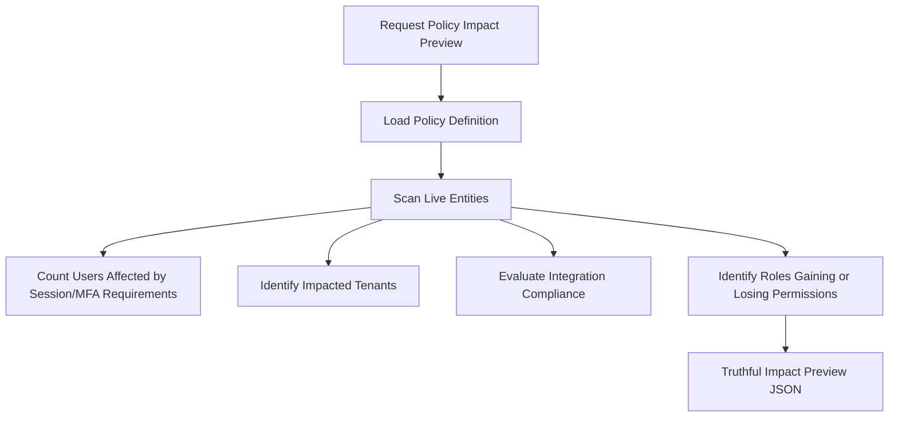
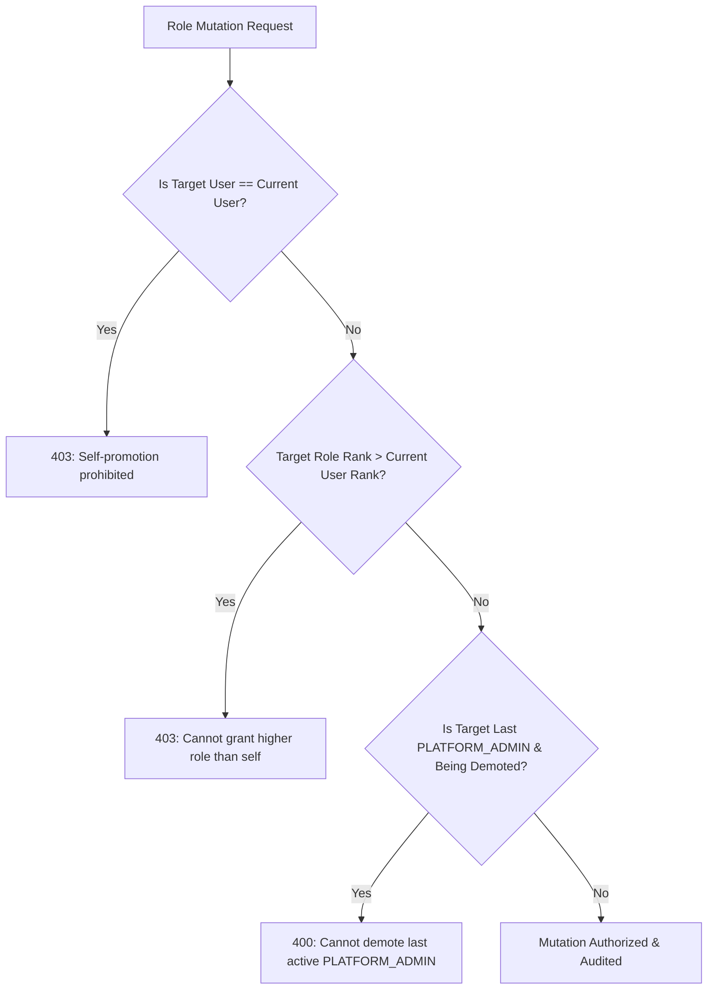

# SECTION 71 — PLATFORM ADMINISTRATION & GOVERNANCE
## CYBERGUARD — AI-Powered Cyber Threat, Phishing & Digital Impersonation Detection and Response System

---

## 1. Executive Summary & Existing Administration Architecture

Section 71 establishes a centralized, auditable, and resilient **Platform Administration & Governance Layer** for the CyberGuard enterprise SOC platform. 

The primary architectural mandate is:
> **Administrative convenience must never weaken security boundaries or override authorization requirements.**

```mermaid
flowchart TD
    subgraph Client Layer
        ADM[Admin / SOC Lead] --> UI[Platform Administration Workspace (/admin)]
        UI --> API_REQ[Authenticated HTTP Request]
    end

    subgraph Security Perimeter & Access Control
        API_REQ --> AUTH[Authentication Header Inspection]
        AUTH --> RBAC[Server-Side RBAC & Permission Resolver]
        RBAC --> TENANT_CHK[Tenant & Scope Boundary Enforcement]
        TENANT_CHK --> ESC_CHK[Privilege Escalation & Self-Promotion Defense]
    end

    subgraph Administrative Engine
        ESC_CHK --> DISPATCH{Administrative Domain Dispatch}
        DISPATCH --> USR_SVC[Users & Identity Governance]
        DISPATCH --> TEAM_SVC[Operational Teams & Membership]
        DISPATCH --> TENANT_SVC[Tenant Boundary Administration]
        DISPATCH --> POL_SVC[Security Policy Engine & Impact Preview]
        DISPATCH --> INT_SVC[Integration Registry & Safe Probes]
        DISPATCH --> SET_SVC[System Settings & Optimistic Locking]
        DISPATCH --> FEAT_SVC[Role-Gated Feature Flags]
        DISPATCH --> HLTH_SVC[Authoritative System Diagnostics]
    end

    subgraph Persistence & Infrastructure
        USR_SVC & TEAM_SVC & TENANT_SVC & POL_SVC & INT_SVC & SET_SVC & FEAT_SVC --> DB[(PostgreSQL / SQLite Database)]
        DB --> AUDIT[Immutable AuditEvent Ledger]
        DB --> WS[WebSocket Realtime Broadcast (Section 46)]
        DB --> JOBS[Background Job Worker (Section 45)]
        DB --> NOTIF[Admin Notification Queue (Section 47)]
    end
```

### Absolute Non-Duplication Rule
Rather than inventing disconnected administrative databases, CyberGuard consolidates identity, permissions, multi-tenancy, integrations, settings, and audit logs into the existing repository infrastructure:
1. **Authentication**: Reuses existing `X-User-Email`, `X-User-Role`, and bearer session resolution.
2. **Audit Ledger**: Reuses the authoritative `AuditService` and `AuditEventModel` (`audit_events` table).
3. **Multi-Tenancy**: Aligns with existing `tenant_id` and `workspace_id` models.
4. **Asynchronous Jobs**: Connects bulk operations to Section 45 (`BackgroundJobWorker`).
5. **Realtime Updates**: Dispatches state changes to Section 46 (`realtime_event_bus`).
6. **Alerting**: Dispatches critical operational failures to Section 47 (`NotificationService`).

---

## 2. Authentication Integration

Platform administration requests require strict identity resolution prior to authorization evaluation.

- **Header / Session Extraction**: The backend extracts `X-User-Email` (actor email), `X-User-Role` (role assertion), and `X-Tenant-Id` (claimed tenant) from requests.
- **Identity Verification**: The actor is cross-referenced against the authoritative `AdminUserModel` table. If the user account is `DISABLED` or `LOCKED`, requests are rejected with `403 Forbidden` (`User account is disabled/locked`).
- **Invariant**: Frontend UI visibility is never treated as authentication. Every administrative route independently verifies the authenticated context on every request.

---

## 3. RBAC & Permission Model

CyberGuard enforces a hierarchical role and permission matrix formatted as:
$$\text{resource} + \text{action} + \text{scope}$$

### Supported Administrative Roles
| Role Name | Scope | Description | Authority Rank |
|:---|:---|:---|:---:|
| `PLATFORM_ADMIN` | Platform-wide | Full governance over all tenants, policies, integrations, and global settings | 100 |
| `TENANT_ADMIN` | Tenant-scoped | Administrative authority within the assigned tenant organization | 80 |
| `SECURITY_ADMIN` | Tenant / Platform | Governance over security policies, detection configurations, and integrations | 70 |
| `SOC_ANALYST` | Operations | Operational triage, investigation, and workflow execution | 40 |
| `READ_ONLY_AUDITOR`| Read-Only | Read-only inspection of audits, reports, and governance status | 10 |

### Explicit Permissions
```text
users.read, users.create, users.update, users.disable
roles.read, roles.manage
teams.read, teams.manage
tenants.read, tenants.manage
policies.read, policies.manage
integrations.read, integrations.configure, integrations.test
settings.read, settings.manage
features.read, features.manage
audit.read
health.read
```

`PlatformAdminService.verify_permission()` dynamically matches the actor's assigned role against required permissions.

---

## 4. User Management & Lifecycle

Administrative user management is exposed via `/api/admin/users`.

### Lifecycle States


- `ACTIVE`: Normal interactive platform access.
- `INVITED`: Account created awaiting initial onboarding.
- `DISABLED`: Immediate revocation of administrative and operational rights.
- `LOCKED`: Security lockout requiring administrator unlock.

### Last Administrator Protection & Account Integrity
- **Last Platform Admin Guard**: The platform prevents disabling or demoting the last active `PLATFORM_ADMIN`. Any attempt returns `400 Bad Request` (`Cannot disable or demote the last remaining active PLATFORM_ADMIN`).
- **Audit Persistence**: Disabling a user preserves all historical investigation, alert, case, evidence, and audit ownership records.

---

## 5. Team Management & Organizational Structure

Operational teams provide logical groupings for analysts, engineers, and administrators via `/api/admin/teams`.

### Capabilities
- **Team Creation & Metadata**: Name, description, department, business unit, and tenant scope.
- **Team Leadership**: Designated team leads who oversee operational assignments.
- **Membership Mapping**: Users are mapped to teams without bypassing individual RBAC checks.
- **Resource Scope**: Team membership does not grant unrestricted access across tenant boundaries; resource authorization remains strictly enforced.

---

## 6. Tenant Architecture & Isolation

CyberGuard supports multi-tenant isolation with strict boundary controls via `/api/admin/tenants`.

### Tenant States
- `ACTIVE`: Full operational and ingestion capabilities.
- `SUSPENDED`: New ingestion, automation workflows, and investigations are frozen; historical records remain immutable and accessible for audit.
- `DECOMMISSIONED`: Tenant deactivated.

### Tenant Isolation Audit
1. **Tenant ID Scoping**: Every user, team, policy, setting, and integration is explicitly bound to a `tenant_id`.
2. **Cross-Tenant Prevention**: A `TENANT_ADMIN` cannot view, update, or administer entities belonging to another tenant (`403 Forbidden: Cross-tenant modification denied`).
3. **Platform Scope**: Only `PLATFORM_ADMIN` can provision new tenants or modify cross-tenant global configurations.

---

## 7. System Settings Architecture

System settings are managed via `/api/admin/settings` across structured operational categories:
- `GENERAL`, `SECURITY`, `AUTHENTICATION`, `ANALYSIS`, `THREAT_INTEL`, `NOTIFICATIONS`, `DATA_RETENTION`, `INTEGRATIONS`, `PERFORMANCE`, `APPEARANCE`.

```mermaid
flowchart LR
    DEP[Deployment Defaults\n(Hardcoded / Env)] --> PLAT[Platform Settings\n(Global Scope)]
    PLAT --> TEN[Tenant Overrides\n(Tenant Scope)]
    TEN --> USR[User Preferences\n(Appearance Only)]
```

### Immutable Security Settings
Settings that define core security perimeters (e.g., password hashing algorithms, database encryption keys, immutable audit logging) cannot be overridden by tenant or user preferences.

---

## 8. Configuration Precedence & Optimistic Concurrency

### Precedence Model
$$\text{Effective Setting} = \text{Tenant Override} \parallel \text{Platform Global Config} \parallel \text{Deployment Default}$$

### Optimistic Locking
To prevent concurrent administrator updates from clobbering state:
1. Every setting holds an integer `version` field.
2. Update requests must submit `expected_version`.
3. If `current_version != expected_version`, the server rejects the mutation with `409 Conflict` (`Configuration version conflict: reload settings before saving`).

---

## 9. Security Policy Management

Security policies define organizational compliance and operational constraints via `/api/admin/policies`.

### Policy Types
- `PASSWORD_POLICY`: Complexity, rotation, and entropy rules.
- `SESSION_POLICY`: Inactivity timeouts and concurrent session limits.
- `MFA_POLICY`: Mandatory MFA enforcement scopes.
- `DATA_RETENTION_POLICY`: Evidence and log retention timeframes.
- `AUTOMATION_APPROVAL_POLICY`: Thresholds requiring human-in-the-loop sign-off.
- `API_ACCESS_POLICY`: Token expiration and rate limiting constraints.

### Policy Lifecycle
$$\text{DRAFT} \longrightarrow \text{VALIDATING} \longrightarrow \text{ACTIVE} \longrightarrow \text{DISABLED}$$
- Immutable version tracking preserves historical policy state for compliance auditability.

---

## 10. Policy Impact Preview

Administrators can simulate policy updates prior to activation via `POST /api/admin/policies/{id}/preview-impact`.



- **Pure Evaluation**: Impact simulation performs zero database mutations.
- **Truthful Counts**: Previews reflect actual live database records rather than mock approximations.

---

## 11. Integration Administration & Credential Security

Integrations with external telemetry and threat intelligence providers are managed via `/api/admin/integrations`.

### Supported Categories
- `THREAT_INTEL`: VirusTotal, AlienVault OTX, Shodan, AbuseIPDB.
- `SIEM_EDR`: CrowdStrike Falcon, Microsoft Sentinel, Splunk.
- `COMMUNICATION`: Slack, Microsoft Teams, PagerDuty, Webhooks.
- `EMAIL_GATEWAY`: Microsoft 365, Google Workspace, Proofpoint.
- `TICKETING`: Jira Service Desk, ServiceNow.

### Secret Redaction & Write-Only Ingestion
- Stored credentials (API keys, client secrets, tokens) are **never** returned in GET responses.
- Responses return `credentials_configured: true` and redacted masks (e.g., `••••••••`).
- Updates accept new credentials over TLS and encrypt/hash them server-side.

---

## 12. Safe Integration Health Probes

Integrations can be tested on demand via `POST /api/admin/integrations/{id}/test`.

### SSRF Protection & Safe Connection Probes
1. **SSRF Guard**: Endpoints target only allowlisted domains or validated vendor URLs. Loopback (`127.0.0.1`, `localhost`) and private RFC-1918 subnets (`10.0.0.0/8`, `192.168.0.0/16`) are blocked unless explicitly configured in development mode.
2. **Bounded Timeouts**: Probe HTTP connections enforce a strict 10-second timeout.
3. **Sanitized Output**: Error responses sanitize sensitive connection details, credentials, and tracebacks.
4. **Honest Status**: A passed probe verifies endpoint reachability, not complete end-to-end telemetry fidelity.

---

## 13. Feature Controls & Role Gating

Feature flags govern incremental capability rollout via `/api/admin/features`.

### Properties
- `scope`: `PLATFORM`, `TENANT`, or `ENVIRONMENT`.
- `enabled`: Boolean toggle.
- `min_role`: Minimum required role (e.g., `SOC_ANALYST`, `SECURITY_ADMIN`).
- **Authorization Invariant**: Disabling a feature flag safely blocks new operations without corrupting or deleting existing historical records.

---

## 14. Administrative Audit & Tamper Resistance

Every consequential administrative operation automatically logs an immutable event via `AuditService.record_audit_event()`.

### Audited Actions
- `ADMIN_USER_CREATED`, `ADMIN_USER_UPDATED`, `ADMIN_USER_DISABLED`, `ADMIN_USER_ACTIVATED`
- `ADMIN_ROLE_ASSIGNED`, `ADMIN_PERMISSIONS_UPDATED`
- `ADMIN_TEAM_CREATED`, `ADMIN_TEAM_UPDATED`
- `ADMIN_TENANT_CREATED`, `ADMIN_TENANT_UPDATED`
- `ADMIN_SETTING_UPDATED`
- `ADMIN_POLICY_CREATED`, `ADMIN_POLICY_ACTIVATED`
- `ADMIN_INTEGRATION_CONFIGURED`, `ADMIN_INTEGRATION_TESTED`
- `ADMIN_FEATURE_UPDATED`

### Immutability & Integrity
- Audit events are written to the append-only `audit_events` table.
- Administrative endpoints expose **no delete or update routes** for historical audit records.

---

## 15. Administrative API Design

Mounted under `/api/admin` with comprehensive OpenAPI documentation:

| Method | Endpoint | Description | Required Permission |
|:---|:---|:---|:---|
| `GET` | `/api/admin/overview` | Platform health, counts, and recent activity | `health.read` |
| `GET` | `/api/admin/users` | List users with search and pagination | `users.read` |
| `POST` | `/api/admin/users` | Create new user account or invitation | `users.create` |
| `PATCH` | `/api/admin/users/{id}` | Update user attributes, role, or status | `users.update` |
| `GET` | `/api/admin/roles` | List all platform and tenant roles | `roles.read` |
| `GET` | `/api/admin/permissions` | List authoritative permission definitions | `roles.read` |
| `GET` | `/api/admin/teams` | List operational teams and members | `teams.read` |
| `POST` | `/api/admin/teams` | Create new operational team | `teams.manage` |
| `PATCH` | `/api/admin/teams/{id}` | Update team metadata or membership | `teams.manage` |
| `GET` | `/api/admin/tenants` | List tenants | `tenants.read` |
| `POST` | `/api/admin/tenants` | Provision new tenant organization | `tenants.manage` |
| `PATCH` | `/api/admin/tenants/{id}` | Update tenant status or configuration | `tenants.manage` |
| `GET` | `/api/admin/settings` | Get effective system settings | `settings.read` |
| `PATCH` | `/api/admin/settings` | Update system setting with version lock | `settings.manage` |
| `GET` | `/api/admin/policies` | List security policies | `policies.read` |
| `POST` | `/api/admin/policies` | Create draft security policy | `policies.manage` |
| `PATCH` | `/api/admin/policies/{id}` | Update policy state or definition | `policies.manage` |
| `POST` | `/api/admin/policies/{id}/preview-impact` | Simulate policy activation impact | `policies.read` |
| `GET` | `/api/admin/integrations` | List integration configurations (redacted) | `integrations.read` |
| `PATCH` | `/api/admin/integrations/{id}` | Update integration settings and secrets | `integrations.configure` |
| `POST` | `/api/admin/integrations/{id}/test` | Trigger safe connection probe | `integrations.test` |
| `GET` | `/api/admin/features` | List feature control flags | `features.read` |
| `PATCH` | `/api/admin/features/{id}` | Toggle feature flag or role requirement | `features.manage` |
| `GET` | `/api/admin/audit` | Paginated administrative governance audit | `audit.read` |

---

## 16. Background Job Integration (Section 45)

Expensive or long-running administrative tasks are offloaded to `BackgroundJobWorker`:
1. `ADMIN_BULK_USER_OPERATION`: Executes batch user operations (role reassignment, batch disabling) with per-user authorization checks, partial-failure tracking, and audit logging.
2. `ADMIN_INTEGRATION_HEALTH_SWEEP`: Conducts periodic asynchronous connectivity sweeps across active integration endpoints.

---

## 17. Realtime Integration (Section 46)

State changes in platform governance trigger real-time broadcasts via `realtime_event_bus.broadcast()` to the `ADMIN` channel:
- `ADMIN_USER_UPDATED`
- `ADMIN_ROLE_CHANGED`
- `ADMIN_POLICY_UPDATED`
- `ADMIN_INTEGRATION_STATUS_CHANGED`
- `ADMIN_CONFIGURATION_UPDATED`
- `ADMIN_FEATURE_UPDATED`

Event payloads omit sensitive credentials or raw tokens. Clients reconcile local UI cache upon receiving real-time notifications.

---

## 18. Notification Integration (Section 47)

Critical administrative events trigger alerts via `NotificationService`:
- Integration failure alerts when critical providers fail consecutive health sweeps.
- Unauthorized escalation attempts or repeated administrative lockouts.
- Policy activation failure notifications.

---

## 19. Security Controls & Privilege Escalation Defenses



1. **Self-Promotion Defense**: Users cannot elevate their own role or modify their own authorization scope.
2. **Hierarchical Delegation Boundary**: Users can only assign roles of equal or lesser rank than their own.
3. **Mass Assignment Prevention**: Protected database fields (`id`, `created_at`, `tenant_id`) are immutable via general update endpoints.
4. **Input Sanitization**: All incoming payloads are validated via strict Pydantic schemas.

---

## 20. Database Changes & Schema Integrity

Section 71 introduces seven indexed models in `backend/db/models.py`:
- `AdminUserModel` (`admin_users`): Persistent user accounts, status, roles, MFA flags.
- `AdminTeamModel` (`admin_teams`): Teams, departments, team leads.
- `AdminTenantModel` (`admin_tenants`): Tenant organizations, statuses, config limits.
- `AdminSecurityPolicyModel` (`admin_security_policies`): Security policies, rules, versioning.
- `AdminSystemSettingModel` (`admin_system_settings`): Key-value settings with version locking.
- `AdminIntegrationConfigModel` (`admin_integration_configs`): Integration registry and status.
- `AdminFeatureControlModel` (`admin_feature_controls`): Feature flags with role gates.

All tables include foreign keys or indexes on `tenant_id` and timestamps (`created_at`, `updated_at`).

---

## 21. Testing & Verification

Automated test suite `backend/tests/test_section71_platform_administration_governance.py` validates all architectural guarantees:
- `test_01_access_control_and_rbac_boundaries`: Verifies anonymous rejection, analyst restrictions, and admin authorization.
- `test_02_user_management_lifecycle`: Validates user creation, updating, disabling, and status transitions.
- `test_03_privilege_escalation_and_self_promotion_prevention`: Proves self-promotion and role-rank exceedance are rejected.
- `test_04_last_platform_administrator_protection`: Confirms protection of the last active platform administrator.
- `test_05_role_and_permission_matrix_integrity`: Validates role and permission resolution.
- `test_06_team_management_and_membership`: Tests team creation and membership mapping.
- `test_07_tenant_isolation_and_scoping`: Verifies cross-tenant modification blocking.
- `test_08_system_settings_precedence_and_optimistic_locking`: Confirms category validation and optimistic concurrency collision rejection.
- `test_09_security_policy_lifecycle_and_impact_preview`: Validates policy state machine and truthful impact calculation.
- `test_10_integration_registry_credential_redaction_and_probe`: Proves credential redaction and connection probe execution.
- `test_11_feature_controls_and_role_gating`: Verifies feature flag toggles and role boundaries.
- `test_12_administrative_audit_trail_and_health_diagnostics`: Validates administrative audit generation and health aggregation.

**Results: 12/12 PASSED (100%). Regression Suite (Sections 45–71): 87/87 PASSED (100%). Frontend Build: PASS (`tsc -b && vite build` exited with code 0).**

---

## 22. Deployment Considerations

1. **Default Database Seeding**: On application startup, `PlatformAdminService.seed_defaults_if_needed()` ensures baseline roles, settings, policies, and the primary tenant are seeded idempotently.
2. **Environment Variables**:
   - `ADMIN_DEFAULT_TENANT_ID`: Defaults to `tenant-default`.
   - `ADMIN_DEFAULT_EMAIL`: Defaults to `admin@cyberguard.local`.
   - `PROBE_ALLOW_LOCALHOST`: Enables local development connection probes (`false` in production).

---

## 23. Limitations & Future Extension Points

- **Cryptographic Audit Signatures**: Current audit trails rely on database immutability and append-only constraints. Cryptographic tamper-evident hash chaining (Merkle trees) can be integrated in subsequent hardening.
- **Hardware MFA Integration**: WebAuthn/FIDO2 hardware token verification flows remain an extension point for enterprise SSO/IdP federation.
