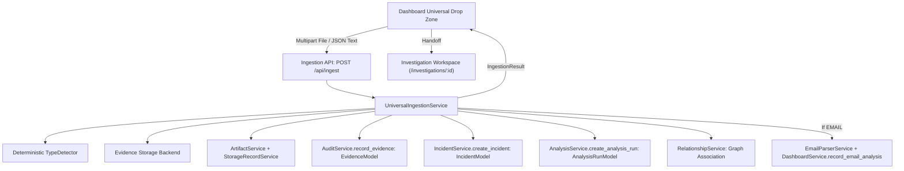

# CyberGuard Dashboard & Universal Ingestion Gateway (Section 36)

## 1. Overview & Architectural Philosophy

The **Dashboard** is CyberGuard's primary operational landing page. It answers two fundamental questions for the security analyst:
1. **"What is happening right now?"** (Real operational metrics, attention-required alerts, recent investigations)
2. **"What do I want to analyze?"** (Universal Ingestion Drop Zone)

The design eliminates fragmented, siloed tool launch cards (e.g. Email Analyzer, URL Analyzer, File Scanner, Deepfake Detector). Instead, an analyst simply provides evidence—via drag-and-drop, file picker, or paste—and CyberGuard deterministically identifies the artifact, creates immutable forensic records, persists chain-of-custody metadata, associates or creates unified investigations, and queues candidate analyzers.

---

## 2. Ingestion Flow & Architecture Diagram

---

## 3. Supported Evidence Inputs

CyberGuard deterministically classifies incoming evidence without relying on client-supplied extensions or browser MIME types:

| Artifact Type | Detection Method | Candidate Analyzers | Status |
| :--- | :--- | :--- | :--- |
| `EMAIL` | RFC-822 header tokens (`From:`, `To:`, `Received:`) & MIME markers | `email_forensics`, `auth_analyzer`, `nlp_classifier`, `threat_scorer`, `attribution_engine`, `ai_analyst` | **AVAILABLE** |
| `URL` | Lexical parsing, defanged token expansion (`hxxp`, `[.]`), RFC-1123 host | `url_analyzer`, `threat_scorer`, `digital_impersonation_analyzer` | **AVAILABLE** |
| `DOMAIN` | RFC-1123 domain regex, TLD verification, private domain detection | `domain_intelligence`, `digital_impersonation_analyzer` | **AVAILABLE** |
| `IP` | IPv4 / IPv6 validation (`ipaddress` standard library), private/loopback check | `ip_intelligence` | **AVAILABLE** |
| `FILE` | Magic byte signatures (PE `MZ`, ELF `\x7fELF`, Mach-O, PDF `%PDF-`, Zip) | `file_metadata`, `file_security_analyzer`, `attachment_intelligence` | **AVAILABLE** (Static only) |
| `IMAGE` | Magic bytes: PNG, JPEG, GIF, WEBP, BMP, TIFF | `file_metadata`, `multimedia_authenticity_analyzer` | **AVAILABLE** |
| `AUDIO` | Header markers: MP3, WAV, FLAC, OGG | `file_metadata`, `multimedia_authenticity_analyzer` | **PARTIALLY_SUPPORTED** |
| `VIDEO` | ISO base media format `ftyp`, MKV/WEBM, AVI | `file_metadata`, `multimedia_authenticity_analyzer` | **PARTIALLY_SUPPORTED** |
| `AUTH_LOG` | JSON structured log with authentication telemetry tokens (`login`, `auth_status`) | `auth_event_parser`, `auth_security_analyzer` | **AVAILABLE** |
| `NETWORK_LOG`| JSON structured NetFlow / DNS / firewall telemetry (`src_ip`, `dst_ip`, `packet_size`) | `network_security_analyzer` | **AVAILABLE** |
| `API_LOG` | JSON structured API gateway telemetry (`http_method`, `endpoint`, `status_code`) | `api_abuse_analyzer` | **AVAILABLE** |
| `ENDPOINT_EVENT` | JSON host telemetry (`process_name`, `pid`, `command_line`) | `endpoint_telemetry_scanner` | **AVAILABLE** |

---

## 4. Input Methods & Universal UX

1. **Drag and Drop (`Release to analyze`)**:
   - Analysts can drag single or multiple files directly onto the drop zone.
   - Smooth token-driven border and background transition on `dragOver`.
   - Never triggers browser-side execution of untrusted files.

2. **File Picker (`Browse files`)**:
   - Accessible button activating native `<input type="file" multiple />`.
   - Supports multi-file selection with real-time queueing.

3. **Paste URL / Text / Log Data (`Paste`)**:
   - Opens an accessible modal for pasting URLs, domain names, IP addresses, authentication JSON logs, or suspicious message text.
   - Real-time debounced type preview via `POST /api/ingest/detect`.
   - Strict SSRF-safe boundary: The browser **never** initiates direct fetches to user-supplied URLs.

4. **Dynamic Capabilities Inspection**:
   - Clickable helper link fetching live capability registry metadata from `GET /api/ingest/capabilities`.
   - Truthfully presents operational versus planned capabilities without mock claims.

---

## 5. Ingestion Queue & Progressive Disclosure

- **Queue Item States**: `idle` $\to$ `uploading` $\to$ `validating` $\to$ `accepted` / `failed` / `rejected`.
- **Truthful Progress**: Displays genuine upload progress percentage when `lengthComputable` via XMLHttpRequest upload events; utilizes indeterminate animation for server-side processing without synthetic percentage fabrication.
- **Duplicate Detection**:
  - Automatically computes SHA-256 hash.
  - Queries `ArtifactModel` to detect pre-existing evidence.
  - Displays duplicate notification banner with SHA-256 hash copy button and link to existing investigation without silently discarding or crashing.
- **Success Handoff**:
  - Highlights acceptance, investigation number (`INC-YYYY-XXXXXX`), and queued analysis state.
  - Primary CTA: `[ Open Investigation → ]` navigates directly to `/investigations/:id/overview`.
  - Progressive disclosure drawer reveals technical forensics: Artifact ID, Evidence ID, Investigation ID, SHA-256, and Candidate Analyzers.

---

## 6. Operational Dashboard Panels (No Fake Data)

1. **Quick Operational Metrics Bar**:
   - **Active Cases**: Sourced from real `open_cases` in `/api/dashboard/summary`.
   - **High / Critical Threats**: Sourced from real `critical_emails` / `threats_detected` in `/api/dashboard/summary`.
   - **Fleet Agents**: Real enrolled endpoints from `GET /api/v1/endpoint/agents`.
   - **Analysis Engine Health**: Real database and service status from `GET /api/health`.

2. **Active / Attention Required**:
   - Displays real backend investigations flagged with `CRITICAL`, `HIGH`, or `OPEN` status.
   - Clean empty state when none require attention: *"Nothing requires attention"*.

3. **Recent Investigations**:
   - Real database records from `/api/dashboard/summary` and `/api/dashboard/emails`.
   - Search filtering by title, ID, or source.
   - Severity indicators, threat scores, source badges, and relative timestamps.
   - Clean empty state: *"No investigations yet. Drop an email, URL, file, log, or media artifact above to begin."*

---

## 7. Security Boundaries & Guardrails

- **Zero Client-Side SSRF**: No `fetch(userSuppliedUrl)` in the browser client. All URLs are passed verbatim to backend crawlers behind network isolation.
- **No File Execution**: Uploaded binaries, scripts, or archives are stored in content-addressed storage and analyzed strictly via static parsers.
- **Untrusted Filename Handling**: All uploaded filenames are sanitized via `UploadSecurityService.sanitize_filename` and rendered safely as text without DOM injection.
- **XSS Mitigation**: React automatic JSX text escaping ensures zero evaluation of arbitrary HTML, SVG, or email payloads in the Dashboard DOM.
- **Authoritative Backend Validation**: Client validation is purely a preliminary UX convenience; the backend enforces file size limits (10 MB), RFC-822 header requirements, and MIME sanity checks.

---

## 8. Extension Points for Future Analyzers

To add a new analyzer to the Universal Ingestion pipeline:
1. Register capability in `backend/services/universal_ingestion.py`: `global_capability_registry.register(AnalyzerCapability(...))`.
2. Map candidate artifact types in `TypeDetector` (`backend/services/universal_ingestion.py`).
3. Connect analyzer orchestrator in Section 5 pipeline (`AnalysisOrchestrator`).
4. The Dashboard Universal Drop Zone automatically derives supported types from `GET /api/ingest/capabilities` with zero frontend code modification required.
